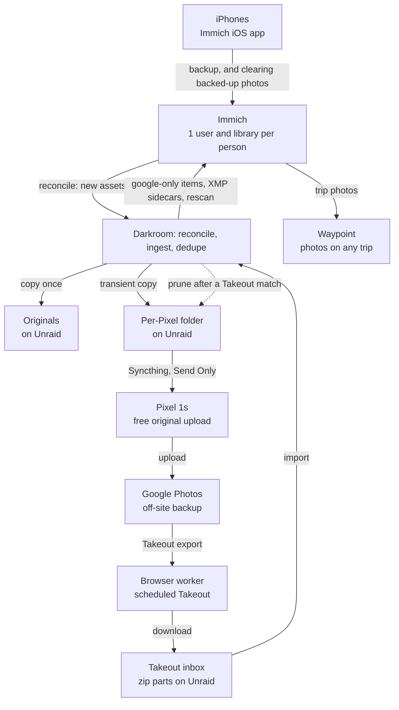

# Darkroom — Spec

Source of truth: the "Photo Coordinator Service — Spec" doc (as of 2026-10-31). This file is the repo copy for agents, revised for the Immich-first design (#199).

## Overview

Darkroom (working name) keeps one complete, deduplicated photo library per family member in Immich. Each person's iPhone backs up to Immich with Immich's own iOS app and clears its backed-up photos with Immich's own "clear backed-up photos" feature; Darkroom ships no iPhone app. Darkroom reads each new asset from Immich and writes a copy once into the person's `originals/` on Unraid. Google Takeout exports fill the gaps, and a browser worker automates Takeout, so the only manual work is an occasional Google sign-in. A transient per-Pixel folder, synced by Syncthing, carries new photos to each person's Pixel, which uploads them to Google Photos; Darkroom deletes a photo's copy from that folder once a Takeout match proves Google has it, and Syncthing carries the deletion to the Pixel.

**Goals**

- One Immich library per person, organized by person and Google account.
- A one-time full Takeout per account for history, then incremental exports for anything that never passes through Immich's app.
- Dedupe across sources, preferring the original from Immich while keeping Google-only metadata such as added locations.
- Complete GPS and capture times, so Waypoint can match photos to any trip.
- Bare minimum on the iPhones: Immich's own app backs up each photo and clears it afterwards, with no Darkroom code on the phone. Google Photos via the Pixels stays the off-site backup.

**Non-goals**

- Replacing Google Photos or the Pixel backup flow.
- Daily scraping of the Google Photos web app.
- Editing, albums or face tagging. Immich already handles those.
- An iPhone app, or gating what Immich's app clears from a phone. Darkroom no longer decides when a photo may leave an iPhone.
- Waypoint's trip matching. That is a separate spec, and Waypoint reads Immich directly.

## Current setup

New photos already pass through the home network on their way to Google, so the home copy can be the source of truth. Google Takeout only has to fill the gaps.

| Piece | Role |
| --- | --- |
| iPhones → Möbius Sync → Pixel 1s | Today each iPhone syncs photos through Möbius Sync (a Syncthing client) to an original Pixel, which uploads to Google Photos at original quality for free. Möbius Sync comes off the iPhones when Immich's app takes over |
| Google Photos | Off-site backup. Only copy of anything that never passed through Syncthing: older photos, shared albums, other devices |
| Unraid | Docker host and storage. Becomes the Pixels' Syncthing peer in this design |
| Traefik + Pocket ID | Reverse proxy and OIDC login. Groups: `parents`, `family` |
| Tailscale | Remote access to internal-only services |
| Immich | New. Runs on Unraid, one user per person. Its own iOS app is the only thing on the iPhones |

Darkroom changes the chain this way: Immich's iOS app replaces Möbius Sync as what takes photos off the iPhone, Darkroom copies them from Immich into the person's `originals/` and into a transient folder per Pixel, and Unraid syncs that folder to the Pixel with Syncthing. The Pixels and Google Photos stay as they are. Darkroom isn't deployed yet, so everyone switches at once, with no pilot phase.

## Architecture

Two sources feed one deduplicated library per person, and Waypoint reads it through Immich.



Immich's iOS app uploads into Immich's own storage. Darkroom reads each new asset from Immich and writes a copy once into the person's `originals/` (the permanent copy, never touched again) and into the transient folder of each Pixel that serves the person. It also writes Google-only items and XMP sidecars, then triggers a rescan. Darkroom does not tell the iPhones anything: Immich's app decides what it clears.

## Takeout browser worker

The worker drives Google Takeout in a real browser, reusing a session you sign in to by hand. It never types a Google password or 2FA code. One scheduled export per account covers both needs: its first archive is the full library (the one-time backfill), and later archives contain only new or changed items.

**Runtime**

- One container: Chromium driven by Playwright, running headed on a virtual display (Xvfb), with noVNC for remote viewing.
- One persistent browser profile per Google account, stored on Unraid.
- Runs from the home connection, a few visits a week at most.

**Jobs**

| Job | When | What it does |
| --- | --- | --- |
| Connect account | Onboarding, and whenever a session expires | Opens Takeout in the noVNC view. You sign in, including 2FA. The worker confirms the session and saves the profile |
| Create schedule | Once per account, and again once a schedule has ended unrenewed | Google Photos only, download link by email, .zip, 50 GB parts, scheduled export (every 2 months for 1 year) |
| Check status | Daily | Reads the Takeout downloads page for new exports. No Gmail access needed |
| Download | When an export is ready | Downloads every part to the person's inbox on Unraid, one at a time. Verifies the part count and runs a zip integrity test |
| Renew | About 3 weeks before the schedule ends, or on request (`POST /api/accounts/{id}/schedule/renew`) | Creates the next year's schedule and records the new end date |
| Renew now | When the owner asks, from 3 weeks before the schedule ends (so also after a failed renewal, and after the end) | Queues one renew job through the same path as the daily watch and closes the "not renewed" alert until that job's outcome. Refused before the window (which also covers a schedule just renewed), while a schedule or renew job is open or awaiting the Takeout check answer, with no schedule, and when the account needs sign-in |

**Limits it must respect**

- Each archive expires after about 7 days and can be downloaded only 5 times. Retries are capped at 2 per part, then it alerts instead of burning the rest. An export whose download jobs fail 3 times (a job that started a download and failed before every part was downloaded, or a job that had nothing left to download and only had to finish a complete export; a job that fails right after downloading the last part is not counted) is marked failed, which frees the account.
- Google often asks you to verify it's you before a download. The job pauses, raises an alert linking to the noVNC view (the delivery channel is not decided, #199), and resumes after you sign in.
- Alerts repeat at 24 hours and again at 4 days, so an export never expires unnoticed. An alert about an export that is about to expire is closed, before the alert tick sends it again, once the export has expired or been downloaded.

**Resilience**

- All page selectors live in one module, so a Google UI change is a one-file fix.
- Every failure saves a screenshot and page snapshot, linked from the alert and the status page.

## Ingest pipeline

Every photo, from either source, ends up in one per-person index with a hash, a fingerprint, a capture time and a location. Nothing is deleted until a whole export has been processed.

**Immich assets (continuous)**

- A reconcile job polls Immich for each person's new or changed assets. Assumed (to confirm in the spike, [#202](https://github.com/AnthonyPluth/Darkroom/issues/202)): the API lists a user's assets with a stored SHA-1 checksum and tells uploads from the Immich app (device assets) apart from assets of an external library.
- For each new asset it reads the original from Immich, checks the bytes against the stored SHA-1 (assumed to be the original's SHA-1, #202), writes the original once to the person's `originals/` and indexes it: fingerprint, EXIF time and GPS. It also writes a transient copy for each Pixel that serves the person.
- Never modifies or moves an original once it is saved. Immich moving or deleting its own file, or the iPhone clearing the photo, does not touch the copy.

**Takeout side (per export)**

1. **Unpack** all parts of one export together into staging. Takeout can put a photo in one part and its JSON sidecar in another.
2. **Pair** each media file with its JSON sidecar. Takeout truncates long names and adds suffixes such as `-edited` and `(1)`, so follow the matching rules immich-go already implements rather than inventing new ones.
3. **Read metadata** from the file's EXIF first, then the sidecar: `photoTakenTime` (UTC), `geoData` / `geoDataExif` (location) and description.
4. **Fingerprint**: SHA-1 of the file bytes, a perceptual hash (pHash and dHash) for images, duration for videos. Near-duplicate groups are built from the two hashes and only ever suggest: they confirm nothing and never feed eligibility.
5. **Dedupe** against the person's index (next section).
6. **Place** Google-only items in the person's `google-only/YYYY/MM/` folder. Fill metadata gaps with XMP sidecars, never by rewriting files.
7. **Rescan** that person's Immich library through the API, then report counts.
8. **Clean up** staging and the archive after 14 days.

**Time zones**

- Store every capture time as UTC plus an offset. Use the EXIF offset when present, otherwise look it up from the GPS position, otherwise mark it unknown.
- Waypoint needs this to match photos to trips that cross time zones.

## Legacy library import (#217)

Each person may have a folder of photos from the old Google Photos sync. It is imported once, per person, after that person's Takeout import, and never changes.

- **Source:** `python run.py import-legacy --person SLUG --dir /path` sets the person's legacy folder (an absolute path that overlaps neither the photo folder nor another person's legacy folder) and imports it. Darkroom only reads it: no write, rename or delete, and the Semgrep rule `darkroom-originals-read-only` covers it. It should also be mounted read-only into the container; that is deployment configuration, not added yet. Links and hidden files are skipped.
- **Matching:** each file is fingerprinted (SHA-1, perceptual hashes, EXIF) and goes through the existing dedupe tiers against what proves Google has a photo of that person: the Takeout items of the Google accounts that serve them, and their originals that an unreversed automatic tier 1 or 2 decision confirms. A file is `matched` at tier 1 or 2 (proven in Google) and `unmatched` otherwise, including a tier 4 near match, which stays for review. A file that cannot be read or copied is `failed`. The accounts that count are those that serve the person now plus those of imported exports they own. Another person's Takeout never counts.
- **Result:** every file is recorded once in `legacy_files` with its status, tier and the item it matched. An unmatched file gets a copy under the person's `originals/legacy/` (written once through `paths.write_once`, named with a SHA-1 prefix) unless the person already has an original with the same SHA-1. A matched file is only recorded.
- **Pixel queue:** an unmatched original is offered to a `PixelQueue` (a narrow interface). `import-legacy` uses `PixelFolderQueue`, which calls `pixel_folder.queue` for every Pixel that serves the person; the hourly Pixel job copies it into each folder within the size cap. Every run offers every unmatched original again, so a Pixel added later gets the files already imported (queueing is idempotent per Pixel). A person no Pixel serves queues nothing, and `legacy-report` says no Pixel serves them. A queue error marks the file failed, to be tried again.
- **Report:** `python run.py legacy-report` prints, per person, how many legacy files are matched, not in Google, sent to the Pixel folder and waiting for it. Failed files count as not backed up. Whether "everything is backed up" is true is the not-backed-up count (unmatched plus failed) reaching zero.
- **Re-runs:** a file already recorded is not read again, so a second run changes nothing; a new, failed or changed (size or time) file is handled again, and an earlier copy in `originals/legacy/` stays. A matched file is checked every run: when the match that proved it is reversed, it becomes unmatched, is copied and offered to the Pixel queue (owner decision 3). A file that stops being media loses its record. The queued count comes from the Pixel copies that exist for Pixels that serve the person now.

## Dedupe rules

The original from Immich always wins. A Takeout copy only adds a file when nothing matches, plus any metadata the original lacks. Immich won't do this for us: external libraries deliberately allow identical files in different locations.

Matching runs against everyone the export's Google account serves, in this order, and stops at the first hit:

| Order | Match when | Result |
| --- | --- | --- |
| 1. Exact | Same SHA-1 | Skip the Takeout copy. Copy Google-only metadata (location, description) to an XMP sidecar if the original lacks it |
| 2. Same shot | Same capture time to the second (sub-second when both have it), same camera make and model, and same dimensions (photos) or duration (videos), with exactly one candidate. Two or more candidates, such as a burst, go to review | Same as exact |
| 3. Edited copy | A Takeout `-edited` file whose pair matched at 1 or 2 | Skip by default. Setting: keep as its own asset |
| 4. Likely re-encode | Perceptual hash within threshold and capture time within 2 seconds | Review queue, never auto-skipped |
| 5. No match | Nothing above | Google-only: placed in `google-only/` with sidecar metadata |

**Rules**

- Dedupe auto-deletes nothing. Every decision is stored with its tier and reason, and can be reversed from the review queue. The one deletion that follows a match is resolving a Takeout copy once the Immich original arrives (below).
- A matched item belongs to the person whose Immich user holds the original (assumed to be the asset's owner, #202). A Google-only item goes to the person who owned the export when it was created (the account's default person at that moment; old exports without an owner use the current default) and can be reassigned from the review queue. Matching never crosses Google accounts, so the same photo can still land in two people's libraries, for example from a shared album.
- A tier 1 or 2 match also records that Google has the original (`confirmed_in_google`). No iPhone deletion rests on it any more, since Immich's own app clears photos. The flag is the signal for pruning a Pixel's transient folder (decided on [#199](https://github.com/AnthonyPluth/Darkroom/issues/199), question 6): only an unreversed automatic tier 1 or 2 decision counts, and waiting up to about two months for a Takeout export is acceptable because the Pixel has the space.
- Tier 2 needs exactly one candidate both ways: when another item of the same export also qualifies for the same Immich item, both go to review. An edited copy (`-edited`) is never matched at tier 2, since it would prove only that Google has the edit; byte-identical copies still match at tier 1.

## Storage, Syncthing and Immich

Each person gets one folder tree on Unraid, and the originals in it are written once (never modified or moved; the only one ever deleted is an Immich original that loses to a better Takeout copy, below). Darkroom is the only thing that writes to these folders. Immich's own upload storage is separate from them (assumed, #202).

```text
/mnt/user/photos/
  <person>/
    originals/          Copied once from Immich by Darkroom, never changed
    google-only/YYYY/MM Items found only in Takeout
  _pixels/<pixel id>/<person>/   Copies on their way to a Pixel, one part per person it serves (#216)
  _inbox/<person>/      Downloaded Takeout parts and staging
  _browser/<account>/   Saved browser profiles
```

**Syncthing**

- Unraid shares each Pixel's transient folder with that Pixel as Send Only, so nothing on the Pixel can change Unraid's copy. The Pixel keeps its Syncthing app and settings. Pixels have limited space (about 128 GB), so the folder is not a permanent store: photos wait there until Google Photos has backed them up, then leave the synced folder.
- Pruning is Darkroom deleting the transient per-Pixel copy: removing a photo from a synced folder removes it from the Pixel on the next sync, so Syncthing carries the deletion. This is a deletion path on Unraid that may touch only the per-Pixel folder, never `originals/` (promises 1 and 2 in AGENTS.md are restated for it), and it has its own check: Semgrep's `darkroom-pixel-prune-one-remover` and `darkroom-pixel-prune-one-caller`, and `tests/test_pixel_paths.py` (#216).
- The signal for when Darkroom may delete is the Takeout match: the item's `confirmed_in_google` (an unreversed automatic tier 1 or 2 decision), not a fixed delay, a report from the Pixel or a manual check ([#199](https://github.com/AnthonyPluth/Darkroom/issues/199), question 6). Up to about two months of waiting is acceptable. Removing a photo from a device doesn't remove the Google Photos copy once it has been backed up (confirmed by the owner). The deletion never touches `originals/`, which keeps the permanent copy. Confirmation has to be per destination Pixel and Google account, not a single per-item flag, so that a match in one account doesn't empty the folder of a Pixel that backs up to another (#199, owner decision 1). Darkroom keeps one `pixel_copies` row per Pixel and photo, and prunes a copy only on an unreversed automatic tier 1 or 2 match in the Takeout of that Pixel's Google account, for the same person (#216). A photo that arrives through Immich is sent even when a match already exists (owner decision 5), so its copy is pruned only once Google has it after the copy was placed: a match from a Takeout that Google created since, or a later Takeout that contains it again.
- The folder is capped by size (`PIXEL_FOLDER_CAP_GB`, default 50): photos are copied oldest first while they fit, and the next ones wait until earlier ones are pruned. A photo larger than the cap goes in only when the folder is empty. Reversing the match of a pruned photo puts it back in the queue, copied again from `originals/`. A Pixel can't be deleted while anything is queued for it or in its folder (#199, owner decisions 3 and 4). The job runs hourly.
- The permanent copies are copies, not hardlinks: the transient folder and `originals/` are separate files.
- Deleting or clearing a photo on an iPhone never reaches `originals/`: Darkroom only reads from Immich and writes copies.
- Add `*.xmp` to Unraid's `.stignore`, so the service's sidecars never sync to the Pixels.
- Möbius Sync comes off the iPhones when Immich's app is backing them up, so no phone is left uploading through both.

**Shared Pixels (optional)**

- By default each Pixel serves one person and backs up to that person's own Google account. Optionally, a Pixel can serve several people, set per Pixel in the web UI. The Pixel's transient folder must be turned on for backup in Google Photos there; how it is laid out for several people is left to the implementation issue.
- Google Photos on a Pixel backs up to one Google account, so everything that Pixel uploads lands in that account.
- No tags are written into files. Darkroom knows each original's owner from the Immich user that holds it, and Takeout copies match back by hash.

**Immich**

- One Immich user per person, and one external library per person owned by that user. The owner can't be changed after creation. Each person's iPhone backs up to that user with Immich's own iOS app, into Immich's own storage.
- Import paths: the person's `google-only/` folder. Whether `originals/` is imported too is for the spike to settle ([#202](https://github.com/AnthonyPluth/Darkroom/issues/202)): the app's own uploads already show in Immich, and importing the copy would show each photo twice. One library can hold several paths.
- Exclusion patterns: `**/.stfolder/**` and `**/.stversions/**`.
- Mount the photo share read-only in Immich. That keeps Darkroom as the single writer to it and blocks deletes from the Immich UI.
- Darkroom triggers a library rescan after each ingest. A nightly scheduled rescan is the backstop.
- Immich's iOS app does the backup and the clearing. Darkroom doesn't see or gate what it clears from a phone, and ships no app. iCloud Photos must be off on these iPhones: with it on, clearing a photo on the phone also removes it from iCloud and every other device.
- Clearing a photo from an iPhone with Immich's own function can happen at any time, with no Takeout wait, and Darkroom plays no part in it: Immich's app decides. The owner accepted the gap this leaves between Immich and Google Photos (via the Pixel), expected to be an hour or two at most (#199). Until Google has the photo, Immich's copy plus the copy in `originals/` are the only copies, so Immich's library and the Unraid share need to be durable (redundant storage and a backup).

**Assumptions about Immich to confirm in the spike ([#202](https://github.com/AnthonyPluth/Darkroom/issues/202))**

None of these has been checked on the running server; the design relies on them and the spike either confirms or changes each.

- The API lists a user's new or changed assets, and can tell the Immich app's uploads from external-library assets.
- The stored checksum is the SHA-1 of the original's bytes, and the original downloads byte-identical.
- Which photos "clear backed-up photos" removes, for example RAW+JPEG pairs and Live Photos, and how reliable the iOS background backup is.
- Whether importing `originals/` as well as Immich's own uploads shows duplicates.

## Web UI and notifications

Day to day you only hear from the service when it needs a sign-in or has finished an import. Everything else lives on its status page.

**Web UI** (internal only, Traefik + Pocket ID, `parents` group, reachable remotely over Tailscale)

- **People:** each person's Google accounts, Pixels, Immich user and session status. The per-iPhone check-in, uploads pending and photos eligible to delete go away with the iPhone app; a changed People page needs the owner's sign-off first (AGENTS.md, promise 6).
- **Exports:** schedule end date, last and next export, download progress per part.
- **Imports:** counts added, skipped as duplicates, sent to review, and missing GPS; the summary line also names the items already imported by an earlier export.
- **Review queue:** side-by-side thumbnails for likely re-encodes. Keep both, skip, or undo any past decision.
- **Remote browser:** the noVNC view, embedded, for sign-ins.

The web UI is dark mode only: one theme, with no light theme and no theme switch.

**Alerts** — the channel is not decided ([#199](https://github.com/AnthonyPluth/Darkroom/issues/199), question 3). They were push alerts to the iPhone app, which no longer exists, and nothing has replaced them. Until the owner picks a channel, an alert is recorded as an event and shown on the status page, and nothing is delivered. The events below keep their timing; where each one is delivered is the open part. An alert carries only its kind and an id, never an email address, name or file name.

| Event | Alert |
| --- | --- |
| Sign-in or verification needed | Immediately, repeated at 24 hours and 4 days |
| Export imported | Summary: added, skipped, in review, missing GPS |
| Originals unmatched after a full export cycle | Per person and Pixel: check that the Pixel's transient folder is backed up in Google Photos |
| Schedule ending | About 3 weeks before, then a confirmation once renewed |
| Schedule renewal failed | When the renewal fails, or the owner finds no new schedule in Takeout after an unconfirmed one: it did not happen, is not retried and the end date stands; once the schedule has ended, Create schedule makes a new one. It replaces the ending alert (a deliberate departure from #40's "leave the ending alert open", whose text promises a renewal that will not come), repeated at 24 hours and 4 days. Renew now on the account's schedule route queues a new attempt on request (the Renew now row of the Takeout jobs table) |
| Schedule renewal not confirmed | When Darkroom cannot tell whether the renewal worked (Takeout did not confirm it, or the worker was lost): look in Takeout and answer on the Exports page. "Takeout has the new schedule" records it (ending a year after the renew job started, which must be after the current end) and confirms it like a renewal; "Takeout has no new schedule" turns it into "Schedule renewal failed". Darkroom does not retry, so it creates no second schedule. Same repeats |
| Failure (download, unpack, page change) | Immediately, with a link to the screenshot |

## Data model

A single SQLite database is enough. Photos never enter it, only their index and the decisions made about them.

| Entity | Key fields |
| --- | --- |
| Person | name, Immich user ID, Immich API key (secret), originals path, google-only path |
| Pixel | name, Syncthing device ID, Google account, people served (one by default, several optional), transient folder (`_pixels/<id>/`) |
| PixelCopy | Pixel, media item, person, state (queued, placed, pruned), name in the folder, size, SHA-1, queued, placed and pruned at, times re-queued, always send (#216) |
| ImmichAsset (replaces PhoneAsset) | person, Immich asset ID, stored checksum, SHA-1 of the copy, copied to `originals/` at, copied to each Pixel's folder at |
| GoogleAccount | email, default person (owns Google-only items of exports created while they were the default), browser profile path, session state (ok / needs sign-in), schedule end date |
| Export | account, kind (initial full / incremental), ready at, expires at, part count, status |
| ExportPart | export, part number, size, downloads used (of 5), status |
| MediaItem | person, source (Immich / Takeout), path, SHA-1, pHash, dHash, capture time (UTC) + offset, dimensions or duration, camera make and model, latitude, longitude, GPS source (EXIF / Google / none), confirmed in Google (yes / no; the signal for pruning a Pixel's folder, #199), raw sidecar JSON |
| DedupeDecision | Takeout item, matched item, tier, reason, decided by (auto / you), decided at |
| Event | time, type, subject, detail. Feeds alerts and the status page |

The `Device` records (iPhone name, sign-in token, last check-in) and the push tokens go away with the iPhone app.

## Deployment and stack

Same stack and repo conventions as Waypoint and Runway (AnthonyPluth/Waypoint, AnthonyPluth/Runway), so the same tooling, CI and Claude setup carry over. Two containers on Unraid, from one repo.

| Component | Runs | Access |
| --- | --- | --- |
| `darkroom` | Web UI, API, reconcile and ingest worker, scheduler | `photos/` read-write; Immich's API |
| `darkroom-browser` | Playwright job runner, Chromium on Xvfb, noVNC | `_inbox/` and `_browser/` read-write |
| Syncthing on Unraid | Sends each Pixel's transient folder to that Pixel, Send Only | The transient folders, read-only |
| Immich (existing stack) | Library, search, map, and the backend for the iPhones' Immich app | `photos/` read-only; its own upload storage |

**Stack**

- Backend: Python 3.14, Poetry, SQLAlchemy + Alembic on SQLite, in-app OIDC sign-in with Pocket ID (as Waypoint does). A web session lasts until sign-out, an admin revoke (`run.py revoke-sessions`) or loss of access, which a daily background check against the provider's refresh token detects; a session the provider gave no refresh token for ends after 30 days.
- Frontend: Svelte 5, Vite, Tailwind 4, bits-ui.
- Browser: Playwright for Python.
- Media: exiftool for EXIF and XMP sidecars, Pillow + imagehash for perceptual hashes, a GPS-to-time-zone lookup library.
- Quality: ruff, mypy, import-linter, Semgrep, pre-commit, coverage, plus `CLAUDE.md` / `AGENTS.md`.

**Runtime notes**

- Chromium starts only for a job and exits afterwards, so the browser container sits idle almost all the time.
- Internal-only Traefik route, reached remotely over Tailscale. The noVNC view sits behind the same sign-in.
- Immich keys: an admin key for library rescans, and a per-person key for reads, including the reconcile job's reads of originals, which can be several GB for a video.
- The iPhones talk to Immich, not to Darkroom, so Darkroom's own route carries no upload traffic.

## Risks and mitigations

Darkroom no longer deletes anything from the iPhones, so the one step that can lose a photo is Immich's own clearing, which Darkroom can't gate. The browser automation is the most fragile part, so everything downstream of the inbox works without it: a hand-downloaded export runs through the same pipeline.

| Risk | Mitigation |
| --- | --- |
| A photo is cleared from an iPhone before Google has it | Accepted by the owner (#199): clearing happens in Immich's app at any time, Darkroom plays no part, and the gap to Google (via the Pixel) should be an hour or two at most. Immich's copy and the copy in `originals/` are the only ones until Google has it, so Immich's library and the Unraid share need redundant storage and a backup |
| Immich's storage is lost, or its upload is incomplete | The copy in `originals/` is checked against Immich's stored checksum (assumed to be the original's SHA-1, #202) when written, and Immich's library is backed up |
| iCloud Photos is on, so clearing a photo on the phone removes it everywhere | Confirm it is off on every iPhone before Immich's app is allowed to clear photos |
| Large uploads from a phone fail through a proxy | A Cloudflare-proxied hostname caps request bodies at 100 MB on its Free and Pro plans, so big videos would fail. Point the Immich app at the LAN or Tailscale address, an unproxied hostname, or a plan without the cap |
| A Pixel's transient folder is never pruned, or is pruned too early | Pruning acts on the Takeout match, which can take up to about two months (accepted, the Pixel has the space). Pruning deletes only the per-Pixel copy, only after an unreversed automatic tier 1 or 2 decision, `originals/` is never part of that folder, and the deletion gets its own Semgrep rule and test before it ships |
| The Pixel's transient folder isn't turned on for backup in Google Photos | Its photos never reach Google. Darkroom alerts after a full export cycle with no match |
| Google changes the Takeout pages and the worker breaks | Selectors in one module, screenshot on failure, alert. Fallback: download the parts by hand into the inbox |
| Google flags the automation | Headed browser, saved profile, home IP, a few visits a week, no password automation |
| An export expires before it's downloaded (about 7 days, 5 downloads per part) | Daily status check, alerts at 24 hours and 4 days, retries capped at 2 per part |
| Immich's iOS background backup lags | Assumed to be a delay, not a loss (#202 checks how reliable it is). Darkroom copies each asset once Immich has it |
| Renewing the schedule triggers another full export | Dedupe makes it safe. Plan disk headroom of about twice the largest library during an import |
| A wrong dedupe match hides a photo | Only the losing copy of an automatic tier 1 or 2 pair is deleted, after the kept copy is checked; other decisions are reversible, and Google still holds every original |
| No alert channel exists, so a sign-in prompt goes unseen | Not decided (#199, question 3). Until then alerts show on the status page only |

## Phases

Build ingest before the browser worker: a hand-downloaded export gives real data to build against, and the backfill lands sooner. Everyone switches to Immich's app at once, since Darkroom isn't deployed yet.

1. **Infrastructure (no code).** Immich on Unraid with one user per person and Immich's iOS app on each iPhone, redundant storage and a backup for Immich's library, iCloud Photos confirmed off, large uploads working, one external library per person for `google-only/`, `.stignore` set. Done when each person's photos show in Immich with GPS.
2. **Service skeleton.** New repo on the Waypoint conventions: people, accounts, Pocket ID sign-in, status page, alert policy, originals indexer.
3. **Ingest and dedupe.** Run on one hand-downloaded export: pairing, metadata, dedupe tiers, `google-only/` placement, XMP sidecars, review queue. Done when one account's history is fully imported.
4. **Browser worker.** Connect account via noVNC, create the schedule, daily status check, downloads within Google's limits, re-auth alerts.
5. **Immich reconcile.** The spike (#202) first, then the job that reads new Immich assets, writes `originals/` once and the Pixels' transient folders, and Syncthing as the Pixels' peer. Done when Möbius Sync is off every iPhone and new photos still reach Google Photos.
6. **Pruning and alerts.** Pruning a Pixel's transient folder on a Takeout match, with its own Semgrep rule and test first; and an alert channel, which is not decided (#199).
7. **Steady state.** Incremental imports, schedule renewal.
8. **Waypoint integration.** Separate spec: match Immich photos to any trip by date and GPS, with the itinerary as the location fallback.

Order of the first imports: Takeout first, then the legacy library, then the Immich reconcile (#199, decision 2), and the reconcile resolves the Takeout copies already placed in `google-only/` so that a photo Immich holds is not stored twice (owner decisions of Nov 7, #234).

**Resolving Takeout copies (#234).** The owner's decision of Nov 7, in full: "Let's make sure we're not storing duplicate images permanently - figure out which one is higher quality and keep that one. If both images are identical, get rid of the duplicate." On how the duplicate goes: "if a duplicate exists on Unraid, delete the duplicate", with no trash area. Once in each reconcile run, after it has stored that run's phone originals and before any of them is offered to a Pixel, the reconcile matches that person's `google-only/` items against the originals it stored in `originals/immich/`, with the dedupe tiers (SHA-1 first, then tier 2; an ambiguous shot, tier 3 or 4 never count). A Takeout item takes part only when every decision naming it is an unreversed automatic tier 5 for that person and none is for an edited copy (read from the decision's export path, not the library name). For each pair it keeps one copy and deletes the other with its `.xmp`, and nothing else:

- Identical (same SHA-1): the phone original stays and the Takeout copy goes.
- Otherwise: the Takeout copy wins only with strictly more pixels (width times height). At equal resolution the phone original stays, whatever the file size or metadata, since Google's copy can be a re-encode that is larger without being better.
- A phone original is deleted only when nothing depends on it: no dedupe decision matches it, no Pixel copy of it was placed or pruned, it is not confirmed, and every Pixel of the person uploads to the Google account whose Takeout the copy came from (that account already has the better copy). Otherwise both stay. A deleted phone original is not sent to a Pixel and its queued copies are dropped; a kept one is sent as before (decision 5) and keeps its `confirmed_in_google`. Only phone items carry that flag, so deleting a Takeout copy loses no confirmation.
- Before a Takeout copy goes, its Google metadata (location, description) fills the kept original's XMP sidecar where the original has no value of its own, through the same sidecar writer as a tier 1 or 2 match. If that can't be written or checked, nothing is deleted. When the phone original goes, the kept Takeout copy keeps its own sidecar.

The kept copy must be present, a regular file in the same person's library and have the SHA-1 Darkroom recorded before anything is deleted. Each removal is recorded before anything is written or deleted, and every condition above is checked again under the database's write lock right before the delete, so a crash is finished on the next run, and a removal whose keeper or conditions changed is refused with an event, never leaving zero copies. Each deletion is a `duplicate_removed` event; a failed or refused one has its own event and is counted in the `immich_reconciled` event. Re-running changes nothing, and a retried import never places a removed Takeout copy again.

## Open questions

- [ ] Who is included: how many people, and which Google accounts, iPhones and Pixel belong to each?
- [ ] Is iCloud Photos off on every iPhone? Immich's clearing depends on it.
- [ ] Which alert channel replaces the app's push? Not decided ([#199](https://github.com/AnthonyPluth/Darkroom/issues/199), question 3).
- [ ] What can the reconcile job rely on in Immich (asset listing and ownership, stored checksum, original download, what "clear backed-up photos" removes, duplicates when `originals/` is imported)? The spike, [#202](https://github.com/AnthonyPluth/Darkroom/issues/202).
- [ ] Does renewing a scheduled export start again with a full export, or carry on incrementally?
- [ ] Are Takeout copies byte-identical to the originals on Unraid (tier 1), or does Google change their metadata (tier 2)?
- [ ] Live Photos: does Takeout export both the photo and its video, so both halves can be matched?
- [ ] Does Takeout include photos others shared into albums? If so, should they go only to the owner's library?
- [ ] Confirm Immich reads XMP sidecars from a read-only external library, and that sidecar values override embedded EXIF.
- [ ] Keep Google's edited copies as their own assets, or skip them?
- [ ] Final name: Darkroom, or something else?

## Sources

- [Google Takeout help: delivery methods and archive expiry](https://goo.gle/2QoCz4N)
- [Takeout limits: scheduled exports, 7-day expiry, 5 downloads per archive](https://www.cloudspress.com/?p=413545)
- [Android Authority: Incremental Takeout for Google Photos](https://androidauthority.com/google-photos-incremental-takeout-3673297/)
- [9to5Google: Google Photos scheduled export](https://9to5google.com/2026/06/01/google-photos-schedule-export/)
- [Design: ingest from Immich's own app (#199)](https://github.com/AnthonyPluth/Darkroom/issues/199)
- [Immich docs: external libraries](https://immich.app/docs/features/libraries)
- [Immich docs (v1.119): library owner and external asset metadata](https://v1.119.1.archive.immich.app/docs/features/libraries)
- [Immich docs (v1.120): multiple import paths and exclusion patterns](https://v1.120.0.archive.immich.app/docs/features/libraries)
- [Immich docs (v1.102): duplicate handling in external libraries](https://v1.102.0.archive.immich.app/docs/features/libraries)
