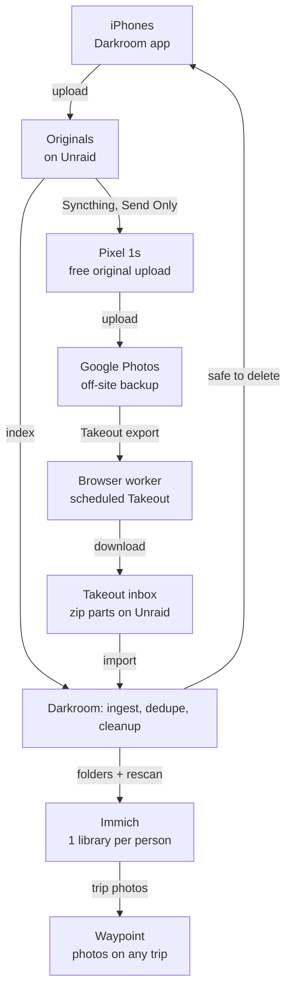

# Darkroom — Spec

Source of truth: the "Photo Coordinator Service — Spec" doc (as of 2026-10-31). This file is the repo copy for agents.

## Overview

Darkroom (working name) keeps one complete, deduplicated photo library per family member in Immich. It draws from two sources: originals uploaded by a small iPhone app that replaces Möbius Sync, and Google Takeout exports. A browser worker automates Takeout, so the only manual work is an occasional Google sign-in. The same app clears photos off the iPhones once each one exists on Unraid and in Google.

**Goals**

- One Immich library per person, organized by person and Google account.
- A one-time full Takeout per account for history, then incremental exports for anything that never passes through the iPhone app.
- Dedupe across sources, preferring the phone original while keeping Google-only metadata such as added locations.
- Complete GPS and capture times, so Waypoint can match photos to any trip.
- Bare minimum on the iPhones: one app replaces Möbius Sync, uploads each photo once, and deletes it once it is on Unraid and in Google. Google Photos via the Pixels stays the off-site backup.

**Non-goals**

- Replacing Google Photos or the Pixel backup flow.
- Daily scraping of the Google Photos web app.
- Editing, albums or face tagging. Immich already handles those.
- Waypoint's trip matching. That is a separate spec, and Waypoint reads Immich directly.

## Current setup

New photos already pass through the home network on their way to Google, so the home copy can be the source of truth. Google Takeout only has to fill the gaps.

| Piece | Role |
| --- | --- |
| iPhones → Möbius Sync → Pixel 1s | Each iPhone syncs photos through Möbius Sync (a Syncthing client) to an original Pixel, which uploads to Google Photos at original quality for free |
| Google Photos | Off-site backup. Only copy of anything that never passed through Syncthing: older photos, shared albums, other devices |
| Unraid | Docker host and storage. Becomes the Pixels' Syncthing peer in this design |
| Traefik + Pocket ID | Reverse proxy and OIDC login. Groups: `parents`, `family` |
| Tailscale | Remote access to internal-only services |
| Immich | New. Runs on Unraid, one user per person |

Darkroom changes one link in that chain: its iPhone app replaces Möbius Sync and uploads to Unraid, and Unraid syncs to the Pixels with Syncthing. The Pixels and Google Photos stay as they are.

## Architecture

Two sources feed one deduplicated library per person, and Waypoint reads it through Immich.



Immich reads each person's folders directly. Darkroom writes the originals the app uploads, Google-only items and XMP sidecars, then triggers a rescan. It also tells each iPhone which photos are safe to delete.

## Takeout browser worker

The worker drives Google Takeout in a real browser, reusing a session you sign in to by hand. It never types a Google password or 2FA code. One scheduled export per account covers both needs: its first archive is the full library (the one-time backfill), and later archives contain only new or changed items.

**Runtime**

- One container: Chromium driven by Playwright, running headed on a virtual display (Xvfb), with noVNC for remote viewing.
- One persistent browser profile per Google account, stored on Unraid.
- Runs from the home connection, a few visits a week at most.

**Jobs**

| Job | When | What it does |
| --- | --- | --- |
| Connect account | Onboarding, and whenever a session expires | Opens Takeout in the noVNC view. You sign in, including 2FA. The worker confirms the session and saves the profile |
| Create schedule | Once per account, and again once a schedule has ended unrenewed | Google Photos only, download link by email, .zip, 50 GB parts, scheduled export (every 2 months for 1 year) |
| Check status | Daily | Reads the Takeout downloads page for new exports. No Gmail access needed |
| Download | When an export is ready | Downloads every part to the person's inbox on Unraid, one at a time. Verifies the part count and runs a zip integrity test |
| Renew | About 3 weeks before the schedule ends | Creates the next year's schedule and records the new end date |

**Limits it must respect**

- Each archive expires after about 7 days and can be downloaded only 5 times. Retries are capped at 2 per part, then it alerts instead of burning the rest. An export whose download jobs fail 3 times (a job that started a download and failed before every part was downloaded, or a job that had nothing left to download and only had to finish a complete export; a job that fails right after downloading the last part is not counted) is marked failed, which frees the account.
- Google often asks you to verify it's you before a download. The job pauses, sends a push alert to the person's iPhone app linking to the noVNC view, and resumes after you sign in.
- Alerts repeat at 24 hours and again at 4 days, so an export never expires unnoticed. An alert about an export that is about to expire is closed, before the alert tick sends it again, once the export has expired or been downloaded.

**Resilience**

- All page selectors live in one module, so a Google UI change is a one-file fix.
- Every failure saves a screenshot and page snapshot, linked from the alert and the status page.

## Ingest pipeline

Every photo, from either source, ends up in one per-person index with a hash, a fingerprint, a capture time and a location. Nothing is deleted until a whole export has been processed.

**Phone uploads (continuous)**

- Receives each original from the iPhone app with its asset ID and SHA-1, verifies the hash, saves it to the person's originals folder and indexes it: fingerprint, EXIF time and GPS.
- Never modifies or moves an original once it is saved.

**Takeout side (per export)**

1. **Unpack** all parts of one export together into staging. Takeout can put a photo in one part and its JSON sidecar in another.
2. **Pair** each media file with its JSON sidecar. Takeout truncates long names and adds suffixes such as `-edited` and `(1)`, so follow the matching rules immich-go already implements rather than inventing new ones.
3. **Read metadata** from the file's EXIF first, then the sidecar: `photoTakenTime` (UTC), `geoData` / `geoDataExif` (location) and description.
4. **Fingerprint**: SHA-1 of the file bytes, a perceptual hash (pHash and dHash) for images, duration for videos. Near-duplicate groups are built from the two hashes and only ever suggest: they confirm nothing and never feed eligibility.
5. **Dedupe** against the person's index (next section).
6. **Place** Google-only items in the person's `google-only/YYYY/MM/` folder. Fill metadata gaps with XMP sidecars, never by rewriting files.
7. **Rescan** that person's Immich library through the API, then report counts.
8. **Clean up** staging and the archive after 14 days.

**Time zones**

- Store every capture time as UTC plus an offset. Use the EXIF offset when present, otherwise look it up from the GPS position, otherwise mark it unknown.
- Waypoint needs this to match photos to trips that cross time zones.

## Dedupe rules

The phone original always wins. A Takeout copy only adds a file when nothing matches, plus any metadata the original lacks. Immich won't do this for us: external libraries deliberately allow identical files in different locations.

Matching runs against everyone the export's Google account serves, in this order, and stops at the first hit:

| Order | Match when | Result |
| --- | --- | --- |
| 1. Exact | Same SHA-1 | Skip the Takeout copy. Copy Google-only metadata (location, description) to an XMP sidecar if the original lacks it |
| 2. Same shot | Same capture time to the second (sub-second when both have it), same camera make and model, and same dimensions (photos) or duration (videos), with exactly one candidate. Two or more candidates, such as a burst, go to review | Same as exact |
| 3. Edited copy | A Takeout `-edited` file whose pair matched at 1 or 2 | Skip by default. Setting: keep as its own asset |
| 4. Likely re-encode | Perceptual hash within threshold and capture time within 2 seconds | Review queue, never auto-skipped |
| 5. No match | Nothing above | Google-only: placed in `google-only/` with sidecar metadata |

**Rules**

- Nothing is auto-deleted. Every decision is stored with its tier and reason, and can be reversed from the review queue.
- A matched item belongs to whoever's iPhone uploaded the original. A Google-only item goes to the person who owned the export when it was created (the account's default person at that moment; old exports without an owner use the current default) and can be reassigned from the review queue. Matching never crosses Google accounts, so the same photo can still land in two people's libraries, for example from a shared album.
- A tier 1 or 2 match also proves Google has the original. That proof is what makes the photo eligible for deletion on the iPhone.
- Tier 2 needs exactly one candidate both ways: when another item of the same export also qualifies for the same phone item, both go to review. An edited copy (`-edited`) is never matched at tier 2, since it would prove only that Google has the edit; byte-identical copies still match at tier 1.

## Storage, Syncthing and Immich

Each person gets one folder tree on Unraid and one Immich library over it, so every photo is stored once. The service is the only thing that writes to these folders.

```text
/mnt/user/photos/
  <person>/
    originals/          Uploaded by the iPhone app, synced to the Pixel
    google-only/YYYY/MM Items found only in Takeout
  _inbox/<person>/      Downloaded Takeout parts and staging
  _browser/<account>/   Saved browser profiles
```

**Syncthing**

- Unraid shares each person's `originals/` folder with their Pixel as Send Only, so nothing on the Pixel can change Unraid's copy. The Pixel keeps its Syncthing app and settings.
- Deleting a photo on an iPhone never reaches Unraid. The app only uploads.
- Add `*.xmp` to Unraid's `.stignore`, so the service's sidecars never sync to the Pixels.
- During the switch, Unraid can join the existing Möbius Sync folders, so Immich works before the app ships. Möbius Sync comes off the iPhones once the app is uploading.

**Shared Pixels (optional)**

- By default each Pixel serves one person and backs up to that person's own Google account. Optionally, a Pixel can serve several people, set per Pixel in the web UI. Each person's `originals/` is its own Send Only folder on that Pixel, and each folder must be turned on for backup in Google Photos there.
- Google Photos on a Pixel backs up to one Google account, so everything that Pixel uploads lands in that account.
- No tags are written into files. Darkroom knows each original's owner from the iPhone that uploaded it, and Takeout copies match back by hash.

**Immich**

- One Immich user per person, and one external library per person owned by that user. The owner can't be changed after creation.
- Import paths: that person's `originals/` and `google-only/` folders. One library can hold several paths.
- Exclusion patterns: `**/.stfolder/**` and `**/.stversions/**`.
- Mount the photo share read-only in Immich. That keeps the service as the single writer and blocks deletes from the Immich UI.
- The service triggers a library rescan after each ingest. A nightly scheduled rescan is the backstop.
- No Immich phone app. The Darkroom app is the only thing running on the iPhones.

## iPhone app

The app replaces Möbius Sync. It uploads each new photo once, then deletes it from the iPhone after Darkroom confirms it is on Unraid and in Google. iOS always asks before an app deletes photos, so cleanup is one tap per batch, never silent.

**Upload**

- Watches the Photos library and uploads each photo's original resources: the photo, a Live Photo's video, and any edited version.
- Sends each with its asset ID and SHA-1. Darkroom skips anything it already has, so the first run doesn't re-send what Möbius Sync delivered.
- Uses background uploads, so transfers finish after the app closes. New photos are picked up when iOS gives the app background time, or whenever it's opened.

**Cleanup**

- A photo is eligible once every one of its resources is on Unraid and matched in a Takeout export. There are no retention settings.
- A background check fetches the eligible list and sends a local notification with the count and the space it frees.
- Tapping it shows the batch, and one system confirmation deletes it. Deleted photos stay in Recently Deleted for 30 days.
- The app re-checks with Darkroom right before deleting, so it never acts on a stale list.

**Connection and sign-in**

- Talks to Darkroom's API on home Wi-Fi or over Tailscale. Uploads wait until one is available.
- Signs in with Pocket ID. Darkroom ties each device to a person.

**Build and install**

- Swift and SwiftUI, with PhotoKit, background URLSession uploads and BGTaskScheduler.
- Needs a paid Apple Developer account. Installed on the family's iPhones through TestFlight or ad hoc.
- Cleanup assumes iCloud Photos is off on these iPhones. With it on, a delete on the phone also removes the photo from iCloud and every other device.

## Web UI and notifications

Day to day you only hear from the service when it needs a sign-in or has finished an import. Everything else lives on its status page.

**Web UI** (internal only, Traefik + Pocket ID, `parents` group, reachable remotely over Tailscale)

- **People:** each person's Google accounts, iPhones, Immich user and session status. Per iPhone: last check-in, uploads pending, photos eligible to delete.
- **Exports:** schedule end date, last and next export, download progress per part.
- **Imports:** counts added, skipped as duplicates, sent to review, and missing GPS.
- **Review queue:** side-by-side thumbnails for likely re-encodes. Keep both, skip, or undo any past decision.
- **Remote browser:** the noVNC view, embedded, for sign-ins.

The web UI is dark mode only: one theme, with no light theme and no theme switch.

**Push alerts** — sent to the Darkroom iPhone app through Apple's push service (APNs, production, TestFlight builds), to the devices of the person an alert concerns; an alert about a Google account goes to the people that account serves. The push carries only the alert kind and an id, never an email address, name or file name; the app fetches the details from Darkroom when it can reach it. Delivery does not depend on being on home Wi-Fi; acting on an alert (for example the sign-in view) needs Darkroom reachable over home Wi-Fi or Tailscale. Darkroom sends the push within about a minute of the alert opening or repeating, retries for an hour while Apple can't be reached, records each outcome as an event and forgets a push token Apple reports invalid (unless the device registered it again since). Without the APNs settings, alerts are recorded as events and not delivered.

| Event | Alert |
| --- | --- |
| Sign-in or verification needed | Immediately, repeated at 24 hours and 4 days |
| Export imported | Summary: added, skipped, in review, missing GPS |
| Originals unmatched after a full export cycle | Per person and Pixel: check that their folder is backed up in Google Photos |
| Schedule ending | About 3 weeks before, then a confirmation once renewed |
| Schedule renewal failed | When the renewal fails, or the owner finds no new schedule in Takeout after an unconfirmed one: it did not happen, is not retried and the end date stands; once the schedule has ended, Create schedule makes a new one. It replaces the ending alert (a deliberate departure from #40's "leave the ending alert open", whose text promises a renewal that will not come), repeated at 24 hours and 4 days. Renewing on request is a later addition |
| Schedule renewal not confirmed | When Darkroom cannot tell whether the renewal worked (Takeout did not confirm it, or the worker was lost): look in Takeout and answer on the Exports page. "Takeout has the new schedule" records it (ending a year after the renew job started, which must be after the current end) and confirms it like a renewal; "Takeout has no new schedule" turns it into "Schedule renewal failed". Darkroom does not retry, so it creates no second schedule. Same repeats |
| Failure (download, unpack, page change) | Immediately, with a link to the screenshot |

## Data model

A single SQLite database is enough. Photos never enter it, only their index and the decisions made about them.

| Entity | Key fields |
| --- | --- |
| Person | name, Immich user ID, Immich API key (secret), originals path, google-only path |
| Device | person, iPhone name, sign-in token (secret), last check-in |
| Pixel | name, Syncthing device ID, Google account, people served (one by default, several optional) |
| PhoneAsset | device, PhotoKit asset ID, resources (photo / Live Photo video / edit) with SHA-1 each, uploaded at, eligible at, deleted at |
| GoogleAccount | email, default person (owns Google-only items of exports created while they were the default), browser profile path, session state (ok / needs sign-in), schedule end date |
| Export | account, kind (initial full / incremental), ready at, expires at, part count, status |
| ExportPart | export, part number, size, downloads used (of 5), status |
| MediaItem | person, source (phone / Takeout), path, SHA-1, pHash, dHash, capture time (UTC) + offset, dimensions or duration, camera make and model, latitude, longitude, GPS source (EXIF / Google / none), confirmed in Google (yes / no), raw sidecar JSON |
| DedupeDecision | Takeout item, matched item, tier, reason, decided by (auto / you), decided at |
| Event | time, type, subject, detail. Feeds alerts and the status page |

## Deployment and stack

Same stack and repo conventions as Waypoint and Runway (AnthonyPluth/Waypoint, AnthonyPluth/Runway), so the same tooling, CI and Claude setup carry over. Two containers on Unraid and one iPhone app, all from one repo.

| Component | Runs | Access |
| --- | --- | --- |
| `darkroom` | Web UI, API (including uploads and cleanup), ingest worker, scheduler | `photos/` read-write |
| `darkroom-browser` | Playwright job runner, Chromium on Xvfb, noVNC | `_inbox/` and `_browser/` read-write |
| Syncthing on Unraid | Sends each person's `originals/` to their Pixel, Send Only | `originals/` read-only |
| Immich (existing stack) | Library, search, map | `photos/` read-only |
| Darkroom iPhone app | Upload and cleanup | Darkroom API over home Wi-Fi or Tailscale |

**Stack**

- Backend: Python 3.14, Poetry, SQLAlchemy + Alembic on SQLite, in-app OIDC sign-in with Pocket ID (as Waypoint does). A web session lasts until sign-out, an admin revoke (`run.py revoke-sessions`) or loss of access, which a daily background check against the provider's refresh token detects; a session the provider gave no refresh token for ends after 30 days.
- Frontend: Svelte 5, Vite, Tailwind 4, bits-ui.
- Browser: Playwright for Python.
- iPhone: Swift and SwiftUI, PhotoKit, background URLSession, BGTaskScheduler.
- Media: exiftool for EXIF and XMP sidecars, Pillow + imagehash for perceptual hashes, a GPS-to-time-zone lookup library.
- Quality: ruff, mypy, import-linter, Semgrep, pre-commit, coverage, plus `CLAUDE.md` / `AGENTS.md`.

**Runtime notes**

- Chromium starts only for a job and exits afterwards, so the browser container sits idle almost all the time.
- Internal-only Traefik route, reached remotely over Tailscale. The noVNC view sits behind the same sign-in.
- Immich keys: an admin key for library rescans, and a per-person key for reads. The upload route needs no body-size cap or short timeout, since videos can run to several GB.

## Risks and mitigations

Deleting from the iPhones is the only step that can lose a photo, so it gets the strictest checks. The browser automation is the most fragile part, so everything downstream of the inbox works without it: a hand-downloaded export runs through the same pipeline.

| Risk | Mitigation |
| --- | --- |
| A photo is deleted from an iPhone before both copies exist | Eligible only when every resource matches by hash on Unraid and in a Takeout export. The app re-checks right before deleting, and Recently Deleted keeps 30 days |
| iCloud Photos is on, so a phone delete removes the photo everywhere | Confirm it is off before cleanup is turned on |
| A person's folder isn't turned on for backup on a shared Pixel | Their photos never match in Takeout, so nothing is deleted from their iPhone. Darkroom alerts after a full export cycle with no match |
| Google changes the Takeout pages and the worker breaks | Selectors in one module, screenshot on failure, alert. Fallback: download the parts by hand into the inbox |
| Google flags the automation | Headed browser, saved profile, home IP, a few visits a week, no password automation |
| An export expires before it's downloaded (about 7 days, 5 downloads per part) | Daily status check, alerts at 24 hours and 4 days, retries capped at 2 per part |
| iOS limits background time, so uploads lag | Background uploads finish after the app closes, opening the app catches up, and the status page shows each iPhone's last check-in |
| Renewing the schedule triggers another full export | Dedupe makes it safe. Plan disk headroom of about twice the largest library during an import |
| A wrong dedupe match hides a photo | Nothing is deleted on Unraid, decisions are reversible, and Google still holds every original |

## Phases

Build ingest before the browser worker: a hand-downloaded export gives real data to build against, and the backfill lands sooner. Cleanup on the iPhones comes last, because it depends on Takeout matches.

1. **Infrastructure (no code).** Immich on Unraid, Unraid joined to the Möbius Sync folders as each person's `originals/`, one external library per person, `.stignore` set. Done when each person's photos show in Immich with GPS.
2. **Service skeleton.** New repo on the Waypoint conventions: people, accounts and devices, Pocket ID sign-in, status page, alert policy, originals indexer.
3. **Ingest and dedupe.** Run on one hand-downloaded export: pairing, metadata, dedupe tiers, `google-only/` placement, XMP sidecars, review queue. Done when one account's history is fully imported.
4. **Browser worker.** Connect account via noVNC, create the schedule, daily status check, downloads within Google's limits, re-auth alerts.
5. **iPhone app: upload.** Upload API and the app's upload side. Unraid becomes the Pixels' Syncthing peer. Done when Möbius Sync is off every iPhone and new photos still reach Google Photos.
6. **iPhone app: cleanup.** Eligibility API, notification and batch delete. Turned on only after iCloud Photos is confirmed off.
7. **Steady state.** Incremental imports, schedule renewal.
8. **Waypoint integration.** Separate spec: match Immich photos to any trip by date and GPS, with the itinerary as the location fallback.

## Open questions

- [ ] Who is included: how many people, and which Google accounts, iPhones and Pixel belong to each?
- [ ] Is iCloud Photos off on every iPhone? Cleanup depends on it.
- [ ] Does Möbius Sync deliver byte-identical originals? This decides whether the app's first run re-uploads them.
- [ ] Does renewing a scheduled export start again with a full export, or carry on incrementally?
- [ ] Are Takeout copies byte-identical to the originals on Unraid (tier 1), or does Google change their metadata (tier 2)?
- [ ] Live Photos: does Takeout export both the photo and its video? A Live Photo stays on the phone until both halves match.
- [ ] Does Takeout include photos others shared into albums? If so, should they go only to the owner's library?
- [ ] Confirm Immich reads XMP sidecars from a read-only external library, and that sidecar values override embedded EXIF.
- [ ] Keep Google's edited copies as their own assets, or skip them?
- [ ] Final name: Darkroom, or something else?

## Sources

- [Google Takeout help: delivery methods and archive expiry](https://goo.gle/2QoCz4N)
- [Takeout limits: scheduled exports, 7-day expiry, 5 downloads per archive](https://www.cloudspress.com/?p=413545)
- [Android Authority: Incremental Takeout for Google Photos](https://androidauthority.com/google-photos-incremental-takeout-3673297/)
- [9to5Google: Google Photos scheduled export](https://9to5google.com/2026/06/01/google-photos-schedule-export/)
- [Immich docs: external libraries](https://immich.app/docs/features/libraries)
- [Immich docs (v1.119): library owner and external asset metadata](https://v1.119.1.archive.immich.app/docs/features/libraries)
- [Immich docs (v1.120): multiple import paths and exclusion patterns](https://v1.120.0.archive.immich.app/docs/features/libraries)
- [Immich docs (v1.102): duplicate handling in external libraries](https://v1.102.0.archive.immich.app/docs/features/libraries)
