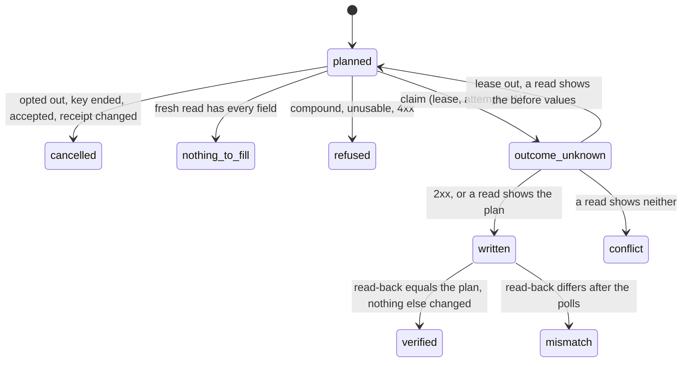

# Fill the fields an existing Immich asset lacks

Design for [#574](https://github.com/AnthonyPluth/Darkroom/issues/574), part of the Immich-managed storage epic [#530](https://github.com/AnthonyPluth/Darkroom/issues/530), prepared 2026-11-24. **Draft, waiting on the owner's design review and on a security review of sections 5 and 6 (open security decisions are listed in section 18). No code follows until the owner approves it, the live-spike rows of section 16 have run on a disposable user, and the review gates pass.** It builds on [immich-managed-storage.md](immich-managed-storage.md) (sections 2, 3, 5, 6 and 8), [terminal-holds.md](terminal-holds.md), [per-person-switch.md](per-person-switch.md) and [recovery-point-gate.md](recovery-point-gate.md). Nothing here is reachable today: `people.managed_imports` and `people.managed_backfill` are set only by tests, so no managed receipt exists outside tests.

## 0. The owner's decision, and what this settles

On 2026-11-24 the owner first decided on [#548](https://github.com/AnthonyPluth/Darkroom/issues/548#issuecomment-7121490970) that Darkroom never changes an asset already in Immich, then reversed it the same day ([comment](https://github.com/AnthonyPluth/Darkroom/issues/548#issuecomment-7132386267)): enrichment comes back, in this shape.

- It fills only fields the existing asset lacks and never overwrites a present value.
- It uses a separate key held only by the enrichment job. The person's read or import key stays without `asset.update`.
- It is opt-in per person.
- Every change leaves a before and after receipt and is read back and verified.
- Nothing is built, and the managed key checks keep refusing `asset.update`, until the design is approved, the live-spike enrichment rows have run on a disposable user and the review gates pass. `not_enriched` holds keep working as designed in the meantime.

The reason it matters: a Takeout photo that is a byte-duplicate of an Immich asset (the usual case for a phone photo) cannot carry Google's date, offset, place or description to Immich, because a sidecar only takes effect with a first upload (confirmed on v3.4.1). Those photos end as `not_enriched` holds and their zips stay pinned ([#545](https://github.com/AnthonyPluth/Darkroom/issues/545)). This document settles the field list's mechanics, the key, the API path and its evidence, the opt-in, the receipt and journal, the recovery-point change, the checks and the slicing. Anything a user would notice that the issue leaves open is in section 18, and this design does not choose it.

## 1. Where things stand

| Where | What it does today |
| --- | --- |
| `darkroom/providers/immich.py`, `MANAGED_GRANTS` | `ManagedReader` accepts exactly the read set, the import set (read plus `asset.upload`) or either of them (`read_or_import`). `asset.update`, `asset.delete`, `all` and any extra grant are refused on every path, before any asset is read |
| `require_allowed_request` | A fixed allowlist: reads, the metadata search (POST, a read), the two import routes only for a call that says it imports, and the library scan. No `PUT`, `PATCH` or `DELETE` of an asset is on it. `tests/test_immich_managed.py` holds that |
| `darkroom/domain/managed_metadata.py` | `intend` works out the date, offset, place and description Immich must show, with provenance, and `verify_metadata` marks a duplicate whose sidecar had something to add `not_enriched` (`REASONS` says only an approved enrichment path may add it). `managed_ingest.TERMINAL` makes it terminal: not polled again, a held alert, the zip pinned |
| `tools/spikes/immich_live.py` | Its `enrich` row is `not run`: the harness refuses any key with `asset.update` |
| Key storage | The person's key is `people.immich_api_key_sealed`, sealed with `storage.secretbox` and the service secret key (`DARKROOM_SECRET_KEY` or the `secret-key` file). `storage/secret_key.py`'s `SEALED_COLUMNS` lists every sealed column so a missing key is never silently replaced |
| Sign-in | `oidc.access_lapsed` and `oidc.recheck_due` end a browser session when its user is no longer allowed. `access_lapsed` also returns `sign_in_lapsed` after 30 days (`NO_RECHECK_DAYS`) without a sign-in, but only for a user who is admitted by group and not by a verified address on `OIDC_ALLOWED_EMAILS`: a user admitted by email never lapses with time (`tests/test_oidc.py` asserts None at 80 days). People and sign-in users are joined by verified email (`people.person_for`) |

Three kinds of existing asset can lack a field. This design starts with (a), the duplicate answer to an upload (a receipt in `not_enriched`; an Import, a Keep both from review and a Backfill all produce one). It adds (b), the keeper of an automatic tier 1 match in a managed export, which has no receipt, in slice 7. It leaves out (c), tier 2 and 3 keepers, which have other bytes than the Takeout copy (open question 6).

## 2. Principles

1. **A present value is never overwritten, by any path.** "Present" is judged on Immich's own fresh answer immediately before the write, not on a plan made earlier, and a field the owner or the person typed in Immich counts as present.
2. **No offset is invented.** The offset comes from the file, from Google's instant together with the place Immich will show, or from the owner. A photo whose capture time has none stays an `unknown_offset` hold. Enrichment never sends a date without its offset and never lets Immich pick one.
3. **One key, one job, one call.** The enrichment key is read only by the enrichment job. The job sends one kind of request that changes an asset (section 3.3), from one function, to one route.
4. **The writer never judges its own work.** A receipt commits only after the person's read-only key sees the intended values. The enrichment key's own read-back is the receipt's evidence of what was written, not what commits the photo.
5. **Nothing is ever written back from a snapshot.** The before snapshot is audit evidence. No code path sends a value read from Immich, and no undo restores one (section 11).
6. **Nothing is deleted, replaced or moved.** Immich's bytes, checksum, owner, library, visibility, albums, favorites and ratings are never touched, and no resolution deletes an inbox copy, a hold, a zip or a receipt.
7. **Immich's filesystem is never written by Darkroom.** Darkroom sends API requests only. What Immich does itself afterwards is in section 3.1 (it writes an `.xmp` beside the original in its own storage, as it does for an edit in its web app).
8. **It ends with its owner.** The key stops working in Darkroom when its person can no longer sign in, and its stored secret is erased (section 5.4).
9. **Fail closed.** Any check that cannot be made (Immich unreachable, grants unreadable, sign-in state unknown) writes nothing and leaves the row pending.

## 3. The API path and its evidence

Evidence has the three levels of the managed-storage design: **pinned source** (read in this design at tags `v3.3.6` and `v3.4.1` of [immich-app/immich](https://github.com/immich-app/immich), each file's blob SHA below), **prior live observation** (none exists for any update; the 2026-11-17 spike ran with no `asset.update` key), and **unverified on a live server** (everything that depends on a running server; each has a row in section 16).

### 3.1 What the pinned sources show

| Question | Finding, the same on both tags unless said | Level |
| --- | --- | --- |
| The route | `PUT /api/assets/{id}` (`updateAsset`) in `asset.controller.ts`, `@Authenticated({ permission: Permission.AssetUpdate })`, body `UpdateAssetDto`, answers 200 with the `AssetResponseDto` after the change (`AssetService.update` returns `this.get(auth, id)`). An unlisted twin `PATCH /api/assets/{id}` (`@ApiExcludeEndpoint`) calls the same service method. In the OpenAPI, v3.3.6 marks `PUT /assets/{id}` `deprecated` (history `.deprecated('v3', { replacementId: 'updateAsset' })`) and v3.4.1 does not (history `.v3PatchMigration()`); the operation, body schema and permission are the same | Source |
| The body | `UpdateAssetDto` (blob `bcdb1937235d938cee62a0032d35d65f9d312f05` on both tags), every field optional: `isFavorite`, `visibility`, `dateTimeOriginal` (string), `latitude` and `longitude` (numbers, -90..90 and -180..180, refused unless both are sent), `rating`, `description` (string), `livePhotoVideoId`. There is no null for `dateTimeOriginal`, `latitude` or `longitude` | Source |
| It overwrites, unconditionally | `AssetService.updateExif` calls `assetRepository.upsertExif({ exif: updateLockedColumns({ assetId, ...writes }), lockedPropertiesBehavior: 'append' })` for every key sent. There is no precondition: no `If-Match`, no `updatedAt` or value check. Whether a field was empty is decided only by the caller, so "fill only if missing" is a read followed by a write with a window between them (section 11) | Source |
| What a date write stores | `dateTimeOriginal` is written as sent, and `timeZone` as `extractTimeZone(dateTimeOriginal)?.name`, which is set only when the string carries a fixed offset (`+02:00` gives a zone named `UTC+2`; a string with no offset gives no zone). The single-asset route has no `timeZone` field | Source |
| What it does not update | `asset.localDateTime` and `asset.fileCreatedAt` are set only in `MetadataService` extraction (`getDates`, then `assetRepository.update`), not in `update` or `updateAll`. `exifInfo.city`, `country` and `state` come from extraction's reverse geocoding. So after an update `exifInfo.dateTimeOriginal` changes at once but the timeline position and the capture-time search (`filter.takenAt`, which compares `fileCreatedAt`) may not move until Immich extracts again | Source; live effect unverified (E4, E5, E15) |
| Side effect Immich performs | Each update queues a `SidecarWrite` job. `MetadataService.handleSidecarWrite` writes the changed description, date, place and rating with exiftool into the asset's sidecar (`<originalPath>.xmp`, or the registered sidecar), records it as the asset's sidecar file when none was registered, then unlocks the properties it locked. The original's bytes and checksum are not touched. The handler is identical on both tags | Source; unverified (E8) |
| A date with no real source | When a file has no capture tag, extraction stores the earliest of the upload's `fileCreatedAt` and the file's times as `dateTimeOriginal` and leaves `timeZone` null (`getDates`). So `exifInfo.dateTimeOriginal != null` does not mean Immich knows when the photo was taken | Source |
| Who may update | `Permission.AssetUpdate` is checked by `access.asset.checkOwnerAccess(auth.user.id, ids, auth.session?.hasElevatedPermission)`: the caller must own the asset, and an asset in the locked folder is excluded unless the session is elevated (an API key has no session). Another user's or a partner-shared asset answers `400 Not found or no asset.update access`. A trashed asset is not excluded | Source; unverified (E11 to E13) |
| What else the permission opens | In the OpenAPI, `asset.update` also gates `PUT /assets` (bulk update, with `ids`, `visibility`, `isFavorite`, `dateTimeRelative`, `timeZone`, `duplicateId`), `PUT /assets/metadata`, `DELETE /assets/metadata`, `PUT /assets/{id}/metadata` and `DELETE /assets/{id}/metadata/{key}`. Its twin `PATCH /assets` is unlisted. `visibility: locked` removes the assets from every album (`albumRepository.removeAssetsFromAll`) | Source |
| API keys | `ApiKeyCreateDto` has `name` and `permissions` only: **a key has no expiry**. A key is checked by `isGranted` against the route's permission (`403 Missing required permission: ...`). `GET /api/api-keys/me` needs no permission and lists the current key's grants | Source |
| A duplicate upload does not enrich | Confirmed live on v3.4.1: a duplicate with a new sidecar leaves the existing asset unchanged | Live |

Pinned files and blobs, v3.3.6 / v3.4.1 (commits `587f549f46f1cd1822a06e16dcccecef04ea4565` / `22b95194c80a2f2e6201093916b6c8c3d6d271dd`): `server/src/controllers/asset.controller.ts` `5816de020c75089c58e3ab522eb9f243299a3e47` / `9e670a6d6fb684cb8f10c941c74feda9c070fef9` (only the route's `history` differs); `server/src/services/asset.service.ts` `df0ede47ff159a093d93e6c326616fb9c0d5f549` / `e53d20f64788619a0fd2ff4d0c95d93f0315e717` (`update` differs only by v3.4.1's added `requireAccess` on `livePhotoVideoId`; `updateAll` and `updateExif` are identical); `server/src/repositories/asset.repository.ts` `6c24e7e13a63d10ca93de21f7555f5da79b8118c` / `6bf649b5c5a7f1a446a7ecad42729c70f4fdf71e` (`upsertExif`, `updateAllExif`, `updateDateTimeOriginal`, `unlockProperties` byte-identical); `server/src/services/metadata.service.ts` `e1c1bee16ef3c5779d424a283491b43156141e75` / `1e968eda86b78ed8f1f61c518109d83d99df3d03` (`handleSidecarWrite` and `getDates` identical in the parts used); `server/src/utils/access.ts` `0666f2d671ab4d902e4b0405ad31b5ad6e7c6885` / `9cbcc97401504359e3944af4221cfd32b43ca2d3` and `server/src/repositories/access.repository.ts` `6e9a3c2b3efae94465f775d9c80e8f5a1565a265` / `e23fea79047e9717b6bf21751327778a6e6f2cc8` (the `AssetUpdate` case and `checkOwnerAccess` identical); `server/src/dtos/asset.dto.ts` `bcdb1937235d938cee62a0032d35d65f9d312f05` (both); `server/src/validation.ts` `38a6052116171c0bd368f3ea7e8cf32365f1dba4` / `221c986cc076b1216887deecd4cbfc170549f48f`; `server/src/utils/date.ts` `0116055803df259b956e49ecea43377d99f4cebe` / `d978cd4e6340947e82df109cfb41199c6f56b9cc`; the OpenAPI `2468a3a173adb4ab1fa9ea7e02e3f2e8446dff62` / `5a07e2c4b8958b883f17389c2603087abf99127e` (`info.version` 3.3.6 / 3.4.1). The v3.4.1 blobs of the controller, service, `access.ts`, repository, metadata service and OpenAPI, and v3.3.6's repository, metadata service and OpenAPI, match those already pinned in the managed-storage design; the rest were read here for the first time. Each file was fetched at its tag and its blob hash computed with `git hash-object`.

### 3.2 The call

One request, per asset, with only the fields that are missing (section 4):

`PUT /api/assets/{id}` with the enrichment key, body any of `{"description": "..."}`, `{"latitude": 12.3456789, "longitude": 98.7654321}` (always both) and `{"dateTimeOriginal": "2019-07-04T12:30:15+02:00"}` (always with its offset). Never `isFavorite`, `visibility`, `rating`, `livePhotoVideoId`, a `null`, or an empty body. Success is a 200 whose body is parsed only as a hint; the read-back is a separate `GET /api/assets/{id}` (section 10).

It is `PUT` because the route is in the OpenAPI of both tags with the same body and permission (v3.3.6 marks it deprecated; v3.4.1 does not), and the `PATCH` twin is not documented. Only the version with a live pass is enabled (`ENRICH_VERSIONS`, section 5.1), and a version that removes the route or changes its body is refused by that list, as every other version is.

### 3.3 Routes not used

| Route | Why not |
| --- | --- |
| `PUT /api/assets` (bulk) | Takes `ids`, `visibility`, `isFavorite`, `dateTimeRelative`, `duplicateId`: a wider body than one asset needs. Its `timeZone` field would let a bug name a zone, which principle 2 forbids |
| `PATCH` on either route | Not in the OpenAPI of either tag |
| `PUT /api/assets/{id}/metadata`, `/assets/metadata` | Key-value metadata (the phone-origin marker Darkroom reads is one), not the EXIF fields |
| `PUT /api/assets/copy` (`asset.copy`) | Copies metadata between two assets: it needs a second asset's authority and gives the wrong provenance |
| A second upload with a sidecar | Confirmed not to change an existing asset |
| `POST /api/assets/jobs` (re-extract) | `job.create` is not granted. It would also let Immich overwrite a value from the file |

## 4. What is eligible, and what "missing" means

**Eligible fields:** description, place, capture time (date and offset). Which of them an owner's opt-in covers is open question 2. The mechanism is the same for each: a field is written only when it is in the receipt's plan **and** missing on the fresh read.

The plan is not worked out again from Google at enrichment time. `managed_metadata.intend` already works out the date, offset, place and description with the existing missing-field mapping (`xmp.gaps`, under the Takeout-copy rules). Its snapshot (`expected_metadata`, schema 1) records what the sidecar carries but not which sidecar fields fill a gap and which replace a present value on a first upload (Google's correction wins there, the owner's decision of 2026-11-18 on [#438](https://github.com/AnthonyPluth/Darkroom/issues/438)). So the snapshot gains schema 2 and a key `fills`: the field names `xmp.gaps(..., corrects=False)` returns (`fill_fields` already takes that parameter). That key set is not enough for capture time: with corrections off, `xmp.date_kind` returns None whenever the file has a date (`has_date`), so `xmp.gaps` never returns a date field for a file whose wall clock lacks only its offset (C2), and `fills` taken from it alone would leave that case unplannable. So `fills` also carries an explicit **offset-only fill**, the pseudo-field `offset`, which `intend` records when its capture time has `taken_from == "sidecar_offset"` (the file has a wall clock and no offset, and Google's instant together with the place Immich will show agree on one, `taken_of`'s third branch). Its plan value is the wall clock and the offset in minutes, taken from `intend`'s `taken_utc` and `offset`, never worked out again. A `taken_from` of `media` or `sidecar` adds nothing for C2: `media` is a present, complete date (C3), and `sidecar` is C1 or a correction, which `gaps` already decides. No `sidecar_offset` means no `offset` fill, so an unknown offset stays an `unknown_offset` hold. Nothing outside tests holds a managed receipt, so no schema 1 row needs converting; a schema 1 snapshot is read as "no plan" and gets none.

| Field | Missing means (all must hold) | What is sent | Never |
| --- | --- | --- | --- |
| Description | In `fills`; the fresh `exifInfo.description` is null or only whitespace (`managed_metadata.normalized` gives None) | `description` | A text over a present one, including a different text the person typed in Immich; a description XML cannot carry (`xmp.xml_char`), which Immich's sidecar writer would have to write: it is skipped and recorded `unwritable` |
| Place | In `fills`; fresh `latitude` and `longitude` are both null, or both 0 (Immich treats 0,0 as no place, as `same_place` does) | `latitude` and `longitude`, both | One without the other; a place over a present one; Google's place when it only differs from a present one |
| Capture time, no date (C1, open question 11) | In `fills`; the file has no capture tag (so the fresh `dateTimeOriginal` is Immich's file-time fallback, source `getDates`), fresh `timeZone` is null, `intend` has no pre-upload hold, **and the date is shown to be the unedited fallback**: the fresh `exifInfo.dateTimeOriginal` equals the asset's `fileCreatedAt` within 1 s. Extraction sets both from the same value, while an update through the API changes `exifInfo` and not `fileCreatedAt` (section 3.1), so a date someone entered since (an offsetless API edit also leaves `timeZone` null) differs from it. When they differ, the case is `ambiguous_date` and refused: nothing is sent and the hold stays. If E4 shows the equality does not hold on a fresh fallback, C1 is not enriched at all | `dateTimeOriginal` as an ISO string with the offset `intend` chose | Any date when `intend` raised `unknown_offset` or `no_instant`: the hold stays, and nothing is sent |
| Capture time, no offset (C2) | `offset` is in `fills` (the offset-only fill above, from `sidecar_offset` provenance, not from `xmp.gaps`); the file's own capture tag has a wall clock and no offset, fresh `timeZone` is null, and the fresh wall clock (`dateTimeOriginal` read as UTC) equals `intend`'s wall clock at its offset | `dateTimeOriginal` with the same wall clock and the offset. The stored instant moves by the offset; the wall clock does not. See open question 3 | A wall clock that differs from the one Immich shows; an offset that `intend` marked unknown |
| Capture time, both present (C3) | Never missing | Nothing | A date or zone over a present one, including Google's corrected date |

Never eligible, whatever the plan: rating, favorite, visibility and albums, tags and people, stacks, `livePhotoVideoId`, city, country and state (Immich's own). Out of scope here because another design owns them: Live Photo halves ([live-photo-compounds.md](live-photo-compounds.md), #553) and a still with `livePhotoVideoId` or a hidden video are refused as `compound`; same-shot pairs with other bytes and edited copies (#554). An asset that is trashed, offline, external, another owner's, in another checksum, or not found is refused by the same custody test every managed read uses, never enriched and never restored.

A field Google corrected, or one that differs from Google's, is not filled and does not change. Such a photo stays a `not_enriched` hold with its facts, and the owner resolves it as [terminal-holds.md](terminal-holds.md) section 3 says. That is the owner's rule, not a gap in the design: "never overwrite a present value" and #438's "Google's corrected value wins" apply at different times (the latter on a first upload and in sidecars).

## 5. The enrichment key

### 5.1 Grants and versions

The key's grants must equal exactly `user.read`, `server.about`, `asset.read` and `asset.update` (`ENRICH_PERMISSIONS`): `user.read` to bind the owner (`GET /api/users/me`), `server.about` for the version, `asset.read` for the before and after reads, `asset.update` for the one write. `GET /api/api-keys/me` needs none. It has no `asset.upload`, `asset.download` or `asset.delete`, so it cannot upload, read a byte of a photo (the original needs `asset.download`, a thumbnail `asset.view`), or trash anything. The key's user must answer `isAdmin: false`. The server version must be in `ENRICH_VERSIONS`, which starts as `{"v3.4.1"}`: the live spike ran on v3.4.1 only, and v3.3.6 has source evidence alone (section 16).

The existing checks do not change. `MANAGED_GRANTS` and `require_allowed_request` keep refusing `asset.update` for `read`, `import` and `read_or_import`, and a key that holds it is refused by all three, exactly as today. The new reader is a separate class, `immich.EnrichReader`, with its own exact grant set, in the same provider module (the one Immich provider; `providers-alone` is unchanged). `Client.call` and `Client.open` take a new keyword `enriching`, as they take `importing`, and `require_allowed_request(..., enriching=True)` allows exactly `("PUT", "/api/assets/<canonical uuid>")` and the reads. `EnrichReader.fill(asset_id, body, sending)` is the only method that sends it, after `check_access()` in the same method, which re-reads the key's owner, admin flag, exact grants and version on every operation. The person's own key never reaches it: `EnrichReader.__post_init__` refuses the admin key and the person's own sealed key by value.

### 5.2 Where it is stored

A new table `managed_enrichment_keys` (section 8), one row per person: `key_sealed` (the key, sealed with `storage.secretbox` and the service secret key, as `people.immich_api_key_sealed` is), `owner_id` (the Immich user ID the key was checked against), times and an end reason. It is not a column of `people` because it has its own lifecycle and a person-reading API must not be able to return it by accident. Its sealed column joins `SEALED_COLUMNS`, so a missing secret key is refused while one is stored, and `check-config` says whether a key is set and never the key. It is entered only through the command line (`python run.py enrichment set-key --person <slug>`, key from standard input or an environment variable, never an argument), not the web app: a page needs a signed-off design (promise 6) and the key should not pass through a browser. Open question 7 asks whether the owner wants a page.

Nothing but `darkroom/storage/enrichment_keys.py` touches the model, and nothing but `darkroom/domain/managed_enrich.py` unseals it (section 14). `people` responses, `/api/people`, events, alerts, logs and error bodies carry at most `has_enrichment_key`. In the one container the app and the job are one process, so "held only by the job" is a code boundary with checks, not a process boundary: a flaw that runs code in the app can read the sealed value and the secret key, as it can read every other sealed key. Section 6 and open question S2 deal with that.

### 5.3 Binding to the person

`set-key` calls `GET /api/users/me` with the new key and stores the answered `id` as `owner_id` only if it equals `people.immich_user_id` (a canonical ID) and `isAdmin` is false. Every use re-reads it (5.1) and compares to both the stored `owner_id` and the person's current `immich_user_id`; a mismatch ends the key (`owner_changed`). `people.update` changing `immich_user_id` ends it in the same transaction, and `people.delete` is refused while a key row is active (`blockers`). The key row's FK to `people` is `RESTRICT`. Every asset it touches is read first and must be that owner's own managed asset (`libraryId: null`, not trashed, not offline, the version's checksum), never found by name or path.

### 5.4 How it ends

The AGENTS.md rule: a new kind of credential must end when its owner can no longer sign in, like browser sessions do. Here:

- **The predicate.** `enrich_gate.may_enrich(opened, settings, person, now)` is true only when sign-in is configured, the person's verified email matches exactly one `users` row, and `oidc.access_lapsed(opened, settings, user.sub, user.email, now)` is None for it. That is: the user is still allowed (`oidc.still_allowed`), and, for a user admitted by group only, has signed in within `NO_RECHECK_DAYS`; a user whose verified address is on `OIDC_ALLOWED_EMAILS` does not lapse with elapsed time at all (`access_lapsed` computes `by_email` and returns `sign_in_lapsed` only `if not by_email`). **What that means for the key:** for an email-admitted person the key is erased only by opt-out, removal, or the person's address being taken off the list (or another end in the list below), never by elapsed time, so a person who has not signed in for a year keeps an active `asset.update` key in Darkroom. For a group-admitted person it also ends after 30 days without a sign-in. The design does not add its own idle limit; S1 asks whether it should. It reads the database only, so a provider outage does not end a key (as it does not end a session).
- **When it is evaluated.** At the start of every enrichment tick, and again under the write lock in the claim of every attempt, before a request is sent.
- **What happens when it is false.** The key is ended, not merely skipped: in the same transaction `key_sealed` is set to NULL and `ended_at` and `ended_reason` (`sign_in_ended`) are set, every `planned` row of the person becomes `cancelled`, and `people.managed_enrichment` is cleared. A row `outcome_unknown` (a request that may have gone out) is reconciled by a read with the person's own read key, never the ended key. An ended key can come back only by `set-key` again, after the person can sign in.
- **Also ending it:** `enrichment off`, `enrichment remove-key` (`removed`), an Immich refusal of the key (401 or a changed grant set, `refused`), an unreadable seal (`key_unreadable`), a changed `immich_user_id` (`owner_changed`), and `expires_at` (open question S1).
- **A check constraint** keeps the invariant: an ended row holds no sealed value, an active row holds one.
- **What Darkroom cannot do.** It cannot revoke the key in Immich: that needs the person's own session, and the key's own grants cannot delete keys. The sealed value is erased in Darkroom; the key stays valid in Immich until its person deletes it there, and a pinned API key has no expiry. The owner must be told this in the `set-key` output and in the alert an ended key raises ("revoke it in Immich"). A restored Darkroom backup can bring back a key row that was active when the backup was taken; the gate re-evaluates sign-in at every use, but the only real end is revocation in Immich.

## 6. What a leaked enrichment key can do

**Immich scopes an API key by permission, not by field, asset or time.** `asset.update` is the narrowest grant that allows the one call this design needs, and it is wider than the call. For anyone who holds the key and can reach the Immich address, on the pinned versions:

- **Read:** `asset.read` opens the metadata of every asset the person owns: exact places, descriptions, file names, people and tags on each, and the search (`POST /api/search/metadata`). It reads no photo bytes and no thumbnails: `asset.download` and `asset.view` are not granted.
- **Change, on every asset the person owns (never another user's, a partner-shared one, or one in the locked folder):** date, time zone, place, description, rating and favorite; visibility (timeline, archive, hidden; and `locked`, which also removes the assets from every album); a Live Photo's link to its video; the duplicate-group ID. `PUT /assets` does this for a whole list of IDs in one request. `PUT` and `DELETE` on `/assets/metadata` and `/assets/{id}/metadata` add and remove key-value metadata, including the `mobile-app` marker that Darkroom reads to tell a phone asset from another (`PHONE_KEY`), so a leaked key could change what Darkroom treats as a phone origin and so its Pixel routing.
- **Not possible with it:** upload, read bytes, trash or delete, restore, edit pixels, create jobs, manage keys, users or libraries, read or change another person's assets.
- **What it costs.** A silent, wide, hard-to-see change to metadata that makes photos sort in the wrong place, vanish from albums or the timeline, or lose their descriptions and locations, with no bytes lost. Immich keeps no history of an edit, and its sidecar writer then writes the new values into the asset's `.xmp`. Darkroom's before snapshots exist only for assets Darkroom enriched. Recovery is Immich's own database and media backup (the recovery point of #545), the original's embedded EXIF and a fresh Takeout; none of them tells which assets were changed.

**What limits it, honestly:**

1. Immich: ownership only. The key cannot touch another user's assets, and an API key cannot touch the locked folder (`checkOwnerAccess` with no elevated session). It cannot delete.
2. The key's life in Darkroom: sealed at rest, read by one module, returned or logged nowhere, ended with its person's sign-in, erased when ended or opted out, and only `ENRICH_VERSIONS`.
3. The key's use in Darkroom: Darkroom itself refuses a key with any extra grant (so it will not use a broader key by accident), writes only planned fields, one asset at a time, at most `ENRICH_PER_TICK` per tick, and stops a person at the first `ENRICH_BREAKER` consecutive mismatches (section 13).
4. Exposure: the key travels only between Darkroom and the Immich address on the LAN, in a header, through `darkroom/tls.py`.

**What does not limit it:** Darkroom's checks bind Darkroom's own use of the key, not the key. Once the key leaves Darkroom (a stolen database backup with the secret key beside it in appdata, a process compromise, a log or screenshot, the person's Immich account page) the checks above are not in the way. The person's existing read or import key has the same reach for reading and uploading; this key adds writing to existing metadata, which is a real increase. The stored copy ends with sign-in, but the key itself has no expiry in Immich.

**Flagged for a security-minded review before approval, because this design does not settle it and the owner will want a stronger model on it** (section 18, S1 to S5): the key's lifetime and form (stored sealed, stored with an expiry, or typed in per run and never stored); whether the job should run in a process of its own so that an app flaw does not hold the key; whether a per-person write budget is enough of a limit when Immich offers none; whether the window between the read and the write is acceptable; and what to do when sign-in is not configured. A dedicated Immich user is not an option: the key's user must own the assets it updates.

## 7. Opt-in, the per-person switch and the holds

**Opt-in.** `people.managed_enrichment` (migration, section 8) is NULL (off), `on` or `paused`. It is a person-level opt-in, as the owner decided; whether the owner can narrow it to fields or sources is open question 2. It is independent of `people.managed_imports` and `people.managed_backfill`, as the backfill is independent of the switch: enrichment writes nothing in `originals/`, `google-only/` or the inbox, so [per-person-switch.md](per-person-switch.md)'s pause, its lock order and `managed_switch.hold` do not apply to it and `advance` never waits on it. It runs for a person whose switch is `pausing`, `on` or `stopped`, and for one with only a backfill. What it works on exists only where a managed receipt does. Turning it on needs, all checked by `run.py enrichment on`: `DARKROOM_MANAGED_ENRICH` set (off by default; the deployment's own release gate), a canonical Immich user, the person's own sealed key (for the verifying reads), an active enrichment key, and `may_enrich` true. `enrichment off` cancels planned rows, erases the key, and leaves every written field as it is.

**Holds.** The terminal holds of [terminal-holds.md](terminal-holds.md) keep their meaning and their resolutions. Two changes:

- A receipt that would become `not_enriched` is, for an opted-in person, first planned for enrichment. The receipt stays `bytes_verified` with that hold while an enrichment row is open, and the hold list says so ("waiting to fill what Immich lacks"). When the row is `verified`, or `nothing_to_fill` with every planned field matching (someone filled it first), the job clears the receipt's hold by compare-and-set (principle 4); the ordinary import tick then verifies with the person's key and commits, or returns the receipt to `not_enriched` with the facts that still differ. The same asset and plan are never planned twice (a unique plan key), so a still-different field cannot loop.
- **The hold transition must recognise an offset-only fill.** Today `managed_metadata.verify_metadata` sets `not_enriched` only when the receipt is a `duplicate` and `intended.sidecar` is non-empty. A C2 photo's `intend` result has `taken_from == "sidecar_offset"` with an empty `sidecar` (the file has its date; only the offset is missing from Immich), so a duplicate that lacks only the offset ends as `mismatch`, which this section excludes from enrichment. The change, in slice 4 with `fills`: the condition becomes `duplicate and (intended.sidecar or intended.taken_from == "sidecar_offset")`, so such a duplicate is `not_enriched` and reaches the planner. It also alters what the owner sees for it today (a `not_enriched` hold, resolvable as terminal-holds.md section 3 says, instead of a `mismatch` that becomes `not_settled` after a day), which is the fix `not_enriched` was meant to give; no other receipt changes hold. A Darkroom-created asset (`created`) with the same gap stays `mismatch`.
- The owner's resolutions (accept, record an offset, check again, keep held) are unchanged and stay available while a row is open. Accepting cancels a `planned` row; it does not cancel one already `written`. A `not_enriched` hold with only fields enrichment may not touch (corrections, present values, an unresolved offset) is not planned and goes to the owner as today. `unknown_offset`, `no_instant` and `unwritable` are pre-upload holds and never reach enrichment. A Darkroom-created asset that ends `mismatch` or `not_settled` is not enriched: enrichment does not repair Darkroom's own uploads.

## 8. Data

One Alembic migration, numbered after main's newest when its slice lands (0052 and later are named by other designs, so the number is not fixed here), with its `test_<revision>_...` in `tests/test_migrations.py` on SQLite and PostgreSQL, no `PRAGMA` or SQLite-only function without a PostgreSQL branch. Times are UTC epoch seconds. The sealed column joins `SEALED_COLUMNS` in the same slice.

`people.managed_enrichment`: nullable string with `one_of("managed_enrichment", ("on", "paused"), "ck_people_managed_enrichment")`, set by a function in `enrich_gate` only.

`managed_enrichment_keys`: `person_id` (PK, FK `people.id` `RESTRICT`), `owner_id` (not null, length > 0), `key_sealed` (Text, nullable), `set_at`, `verified_at` (last passing `check_access`), `expires_at` (nullable; see S1), `ended_at` (nullable), `ended_reason` (nullable, `one_of` `removed`, `opted_out`, `sign_in_ended`, `owner_changed`, `refused`, `key_unreadable`, `expired`). Checks: `(ended_at IS NULL) = (key_sealed IS NOT NULL)` and `(ended_at IS NULL) = (ended_reason IS NULL)`. A person has at most one row; a new key replaces an ended row's values in one transaction.

`managed_enrichments`, one row per asset version and plan:

| Column | Meaning |
| --- | --- |
| `id` | key |
| `person_id`, `owner_id`, `asset_id`, `sha1` | the asset version, bound to `managed_asset_versions` by the composite FK pattern `managed_asset_origins` uses |
| `source_kind`, `receipt_id`, `source_key` | `receipt` (FK to `managed_import_receipts`, `RESTRICT`) now; `keeper` (the decision's item) in slice 7. `source_key` is the receipt's `takeout-entry:<id>`, `review:<id>` or `backfill:media-item:<id>` |
| `plan` | ASCII-escaped JSON: for each planned field its value and provenance (`media`, `sidecar`, `sidecar_offset`) from the snapshot's `fills` (an `offset` entry holds the wall clock and offset minutes), never worked out from Google again. A receipt records an offset-only fill as plan field `offset` with provenance `sidecar_offset`, and `written_fields` and `result` name it `offset`. Private data, stored as `expected_metadata` is, never logged |
| `plan_key` | SHA-256 of the sorted `(field, value)` pairs; with the asset version it is unique, so one plan is attempted once |
| `state` | `planned`, `outcome_unknown`, `written`, `verified`, `mismatch`, `conflict`, `nothing_to_fill`, `refused`, `cancelled` (check) |
| `seen_snapshot`, `before_snapshot`, `after_snapshot` | the five fields as the API showed them (`dateTimeOriginal`, `timeZone`, `latitude`, `longitude`, `description`), plus `localDateTime`, `fileCreatedAt`, `updatedAt` and the checksum, ASCII-escaped JSON; seen at planning, read immediately before the write, and read back after |
| `written_fields` | the fields actually sent (a subset of the plan) |
| `result` | fixed code per field: `written`, `already_present`, `differs`, `mismatch`, `unwritable`; and a row code: `verified`, `collateral`, `conflict`, `refused:<status>`, `compound`, `unusable` |
| `send_attempts`, `send_lease_until` | as `managed_import_receipts`' send claim; `LEASE_SECONDS` 600 |
| `planned_at`, `written_at`, `verified_at`, `updated_at` | times |

Partial unique index on `(person_id, owner_id, asset_id, sha1)` where `state` in `planned`, `outcome_unknown`, `written` (one open row per asset version, written for both databases). Events, all with fixed text and ids only (`enrichment <id>`, the field names, never a value): `enrichment_planned`, `enrichment_written`, `enrichment_verified`, `enrichment_mismatch`, `enrichment_conflict`, `enrichment_refused`, `enrichment_key_ended`. Alerts through `alerts.open_alert` with fixed texts: `enrich:key:<person id>` (key ended or refused, with pending rows) and `enrich:paused:<person id>` (the breaker).

## 9. States, journal and crash boundaries

The claim is one compare-and-set under the write lock (`planned` to `outcome_unknown`, `send_attempts` plus 1, a lease, and the `before_snapshot` and `written_fields` of the fresh read just before it, in the same statement), committed before the request; no request is sent while the write lock is held. At most `MAX_SENDS` (3) attempts per row.

| Crash or loss | What the next run finds | What it does |
| --- | --- | --- |
| After the fresh read, before the claim commits | `planned`, no baseline, nothing sent | Starts again from the access check; a lost read costs nothing |
| After the claim, before the request | `outcome_unknown`, lease running, then out | Waits for the lease, reads the asset: every sent field (`written_fields`) still equals the persisted `before_snapshot`, so the request did not apply: back to `planned` (attempt counted) |
| The request was sent, the answer lost, or a 5xx | `outcome_unknown` | The same read: if the planned fields equal the plan it is `written`; if they equal the before values it is `planned` again; if anything else (the person edited it, or Immich changed it) `conflict`, no resend |
| After the 2xx, before `written` was recorded | `outcome_unknown` | As above |
| After `written`, before the read-back | `written` | Reads again (the read-back is idempotent); at most `POLLS` (5) reads 2 s apart per tick |
| After `verified`, before the receipt's hold was cleared | `verified`, hold still set | A compare-and-set on the receipt's hold while it is `bytes_verified` and the row is `verified`; the second run matches nothing |
| A database restored from an older backup | An open row for an asset Immich already shows filled | `outcome_unknown` or `planned` becomes `written` on the read; nothing is sent again, and no snapshot value is ever sent |
| Immich restored from an older backup | A `verified` row whose fields are gone | Not detected by the job. The recovery-point gate's fresh read (G12) and G7 see the missing fields, and the photo is a gap again; it is planned once more only as a new plan key if its snapshot changed (section 12) |

## 10. One attempt, step by step

All of it runs in the enrichment job (`managed.enrich`, every 300 s, `ENRICH_PER_TICK` 20 assets, for opted-in people in ascending order), inside nothing but its own short transactions.

1. **Gate.** For the person: `DARKROOM_MANAGED_ENRICH` on, `people.managed_enrichment == "on"`, `may_enrich` true (else end the key, 5.4), the key active and unexpired. Any failure writes nothing.
2. **Plan.** For each receipt in `bytes_verified` with `metadata_hold` `not_enriched` and no enrichment row for its asset version: read its snapshot, take `fills`, build `plan` (an `offset` entry becomes a `dateTimeOriginal` body of the planned wall clock with the offset, and is scheduled only when open question 3 is answered as a fill), record a `planned` row with a `seen_snapshot` from one `GET /api/assets/{id}` through `EnrichReader`. A snapshot with no `fills`, or with no fillable field, plans nothing and leaves the hold to the owner.
3. **Check access.** `EnrichReader.check_access()`: `GET /api/users/me` (id equals `owner_id` and the person's `immich_user_id`, `isAdmin` false), `GET /api/server/about` (in `ENRICH_VERSIONS`), `GET /api/api-keys/me` (exactly `ENRICH_PERMISSIONS`). No lock is held and nothing is written.
4. **Fresh read, custody.** `GET /api/assets/{id}`: owner, `libraryId: null`, not trashed or offline, checksum equal to the version's, `type` IMAGE or VIDEO, `livePhotoVideoId` null and visibility `timeline`, else `refused`. This read is the baseline.
5. **Decide what is still missing**, per field, with section 4's rules against that read. Fields still missing are the subset to send; fields now present are `already_present`. None left: `nothing_to_fill`, with a per-field code `matches` (the present value equals the plan within the read-back's tolerances) or `differs` (present but not Google's). If every planned field `matches` (someone filled it after planning), step 10 hands back as for `verified`; any `differs` keeps the hold.
6. **Claim, with the baseline.** One compare-and-set under `db.write_lock` taken before the write (AGENTS.md): `planned` to `outcome_unknown`, `send_attempts` plus 1, a lease, **and in the same statement** `before_snapshot` (step 4's read) and `written_fields` (step 5's subset), then commit and release. The row is never `outcome_unknown` without its baseline and subset, so recovery always has what it compares against. A crash before this commit leaves the row `planned` with nothing sent. Step 5's decision is not trusted past the claim: the send uses exactly the persisted subset.
7. **Send** (`managed_enrich.send`, the only caller of `EnrichReader.fill`): one `PUT /api/assets/{id}` built by `body_of(written_fields, plan)` from the persisted subset, which has no access to any snapshot value. A date is sent only as `taken_text`'s ISO string with its offset.
8. **Read back.** `GET /api/assets/{id}` again with the same custody checks, up to `POLLS` times 2 s apart. Verify every sent field (instant within 1 s, offset of `timeZone` at that instant, place within 0.00001 degrees, description normalised, as `managed_metadata.problem` compares) and that every field not sent equals the `before_snapshot` and the checksum is unchanged. Record `after_snapshot`.
9. **End the row.** `verified`; or `mismatch` (a sent field differs after the polls) or `conflict` with result `collateral` (a field not sent changed); a mismatch is read again on later ticks until `managed_ingest.SETTLE_SECONDS` and then stays.
10. **Hand back.** A `verified` row, and a `nothing_to_fill` row whose planned fields all `matches`, clear the receipt's hold by compare-and-set; the ordinary import tick re-verifies with the person's key and commits, or re-holds.

The person's own key is never used to write, and the enrichment key is never used to commit a receipt or to read an original.

## 11. Mismatch, undo and rollback

**How a read-back mismatch ends.** No second write, no rollback and no other value. The row is `mismatch` with the `after_snapshot` and the fields that differ; the receipt stays `not_enriched`, now with facts that say what Darkroom sent and what Immich shows; an `enrichment_mismatch` event and, after `ENRICH_BREAKER` (3) consecutive mismatches or collateral changes for a person, the breaker sets `people.managed_enrichment` to `paused`, plans nothing more and raises `enrich:paused:<person id>` until the owner runs `enrichment resume`. The owner then resolves the hold as today (accept, check again after fixing it in Immich, keep held).

**Undo.** Before a request is sent, an enrichment is cancelled with nothing to undo (a `planned` row, by opting out, ending the key, or accepting the hold). **After it is sent, Darkroom offers no undo.** It could not restore the empty state if it wanted to: the API accepts no null for `dateTimeOriginal`, `latitude` or `longitude`, so a filled date or place cannot be cleared through it (only a description can be set to the empty string). This breaks the "restores exactly what was there" rule for a sent change, so the rule is applied the other way round: the before snapshot is the audit record of what was there, nothing writes it back, and the owner who wants a filled value gone clears it in Immich's own interface. Darkroom then reads it as present and never fills it again.

**Never overwrite from a stale snapshot.** The only values ever sent are the plan's, taken from the receipt's snapshot and checked missing on a fresh read in the same attempt. The `seen_snapshot` and `before_snapshot` are read by the list of facts and by the lost-response comparison only; Semgrep and an AST test (section 14) fail if any code path from them reaches the sender. A plan's values are not re-derived from a restored database or an old backup: a restored row is recognised by a read, never replayed.

**The window the API leaves.** The server has no precondition, so a person who edits the same missing field in Immich between step 5 and step 7 (milliseconds, but not zero) has their edit overwritten, and the read-back then shows Darkroom's value and cannot tell. The `before_snapshot` shows the field was empty when Darkroom last looked. Mitigation: the read and the write are adjacent with no database work between them, only fields the person has not filled are sent, and collateral changes to other fields are detected. Whether that residual risk is acceptable is open question S4; the live row E7 measures it.

## 12. Effect on the recovery-point gate

[recovery-point-gate.md](recovery-point-gate.md) G7 keeps a zip while a tier 1 to 3 keeper lacks a field Google's sidecar has, and its open question 5 asks what to do while enrichment does not exist. With this design G7 for an exact-byte keeper or a duplicate receipt reads, per field of the snapshot's `sidecar`:

- a field in `fills` is satisfied when the fresh read under the lock (G12) shows it, which is true after a `verified` enrichment, after `nothing_to_fill` that found it present, or when Immich already had it;
- a field not in `fills` (Google corrected a present value, or it differs) is never filled; it is satisfied only by the owner's `accept` resolution of that photo's hold, as before, with Google's values kept in Darkroom's ledger;
- the enrichment `verified_at` that G7 relies on must be no later than the recovery point's `opened_at`, so the backup the point stands for holds the filled fields (G10 gets a second sentence, no manifest change: the check is on `managed_enrichments`).

So a matched photo with a missing field stops pinning its zip when its enrichment is `verified` (or the field was already there) and the fresh read shows it and a recovery point opened after that covers it; with enrichment off or declined for the person it keeps pinning until the owner accepts, as today. A corrected or differing photo keeps pinning until the owner accepts. Enrichment itself releases nothing, and it deletes nothing.

## 13. Failure paths

| What fails | What the owner sees | What stays |
| --- | --- | --- |
| Key refused (401), grants changed, version not in `ENRICH_VERSIONS`, or owner changed | `enrich:key:<person id>` alert ("revoke it in Immich if it should not be used") and the key ended | The rows pending; the holds unchanged |
| Person can no longer sign in, or sign-in is not configured | The key ended with `sign_in_ended` and the alert; a status line | The rows cancelled; written fields as they are |
| Immich unreachable, 5xx or a lost answer | The row `outcome_unknown` and, after a day, the person's existing Immich alert path | The receipt's hold; no resend until a read reconciles |
| 400 `Not found or no asset.update access` or another 4xx | The row `refused:<status>` | The hold; the asset untouched |
| The asset is trashed, offline, external, another owner's, changed or a Live Photo half | `refused` with the reason code; no request was sent | The hold |
| The person edited a field between plan and write | The field is `already_present`; if every field is, `nothing_to_fill` | The person's value |
| Read-back differs, or a field not sent changed | `mismatch` or `conflict`, the event, the breaker after three | The fields as Immich shows them |
| The write succeeded, extraction later re-reads the file | Not detected by Darkroom: the sidecar Immich wrote should keep the values (E8); the receipt's later checks see the fields as they are | The row |
| Two ticks race on one row | One claim wins; the other leaves it | The row |
| The enrichment tick throws | Rolled back, logged with the error's type only; the rest of the jobs run | The state |
| The stored key cannot be unsealed (the secret key changed) | `key_unreadable`, the key ended, the alert | The rows pending |

## 14. Checks that hold it

- **Semgrep** (`.semgrep/darkroom.yml`, each with a failing and a passing example in `.semgrep/examples/darkroom/`): `darkroom-immich-update-one-caller` (nothing but `darkroom/domain/managed_enrich.py` calls `EnrichReader.fill` or passes `enriching=`, as `darkroom-immich-upload-one-caller` does for imports); `darkroom-immich-update-behind-check-access` (inside the provider the update route is reached only after `self.check_access()` in the same method); `darkroom-immich-no-other-asset-writes` (no `PUT`, `PATCH` or `DELETE` verb string with an `/api/assets` path in any call to `.call(` or `.open(` outside `providers/immich.py`); `darkroom-enrichment-key-one-reader` (the model, its sealed column and `enrichment_keys.unseal` are named only in `storage/models.py`, `storage/secret_key.py`, `storage/enrichment_keys.py` and `managed_enrich.py`); `darkroom-enrichment-snapshot-never-sent` (a `before_snapshot`, `seen_snapshot` or `after_snapshot` name is not an argument to `body_of`, `fill` or `send`).
- **import-linter** (`pyproject.toml`): a `protected` contract so only `darkroom.domain.managed_enrich` and `darkroom.domain.enrich_gate` import `darkroom.storage.enrichment_keys`; a `forbidden` contract so `darkroom.server.api`, the `people` routes and `darkroom.oidc` import neither `managed_enrich` nor the key module (the gate's ending function lives in `enrich_gate`); the Immich provider stays the one `providers` module with the allowlist, and `providers-alone` is unchanged.
- **An AST test** (`tests/test_managed_enrich_invariants.py`, in the manner of `tests/test_dedupe_invariants.py`): `managed_enrich.py` calls no Immich method but `EnrichReader.check_access`, `custody` reads and `fill`; calls no remover, trash, restore, upload or file-writing function; names no path under `originals/`, `google-only/` or the inbox; and `immich.py`'s update allowlist contains exactly one route.
- **Types:** `domain/` and `providers/` are strict mypy; `Field` and the plan's value types are `Literal` and `NewType`s so an unplanned field does not type-check.
- **Coverage:** the 90% floor per module in `domain/` and `providers/` applies to the new modules.
- **Privacy:** `tests/privacy.py`'s `no_leaks` with canary values in the key, the description, the place, the file name and the snapshots, over the commands, events, alerts, logs, error bodies and the people routes.
- **Generated files** (`make feature-map`, `make api-contract`) change only if a route is added; section 18 asks whether one is wanted.

## 15. Negative tests

Each fails before the change it guards, runs on SQLite and PostgreSQL where it touches locking (`make test-pg`), and uses the fake Immich, which records every request and fails a test on any it does not expect.

- **The key.** `ManagedReader` refuses a key with `asset.update` for `read`, `import` and `read_or_import`, unchanged; `EnrichReader` refuses `asset.upload`, `asset.download`, `asset.delete`, `all`, a missing `asset.update`, any extra grant, an admin user, a missing or non-boolean `isAdmin`, the admin key, the person's own sealed key by value, another user's key, and a version outside `ENRICH_VERSIONS` (v3.3.6 and v3.4.0 included), each before an asset is read.
- **The allowlist.** `require_allowed_request` raises for every unlisted route and verb with `enriching=True`: `PUT /api/assets`, `PATCH /api/assets/{id}`, `PUT /api/assets/{id}/metadata`, `PUT` and `DELETE /api/assets/metadata`, `PUT /api/assets/copy`, `DELETE /api/assets/{id}`, `DELETE /api/assets`, `POST /api/assets` and `/bulk-upload-check`, `POST /api/assets/jobs`, and `PUT /api/assets/{not a canonical id}`; with `enriching=False` the update route raises.
- **One request, one asset.** For every case of section 4 the fake records exactly one `PUT`, to the planned asset, whose body has only planned, still-missing fields; and no `PUT` at all for `nothing_to_fill`, a present value, a correction, a Live Photo half and a refused asset.
- **Never overwrite.** For each field: present on the fresh read (including a value typed after the plan), present and different from Google's, Google corrected, whitespace-only description (missing), place 0,0 (missing), place on only one axis. Nothing is sent over a present value; two fields where one is present send only the other.
- **No offset invented.** `unknown_offset` and `no_instant` receipts never produce a date in a body; a date body always carries an offset; an offset is never taken from a default, from the clock or from Immich's `timeZone`; every case of `test_managed_metadata.py`'s offset table is run through the planner.
- **Filled after planning.** A fake that fills every planned field between planning and the fresh read: the row ends `nothing_to_fill` with `matches`, no PUT is sent, the hold is cleared by compare-and-set, the person's key verifies and the receipt commits; with one field filled with a different value (`differs`) the hold stays and the zip stays pinned.
- **A date entered earlier.** A C1 asset whose `dateTimeOriginal` was set through the API without an offset (so `timeZone` is null and `dateTimeOriginal` differs from `fileCreatedAt`) is refused as `ambiguous_date`: no PUT, the hold stays, and the person's date is untouched; the same asset with `dateTimeOriginal` equal to `fileCreatedAt` is enriched.
- **The offset-only hold, end to end.** A duplicate receipt whose file has a wall clock and no offset, whose Google instant and place agree on one, and whose existing Immich asset shows the wall clock with no zone: `verify_metadata` marks it `not_enriched` (it was `mismatch` before the change, a test that fails first), the planner records an `offset` row, the fake Immich receives one `PUT` with the planned wall clock and offset when open question 3 is a fill, the read-back verifies, the hold is cleared, and the import tick commits the receipt with the person's key; with the setting at overwrite the receipt stays `not_enriched` and nothing is sent.
- **A crash between the claim and the fresh read.** Kill the job at each of: after the access check, after the fresh read, after the claim commits and before the request, after the request and before the answer is recorded. The first two leave `planned` with nothing sent; the others leave `outcome_unknown` with `before_snapshot` and `written_fields` already stored, and the next run tells an unapplied request (back to `planned`) from an applied one (`written`) and from a person's edit (`conflict`), with no baseline ever missing and no second request in the first and third cases.
- **The offset-only planner.** A table-driven test over `intend` inputs: a file with a wall clock and no offset whose Google instant and place agree on one offset gives `fills` containing `offset` (and, with `xmp.gaps(corrects=False)` asserted to return no date field for the same input, shows why it cannot come from `gaps`); a file with a complete date (`media`), a file with no date (C1, `sidecar`), a wall clock whose offset Google and the place do not settle (`unknown_offset`) and a wall clock resolved at the file's own position when the place Immich will see is in another zone give no `offset`; the planned body carries the wall clock and offset exactly; with the open-question-3 setting set to overwrite (a constant the test flips), the planner schedules no `offset` row, and with it set to fill it schedules one, so the mechanism works either way.
- **Time zones.** C1 and C2 with offsets -12:00, -00:30, +05:45 and +14:00 and a UTC+0 value; the read-back instant and offset equal the plan's; C2 keeps the wall clock Immich showed; a C2 whose wall clock differs from the plan is refused.
- **Read-back.** A fake that answers 200 and ignores the write, one that writes a different zone, one that changes another field and one that changes the checksum: `mismatch`, `mismatch` and `collateral`; never a second write; the receipt not committed; the breaker pauses at three.
- **The writer does not judge itself.** A receipt is never moved to `metadata_verified` or `committed` by a call made with the enrichment key; the commit follows only a read with the person's key.
- **Custody.** Trashed, offline, external, another owner's, locked-folder, changed-checksum and not-found assets are refused and untouched (the fake records no `PUT`); a trashed asset is never restored.
- **Concurrency and crashes.** Two ticks on one row (one wins), a crash at each boundary of section 9 with a lost answer, a restored database, a lease that runs out; a user edit injected between the fresh read and the write is the one documented window, asserted so that it fails loudly if the window grows.
- **Sign-in.** Both kinds of user are tested: a group-admitted user removed from the group, a group-admitted user lapsed 31 days (ends), an email-admitted user removed from `OIDC_ALLOWED_EMAILS` (ends), an email-admitted user idle 80 days (does not end: the test pins the behaviour and fails if `access_lapsed` changes it), sign-in not configured and a person with no matching user each end the key at the next tick: `key_sealed` is NULL, the row cancelled, no request sent, the `outcome_unknown` row reconciled with the person's key. A provider outage ends nothing. A key whose user is later allowed again is not revived.
- **Ending.** `off`, `remove-key`, a changed `immich_user_id`, a refused key and an unreadable seal each erase the secret; the check constraint holds on both databases.
- **Leaks.** `no_leaks` as in section 14; `has_enrichment_key` is the only mention in any people reply; the secret key rotation test lists the new sealed column.
- **Nothing else.** A whole-tree SHA-1 of `originals/`, `google-only/` and the inbox is unchanged by every action, and no `.xmp` appears there; the fake records no `DELETE`, trash, restore, upload, download or other `PUT` in any test of the job; a re-listing by the reconcile after an enrichment changes no version, origin or Pixel obligation.
- **Access.** Any route added answers 401 without a session, and `make feature-map-check` finds a test for it.

## 16. Live-spike rows to add on #266

Run by the owner on a disposable instance or **disposable non-admin users** with generated media only, on v3.4.1 (the only version with a running server; v3.3.6 stays source-only and outside `ENRICH_VERSIONS`). Per user, two keys signed in as that user: the existing import key with exactly the five grants of the existing harness, and an **enrichment key with exactly `user.read`, `server.about`, `asset.read`, `asset.update`**. The harness needs a reviewed extension first (it refuses `asset.update` today): `IMMICH_LIVE_ENRICH_KEY` and `_2`, an exact-grants refusal of anything else, only the rows below, a `--enrich` flag that never runs with the upload rows, the same redaction and User-Agent, and it sends no delete, trash or restore request even for a negative. Rows replace the single `enrich` row (runbook row 4). Record the version, request fields, status codes and assertions, never credentials, real media or raw responses.

| Row | Do | Pass when | Records |
| --- | --- | --- | --- |
| E1 | Check the enrichment key's grants, owner and version | `api-keys/me` lists exactly the four; `users/me` is the user, non-admin | Version, grants |
| E2 | `PUT {description}` on an uploaded asset with none | 200; after-read shows it; every other field and the checksum unchanged; the unedited download (with the import key) hashes to the input | Status, fields before and after |
| E3 | `PUT {latitude, longitude}` on an asset with no place | Stored as sent; one without the other answers 400; `city`, `country`, `state` recorded as they are | Status, `city` before and after |
| E4 | `PUT {dateTimeOriginal with offset}` on an asset made from a file with no capture tag (the fallback date) | `dateTimeOriginal` and `timeZone` as sent (record how Immich names the zone). Record `localDateTime` and `fileCreatedAt` before and after, now and after ten minutes, and whether `dateTimeOriginal` equals `fileCreatedAt` on a fresh fallback and differs after an API edit (the evidence C1 relies on) | Whether the timeline position moved |
| E5 | `PUT {dateTimeOriginal with offset}` on an asset whose file has a wall clock and no offset | The wall clock is kept; the instant moved by the offset; `timeZone` set. Record `localDateTime` | The instant and zone before and after |
| E6 | `PUT` onto a field that has a value | The value is overwritten, with no error (shows the server does not protect it; confirms why the guard is Darkroom's) | Status |
| E7 | An edit through Immich's own interface between a read and a `PUT` of the same field, by timing | Records whether anything signals the conflict | Whether any precondition or changed `updatedAt` exists |
| E8 | After a `PUT`: does a sidecar appear in Immich's storage, and for an asset uploaded with a sidecar, does it merge? Owner looks at the instance's storage; then an admin runs "extract metadata" in Immich's UI once | A sidecar is written, the values survive re-extraction, the original's checksum is unchanged | Observed, and what extraction does to `localDateTime` |
| E9 | `PUT` with null date, null place, empty description | The API refuses null for date and place (400); an empty description is accepted | Statuses |
| E10 | `PUT` with the enrichment key without `asset.update` (a read key) and the enrichment key's `GET /original`, upload and thumbnail | 403 `Missing required permission` for each | Statuses |
| E11 | `PUT` on an asset in the locked folder | Refused | Status, message |
| E12 | `PUT` on a trashed asset | Record whether it is accepted (Darkroom refuses it regardless) | Status |
| E13 | `PUT` on another user's asset, and on a partner-shared one (needs partner sharing, see runbook row 1) | `400 Not found or no asset.update access` | Status, message |
| E14 | The enrichment key revoked in Immich, then used | 401, and Darkroom's key ends | Status |
| E15 | The same `PUT` twice; and the reconcile's `updatedAt` window and checksum search after it | The same end state; the asset appears once in the window and its checksum is unchanged | Whether `updatedAt` moves |
| E16 | The capture-time search (`filter.takenAt`) for an enriched date | Whether it finds the asset by the new date | Whether same-shot matching sees it |
| E17 | A `PUT` while Immich's sidecar job queue is paused | The read-back still shows the fields (they are in the database before the job runs) | Behaviour |

E4, E5, E8 and E16 decide what open questions 3 and 4 below can promise. Nothing is enabled until E1, E2, E6, E9, E10, E11, E13 and E14 pass and the others are recorded.

## 17. Slicing

Each its own pull request under 1,000 added lines including tests, landing in order, labelled `security` and `safety-critical` from slice 1 on, all dormant: the job exists only with `DARKROOM_MANAGED_ENRICH` on and `run.py enrichment on` refuses until it is set. The managed key checks never loosen. The owner's gate holds: slice 1 (the harness) follows the approval of this design, slices 2 onward are built only after the section 16 rows have run on a disposable user and their results are recorded on #266, and nothing is enabled until the reviews pass.

| Slice | Content | About |
| --- | --- | --- |
| 0 | Docs only, once this design is approved: the sentences named in this pull request's description in `DECISIONS.md` (including a new record of the 2026-11-24 reversal on #548, comment 7132386267), `AGENTS.md` (promise 5, "Metadata gaps are filled with XMP sidecars, never by rewriting media", which gains the enrichment path and Immich's own sidecar write, and the managed-storage replacement promise 1), `immich-managed-storage.md`, `terminal-holds.md`, `recovery-point-gate.md`, `same-shot-hold.md` and the spike runbook | 120 lines |
| 1 | The harness extension for E1 to E17 and the runbook rows. Not app code | 700 |
| 2 | `EnrichReader`, `ENRICH_PERMISSIONS`, `ENRICH_VERSIONS`, the `enriching` flag and the one allowlisted route, `Client.update_asset`, the fake Immich's `PUT` (unconditional overwrite, no null, lost-answer and ignored-write modes, per-key grants), the three Semgrep rules about the provider and their examples, the allowlist and key negatives | 800 |
| 3 | The migration (`people.managed_enrichment`, `managed_enrichment_keys`), `storage/enrichment_keys.py`, `SEALED_COLUMNS`, `enrich_gate` (`may_enrich`, ending), the `run.py enrichment` commands (`set-key`, `remove-key`, `on`, `off`, `resume`, `status`), `people` blockers and `immich_user_id` hook, the import-linter contracts, the key-ending and sign-in tests (an email-admitted and a group-admitted user, as section 15 lists), `no_leaks` | 900 |
| 4 | `managed_metadata` schema 2 and the `not_enriched` transition for offset-only duplicates (`fills`, including the offset-only fill from `sidecar_offset` provenance and its planner test), `managed_enrichments` (migration), planning from receipts, the state machine without the request (a plan-only report: counts per field, no values), the journal tests | 800 |
| 5 | The apply path for description and place: claim, fresh read, `body_of`, `fill`, read-back, verification, hold hand-back, breaker, events and alerts, crash and lost-answer tests, the AST test and the remaining Semgrep rules | 950 |
| 6 | Capture time (C1, and C2's apply path if the owner decides it; the C2 plan is built and tested in slice 4 either way): offset handling and the time-zone tests | 600 |
| 7 | Keepers of exact-byte matches and backfill-mapped versions as sources, and the recovery-point gate's G7 and G10 change, with that design's slices | 800 |
| 8 | Whatever the owner decides for seeing an enrichment (open question 5): a status route and a design in `docs/design/web/` for sign-off first (promise 6), or nothing beyond the commands | open |

Slices 5 and 6 may swap or split if the owner's field list (open question 2) leaves one out.

## 18. Open questions

For the owner. This design does not choose any of them.

1. **Opt-in by whom.** Who may turn enrichment on for a person: the person, any signed-in member, or only the owner? And whether a person with no sign-in of their own (a child, say) can be enriched at all: the design refuses, because their key could not end with their sign-in (5.4).
2. **The field list and its granularity.** The issue names date and offset, place and description. Does the opt-in cover all of them, or can the owner choose per person which fields (a person who wants places but not dates)? Which ships first?
3. **An offset filled on a date that is already there (C2).** The wall clock Immich shows stays, the zone is set and the stored instant moves by the offset, so a present value does change. Is that a fill (the design supports it) or an overwrite (then only photos with no date at all are enriched)?
4. **What a person sees in Immich after a fill.** The pinned source suggests the timeline position, the capture-time search, the city and the country do not update when an asset is updated through the API (they are set when Immich extracts again). So a photo may show Google's date in its info panel but stay where it was in the timeline, and a filled place may show no city. Is that acceptable, or should the date and place fills wait for E4, E5, E8 and E16?
5. **Seeing an enrichment.** Who may see the receipts (the person, any member, the owner), and how: the commands and events only (the minimum this design builds), a section of the hold list in Review, or a page. Whether the owner also gets a per-photo notice that Darkroom changed an Immich asset, and whether the before values are shown (they are private data: places and descriptions).
6. **Tier 2 and 3 keepers.** A same-shot or edited-copy match has other bytes than the Takeout copy, so "the file lacks it" would have to be read from the keeper's bytes, not the Takeout copy's. Out until the owner says whether to enrich them and, if so, from which bytes.
7. **Where the key is entered.** The command line only (as designed, like the retention commands), or also a page in the app (needs a signed-off design and puts the key through a browser).
8. **What opting out does to the stored key.** The design erases it, so opting back in means entering a key again. The owner may prefer to keep it while off.
9. **A photo whose Google value differs from a present one.** It stays a `not_enriched` hold until the owner accepts. Is that right for a Google-corrected date, given that #438 made Google's correction win on a first upload?
10. **A hold held while enrichment waits.** Should the hold list tell the owner a photo is "waiting to fill what Immich lacks", and for how long before it goes to them anyway?
11. **A file-time fallback date counted as missing (C1).** (The design now also requires the date to equal `fileCreatedAt`, so an edited date is never replaced; the question below is whether the unedited fallback itself counts as missing.) When a file has no capture date, Immich stores a date from file times (`getDates`), so the asset does show a date. The design treats that as missing and replaces it with Google's. Is that a fill (the date was never a capture time) or an overwrite of a present value? If it is an overwrite, C1 is not enriched and such photos stay `not_enriched` for the owner.

**Open security decisions, for a stronger model and the owner (do not approve this design without them settled):**

- **S1. The key's lifetime and form.** Note that no idle limit comes with the sign-in rule for an email-admitted person (section 5.4): their key lives until removal or the address is taken off the list, so a design-level `expires_at` is the only time limit there is. A sealed key that stays until removed (this design's default), the same with an `expires_at` after which Darkroom erases it (how long?), or a key typed in per run and never stored (the safest, and the owner then has to be there for every run). A pinned Immich key never expires, so whatever Darkroom does, the key outlives its copy until it is revoked in Immich.
- **S2. Process isolation.** The job and the app are one process in the one container, so an app flaw reads the key. Is a code boundary with checks enough, or should the job run as a separate process that holds the key (and nothing else of the app's secrets)?
- **S3. A write budget.** Immich cannot scope the key. Is Darkroom's per-tick cap, one request per asset and breaker enough of a limit, or should a person have a daily maximum with an alert? What number?
- **S4. The read-write window.** Accept that a person's edit in the same few milliseconds can be overwritten, or require the owner to run enrichment only when nobody uses Immich, or find a way to detect it (E7 may show one).
- **S5. No sign-in configured.** The design refuses to enrich when sign-in is not set up, since the key could never end with a sign-in. Households run without sign-in on a trusted LAN; is refusing right?
