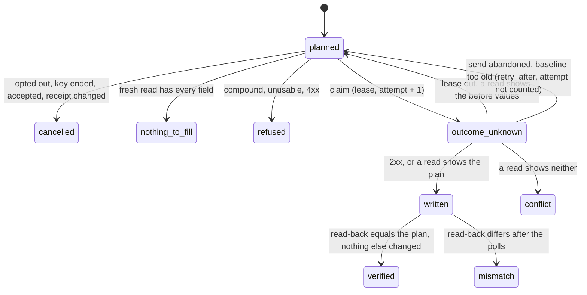

# Fill the fields an existing Immich asset lacks

Design for [#574](https://github.com/AnthonyPluth/Darkroom/issues/574), part of the Immich-managed storage epic [#530](https://github.com/AnthonyPluth/Darkroom/issues/530), prepared 2026-11-24. **Draft, rewritten on 2026-11-24 for the owner's decisions on #574 (comments 7134385591, 7134442957 and 7134540874): one Immich key per person with all permissions and no separate enrichment key. Waiting on the owner's approval, on a security-minded review of sections 5 and 6, and on the few items still open in section 18. No code follows until the owner approves it, the live-spike rows of section 16 have run on a disposable user, and the review gates pass.** It builds on [immich-managed-storage.md](immich-managed-storage.md) (sections 2, 3, 5, 6 and 8), [terminal-holds.md](terminal-holds.md), [per-person-switch.md](per-person-switch.md) and [recovery-point-gate.md](recovery-point-gate.md). Nothing here is reachable today: `people.managed_imports` and `people.managed_backfill` are set only by tests, so no managed receipt exists outside tests.

## 0. The owner's decision, and what this settles

On 2026-11-24 the owner first decided on [#548](https://github.com/AnthonyPluth/Darkroom/issues/548#issuecomment-7121490970) that Darkroom never changes an asset already in Immich, then reversed it the same day ([comment](https://github.com/AnthonyPluth/Darkroom/issues/548#issuecomment-7132386267)): enrichment comes back, in this shape.

- It fills only fields the existing asset lacks and never overwrites a present value.
- It uses no separate key. Each person keeps the one Immich API key Darkroom already holds, and for a person who opts in it carries all permissions (the owner's decision on #574, 2026-11-24, replacing the first draft's separate key). Immich then limits nothing, so Darkroom's own code limits what is sent (section 5).
- It is opt-in per person, by any signed-in member, with one switch for every field.
- Every change leaves a before and after receipt. A separate read-back after the write, with the same key, must show the intended values and that nothing else changed before the photo is marked safe.
- Nothing is built, and the managed key checks keep refusing `asset.update` and `all`, until the design is approved, the live-spike enrichment rows have run on a disposable user and the review gates pass. `not_enriched` holds keep working as designed in the meantime.

The reason it matters: a Takeout photo that is a byte-duplicate of an Immich asset (the usual case for a phone photo) cannot carry Google's date, offset, place or description to Immich, because a sidecar only takes effect with a first upload (confirmed on v3.4.1). Those photos end as `not_enriched` holds and their zips stay pinned ([#545](https://github.com/AnthonyPluth/Darkroom/issues/545)). This document settles the field list's mechanics, the key, the API path and its evidence, the opt-in, the receipt and journal, the recovery-point change, the checks and the slicing. The owner's answers of 2026-11-24 to the open questions are closed in section 18, which lists what is still open; where the answers left a gap, this design states a proposal and marks it open instead of deciding.

**The owner's words these rest on.** They are recorded on #574, and slice 0 puts them in `docs/DECISIONS.md` marked "nothing is built until the design is approved". Quoted as recorded there:

- Comment 7134442957, 2026-11-24: "there is no separate enrichment key. Each person keeps the one Immich API key Darkroom already holds for them, and that key carries every permission Darkroom needs, including `asset.update`."
- Comment 7134540874: "**Key scope:** the single per-person key carries all permissions (the owner's choice; Darkroom cannot check the permission set exactly, so the design must say what it checks instead)." The same comment: "**Q9 Google value differs from a present one:** keep the hold."
- Comment 7134385591 on the key page: "**Q7 where the key is entered:** a page in the app. The owner states no design sign-off is needed for it (a waiver of AGENTS.md promise 6 for this page, recorded here). The command line stays as well."
- Comment 7135686330: "**O2:** the design-sign-off waiver covers the opt-in switch on the key page too." "**O7:** any signed-in member may enter another person's key (bound to that person by whoami)." "**O1:** accepted. Erasing the one key (opt-out, sign-in ending) also stops that person's imports, backfill and Pixel source until a key is entered again." "**O3 and S1:** the key does not expire. This reverses the earlier 90-day `expires_at` (S1): the key is sealed until it is removed, and ends only with sign-in (or opt-out)."

The single key replaces promise 2's clause that the scheduled job's reader accepts only exactly the approved read or import grants (the owner's decision of 2026-11-23 on #535); that is a change to a recorded owner decision, made by the owner in the first quotation above, and it takes effect only when slice 0 and slice 2 land after approval.

## 1. Where things stand

| Where | What it does today |
| --- | --- |
| `darkroom/providers/immich.py`, `MANAGED_GRANTS` | `ManagedReader` accepts exactly the read set, the import set (read plus `asset.upload`) or either of them (`read_or_import`). `asset.update`, `asset.delete`, `all` and any extra grant are refused on every path, before any asset is read |
| `require_allowed_request` | A fixed allowlist: reads, the metadata search (POST, a read), the two import routes only for a call that says it imports, and the library scan. No `PUT`, `PATCH` or `DELETE` of an asset is on it. `tests/test_immich_managed.py` holds that |
| `darkroom/domain/managed_metadata.py` | `intend` works out the date, offset, place and description Immich must show, with provenance, and `verify_metadata` marks a duplicate whose sidecar had something to add `not_enriched` (`REASONS` says only an approved enrichment path may add it). `managed_ingest.TERMINAL` makes it terminal: not polled again, a held alert, the zip pinned |
| `tools/spikes/immich_live.py` | Its `enrich` row is `not run`: the harness refuses any key with `asset.update` |
| Key storage | The person's key is `people.immich_api_key_sealed`, sealed with `storage.secretbox` and the service secret key (`DARKROOM_SECRET_KEY` or the `secret-key` file). `storage/secret_key.py`'s `SEALED_COLUMNS` lists every sealed column so a missing key is never silently replaced |
| Sign-in | `oidc.access_lapsed` and `oidc.recheck_due` end a browser session when its user is no longer allowed. `access_lapsed` also returns `sign_in_lapsed` after 30 days (`NO_RECHECK_DAYS`) without a sign-in, but only for a user who is admitted by group and not by a verified address on `OIDC_ALLOWED_EMAILS`: a user admitted by email never lapses with time (`tests/test_oidc.py` asserts None at 80 days). People and sign-in users are joined by verified email (`people.person_for`) |

Three kinds of existing asset can lack a field. This design starts with (a), the duplicate answer to an upload (a receipt in `not_enriched`; an Import, a Keep both from review and a Backfill all produce one). It adds (b), the keeper of an automatic tier 1 match in a managed export, which has no receipt, and (c), tier 2 and 3 keepers, in slice 7: the owner decided (Q6) to enrich them, reading "the file lacks it" from the keeper's own bytes, since they differ from the Takeout copy's (section 4).

## 2. Principles

1. **A present value is never overwritten, by any path.** "Present" is judged on Immich's own fresh answer immediately before the write, not on a plan made earlier, and a field the owner or the person typed in Immich counts as present. The owner confirmed this on 2026-11-24 (Q9, reversing an earlier "let Google's date win"): no path lets Google's value replace a present one.
2. **No offset is invented.** The offset comes from the file, from Google's instant together with the place Immich will show, or from the owner. A photo whose capture time has none stays an `unknown_offset` hold. Enrichment never sends a date without its offset and never lets Immich pick one.
3. **One key, one write route, one caller.** There is one key per person, and it carries all permissions, so Immich limits nothing. Darkroom's code does: the request allowlist has one changing route besides the two import routes, `PUT /api/assets/<id>`, reachable only with `enriching=True` and sent from one function (sections 3.3, 5.2 and 14).
4. **The write is judged by a separate read.** The same key reads and writes, so the key gives no independence; the code path does. After the write, a separate request (never the PUT's answer) must show the intended values and that nothing else changed before the photo counts as safe: first the enrichment job's own read-back, then the import tick's verifying read, made through a reader with no write method, which alone commits the receipt (section 10).
5. **Nothing is ever written back from a snapshot.** The before snapshot is audit evidence. No code path sends a value read from Immich, and no undo restores one (section 11).
6. **Nothing is deleted, replaced or moved.** Immich's bytes, checksum, owner, library, visibility, albums, favorites and ratings are never touched, and no resolution deletes an inbox copy, a hold, a zip or a receipt.
7. **Immich's filesystem is never written by Darkroom.** Darkroom sends API requests only. What Immich does itself afterwards is in section 3.1 (it writes an `.xmp` beside the original in its own storage, as it does for an edit in its web app).
8. **It ends with its owner.** The key stops working in Darkroom when its person can no longer sign in, or when the person opts out, and its stored secret is erased. It has no expiry (the owner's decision, 2026-11-24) (section 5.4).
9. **Fail closed.** Any check that cannot be made (Immich unreachable, grants unreadable, sign-in state unknown) writes nothing and leaves the row pending.

## 3. The API path and its evidence

Evidence has the three levels of the managed-storage design: **pinned source** (read in this design at tags `v3.3.6` and `v3.4.1` of [immich-app/immich](https://github.com/immich-app/immich), each file's blob SHA below), **prior live observation** (none exists for any update; the 2026-11-17 spike ran with no `asset.update` key), and **unverified on a live server** (everything that depends on a running server; each has a row in section 16).

### 3.1 What the pinned sources show

| Question | Finding, the same on both tags unless said | Level |
| --- | --- | --- |
| The route | `PUT /api/assets/{id}` (`updateAsset`) in `asset.controller.ts`, `@Authenticated({ permission: Permission.AssetUpdate })`, body `UpdateAssetDto`, answers 200 with the `AssetResponseDto` after the change (`AssetService.update` returns `this.get(auth, id)`). An unlisted twin `PATCH /api/assets/{id}` (`@ApiExcludeEndpoint`) calls the same service method. In the OpenAPI, v3.3.6 marks `PUT /assets/{id}` `deprecated` (history `.deprecated('v3', { replacementId: 'updateAsset' })`) and v3.4.1 does not (history `.v3PatchMigration()`); the operation, body schema and permission are the same | Source |
| The body | `UpdateAssetDto` (blob `bcdb1937235d938cee62a0032d35d65f9d312f05` on both tags), every field optional: `isFavorite`, `visibility`, `dateTimeOriginal` (string), `latitude` and `longitude` (numbers, -90..90 and -180..180, refused unless both are sent), `rating`, `description` (string), `livePhotoVideoId`. There is no null for `dateTimeOriginal`, `latitude` or `longitude` | Source |
| It overwrites, unconditionally | `AssetService.updateExif` calls `assetRepository.upsertExif({ exif: updateLockedColumns({ assetId, ...writes }), lockedPropertiesBehavior: 'append' })` for every key sent. There is no precondition: no `If-Match`, no `updatedAt` or value check. Whether a field was empty is decided only by the caller, so "fill only if missing" is a read followed by a write with a window between them (section 11) | Source |
| What a date write stores | `dateTimeOriginal` is written as sent, and `timeZone` as `extractTimeZone(dateTimeOriginal)?.name`, which is set only when the string carries a fixed offset (`+02:00` gives a zone named `UTC+2`; a string with no offset gives no zone). The single-asset route has no `timeZone` field | Source |
| What it does not update | `asset.localDateTime` and `asset.fileCreatedAt` are set only in `MetadataService` extraction (`getDates`, then `assetRepository.update`), not in `update` or `updateAll`. `exifInfo.city`, `country` and `state` come from extraction's reverse geocoding. So after an update `exifInfo.dateTimeOriginal` changes at once but the timeline position and the capture-time search (`filter.takenAt`, which compares `fileCreatedAt`) may not move until Immich extracts again | Source; live effect unverified (E4, E5, E15) |
| Side effect Immich performs | Each update queues a `SidecarWrite` job. `MetadataService.handleSidecarWrite` writes the changed description, date, place and rating with exiftool into the asset's sidecar (`<originalPath>.xmp`, or the registered sidecar), records it as the asset's sidecar file when none was registered, then unlocks the properties it locked. The original's bytes and checksum are not touched. The handler is identical on both tags | Source; unverified (E8) |
| A date with no real source | When a file has no capture tag, extraction stores the earliest of the upload's `fileCreatedAt` and the file's times as `dateTimeOriginal` and leaves `timeZone` null (`getDates`). So `exifInfo.dateTimeOriginal != null` does not mean Immich knows when the photo was taken | Source |
| Who may update | `Permission.AssetUpdate` is checked by `access.asset.checkOwnerAccess(auth.user.id, ids, auth.session?.hasElevatedPermission)`: the caller must own the asset, and an asset in the locked folder is excluded unless the session is elevated (an API key has no session). Another user's or a partner-shared asset answers `400 Not found or no asset.update access`. A trashed asset is not excluded | Source; unverified (E11 to E13) |
| What else the permission opens | In the OpenAPI, `asset.update` also gates `PUT /assets` (bulk update, with `ids`, `visibility`, `isFavorite`, `dateTimeRelative`, `timeZone`, `duplicateId`), `PUT /assets/metadata`, `DELETE /assets/metadata`, `PUT /assets/{id}/metadata` and `DELETE /assets/{id}/metadata/{key}`. Its twin `PATCH /assets` is unlisted. `visibility: locked` removes the assets from every album (`albumRepository.removeAssetsFromAll`) | Source |
| API keys | `ApiKeyCreateDto` has `name` and `permissions` only: **a key has no expiry**. A key is checked by `isGranted` against the route's permission (`403 Missing required permission: ...`). `GET /api/api-keys/me` needs no permission and lists the current key's grants. What it lists for an `all` key, and that `all` satisfies every route's permission, are not read here (the managed-storage design refuses `all` today) | Source; unverified for `all` (E1, E10) |
| A duplicate upload does not enrich | Confirmed live on v3.4.1: a duplicate with a new sidecar leaves the existing asset unchanged | Live |

Pinned files and blobs, v3.3.6 / v3.4.1 (commits `587f549f46f1cd1822a06e16dcccecef04ea4565` / `22b95194c80a2f2e6201093916b6c8c3d6d271dd`): `server/src/controllers/asset.controller.ts` `5816de020c75089c58e3ab522eb9f243299a3e47` / `9e670a6d6fb684cb8f10c941c74feda9c070fef9` (only the route's `history` differs); `server/src/services/asset.service.ts` `df0ede47ff159a093d93e6c326616fb9c0d5f549` / `e53d20f64788619a0fd2ff4d0c95d93f0315e717` (`update` differs only by v3.4.1's added `requireAccess` on `livePhotoVideoId`; `updateAll` and `updateExif` are identical); `server/src/repositories/asset.repository.ts` `6c24e7e13a63d10ca93de21f7555f5da79b8118c` / `6bf649b5c5a7f1a446a7ecad42729c70f4fdf71e` (`upsertExif`, `updateAllExif`, `updateDateTimeOriginal`, `unlockProperties` byte-identical); `server/src/services/metadata.service.ts` `e1c1bee16ef3c5779d424a283491b43156141e75` / `1e968eda86b78ed8f1f61c518109d83d99df3d03` (`handleSidecarWrite` and `getDates` identical in the parts used); `server/src/utils/access.ts` `0666f2d671ab4d902e4b0405ad31b5ad6e7c6885` / `9cbcc97401504359e3944af4221cfd32b43ca2d3` and `server/src/repositories/access.repository.ts` `6e9a3c2b3efae94465f775d9c80e8f5a1565a265` / `e23fea79047e9717b6bf21751327778a6e6f2cc8` (the `AssetUpdate` case and `checkOwnerAccess` identical); `server/src/dtos/asset.dto.ts` `bcdb1937235d938cee62a0032d35d65f9d312f05` (both); `server/src/validation.ts` `38a6052116171c0bd368f3ea7e8cf32365f1dba4` / `221c986cc076b1216887deecd4cbfc170549f48f`; `server/src/utils/date.ts` `0116055803df259b956e49ecea43377d99f4cebe` / `d978cd4e6340947e82df109cfb41199c6f56b9cc`; the OpenAPI `2468a3a173adb4ab1fa9ea7e02e3f2e8446dff62` / `5a07e2c4b8958b883f17389c2603087abf99127e` (`info.version` 3.3.6 / 3.4.1). The v3.4.1 blobs of the controller, service, `access.ts`, repository, metadata service and OpenAPI, and v3.3.6's repository, metadata service and OpenAPI, match those already pinned in the managed-storage design; the rest were read here for the first time. Each file was fetched at its tag and its blob hash computed with `git hash-object`.

### 3.2 The call

One request, per asset, with only the fields that are missing (section 4):

`PUT /api/assets/{id}` with the person's key, body any of `{"description": "..."}`, `{"latitude": 12.3456789, "longitude": 98.7654321}` (always both) and `{"dateTimeOriginal": "2019-07-04T12:30:15+02:00"}` (always with its offset). Never `isFavorite`, `visibility`, `rating`, `livePhotoVideoId`, a `null`, or an empty body. Success is a 200 whose body is parsed only as a hint; the read-back is a separate `GET /api/assets/{id}` (section 10).

It is `PUT` because the route is in the OpenAPI of both tags with the same body and permission (v3.3.6 marks it deprecated; v3.4.1 does not), and the `PATCH` twin is not documented. Only the version with a live pass is enabled (`ENRICH_VERSIONS`, section 5.1), and a version that removes the route or changes its body is refused by that list, as every other version is.

### 3.3 Routes not used

| Route | Why not |
| --- | --- |
| `PUT /api/assets` (bulk) | Takes `ids`, `visibility`, `isFavorite`, `dateTimeRelative`, `duplicateId`: a wider body than one asset needs. Its `timeZone` field would let a bug name a zone, which principle 2 forbids |
| `PATCH` on either route | Not in the OpenAPI of either tag |
| `PUT /api/assets/{id}/metadata`, `/assets/metadata` | Key-value metadata (the phone-origin marker Darkroom reads is one), not the EXIF fields |
| `PUT /api/assets/copy` (`asset.copy`) | Copies metadata between two assets: it needs a second asset's authority and gives the wrong provenance |
| A second upload with a sidecar | Confirmed not to change an existing asset |
| `POST /api/assets/jobs` (re-extract) | Not on the allowlist, which is all that stops it now that the key holds every permission. It would also let Immich overwrite a value from the file |

## 4. What is eligible, and what "missing" means

**Eligible fields:** description, place, capture time (date and offset). One switch covers all of them (the owner's decision Q2: no choice per field or source). The mechanism is the same for each: a field is written only when it is in the receipt's plan **and** missing on the fresh read.

The plan is not worked out again from Google at enrichment time. `managed_metadata.intend` already works out the date, offset, place and description with the existing missing-field mapping (`xmp.gaps`, under the Takeout-copy rules). Its snapshot (`expected_metadata`, schema 1) records what the sidecar carries but not which sidecar fields fill a gap and which replace a present value on a first upload (Google's correction wins there, the owner's decision of 2026-11-18 on [#438](https://github.com/AnthonyPluth/Darkroom/issues/438)). So the snapshot gains schema 2 and a key `fills`: the field names `xmp.gaps(..., corrects=False)` returns (`fill_fields` already takes that parameter). That key set is not enough for capture time: with corrections off, `xmp.date_kind` returns None whenever the file has a date (`has_date`), so `xmp.gaps` never returns a date field for a file whose wall clock lacks only its offset (C2), and `fills` taken from it alone would leave that case unplannable. So `fills` also carries an explicit **offset-only fill**, the pseudo-field `offset`, which `intend` records when its capture time has `taken_from == "sidecar_offset"` (the file has a wall clock and no offset, and Google's instant together with the place Immich will show agree on one, `taken_of`'s third branch). Its plan value is the wall clock and the offset in minutes, taken from `intend`'s `taken_utc` and `offset`, never worked out again. A `taken_from` of `media` or `sidecar` adds nothing for C2: `media` is a present, complete date (C3), and `sidecar` is C1 or a correction, which `gaps` already decides. No `sidecar_offset` means no `offset` fill, so an unknown offset stays an `unknown_offset` hold. Nothing outside tests holds a managed receipt, so no schema 1 row needs converting; a schema 1 snapshot is read as "no plan" and gets none.

**What ships first (the owner's decision Q4).** The job sends only the fields in `ENRICH_FIELDS`, a constant that starts as `{description}`. Place and capture time (C1 and C2) are added only after the owner records on #266 that the live spikes E3, E4, E5, E8 and E16 ran and what they showed, each addition its own pull request. A field outside `ENRICH_FIELDS` is not in the plan at all: nothing is sent for it and the hold stays for it (the mixed-fill rule of section 10, step 10). Because the plan, and so its `plan_key`, covers only the enabled fields, adding place later makes a new plan for a receipt that description alone left held, and it is filled then; nothing stays held for good because it was verified under an earlier subset. The `fills` snapshot, the `offset` plan and the planner are built and tested before then, so adding a field changes a constant and its tests, not the design. Until then a photo whose only gap is a date or a place stays a `not_enriched` hold with its zip pinned, as it does today.

| Field | Missing means (all must hold) | What is sent | Never |
| --- | --- | --- | --- |
| Description | In `fills`; the fresh `exifInfo.description` is null or only whitespace (`managed_metadata.normalized` gives None) | `description` | A text over a present one, including a different text the person typed in Immich; a description XML cannot carry (`xmp.xml_char`), which Immich's sidecar writer would have to write: it is skipped and recorded `unwritable` |
| Place | In `fills`; fresh `latitude` and `longitude` are both null, or both 0 (Immich treats 0,0 as no place, as `same_place` does) | `latitude` and `longitude`, both | One without the other; a place over a present one; Google's place when it only differs from a present one |
| Capture time, no date (C1, a fill: the owner's decision Q11) | In `fills`; the file has no capture tag (so the fresh `dateTimeOriginal` is Immich's file-time fallback, source `getDates`), fresh `timeZone` is null, `intend` has no pre-upload hold, **and the date is shown to be the unedited fallback**: the fresh `exifInfo.dateTimeOriginal` equals the asset's `fileCreatedAt` within 1 s. Extraction sets both from the same value, while an update through the API changes `exifInfo` and not `fileCreatedAt` (section 3.1), so a date someone entered since (an offsetless API edit also leaves `timeZone` null) differs from it. When they differ, the case is `ambiguous_date` and refused: nothing is sent and the hold stays. If E4 shows the equality does not hold on a fresh fallback, C1 is not enriched at all | `dateTimeOriginal` as an ISO string with the offset `intend` chose | Any date when `intend` raised `unknown_offset` or `no_instant`: the hold stays, and nothing is sent |
| Capture time, no offset (C2) | `offset` is in `fills` (the offset-only fill above, from `sidecar_offset` provenance, not from `xmp.gaps`); the file's own capture tag has a wall clock and no offset, fresh `timeZone` is null, and the fresh wall clock (`dateTimeOriginal` read as UTC) equals `intend`'s wall clock at its offset | `dateTimeOriginal` with the same wall clock and the offset. The stored instant moves by the offset; the wall clock does not. A fill, by the owner's decision (Q3) | A wall clock that differs from the one Immich shows; an offset that `intend` marked unknown |
| Capture time, both present (C3) | Never missing | Nothing | A date or zone over a present one, including Google's corrected date |

Never eligible, whatever the plan: rating, favorite, visibility and albums, tags and people, stacks, `livePhotoVideoId`, city, country and state (Immich's own). Out of scope here because another design owns them: Live Photo halves ([live-photo-compounds.md](live-photo-compounds.md), #553) and a still with `livePhotoVideoId` or a hidden video are refused as `compound`; the backfill's exceptions for same-shot pairs and edited copies (#554) stay with that design, but a keeper of an automatic tier 2 or 3 decision is enriched (below, Q6). An asset that is trashed, offline, external, another owner's, in another checksum, or not found is refused by the same custody test every managed read uses, never enriched and never restored.

**Tier 2 and 3 keepers (the owner's decision Q6).** A keeper of an automatic tier 2 or 3 match has other bytes than the Takeout copy, so "the file lacks it" is read from the keeper's own bytes: slice 7 reads the keeper's original through the person's key (the existing unedited read, SHA-1 checked against the version), runs exiftool on it, and its `fills` is what the sidecar has and those bytes lack, with the same fresh-read test against Immich. Which of the keeper's tags decides each field is slice 7's table, written with its tests, and a tier 2 or 3 keeper is not planned before it exists. A keeper whose bytes no longer match the version the decision used is refused by the custody test (proposal, open: O5).

A field Google corrected, or one that differs from Google's, is not filled and does not change. Such a photo stays a `not_enriched` hold with its facts, and the owner resolves it as [terminal-holds.md](terminal-holds.md) section 3 says. That is the owner's rule, not a gap in the design: "never overwrite a present value" and #438's "Google's corrected value wins" apply at different times (the latter on a first upload and in sidecars). The owner confirmed it on 2026-11-24 (Q9) after first answering "let Google's date win": the hold stays until the owner accepts.

## 5. The key

### 5.1 One key, all permissions, and what Darkroom checks

There is no separate enrichment key. Each person has the one Immich API key Darkroom already holds for them (`people.immich_api_key_sealed`), and for a person who opts in that key carries all permissions (Immich's `all`, which includes `asset.update`). That is the owner's decision of 2026-11-24 (#574, comment 7134442957, "all permissions" in comment 7134540874); it replaces the first draft's second key with exactly four grants, its own table and its own reader secret. Two forms of the one key exist:

- **`scoped`:** what Darkroom accepts today, unchanged: exactly the read set, the import set or either (`MANAGED_GRANTS`). `asset.update`, `asset.delete`, `all` and any extra grant are refused as now. A person who has not opted in keeps this form, and a scoped key can never enrich.
- **`all`:** a key whose grants list is `all`. It is accepted only for a person who is opted in (5.3 holds the two together), and then it is the key for everything Darkroom does with Immich for that person: reads, imports, the backfill, the Pixel source and enrichment.

`all` stands for every other grant, so **Darkroom cannot read an exact permission set off the key, cannot see that a permission is absent, and does not try to** (the owner's wording: it cannot check an exact set). It checks these instead, on every operation of a job: `check_access()` runs at the start of each operation and again inside `fill`, after the claim.

1. **Who the key is (whoami).** `GET /api/users/me` answers an `id` that equals the person's `immich_user_id` (a canonical ID) and the `owner_id` recorded when the key was entered, and `isAdmin` is present and `false`. An admin's key is refused, whatever its form: the key's user must be a non-admin user who owns the assets it works on.
2. **The version.** `GET /api/server/about` answers a version in `ENRICH_VERSIONS`, which starts as `{"v3.4.1"}`: the live spike ran on v3.4.1 only, and v3.3.6 has source evidence alone (section 16). The existing managed version list keeps governing a person's reads and imports; enrichment needs both.
3. **The form.** `GET /api/api-keys/me` lists `all` (for the `all` form) or exactly a scoped set (for the scoped form, as today). What Immich lists for an `all` key is not read in this design: E1 records it, and the check is written to the recorded answer, not to a guess.
4. **Asset ownership, on every asset.** Each asset is read first and must be that person's own managed asset: owner equal to the key's user, `libraryId: null`, not trashed or offline, the version's checksum. A key that holds every permission still never finds an asset by name or path, and an asset of another owner is refused by the same custody test every managed read uses.
5. **The request allowlist, in code (5.2).** The one limit that does not depend on the key.

What it cannot check: that the key lacks a permission, that it exists nowhere else, or that it has not been revoked since the last request. The honest effect is in section 6: Darkroom's restraint is code, not the key.

### 5.2 Why the limit is now the code, and how the code holds it

Before this decision the person's key could not update or delete in Immich, so a bug in Darkroom could not either. With `all`, Immich refuses nothing, and promise 2's "Darkroom deletes no Immich asset" and promise 5's "never rewrites media" rest on Darkroom's own code (the owner's choice of S2: a code boundary plus checks, in one process).

- **The allowlist.** `require_allowed_request` stays a fixed list: the reads, the metadata search (a POST that reads), the two import routes only for a call that says it imports, the library scan, and one new entry, `("PUT", "/api/assets/<canonical uuid>")`, only for a call that says `enriching=True`. No `DELETE` verb is on it at all, no `PATCH`, no bulk update, no trash, restore, download of an original outside the existing unedited read, no API-key or shared-link route, and no job route.
- **The grant policy.** `MANAGED_GRANTS` keeps refusing everything it refuses today for the scoped form. For a person in the `all` form it accepts a key whose list is `all` (nothing else on that list can be told apart from it).
- **Two readers over one key.** `immich.ManagedReader` (reads, imports, backfill, Pixel source) accepts either form but has no method that can send a changing request other than the two import routes, and never passes `enriching`. `immich.EnrichReader`, in the same provider module (`providers-alone` is unchanged), is built only by `managed_enrich` from the person's own unsealed key. `EnrichReader.fill(asset_id, body, sending)` is the only method that sends the update route, after `check_access()` in the same method. `Client.call` and `Client.open` take a keyword `enriching`, as they take `importing`.
- **One caller.** Only `darkroom/domain/managed_enrich.py` constructs an `EnrichReader` or calls `fill`, and only `managed_enrich.send` calls `fill`. Section 14's Semgrep rules and tests enforce that, and that the provider holds no `DELETE` verb.
- **What this does not stop.** A flaw that runs code in the app holds the unsealed key and can send any request the key allows, as it can with every other sealed secret in the one process. The checks catch Darkroom's own mistakes, not a compromised process (section 6).

### 5.3 Storage, form, expiry and binding

No new table and no new sealed column. The key is `people.immich_api_key_sealed`, already sealed with `storage.secretbox` and the service secret key and listed in `SEALED_COLUMNS`, so a missing secret key is refused while one is stored. `check-config` says whether a key is set and which form, never the key. `people` responses, events, alerts, logs and error bodies carry at most `has_immich_key` and the form.

`people` gains nullable columns, with their exact names fixed in slice 3: the key's form (`scoped` or `all`), `set_at`, `verified_at` (the last passing `check_access`), `ended_at` and `ended_reason` (`removed`, `opted_out`, `sign_in_ended`, `owner_changed`, `refused`, `key_unreadable`). Checks (written for SQLite and PostgreSQL): the `all` form holds only while `people.managed_enrichment` is `on` or `paused`, and then the sealed value is present; an ended key holds no sealed value.

- **No expiry (S1, reversed by the owner on 2026-11-24).** The first draft proposed a 90-day `expires_at`; the owner decided the key does not expire. There is no `expires_at` column, no `expired` end and no expiry alert. The key is sealed until it is removed and ends only with the person's sign-in (5.4) or opt-out. Immich gives the key no expiry either (section 3.1), so nothing but those ends and the person's own revocation in Immich bounds its life.
- **Binding.** The entry checks (5.5) require whoami's `id` to equal `people.immich_user_id`. Every use compares it again to the stored `owner_id` and the person's current `immich_user_id`; a mismatch ends the key (`owner_changed`). `people.update` changing `immich_user_id` ends the `all` form in the same transaction.

### 5.4 How it ends

The AGENTS.md rule: a key must end when its owner can no longer sign in, like browser sessions do. The person's key in the `all` form is the widest credential Darkroom holds, so it follows the rule and also has an expiry. Here:

- **The predicate.** `enrich_gate.may_enrich(opened, settings, person, now)` is true only when sign-in is configured, the person's verified email matches exactly one `users` row, and `oidc.access_lapsed(opened, settings, user.sub, user.email, now)` is None for it. That is: the user is still allowed (`oidc.still_allowed`), and, for a user admitted by group only, has signed in within `NO_RECHECK_DAYS`; a user whose verified address is on `OIDC_ALLOWED_EMAILS` does not lapse with elapsed time at all (`access_lapsed` computes `by_email` and returns `sign_in_lapsed` only `if not by_email`). **What that means for the key:** for an email-admitted person the sign-in rule alone ends the key only on opt-out, removal, the address being taken off the list or another end in the list below, never by elapsed time. **For an email-admitted person there is no time limit at all:** the key stays active in Darkroom for as long as the person's address is on the list and nobody removes the key or turns enrichment off, however long ago they last signed in. The owner chose this on 2026-11-24 (S1 and O3, reversing the 90-day `expires_at`). For a group-admitted person it also ends after 30 days without a sign-in. Sign-in not configured is the same as a person with no matching user: enrichment is refused and the key is not kept (S5). It reads the database only, so a provider outage does not end a key (as it does not end a session). **A stored user is not enough on its own, because the provider's refusal does not change it.** `oidc.recheck_session` handles `ProviderRefused` (the provider rejects the stored refresh token, as it does for a disabled account) by deleting that browser session only, and leaves the `users` row untouched, so `access_lapsed` keeps returning None for an email-admitted user whose upstream account was disabled. So the gate also consumes a persisted signal: `users.access_ended_at` (nullable float, in the slice 3 migration). `recheck_session` sets it in the same transaction on `NotAllowed` and on **every** `ProviderRefused`, whatever other sessions exist: a session can have no sealed refresh token (the provider gave none, or the seal was unreadable) or be capped at 30 days, and `recheck_due` never rechecks such a session (it selects only sealed ones), so counting a remaining session would let a refusal be swallowed and the key outlive the person. The signal is cleared only by a successful sign-in or a successful refresh (`remember_user`). In `recheck_session` `remember_user` runs before `authorize`, so the order is fixed: clear on the refreshed identity, then set on `NotAllowed`. **That signal alone can lose a refusal.** `recheck_due` goes through due sessions one after another in one pass: a refused session sets `access_ended_at`, and a healthy session of the same user processed later in the pass runs `remember_user` and clears it before the enrichment tick reads it, so the key would survive. So a refusal also writes a **key-revocation marker kept apart from current sign-in eligibility**: `users.access_refused_at` (nullable float, same migration), set in the same transaction as the refusal (`NotAllowed` or `ProviderRefused`, whatever other sessions exist) and **never cleared by `remember_user` or any sign-in**. A key is revoked when its `set_at` is not later than `access_refused_at`: `may_enrich` is false and the gate erases the key (5.4), whichever order the sessions were processed in and however many healthy sessions follow. The marker is consumed by being older than a key: a key entered after the refusal (5.5, which needs `access_ended_at` clear, so a successful sign-in) has a later `set_at` and is not revoked by it. `access_ended_at` keeps meaning "the user is not eligible now" and still blocks entering a key and enrichment while set. The cost is that one refused device ends the key even if another device is fine; and fail-closed is the rule (principle 9). Now that an end erases the person's only Immich key, the cost is larger: one refused device, or a provider-wide 4xx, stops that person's reconcile, imports and Pixel source until someone enters a key again (5.5), and the alert says so. `may_enrich` is false while the signal is set. A later successful sign-in clears the signal and nothing else: the key is not revived, `immich_api_key_sealed` stays NULL, and the key must be entered again.
- **When it is evaluated: independent of `DARKROOM_MANAGED_ENRICH`.** The all-permission key is used by the reconcile, imports, backfill and the Pixel source as well as by enrichment, so its ending cannot live in the enrichment job, which `DARKROOM_MANAGED_ENRICH` can remove after someone has opted in. Two things hold it. (1) **A key sweep**, `enrich_gate.sweep_keys`, its own scheduled job on the reconcile's cadence, runs whether or not the enrichment flag is on: for every person in the `all` form it evaluates `may_enrich`'s sign-in test and the revocation marker (`access_refused_at` against the key's `set_at`) and ends the key (below). (2) **A gate on every consumer:** a key in the `all` form is unsealed only through `enrich_gate.usable_key(opened, settings, person, now)`, which runs the same test first and ends the key and refuses instead of returning it, so `ManagedReader` for the reconcile, imports, backfill and the Pixel source gets no `all`-form key from a person whose sign-in ended, and a tick that began before the sweep cannot use it. Enrichment also evaluates it at the start of every tick and again under the write lock in the claim of every attempt, before a request is sent. With enrichment disabled, an upstream refusal or an admission removal therefore still ends the key at the next sweep or at its next use, whichever comes first.
- **What happens when it is false.** The key is ended, not merely skipped: in the same transaction `people.immich_api_key_sealed` is set to NULL, the form is cleared, `ended_at` and `ended_reason` (`sign_in_ended`) are set, every `planned` row of the person becomes `cancelled`, and `people.managed_enrichment` is cleared. **With the one key gone nothing can read Immich for that person**, so their Immich reconcile (`immich_reconcile.reconcile_all` selects only people with a sealed key, so it would drop them without a word), imports, backfill and Pixel source stop (O1). The stop is never silent: the same transaction opens the alert above, and `reconcile_all` records a person with an Immich user and no key as stopped for no key (a fixed event with the person's id, once per tick, not a skip) instead of dropping them. These ends are routine and many leave nothing pending: a person's opt-out, a single refused device, or one provider 4xx after a client-secret rotation (`REFUSED_STATUSES`) that ends every rechecked person at once, so each person gets their own alert. A row `outcome_unknown` (a request that may have gone out) stays as it is: the first thing the job does for any person who has a key again, whatever their opt-in state and whether the key is scoped or `all`, is reconcile those rows by a read through `ManagedReader` (reads only), before anything is planned or sent. That reconciling pass runs ahead of the opt-in gate of step 1 and is **terminal and read-only when enrichment is no longer authorized for the person** (not opted in, key ended, or only a scoped key): it never leaves a row in `planned`, `outcome_unknown` or `written`, because all three occupy the one-open-row index and no later tick would finish them; section 9's table closes every state of the row machine, and the pass selects all of them (`planned`, `outcome_unknown`, `written`, a `mismatch` still inside `SETTLE_SECONDS`, and a `verified` or matching `nothing_to_fill` row with an unhanded link). For an `outcome_unknown` row it reads the asset once through `ManagedReader` and closes the row: **the sent fields still equal the persisted `before_snapshot` (the request did not apply): `cancelled`**, with the attempt kept as audit, no resend; **the planned fields equal the plan (the request applied): `written`, then the same read-back checks as step 8 on that read (and on further reads, `POLLS` times 2 s apart, still read-only) end it `verified`, `mismatch` or `collateral`/`conflict`, and a `verified` row hands the receipt back (step 10) so the import tick verifies with the person's key and commits or re-holds**, with no opt-in required and no request that changes anything; **neither: `conflict`**, no resend. While the person is authorized the ordinary path of section 9 runs as before. An ended key comes back only by entering a key again (5.5), after the person can sign in.
- **Also ending it:** opting out (`enrichment off` or the page's switch: `opted_out`, the owner's decision Q8, which erases the stored key), `enrichment remove-key` (`removed`), an Immich refusal of the key (401, or a list that no longer shows `all`: `refused`), an unreadable seal (`key_unreadable`), a changed `immich_user_id` (`owner_changed`).
- **Check constraints** (5.3) keep the invariant: an ended key holds no sealed value, and the `all` form holds only for an opted-in person. There is no time-based end for an email-admitted person.
- **What Darkroom cannot do.** It does not revoke the key in Immich. An `all` key could in principle delete its own entry, but Darkroom sends no `DELETE` of anything and this design does not add one (O4). The sealed value is erased in Darkroom; the key stays valid in Immich until its person deletes it there, and a pinned API key has no expiry. The person is told this in the entry output, and every end opens the `enrich:key:<person id>` alert whatever rows are pending (section 8), so an `all` key that stays valid in Immich is never left without the instruction to revoke it. A restored Darkroom backup can bring back a key row that was active when the backup was taken; the gate re-evaluates sign-in at every use, but the only real end is revocation in Immich.

### 5.5 Entering the key: the command line and a page in the app

Two ways, the same function behind both (`enrich_gate.set_key`, which runs the checks of 5.1 against the key, then seals it, then writes the columns of 5.3 in one transaction). The owner's answer to Q7 is a page in the app as well as the command line.

- **The command line:** `python run.py enrichment set-key --person <slug>`, the key from standard input or an environment variable, never an argument. Its output says the stored copy ends with sign-in or opt-out and never by time, and that Darkroom cannot revoke the key in Immich (5.4).
- **The page.** The owner states no design sign-off is needed for it, a waiver of AGENTS.md promise 6 for this page, recorded on #574 (comment 7134385591) and put in `docs/DECISIONS.md` by slice 0. The waiver names the page; the owner confirmed on 2026-11-24 that it covers the opt-in switch on the key page too (O2). It does not cover the hold list's wording (Q10, section 7), which still needs the owner's sign-off. The browser path is designed so a key typed into it is exposed to as little as the command line's is:
  - **POST only,** to one route, `POST /api/people/<id>/immich-key`, with the key in a JSON body. The key is never in a URL, a query, a path or a header of the app's own, and no GET reads it back. The content type must be JSON, which a cross-site form cannot send.
  - **CSRF:** the route requires `auth.same_origin(request)` (the `Sec-Fetch-Site` and `Origin` check the app already has) in addition to the `SameSite=Lax` session cookie, and refuses a `null` or missing origin.
  - **Its own auth check:** the handler itself requires a signed-in session and re-checks that its user is still allowed (`oidc.still_allowed`); it does not rely on the router's default alone. A request with no session answers 401, found by `tests/test_every_route.py`. Any signed-in member may use it for any person (Q1, and the owner's O7 answer: a member may enter another person's key); the key must still be that person's own, because the check binds it to `immich_user_id` (5.3), so a member cannot attach someone else's key to a person.
  - **Never logged:** the handler logs nothing from the body, the logger's scrubbing (`monitoring.log`) is not relied on alone, validation and Immich errors answer with fixed texts that never echo the value, and the reply carries `has_immich_key`, the form and `expires_at` only. The response says `Cache-Control: no-store`.
  - **Sealed at once:** the plaintext lives in one local variable only for the checks of 5.1, is sealed with `storage.secretbox` as soon as they pass and before any other work, is never stored, cached, put in an exception message or attached to an event or an alert, and a failure erases nothing already stored (a failed entry leaves the old key as it was).
  - **Throttled:** failed attempts are counted per signed-in user and per person, with a short lockout; the numbers are slice 3's constants (a proposal, not an owner decision). The route verifies against the configured Immich address only, never a user-supplied one.
  - **In the frontend:** a password-type field with autocomplete off, the one `fetch` in `api.ts` through `apiCall<"POST /api/people/{id}/immich-key">`, the value held in no store, URL or `localStorage` and cleared after the request whatever the answer. `make api-contract` and `make feature-map` change in the slice that adds the route.
- **The existing person routes.** The create and update person routes already seal a key typed into the person form (`immich_api_key`) without calling Immich, and keep doing so for a person who is not opted in: they store it as the scoped form, with no check added, so saving a key while Immich is down or before the Immich user is linked works as today. For a person in the `all` form those routes refuse an `immich_api_key` change (a new scoped key, or `null`) with a fixed reason ("turn enrichment off first") and leave the stored key unchanged; they never opt the person out silently, and a key that lists `all` can reach the `all` form only through the page or the command.

### 5.6 What the other documents must say about the key

The comment of 2026-11-24 asks what AGENTS.md's wording about Darkroom's Immich keys needs to say. Slice 0 (after the owner approves this design) changes the sentences listed in the pull request description. The wording they get:

> A person's Immich key is the one key Darkroom holds for them, sealed with `secretbox`. For a person who has opted in to enrichment it carries all permissions (the owner's decision of 2026-11-24 on #574), so Immich limits nothing Darkroom does with it, and Darkroom cannot check an exact permission set. It checks, on every operation, that the key is the person's own non-admin user (whoami), that the server version is supported, that the key lists `all` or, for a person who has not opted in, exactly the approved read or import grants, and that each asset is that person's own managed asset; and its request allowlist in `providers/immich.py` allows no delete, trash, restore, bulk update or key route, and the update route only from `managed_enrich.send`. The key does not expire; it ends when its person can no longer sign in and when the person opts out.

That replaces promise 2's clause "the scheduled job's reader accepts the person's own non-admin key with exactly the approved read grants or exactly the approved import grants, and only reads" (the owner's decision of 2026-11-23 on #535, whose narrow key remains the form for a person who has not opted in), the managed-storage design's statements that no key holds `asset.update` or `all`, and `SECURITY.md`'s "What must hold" for the key.

## 6. What a leaked key can do

**The key is now the widest credential Darkroom holds, and Immich scopes it by nothing but the user.** With all permissions, for anyone who holds it and can reach the Immich address, the key can do what the person's own Immich account can do through the API, on the pinned versions. This design pinned and read only the routes it uses (section 3.1); the rest of this list is what `all` means by its name, not something verified here, and E1 and E10 record what Immich answers.

- **Read:** the metadata of every asset the person owns (exact places, descriptions, file names, people, tags), the search, and the originals and thumbnails themselves. The person's existing key already reads originals (the Pixel source needs it); the first draft's separate key did not.
- **Change, on every asset the person owns (never another user's, a partner-shared one, or one in the locked folder, which an API key cannot touch):** date, time zone, place, description, rating, favorite, visibility (including `locked`, which removes the assets from every album), a Live Photo's link, the duplicate-group ID and key-value metadata, including the `mobile-app` marker that Darkroom reads (`PHONE_KEY`) to tell a phone asset from another, so a leaked key could change what Darkroom treats as a phone origin and so its Pixel routing. `PUT /assets` does this for a whole list of IDs in one request.
- **Add and destroy:** upload; trash and delete, and empty the trash; edit; create albums and shared links (so a stranger could be shown photos by link); and, as far as `all` reaches, create and delete other API keys, so a leaked key may be able to mint a second one that outlives revoking the first.
- **Not possible with it:** another person's assets, the locked folder, anything an admin alone may do (the key's user must be a non-admin).
- **What it costs.** A silent, wide change or loss that can reach the originals themselves and not only their metadata, and exposure of the person's whole library. Immich keeps no history of a metadata edit. Recovery is Immich's own database and media backup (the recovery point of #545), the original's embedded EXIF and a fresh Takeout; none of them tells which assets were changed.

**What limits it, honestly:**

1. Immich: ownership only. The key cannot touch another user's assets or the locked folder.
2. The key's life in Darkroom: sealed at rest, never returned or logged, ended with its person's sign-in, and erased on opt-out (Q8). It has no expiry (S1, as the owner decided), so for an email-admitted person there is no time limit.
3. The key's use in Darkroom: the allowlist in code (5.2) and nothing else. Darkroom refuses any request off the list, including every delete, even though the key would allow it; writes only planned, still-missing fields, one asset at a time; and stops a person at the first `ENRICH_BREAKER` consecutive mismatches (section 13). There is no write budget: the owner decided none is needed (S3). `ENRICH_PER_TICK` paces a tick and is not a quota; unprocessed rows go on the next tick.
4. Exposure: the key travels only between Darkroom and the Immich address on the LAN, in a header, through `darkroom/tls.py`.

**What does not limit it:** Darkroom's checks bind Darkroom's own use of the key, not the key. Once the key leaves Darkroom (a stolen database backup with the secret key beside it in appdata, a process compromise, a log or screenshot, the person's Immich account page, the page's request in transit) none of the above is in the way, and until the person deletes it in Immich it stays valid (a pinned API key has no expiry). **This is a real loss against the first draft and against today:** the person's existing key holds exactly the read or import grants and cannot update, delete or trash anything, so today a bug in Darkroom could not either. The owner chose it for one key per person.

**Decided by the owner on 2026-11-24 and recorded here:** the key's form and lifetime (sealed until removed, no expiry: S1 as reversed); isolation (one process, a code boundary with Semgrep and tests: S2); no write budget (S3); the freshness deadline of 2 s (S4); and no enrichment when sign-in is not configured (S5). **Still worth a security-minded review before approval**, because this design makes the owner's choice safe only as far as code goes: the opt-in being open to any signed-in member (Q1) with a key entered by the page, the key never expiring for an email-admitted person, and whether ending a key should also revoke it in Immich (O4). A dedicated Immich user is not an option: the key's user must own the assets it updates.

## 7. Opt-in, the per-person switch and the holds

**Opt-in.** `people.managed_enrichment` (migration, section 8) is NULL (off), `on` or `paused`. It is a person-level opt-in with one switch for every field (the owner's decision Q2: no choice per field or source); which fields the job may send at first is `ENRICH_FIELDS` (section 4, Q4). **Any signed-in member may opt a person in** (Q1), by the page or the command. A person with no sign-in of their own is still refused, since their key could not end with their sign-in (5.4). Entering the key and turning the switch on are one step: the `all` form and `managed_enrichment` hold together (5.3). An opt-in records an `enrichment_opted_in` event with the member's user ID and the person, never the key.

It is independent of `people.managed_imports` and `people.managed_backfill`, as the backfill is independent of the switch: enrichment writes nothing in `originals/`, `google-only/` or the inbox, so [per-person-switch.md](per-person-switch.md)'s pause, its lock order and `managed_switch.hold` do not apply to it and `advance` never waits on it. It runs for a person whose switch is `pausing`, `on` or `stopped`, and for one with only a backfill. What it works on exists only where a managed receipt (or, from slice 7, a keeper) does. Turning it on needs: `DARKROOM_MANAGED_ENRICH` set (off by default; the deployment's own release gate), a canonical Immich user, sign-in configured (S5), `may_enrich` true, and a key that passes 5.1 in the `all` form.

**Opting out erases the stored key (Q8).** `enrichment off`, or the page's switch, erases `immich_api_key_sealed`, cancels `planned` rows, clears the switch and opens the `enrich:key` alert; every field already written stays as it is. **Because the one key is also the key for the person's reads, imports, backfill and Pixel source, erasing it stops those too, and the Immich reconcile, until a key is entered again** (the reconcile records the person as stopped for no key; it does not drop them silently). This is the consequence of one key and of "erase on opt-out" together, and the owner accepted it on 2026-11-24 (O1).

**Holds.** The terminal holds of [terminal-holds.md](terminal-holds.md) keep their meaning and their resolutions. Three changes:

- A receipt that would become `not_enriched` is, for an opted-in person, first planned for enrichment. The receipt stays `bytes_verified` with that hold while an enrichment row is open, and the hold list says "waiting to fill what Immich lacks" (the owner's decision Q10). **After 7 days** (`ENRICH_WAIT_DAYS`, counted from the receipt's link in `managed_enrichment_receipts`) the hold goes to the owner as an ordinary `not_enriched` hold, with the alert it has today and its resolutions, while the row stays open and the job keeps trying; if it then verifies, the hold clears as below. **The wording of the waiting line and of the line after 7 days needs the owner's sign-off** (promise 6; the key page's waiver does not cover it), so slice 8 is blocked on it. When the row is `verified`, or `nothing_to_fill` with every planned field matching (someone filled it first), the job clears the receipt's hold by compare-and-set (principle 4); the ordinary import tick then verifies with the person's key and commits, or returns the receipt to `not_enriched` with the facts that still differ. The same asset and plan are never planned twice (a unique plan key), so a still-different field cannot loop.
- **The hold transition must recognise an offset-only fill.** Today `managed_metadata.verify_metadata` sets `not_enriched` only when the receipt is a `duplicate` and `intended.sidecar` is non-empty. A C2 photo's `intend` result has `taken_from == "sidecar_offset"` with an empty `sidecar` (the file has its date; only the offset is missing from Immich), so a duplicate that lacks only the offset ends as `mismatch`, which this section excludes from enrichment. The change, in slice 4 with `fills`: the condition becomes `duplicate and (intended.sidecar or intended.taken_from == "sidecar_offset")`, so such a duplicate is `not_enriched` and reaches the planner. It also alters what the owner sees for it today (a `not_enriched` hold, resolvable as terminal-holds.md section 3 says, instead of a `mismatch` that becomes `not_settled` after a day), which is the fix `not_enriched` was meant to give; no other receipt changes hold. A Darkroom-created asset (`created`) with the same gap stays `mismatch`.
- The owner's resolutions (accept, record an offset, check again, keep held) are unchanged and stay available while a row is open. Accepting cancels a `planned` row; it does not cancel one already `written`. A `not_enriched` hold with only fields enrichment may not touch (corrections, present values, an unresolved offset, a field not yet in `ENRICH_FIELDS`) is not planned for that field and goes to the owner as today. `unknown_offset`, `no_instant` and `unwritable` are pre-upload holds and never reach enrichment. A Darkroom-created asset that ends `mismatch` or `not_settled` is not enriched: enrichment does not repair Darkroom's own uploads.

## 8. Data

One Alembic migration, numbered after main's newest when its slice lands (0052 and later are named by other designs, so the number is not fixed here), with its `test_<revision>_...` in `tests/test_migrations.py` on SQLite and PostgreSQL, no `PRAGMA` or SQLite-only function without a PostgreSQL branch. Times are UTC epoch seconds. The sealed column joins `SEALED_COLUMNS` in the same slice.

`users.access_ended_at`: nullable float, set and cleared only by `oidc.py` (section 5.4). `users.access_refused_at`: nullable float, set only by `oidc.py` on a refusal and never cleared (the key-revocation marker of 5.4); the two changes to an existing sign-in table.

`people.managed_enrichment`: nullable string with `one_of("managed_enrichment", ("on", "paused"), "ck_people_managed_enrichment")`, set by a function in `enrich_gate` only.

The key's lifecycle columns on `people` (form, `set_at`, `verified_at`, `ended_at`, `ended_reason`) are described in section 5.3 and added by the same migration. There is no `managed_enrichment_keys` table and no new sealed column: the key is `people.immich_api_key_sealed`, already in `SEALED_COLUMNS`.

`managed_enrichments`, one row per asset version and plan:

| Column | Meaning |
| --- | --- |
| `id` | key |
| `person_id`, `owner_id`, `asset_id`, `sha1` | the asset version, copied from the receipt (`asset_id` and `verified_sha1`) for a receipt source. They are **not** a foreign key to `managed_asset_versions`: an ordinary import duplicate reaches `bytes_verified` with no catalog row (only `backfill.version_of` inserts one), so a catalog FK would block its enrichment. The receipt FK binds them, with a check that they equal the receipt's. `version_id` is a nullable FK to `managed_asset_versions`, set only for a `keeper` source (slice 7), which has a catalog row by definition |
| `source_kind`, `receipt_id`, `source_key` | `receipt` (FK to `managed_import_receipts`, `RESTRICT`) now; `keeper` (the decision's item) in slice 7. `source_key` is the receipt's `takeout-entry:<id>`, `review:<id>` or `backfill:media-item:<id>` |
| `plan` | ASCII-escaped JSON: for each planned field its value and provenance (`media`, `sidecar`, `sidecar_offset`) from the snapshot's `fills` (an `offset` entry holds the wall clock and offset minutes), never worked out from Google again. A receipt records an offset-only fill as plan field `offset` with provenance `sidecar_offset`, and `written_fields` and `result` name it `offset`. Private data, stored as `expected_metadata` is, never logged |
| `plan_key` | SHA-256 of the sorted `(field, value)` pairs of the plan, which covers only the fields in `ENRICH_FIELDS` when it was made. When a field is added to `ENRICH_FIELDS` the same snapshot gives a different plan and a different key, so a receipt held for that field is planned again as a new row (with a new link and a new `handed_back_at`) once the first row is closed; with the asset version the key is unique, so one plan is attempted once |
| `state` | `planned`, `outcome_unknown`, `written`, `verified`, `mismatch`, `conflict`, `nothing_to_fill`, `refused`, `cancelled` (check) |
| `seen_snapshot`, `before_snapshot`, `after_snapshot` | the five fields as the API showed them (`dateTimeOriginal`, `timeZone`, `latitude`, `longitude`, `description`), plus `localDateTime`, `fileCreatedAt`, `updatedAt` and the checksum, ASCII-escaped JSON; seen at planning, read immediately before the write, and read back after |
| `written_fields` | the fields actually sent (a subset of the plan) |
| `result` | fixed code per field: `written`, `already_present`, `differs`, `mismatch`, `unwritable`; and a row code: `verified`, `collateral`, `conflict`, `refused:<status>`, `compound`, `unusable` |
| `send_attempts`, `send_lease_until`, `retry_after` | as `managed_import_receipts`' send claim; `LEASE_SECONDS` 600; `retry_after` (nullable) is the earliest time an abandoned send is tried again |
| `planned_at`, `written_at`, `verified_at`, `updated_at` | times |

Partial unique index on `(person_id, owner_id, asset_id, sha1)` where `state` in `planned`, `outcome_unknown`, `written` (one open row per asset version, written for both databases). `managed_enrichment_receipts` (`enrichment_id` FK to `managed_enrichments` and `receipt_id` FK to `managed_import_receipts`, both `RESTRICT`, primary key both columns, `linked_at` (not null: the time the receipt was linked to the row, which starts its 7-day wait, Q10) and `handed_back_at`, nullable: the time the job cleared this receipt's hold for this plan, set by the same compare-and-set that clears it) lists every receipt that shares the row's plan, the originating one (the row's own `receipt_id`) included; a check at write time (a test, as the catalog binding is) holds that each linked receipt has the row's asset ID and checksum. A second unique index on `(person_id, owner_id, asset_id, sha1, plan_key)` over every state except `cancelled` (a partial index `where state != 'cancelled'`, written for both databases) keeps one row per plan; a `cancelled` row is an audit record and counts for neither index, so a plan cancelled by opt-out, an ended key or an accept is planned again after the person opts in again, as a new row: a later receipt that supplies a new missing field has a new `plan_key` and may be planned once the first row is closed, and the same plan is never attempted twice. Events, all with fixed text and ids only (`enrichment <id>`, the field names, never a value): `enrichment_opted_in` and `enrichment_opted_out` (the member's user ID, never the key), `enrichment_planned`, `enrichment_written`, `enrichment_verified`, `enrichment_mismatch`, `enrichment_conflict`, `enrichment_refused`, `enrichment_key_ended`. Alerts through `alerts.open_alert` with fixed texts: `enrich:key:<person id>`, opened on **every** end of a person's key (sign-in ended, opt-out, removal, refusal, owner changed, unreadable seal), whether or not any row is pending, with a fixed text that names what stopped (the Immich reconcile, imports, backfill and the Pixel source, as far as the person had them) and says "revoke it in Immich if it should not be used" and `enrich:paused:<person id>` (the breaker).

## 9. States, journal and crash boundaries

The claim is one compare-and-set under the write lock (`planned` to `outcome_unknown`, `send_attempts` plus 1, a lease, and the `before_snapshot` and `written_fields` of the fresh read just before it, in the same statement), committed before the request; no request is sent while the write lock is held. At most `MAX_SENDS` (3) attempts per row.

| Crash or loss | What the next run finds | What it does |
| --- | --- | --- |
| After the fresh read, before the claim commits | `planned`, no baseline, nothing sent | Starts again from the access check; a lost read costs nothing |
| After the claim, before the request | `outcome_unknown`, lease running, then out | Waits for the lease, reads the asset: every sent field (`written_fields`) still equals the persisted `before_snapshot`, so the request did not apply: back to `planned` (attempt counted) |
| The request was sent, the answer lost, or a 5xx | `outcome_unknown` | The same read: if the planned fields equal the plan it is `written`; if they equal the before values it is `planned` again; if anything else (the person edited it, or Immich changed it) `conflict`, no resend |
| After the 2xx, before `written` was recorded | `outcome_unknown` | As above |
| After `written`, before the read-back | `written` | Reads again (the read-back is idempotent); at most `POLLS` (5) reads 2 s apart per tick |
| After `verified`, before the receipt's hold was cleared | `verified`, hold still set | A compare-and-set on the receipt's hold while it is `bytes_verified` and the row is `verified`; the second run matches nothing |
| A database restored from an older backup | An open row for an asset Immich already shows filled | `outcome_unknown` or `planned` becomes `written` on the read; nothing is sent again, and no snapshot value is ever sent |
| Immich restored from an older backup | A `verified` row whose fields are gone | Not detected by the job. The recovery-point gate's fresh read (G12) and G7 see the missing fields, and the photo is a gap again; it is planned once more only as a new plan key if its snapshot changed (section 12) |

**When authorization ends, every state of the row machine is closed or kept for a reason.** "Authorization ends" means the key ended, the person opted out, enrichment was switched off for them, or only a scoped key is entered. Three states occupy the one-open-row index (`planned`, `outcome_unknown`, `written`); the rest are closed states, two of which still owe work. The recovery pass of 5.4 runs ahead of the opt-in gate, for any person who has a key, through `ManagedReader` (reads only), and it selects all of these:

| State | When authorization ends |
| --- | --- |
| `planned` | Nothing was sent. `cancelled` in the transaction that ends the key or switches the person off; a `planned` row found later (a crash, or a scoped key entered afterwards) is cancelled by the pass. A row whose attempt was abandoned (`retry_after`) is the same |
| `outcome_unknown` | The pass reads once: before values still shown, `cancelled`; the plan shown, `written` and read back as below; neither, `conflict`. No resend |
| `written` | Includes the crash after `written` was persisted and before the read-back. The pass runs the read-back of step 8 (read-only, `POLLS` reads 2 s apart per tick) and ends it `verified`, `mismatch` or `conflict`/`collateral`. It is never left `written`: a `written` row whose read-back cannot yet be made (Immich unreachable) is retried on later ticks by the same pass, which does not need an opt-in or an `all` key, only a key that reads |
| `verified` | Closed. Any linked receipt whose `handed_back_at` is null is handed back by the pass (step 10), which sends nothing |
| `nothing_to_fill` | Closed. Linked receipts whose planned fields all `matches` are handed back by the pass, as for `verified`; one with a `differs` field keeps its hold |
| `mismatch` | Closed for writing. Read again by the pass until `SETTLE_SECONDS`, as in step 9, and then stays; the receipt keeps its hold |
| `conflict` | Closed; the receipt keeps its hold and the owner resolves it |
| `refused` | Closed; the receipt keeps its hold |
| `cancelled` | Closed; audit only, and it never blocks planning again once the person is authorized |

No state needs a write, a resend or an opt-in to close, so authorization ending cannot leave a row open, and no receipt waits for a hand-back that only an enabled job could give.

## 10. One attempt, step by step

**Two jobs, so that turning the global flag off removes nothing that finishes work already begun.**

- **`managed.enrich_settle`, independent of `DARKROOM_MANAGED_ENRICH`,** on the reconcile's cadence, in its own short transactions. It is the key sweep (`sweep_keys`, 5.4) and the read-only recovery pass of 5.4 and section 9's table: for any person who has a key, opted in or not and scoped or `all`, it closes every open row (`planned`, `outcome_unknown`, `written`), polls an unsettled `mismatch`, and hands back every `verified` or matching `nothing_to_fill` row's unhanded receipts (step 10), through `ManagedReader`, which sends nothing. It also records the outcome counts the breaker uses and raises `enrich:paused` from them. With no rows it is one query. It exists in every build from the slice that adds the row machine and cannot be removed by the flag.
- **`managed.enrich`, every 300 s, `ENRICH_PER_TICK` 20 assets, for opted-in people in ascending order,** runs only with `DARKROOM_MANAGED_ENRICH` on. It only starts new work: planning, the claim and the send (steps 1 to 7), and nothing it does is needed to finish a row once begun.

Everything else that depends on the flag is only the start of new work: `enrichment on` and the page's opt-in refuse while it is off. Not flag-dependent, because it finishes or protects work: the hand-back, the cancellation of `planned` rows and the `enrich:key` alert (done in the key-ending and opt-out transaction itself, with the settle job cleaning up stragglers), the `enrich:paused` alert, the 7-day hand-over of a waiting hold to the owner (computed from the link's `linked_at` when the hold list is read, no job), the reconcile's "stopped for no key" record, `enrichment off` and the page's opt-out, and G7 and G12, which read the rows and need no job.

1. **Gate.** For the person: `DARKROOM_MANAGED_ENRICH` on, `people.managed_enrichment == "on"`, `may_enrich` true (else end the key, 5.4), the key active (through `enrich_gate.usable_key`). Ending a key does not depend on this flag (5.4). Any failure writes nothing.
2. **Plan.** For each receipt in `bytes_verified` with `metadata_hold` `not_enriched` that is not yet linked to a non-cancelled row for its asset version and plan (a receipt whose only row is `cancelled` is planned afresh; a previously attempted plan is not attempted again, but a receipt with the same plan is linked to its row, see below; an asset already enriched once is planned again when a later receipt gives a new missing field or when `ENRICH_FIELDS` has grown, and only while no row for it is open): the plan is built over the **enabled subset**, `fills` restricted to `ENRICH_FIELDS` as it stands at planning time. If a row other than a `cancelled` one for this asset version and `plan_key` exists, link the receipt to it (`managed_enrichment_receipts`) and send nothing: a closed `verified` or matching `nothing_to_fill` row hands the receipt back at once; read its snapshot, take `fills`, build `plan` (an `offset` entry becomes a `dateTimeOriginal` body of the planned wall clock with the offset, and is scheduled only once capture time is in `ENRICH_FIELDS`, Q3 and Q4), record a `planned` row with a `seen_snapshot` from one `GET /api/assets/{id}` through `EnrichReader`. A snapshot with no `fills`, or with no fillable field (a field outside `ENRICH_FIELDS` is not fillable), plans nothing and leaves the hold to the owner.
3. **Check access.** `EnrichReader.check_access()`: `GET /api/users/me` (id equals `owner_id` and the person's `immich_user_id`, `isAdmin` false), `GET /api/server/about` (in `ENRICH_VERSIONS`), `GET /api/api-keys/me` (lists `all`, 5.1). No lock is held and nothing is written. The key's exact permission set is not checked, since it cannot be.
4. **Fresh read, custody.** `GET /api/assets/{id}`: owner, `libraryId: null`, not trashed or offline, checksum equal to the version's, `type` IMAGE or VIDEO, `livePhotoVideoId` null and visibility `timeline`, else `refused`. This read is the baseline.
5. **Decide what is still missing**, per field, with section 4's rules against that read. Fields still missing are the subset to send; fields now present are `already_present`. None left: `nothing_to_fill`, with a per-field code `matches` (the present value equals the plan within the read-back's tolerances) or `differs` (present but not Google's). If every planned field `matches` (someone filled it after planning), step 10 hands back as for `verified`; any `differs` keeps the hold.
6. **Claim, with the baseline, within a short lock deadline.** One compare-and-set under `db.write_lock` (AGENTS.md: the lock is taken before the write): `planned` to `outcome_unknown`, `send_attempts` plus 1, a lease, **and in the same statement** `before_snapshot` (step 4's read) and `written_fields` (step 5's subset), then commit and release. The wait for the lock is bounded by `CLAIM_LOCK_SECONDS` (2 s, a constant, well under the lock's own `lock_timeout` or SQLite's busy timeout); a timeout is "not claimed, nothing sent": the row stays `planned` and the asset is read again on a later tick. The row is never `outcome_unknown` without its baseline and subset, so recovery always has what it compares against. A crash before this commit leaves the row `planned` with nothing sent. The claim also refuses a row whose `retry_after` is in the future (`retry_after IS NULL OR retry_after <= now` is part of the compare-and-set), so an abandoned send waits for its next tick. Step 5's decision is not trusted past the claim: the send uses exactly the persisted subset. The lock is not held across any HTTP call, and the claim is what widens the read-to-write window (section 11).
7. **Send** (`managed_enrich.send`, the only caller of `EnrichReader.fill`). `fill` runs `check_access()` first, as the provider rule requires (three more requests, after the claim), and **then checks the baseline's age**: if more than `BASELINE_FRESH_SECONDS` (2 s, the owner's decision S4, measured on a monotonic clock from the start of step 4's read) have passed, it abandons the send, sends no request, and returns the row (already `outcome_unknown` from step 6's claim) to `planned` by compare-and-set with the attempt **not** counted (nothing was sent) and `retry_after` set to the next tick; there is no terminal state for it, so a slow Immich only delays the fill, and the owner sees the hold as before ("waiting to fill what Immich lacks", Q10), never a refusal; the asset is read again on a later tick. Otherwise it sends: one `PUT /api/assets/{id}` built by `body_of(written_fields, plan)` from the persisted subset, which has no access to any snapshot value. A date is sent only as `taken_text`'s ISO string with its offset.
8. **Read back, separately.** A new `GET /api/assets/{id}` with the same key, never the PUT's answer and made after it has returned, with the same custody checks, up to `POLLS` times 2 s apart. It must show the intended values and that nothing else changed: every sent field (instant within 1 s, offset of `timeZone` at that instant, place within 0.00001 degrees, description normalised, as `managed_metadata.problem` compares), and every field not sent equal to the `before_snapshot`, the checksum unchanged. Because the key can change anything, "nothing else" covers more than the five fields: the snapshot also records `isFavorite`, `rating`, `visibility`, `livePhotoVideoId`, the trashed and offline flags, the owner, the library and the albums that contain the asset (one more allowlisted read, `GET /api/albums?assetId=<id>`, whose answer E18 records), and any difference outside the sent fields and their derived ones (`localDateTime`, `fileCreatedAt` and `updatedAt` are recorded, not asserted) is `collateral`. Record `after_snapshot`.
9. **End the row.** `verified`; or `mismatch` (a sent field differs after the polls) or `conflict` with result `collateral` (a field not sent changed); a mismatch is read again on later ticks until `managed_ingest.SETTLE_SECONDS` and then stays.
10. **Hand back, once per receipt and plan.** A `verified` row, and a `nothing_to_fill` row whose planned fields all `matches`, clear the hold of every linked receipt, only after step 8's separate read-back has shown the intended values and nothing else changed, whose `handed_back_at` is null, by one compare-and-set that also sets `handed_back_at`; a receipt already handed back for this plan is never cleared again. So a receipt whose other fields still differ (a fillable place and a Google-corrected date) is verified by the import tick, re-held as `not_enriched` with the facts that differ, and stays held for the owner: the next tick finds `handed_back_at` set and does nothing. Only a newly linked receipt, or one the owner asks to check again (which clears `handed_back_at` for that link), is handed back again; the ordinary import tick re-verifies with the person's key and commits, or re-holds.

The photo is marked safe only by the import tick's own read after that, through `ManagedReader`, which has no write method and compares what Immich shows with the receipt's intended values (`verify_metadata`); no receipt is moved to `metadata_verified` or `committed` by a call that wrote, and `managed_enrich` reads no original.

## 11. Mismatch, undo and rollback

**How a read-back mismatch ends.** No second write, no rollback and no other value. The row is `mismatch` with the `after_snapshot` and the fields that differ; the receipt stays `not_enriched`, now with facts that say what Darkroom sent and what Immich shows; an `enrichment_mismatch` event and, after `ENRICH_BREAKER` (3) consecutive mismatches or collateral changes for a person, the breaker sets `people.managed_enrichment` to `paused`, plans nothing more and raises `enrich:paused:<person id>` until the owner runs `enrichment resume`. The owner then resolves the hold as today (accept, check again after fixing it in Immich, keep held).

**Undo.** Before a request is sent, an enrichment is cancelled with nothing to undo (a `planned` row, by opting out, ending the key, or accepting the hold). **After it is sent, Darkroom offers no undo.** It could not restore the empty state if it wanted to: the API accepts no null for `dateTimeOriginal`, `latitude` or `longitude`, so a filled date or place cannot be cleared through it (only a description can be set to the empty string). This breaks the "restores exactly what was there" rule for a sent change, so the rule is applied the other way round: the before snapshot is the audit record of what was there, nothing writes it back, and the owner who wants a filled value gone clears it in Immich's own interface. Darkroom then reads it as present and never fills it again.

**Never overwrite from a stale snapshot.** The only values ever sent are the plan's, taken from the receipt's snapshot and checked missing on a fresh read in the same attempt. The `seen_snapshot` and `before_snapshot` are read by the list of facts and by the lost-response comparison only; Semgrep and an AST test (section 14) fail if any code path from them reaches the sender. A plan's values are not re-derived from a restored database or an old backup: a restored row is recognised by a read, never replayed.

**The window the API leaves.** The server has no precondition, so a person who edits the same missing field in Immich after step 4's read and before step 7's request has their edit overwritten, and the read-back then shows Darkroom's value and cannot tell. The `before_snapshot` shows the field was empty when Darkroom last looked. The window is the read's answer time, plus the claim (one short transaction, whose lock wait is capped at `CLAIM_LOCK_SECONDS`, 2 s, and is normally a few milliseconds), plus the request's latency to the point Immich writes: **normally tens to a few hundred milliseconds (the read, the claim, the three access requests inside `fill` and the PUT), and bounded by a freshness deadline: a PUT is never sent when more than `BASELINE_FRESH_SECONDS` (2 s, the owner's decision S4, shortened from the first draft's 5 s) have passed since the baseline read began, so the window is at most 2 s plus the PUT's own latency**, however slow Immich or the database lock is. Options considered: holding the write lock across the read, the claim and the send closes nothing the claim does not (the lock is Darkroom's, not Immich's) and would hold every other Darkroom writer across two HTTP calls; moving the claim before the read leaves the recovery without a baseline. The design keeps the claim after the read with the bounded wait. Mitigation: only fields the person has not filled are sent, a claim that waits longer than its lock deadline sends nothing, a send whose baseline is older than the freshness deadline sends nothing, and collateral changes to other fields are detected. The owner accepted the residual window with the 2 s deadline (S4); the live row E7 measures it, and a slow Immich only delays fills.

## 12. Effect on the recovery-point gate

[recovery-point-gate.md](recovery-point-gate.md) G7 keeps a zip while a tier 1 to 3 keeper lacks a field Google's sidecar has, and its open question 5 asks what to do while enrichment does not exist. With this design G7 for an exact-byte keeper or a duplicate receipt reads, per field of the union of the snapshot's `sidecar` field names and its `fills`. The union matters: an offset-only fill (C2) has `offset` in `fills` and an empty `sidecar`, so iterating `sidecar` alone would skip it and let G7 pass with no enrichment and no acceptance, and an exact-byte keeper has no held receipt for G5 to catch. The same snapshot, with its `fills`, is written for a keeper with no receipt when its decision is made (slice 7), and a keeper with no snapshot is unproven and pins:

- a field in `fills` (the `offset` fill included: Immich's `timeZone` at the instant gives the planned offset and the wall clock is the planned one) is satisfied when the fresh read under the lock (G12) shows it, which is true after a `verified` enrichment, after `nothing_to_fill` that found it present, or when Immich already had it;
- a field not in `fills` (Google corrected a present value, or it differs) is never filled; it is satisfied only by the owner's `accept` resolution of that photo's hold, as before, with Google's values kept in Darkroom's ledger;
- **every path needs an observation inside the backup, not only an enrichment.** A `verified_at` before `opened_at` covers a field this job wrote, but not the no-write paths (`nothing_to_fill`, "Immich already had it", a keeper with no row at all): someone can fill the field after the backup, and the fresh G12 read would then satisfy G7 although the backup lacks it. So `recovery-point begin` records, for each manifest asset and each of the G7 fields (`description`, place, capture time with its offset) Immich showed in the custody read it already makes, **a fingerprint of the normalized value, not only the field's name** (`recovery_point_assets.fields_seen`, nullable text holding field names with an HMAC-SHA256 of the value normalized as `managed_metadata.problem` compares it: description normalised, place rounded to 0.00001 degrees, the instant to the second with its offset; the HMAC key is derived from the service secret key so a low-entropy description cannot be guessed from the database; no new request). G7 requires, for each field it relies on, that the fingerprint in the covering point's row **equals the fingerprint of the value G7 requires** (the plan's or Google's normalized value, from the snapshot) **and** that the G12 read shows that value now. A name alone proves nothing: `begin` can observe a description that differs from Google's, the backup captures it, and someone then changes it to Google's value, which would match the fresh read although the backup holds another text. A field filled or corrected after `begin` has no matching fingerprint in that point's row, so the zip stays until a later point whose `begin` saw the required value. This covers an enrichment as well (`verified_at <= opened_at` stays as a cheaper necessary condition) and needs no per-path rule.

So a matched photo with a missing field stops pinning its zip when its enrichment is `verified` (or the field was already there) and the fresh read shows it and a recovery point opened after that covers it; with enrichment off or declined for the person it keeps pinning until the owner accepts, as today. A corrected or differing photo keeps pinning until the owner accepts. Enrichment itself releases nothing, and it deletes nothing.

## 13. Failure paths

| What fails | What the owner sees | What stays |
| --- | --- | --- |
| Key refused (401), no longer listing `all`, version not in `ENRICH_VERSIONS`, or owner changed | `enrich:key:<person id>` alert ("revoke it in Immich if it should not be used", naming what stopped) and the key ended; the reconcile records the person as stopped for no key | The rows pending; the holds unchanged |
| Person can no longer sign in, or sign-in is not configured (S5) | The key ended with `sign_in_ended` and the `enrich:key` alert (opened whatever rows are pending); a status line; the reconcile records the person as stopped for no key and their imports, backfill and Pixel source wait (O1) | The rows cancelled; written fields as they are |
| A send abandoned because the baseline was too old (Immich or the lock was slow) | Nothing new: the hold as before, shown as waiting | The row back to `planned` from `outcome_unknown` with `retry_after`; no attempt counted, no refusal |
| Immich unreachable, 5xx or a lost answer | The row `outcome_unknown` and, after a day, the person's existing Immich alert path | The receipt's hold; no resend until a read reconciles |
| 400 `Not found or no asset.update access` or another 4xx | The row `refused:<status>` | The hold; the asset untouched |
| The asset is trashed, offline, external, another owner's, changed or a Live Photo half | `refused` with the reason code; no request was sent | The hold |
| The person edited a field between plan and write | The field is `already_present`; if every field is, `nothing_to_fill` | The person's value |
| Read-back differs, or a field not sent changed | `mismatch` or `conflict`, the event, the breaker after three | The fields as Immich shows them |
| The write succeeded, extraction later re-reads the file | Not detected by Darkroom: the sidecar Immich wrote should keep the values (E8); the receipt's later checks see the fields as they are | The row |
| Two ticks race on one row | One claim wins; the other leaves it | The row |
| The enrichment tick throws | Rolled back, logged with the error's type only; the rest of the jobs run | The state |
| The stored key cannot be unsealed (the secret key changed) | `key_unreadable`, the key ended, the alert | The rows pending |

## 14. Checks that hold it

- **Semgrep** (`.semgrep/darkroom.yml`, each with a failing and a passing example in `.semgrep/examples/darkroom/`; the owner's S2 rule: a code boundary plus checks, because the key itself limits nothing): `darkroom-immich-key-through-gate` (`people.immich_api_key_sealed` is unsealed for an Immich reader only inside `enrich_gate.usable_key`, so no consumer, `immich_reconcile.py`'s included, takes the key around the lifecycle test); `darkroom-immich-update-one-caller` (nothing but `darkroom/domain/managed_enrich.py` calls `EnrichReader.fill`, constructs an `EnrichReader` or passes `enriching=`, as `darkroom-immich-upload-one-caller` does for imports); `darkroom-immich-update-behind-check-access` (inside the provider the update route is reached only after `self.check_access()` in the same method); `darkroom-immich-no-other-asset-writes` (no `PUT`, `PATCH` or `DELETE` verb string in any call to `.call(` or `.open(` outside `providers/immich.py`, for any `/api` path); `darkroom-immich-no-delete-verb` (inside `providers/immich.py` no `DELETE` verb string at all, and no `PATCH`, since the key could delete and Darkroom never asks it to); `darkroom-enrichment-snapshot-never-sent` (a `before_snapshot`, `seen_snapshot` or `after_snapshot` name is not an argument to `body_of`, `fill` or `send`). The first draft's `darkroom-enrichment-key-one-reader` is dropped: the key is unsealed where it is today.
- **import-linter** (`pyproject.toml`): a `protected` contract so only `darkroom.domain.managed_enrich` imports the provider's `EnrichReader` (through the provider module's allowlisted name); a `forbidden` contract so `darkroom.server.api`, the `people` routes and `darkroom.oidc` import neither `managed_enrich` nor `EnrichReader` (the key page's route calls `enrich_gate` only, whose entry and ending functions live there); the Immich provider stays the one `providers` module with the allowlist, and `providers-alone` is unchanged.
- **An AST test** (`tests/test_managed_enrich_invariants.py`, in the manner of `tests/test_dedupe_invariants.py`): `managed_enrich.py` calls no Immich method but `EnrichReader.check_access`, `custody` reads and `fill`; calls no remover, trash, restore, upload or file-writing function; names no path under `originals/`, `google-only/` or the inbox; and `immich.py`'s allowlist contains exactly one changing route besides the two import routes and no `DELETE`, `PATCH`, trash, restore, bulk-update, API-key or shared-link route, with a fake key that holds `all`.
- **Types:** `domain/` and `providers/` are strict mypy; `Field` and the plan's value types are `Literal` and `NewType`s so an unplanned field does not type-check.
- **Coverage:** the 90% floor per module in `domain/` and `providers/` applies to the new modules.
- **Privacy:** `tests/privacy.py`'s `no_leaks` with canary values in the key, the description, the place, the file name and the snapshots, over the commands, events, alerts, logs, error bodies and the people routes.
- **Generated files** (`make feature-map`, `make api-contract`) change only if a route is added; section 18 asks whether one is wanted.

## 15. Negative tests

Each fails before the change it guards, runs on SQLite and PostgreSQL where it touches locking (`make test-pg`), and uses the fake Immich, which records every request and fails a test on any it does not expect.

- **The key.** `ManagedReader` and `EnrichReader` accept an `all`-listing key only for a person in the `all` form (opted in); for any other person `asset.update`, `asset.delete`, `all` and any extra grant are refused for `read`, `import` and `read_or_import`, unchanged. Both refuse an admin user, a missing or non-boolean `isAdmin`, a user ID other than the person's own `immich_user_id`, a key that lists neither `all` (for an opted-in person) nor exactly a scoped set, and a version outside `ENRICH_VERSIONS` (v3.3.6 and v3.4.0 included), each before an asset is read. The check cannot see an absent permission, and a test says so: a fake that lists `all` is accepted whatever else it would allow.
- **The allowlist.** `require_allowed_request` raises for every unlisted route and verb with `enriching=True`: `PUT /api/assets`, `PATCH /api/assets/{id}`, `PUT /api/assets/{id}/metadata`, `PUT` and `DELETE /api/assets/metadata`, `PUT /api/assets/copy`, `DELETE /api/assets/{id}`, `DELETE /api/assets`, `POST /api/assets` and `/bulk-upload-check`, `POST /api/assets/jobs`, and `PUT /api/assets/{not a canonical id}`; with `enriching=False` the update route raises. The fake Immich answers as if the key held `all`, so every one of these is refused by Darkroom's allowlist alone, and a test fails on any request the fake receives that is not on the list (`DELETE` of an asset, trash or empty-trash, restore, `PUT /api/assets`, `POST /api/assets/jobs`, an API-key or shared-link route, a download of an original outside the unedited read).
- **One request, one asset.** For every case of section 4 the fake records exactly one `PUT`, to the planned asset, whose body has only planned, still-missing fields; and no `PUT` at all for `nothing_to_fill`, a present value, a correction, a Live Photo half and a refused asset.
- **Never overwrite.** For each field: present on the fresh read (including a value typed after the plan), present and different from Google's, Google corrected, whitespace-only description (missing), place 0,0 (missing), place on only one axis. Nothing is sent over a present value; two fields where one is present send only the other.
- **No offset invented.** `unknown_offset` and `no_instant` receipts never produce a date in a body; a date body always carries an offset; an offset is never taken from a default, from the clock or from Immich's `timeZone`; every case of `test_managed_metadata.py`'s offset table is run through the planner.
- **Cancelled rows and opting in again.** A receipt planned, cancelled by `enrichment off`, then the person opts in again: the receipt is planned afresh (a new row, the cancelled one kept as audit), sent once and verified; a `cancelled` row never blocks its plan, while a `verified` or `refused` row still does.
- **Mixed fill and correction.** A receipt whose plan fills a place and whose Google date corrects a present one: the place is filled and verified, the receipt is handed back once, the import tick re-holds it as `not_enriched` for the differing date, and over the next several ticks the hold is not cleared again, no second PUT is sent and the facts still list the date; a second receipt linked later to the same plan is handed back once and re-held the same way; the owner's `check again` hands it back one more time.
- **Two receipts, one plan.** Two `not_enriched` receipts for the same asset and the same plan (two Takeouts of one photo) before enrichment runs: both are linked to the one row; one PUT is sent; both holds are cleared and both commit with the person's key. A second receipt arriving after the row is `verified` (or `nothing_to_fill` with `matches`) is linked and handed back at once with no request; arriving while it is `planned`, `outcome_unknown` or `written` it is linked and waits; arriving after `mismatch`, `conflict` or `refused` it is linked and keeps its hold. Linking never creates a second open row, and a link to a receipt of another asset or checksum is refused.
- **Corrected after the backup.** A keeper whose description differs from Google's when a recovery point begins (so the row holds the fingerprint of the other text), and which is then changed to Google's value (by a person or by enrichment) before the fresh read: G7 refuses and the zip stays, though `description` is in the row and the G12 read matches; it is released only after a later point whose `begin` fingerprinted Google's value. A point that saw the required value releases; a place within 0.00001 degrees and an instant within a second count as equal, a different offset does not.
- **Filled after the backup.** A receipt-less exact-byte keeper and a duplicate receipt, each lacking a field when a recovery point begins, and the field filled in Immich (by a person, or by enrichment) after `begin` and before the fresh read: G7 refuses, the zip is kept, and it is released only after a later recovery point whose `begin` saw the field; the same holds for a field present before `begin`, which releases on the first point.
- **The offset-only keeper pins its zip.** An exact-byte keeper whose snapshot has an empty `sidecar` and `offset` in `fills`, with Immich showing the wall clock and no zone: the recovery-point gate keeps the zip (G7 refuses) with no enrichment; it keeps it while the enrichment is `verified` but its `verified_at` is later than the recovery point's `opened_at`; it releases only when the offset is verified, a recovery point opened after that covers it and the fresh read under the lock shows it, or the owner has accepted. A keeper with no snapshot pins.
- **A second plan for the same asset.** An asset enriched with a place by one receipt, then a later Takeout receipt for the same bytes that supplies a description: the second receipt is planned (new `plan_key`), sent once, and verified; the same plan twice is not attempted; two open rows for one asset version are refused by the index.
- **No catalog row.** An import duplicate that reaches `bytes_verified` and `not_enriched` with no `managed_asset_versions` row is planned, enriched and handed back, and no catalog row is created by enrichment; the row's asset ID and checksum equal the receipt's, and a row that does not match its receipt is refused by the check.
- **Filled after planning.** A fake that fills every planned field between planning and the fresh read: the row ends `nothing_to_fill` with `matches`, no PUT is sent, the hold is cleared by compare-and-set, the person's key verifies and the receipt commits; with one field filled with a different value (`differs`) the hold stays and the zip stays pinned.
- **A date entered earlier.** A C1 asset whose `dateTimeOriginal` was set through the API without an offset (so `timeZone` is null and `dateTimeOriginal` differs from `fileCreatedAt`) is refused as `ambiguous_date`: no PUT, the hold stays, and the person's date is untouched; the same asset with `dateTimeOriginal` equal to `fileCreatedAt` is enriched.
- **The offset-only hold, end to end.** A duplicate receipt whose file has a wall clock and no offset, whose Google instant and place agree on one, and whose existing Immich asset shows the wall clock with no zone: `verify_metadata` marks it `not_enriched` (it was `mismatch` before the change, a test that fails first), the planner records an `offset` row, the fake Immich receives one `PUT` with the planned wall clock and offset when open question 3 is a fill, the read-back verifies, the hold is cleared, and the import tick commits the receipt with the person's key; with the setting at overwrite the receipt stays `not_enriched` and nothing is sent.
- **A crash between the claim and the fresh read.** Kill the job at each of: after the access check, after the fresh read, after the claim commits and before the request, after the request and before the answer is recorded. The first two leave `planned` with nothing sent; the others leave `outcome_unknown` with `before_snapshot` and `written_fields` already stored, and the next run tells an unapplied request (back to `planned`) from an applied one (`written`) and from a person's edit (`conflict`), with no baseline ever missing and no second request in the first and third cases.
- **The offset-only planner.** A table-driven test over `intend` inputs: a file with a wall clock and no offset whose Google instant and place agree on one offset gives `fills` containing `offset` (and, with `xmp.gaps(corrects=False)` asserted to return no date field for the same input, shows why it cannot come from `gaps`); a file with a complete date (`media`), a file with no date (C1, `sidecar`), a wall clock whose offset Google and the place do not settle (`unknown_offset`) and a wall clock resolved at the file's own position when the place Immich will see is in another zone give no `offset`; the planned body carries the wall clock and offset exactly; with capture time outside `ENRICH_FIELDS` the planner schedules no `offset` row, and with it inside it schedules one (Q3 decided the offset is a fill; `ENRICH_FIELDS` is the only gate, Q4).
- **Time zones.** C1 and C2 with offsets -12:00, -00:30, +05:45 and +14:00 and a UTC+0 value; the read-back instant and offset equal the plan's; C2 keeps the wall clock Immich showed; a C2 whose wall clock differs from the plan is refused.
- **Read-back.** A fake that answers 200 and ignores the write, one that writes a different zone, one that changes another field and one that changes the checksum: `mismatch`, `mismatch` and `collateral`; never a second write; the receipt not committed; the breaker pauses at three.
- **The write is judged by a separate read.** A receipt is never moved to `metadata_verified` or `committed` by a call that wrote; the commit follows only the import tick's read through `ManagedReader`, which has no write method (a test that it cannot send a PUT even with an `all` key). The photo is not marked safe when the read-back shows the intended values but another field changed (favorite, rating, visibility, an album, the checksum), nor when it shows a different value in a sent field, nor when only the PUT's answer says it worked.
- **Custody.** Trashed, offline, external, another owner's, locked-folder, changed-checksum and not-found assets are refused and untouched (the fake records no `PUT`); a trashed asset is never restored.
- **Concurrency and crashes.** Two ticks on one row (one wins), a crash at each boundary of section 9 with a lost answer, a restored database, a lease that runs out; a user edit injected between the fresh read and the write is the one documented window, asserted so that it fails loudly if the window grows. **The freshness deadline:** the fake Immich delays each of the three access requests inside `fill` so that the baseline read is older than `BASELINE_FRESH_SECONDS` when the PUT would go out, and injects a person's edit of a planned field meanwhile: no PUT is sent, the row returns to `planned` with the attempt not counted and `retry_after` set, the next tick reads the person's value as present and sends nothing, and the receipt's hold is unchanged (still held, still shown as waiting, no `refused` row) however many sends are abandoned; with the delay under the deadline the PUT goes out. **`retry_after`:** the claim refuses a row whose `retry_after` is in the future and accepts it once it passes. **The claim's lock wait:** a second session holds `db.write_lock` while the first claims, and the fake Immich injects a person's edit of a planned field during that wait; with the wait shorter than the deadline the claim then proceeds, finds nothing changed in the baseline it persists (it persists what step 4 read, so the edit appears as an overwrite the test asserts is the documented window), and with the wait over `CLAIM_LOCK_SECONDS` no request is sent, the row stays `planned` and the next tick reads the person's value as present and sends nothing.
- **Sign-in.** An **upstream refusal** is tested separately from allowlist removal: the fake identity provider answers the refresh grant with `invalid_grant` for an email-admitted user (still on `OIDC_ALLOWED_EMAILS`, so `access_lapsed` stays None) whose only session is then deleted: `access_ended_at` is set, the next tick ends the key, and a later successful sign-in clears the signal but does not revive the key; the refusal sets the signal whatever other sessions exist, in particular **when the user's only other session has no sealed refresh token (or is capped), the refusal sets `access_ended_at` and ends the key**, and a refusal on one of two refreshable sessions also sets it. A `NotAllowed` outcome reached after `remember_user` in the same recheck leaves it set. **Both processing orders of one user's sessions are tested:** a refused session then a healthy one in the same `recheck_due` pass, and a healthy one then a refused one; in both, `access_refused_at` is set, the healthy refresh clears `access_ended_at` but not `access_refused_at`, and the next tick erases a key whose `set_at` is not later than the marker; a key entered after the refusal and a successful sign-in is not revoked by it. Both kinds of user are tested: a group-admitted user removed from the group, a group-admitted user lapsed 31 days (ends), an email-admitted user removed from `OIDC_ALLOWED_EMAILS` (ends), an email-admitted user idle 80 days (does not end: the test pins the behaviour and fails if `access_lapsed` changes it), sign-in not configured and a person with no matching user each end the key at the next tick: `immich_api_key_sealed` is NULL, the row cancelled, no request sent, the person's other jobs find no key, and an `outcome_unknown` row is left as it is and reconciled by a read first when a key is entered again. A provider outage ends nothing. A key whose user is later allowed again is not revived.
- **Sign-in loss with enrichment disabled.** A person opted in and in the `all` form, `DARKROOM_MANAGED_ENRICH` then turned off: an upstream refusal (`access_refused_at` set) or removal from `OIDC_ALLOWED_EMAILS` ends the key at the next `sweep_keys` run, and, with the sweep held back in the test, the reconcile, an import, the backfill and the Pixel source each get no key from `usable_key` and end it; none of them sends a request with the old key.
- **Ending.** Every end opens `enrich:key:<id>` even when no row is pending (an opt-out and a sign-in end with nothing planned are the cases), naming the reconcile, imports, backfill and Pixel source and "revoke it in Immich", and the next `reconcile_all` records the person as stopped for no key instead of skipping them; a successful sign-in after `access_ended_at` leaves `immich_api_key_sealed` NULL. Opting out, `remove-key`, a changed `immich_user_id`, a refused key and an unreadable seal each erase the secret; the check constraints hold on both databases.
- **Opting out erases the key (Q8).** After opt-out the stored key is gone, the person's imports and Pixel source find no key, `planned` rows are `cancelled`, written fields are untouched, and opting in again needs a new key.
- **No expiry (S1).** An email-admitted person who has not signed in for a year and whose address is still on the list keeps an active key (a test pins it, with the 80-day `access_lapsed` test); a group-admitted person's key still ends at 30 days without a sign-in; nothing erases a key by elapsed time.
- **The person form.** A person created with a key and no Immich user saves as today; a PATCH with a scoped key or `null` for a person in the `all` form is refused with the fixed reason and the stored key, switch and form are unchanged; for a person not opted in the routes behave as before.
- **The global flag turned off with work outstanding.** `DARKROOM_MANAGED_ENRICH` is turned off while a row is `outcome_unknown`, `written` or `planned`, a `verified` row has an unhanded receipt, and a `mismatch` is unsettled, with the person holding only a usable scoped key: the settle job (no flag) closes each by a read, hands the receipt back so the import tick commits or re-holds it, cancels the `planned` row, polls the `mismatch`, and sends nothing that changes anything; `managed.enrich` is not scheduled and no new row is planned.
- **Authorization ending at every state.** One test per state of the section 9 table: the key ends (and, separately, only a scoped key is entered, and enrichment is switched off) while a row is `planned`, `outcome_unknown`, `written` with the read-back not yet made, `verified` with an unhanded receipt, `nothing_to_fill` with `matches`, `mismatch` inside `SETTLE_SECONDS`, `conflict`, `refused` and `cancelled`. Each asserts the closed state or the reason it stays, the receipt's hold and hand-back, that no row is left in `planned`, `outcome_unknown` or `written`, that nothing that changes anything is sent, and that the asset can be planned again once the person is authorized. A crash after `written` is persisted and before the read-back is among them.
- **An ended key's `outcome_unknown` row.** A key ended with an `outcome_unknown` row and then a scoped key entered (or no opt-in again): the next tick closes the row by a read with no request that changes anything: an unapplied attempt (before values still shown) ends `cancelled`, an applied one ends `verified` (or `mismatch` or `conflict`) after the read-back checks and, when `verified`, its receipt is handed back and the import tick commits it or re-holds it, and a row that matches neither ends `conflict`. The test asserts a closed state and the receipt's hold for each, and that no row stays `planned` or `written`, so the one-open-row index is free and the asset can be planned again once the person is authorized.
- **Opt-in (Q1).** Any signed-in member may opt a person in; a request with no session answers 401; a person with no matching sign-in user, and sign-in not configured (S5), are refused.
- **Entering a key in the browser (Q7).** A `GET`, a form post, a cross-site or `null` origin, a missing or ended session and a wrong person's key (whoami differs) are refused, a failed entry leaves the old key as it was, repeated failures are throttled, and the key appears nowhere in the reply, the logs, the events, the alerts or an error body (`no_leaks` with a canary key); the command line and the page seal the same way.
- **What ships first (Q4), through both stages.** With `ENRICH_FIELDS` at `{description}`, a receipt whose `fills` has description and place sends a body with the description only, hands back once, and is re-held for the place. Advancing the same receipt: the constant is then set to `{description, place}`, the unchanged snapshot gives a new `plan_key`, a new row is planned (the first stays `verified`), the fresh read shows the description as `matches` and only the place is sent, the read-back verifies, the receipt is handed back again through its new link and commits with the person's key. The test fails if the completed first row is reused or if the first link's `handed_back_at` stops the second hand-back.
- **The waiting hold (Q10).** The hold list says it is waiting while a row is open; at 7 days after the link it goes to the owner with the alert it has today, the row stays open and a later `verified` clears it.
- **Tier 2 and 3 keepers (Q6).** The `fills` of a keeper come from its own bytes (a keeper with a date the Takeout copy lacks, and the reverse); a keeper whose bytes no longer match the version is refused.
- **Leaks.** `no_leaks` as in section 14; `has_immich_key` and the key's form are the only mentions in any people reply; the secret key rotation test still lists the one sealed column, `people.immich_api_key_sealed`.
- **Nothing else.** A whole-tree SHA-1 of `originals/`, `google-only/` and the inbox is unchanged by every action, and no `.xmp` appears there; the fake records no `DELETE`, trash, restore, upload, download or other `PUT` in any test of the job; a re-listing by the reconcile after an enrichment changes no version, origin or Pixel obligation.
- **Access.** Any route added answers 401 without a session, and `make feature-map-check` finds a test for it.

## 16. Live-spike rows to add on #266

Run by the owner on a disposable instance or **disposable non-admin users** with generated media only, on v3.4.1 (the only version with a running server; v3.3.6 stays source-only and outside `ENRICH_VERSIONS`). Per user, one key signed in as that user **with all permissions** (the form the app will hold), and for E10 alone a second key with only read grants. The harness needs a reviewed extension first (it refuses `asset.update` and `all` today): `IMMICH_LIVE_ENRICH_KEY` and `_2` for the two users and a read-only key for E10, a refusal of an admin user's key, only the rows below, a `--enrich` flag that never runs with the upload rows, the same redaction and User-Agent, and, because an all-permission key could delete, the same request allowlist as the app and a test that no request it sends is a delete, trash, restore or key route, even for a negative. Rows replace the single `enrich` row (runbook row 4). Record the version, request fields, status codes and assertions, never credentials, real media or raw responses.

| Row | Do | Pass when | Records |
| --- | --- | --- | --- |
| E1 | Check the all-permission key: what `api-keys/me` lists for it, the owner and the version | `users/me` is the user, non-admin; the listing shows `all` or whatever Immich answers, recorded so 5.1's check is written to it | Version, grants as listed |
| E2 | `PUT {description}` on an uploaded asset with none | 200; after-read shows it; every other field and the checksum unchanged; the unedited download (with the import key) hashes to the input | Status, fields before and after |
| E3 | `PUT {latitude, longitude}` on an asset with no place | Stored as sent; one without the other answers 400; `city`, `country`, `state` recorded as they are | Status, `city` before and after |
| E4 | `PUT {dateTimeOriginal with offset}` on an asset made from a file with no capture tag (the fallback date); then make an offsetless API edit (no zone) on a second asset and wait | `dateTimeOriginal` and `timeZone` as sent (record how Immich names the zone). Record `localDateTime` and `fileCreatedAt` before and after, now and after ten minutes, and whether `dateTimeOriginal` equals `fileCreatedAt` on a fresh fallback and differs after an API edit (the evidence C1 relies on) | Whether the timeline position moved, and whether `dateTimeOriginal` still differs from `fileCreatedAt` on the edited asset |
| E5 | `PUT {dateTimeOriginal with offset}` on an asset whose file has a wall clock and no offset | The wall clock is kept; the instant moved by the offset; `timeZone` set. Record `localDateTime` | The instant and zone before and after |
| E6 | `PUT` onto a field that has a value | The value is overwritten, with no error (shows the server does not protect it; confirms why the guard is Darkroom's) | Status |
| E7 | An edit through Immich's own interface between a read and a `PUT` of the same field, by timing | Records whether anything signals the conflict | Whether any precondition or changed `updatedAt` exists |
| E8 | After a `PUT`: does a sidecar appear in Immich's storage, and for an asset uploaded with a sidecar, does it merge? Owner looks at the instance's storage; then an admin runs "extract metadata" in Immich's UI once | A sidecar is written, the values survive re-extraction, the original's checksum is unchanged | Observed, and what extraction does to `localDateTime`; also, after the offsetless API edit of E4 and the sidecar job, run the extraction and compare `dateTimeOriginal` with `fileCreatedAt` again |
| E9 | `PUT` with null date, null place, empty description | The API refuses null for date and place (400); an empty description is accepted | Statuses |
| E10 | `PUT` with a read-only key (no `asset.update`); and, with the all-permission key, `GET` of an original and a thumbnail only (no upload, delete or trash is sent) | The read-only key answers 403 `Missing required permission`; the all-permission key's reads are accepted, which is why Darkroom's allowlist, not Immich, is the limit | Statuses |
| E11 | `PUT` on an asset in the locked folder | Refused | Status, message |
| E12 | `PUT` on a trashed asset | Record whether it is accepted (Darkroom refuses it regardless) | Status |
| E13 | `PUT` on another user's asset, and on a partner-shared one (needs partner sharing, see runbook row 1) | `400 Not found or no asset.update access` | Status, message |
| E14 | The key revoked in Immich, then used | 401, and Darkroom's key ends (`refused`) | Status |
| E15 | The same `PUT` twice; and the reconcile's `updatedAt` window and checksum search after it | The same end state; the asset appears once in the window and its checksum is unchanged | Whether `updatedAt` moves |
| E16 | The capture-time search (`filter.takenAt`) for an enriched date | Whether it finds the asset by the new date | Whether same-shot matching sees it |
| E17 | A `PUT` while Immich's sidecar job queue is paused | The read-back still shows the fields (they are in the database before the job runs) | Behaviour |
| E18 | `GET /api/albums?assetId=<id>` for an asset in one album and one in none, before and after a `PUT` | The album list is exact and unchanged by the update (the "nothing else changed" read-back of section 10 uses it) | Statuses, album IDs |

E4, E5, E8 and E16 gate the date and place fills (the owner's decision Q4): until the owner records them on #266, only description ships (section 4). Nothing is enabled until E1, E2, E6, E9, E10, E11, E13 and E14 pass and the others are recorded. If re-extraction makes `dateTimeOriginal` and `fileCreatedAt` equal again after an edit (extraction reads the sidecar Immich wrote and sets both), the C1 test cannot tell an edited date from the fallback, so **C1 is not enriched**: a C1 photo stays `not_enriched` for the owner, and the place, description and C2 fills are unaffected.

## 17. Slicing

Each its own pull request under 1,000 added lines including tests, landing in order, labelled `security` and `safety-critical` from slice 1 on, all dormant: the planning and sending job `managed.enrich` exists only with `DARKROOM_MANAGED_ENRICH` on and `run.py enrichment on` refuses until it is set, while the settle job `managed.enrich_settle` and the key sweep run without it, so turning the flag off never strands a row or a key. The managed key checks never loosen. The owner's gate holds: slice 1 (the harness) follows the approval of this design, slices 2 onward are built only after the section 16 rows have run on a disposable user and their results are recorded on #266, and nothing is enabled until the reviews pass.

| Slice | Content | About |
| --- | --- | --- |
| 0 | Docs only, once this design is approved: the sentences named in this pull request's description in `DECISIONS.md` (including a new record of the 2026-11-24 reversal on #548, comment 7132386267), `AGENTS.md` (promise 2's sentence about the person's key, worded as 5.6 gives; promise 5, "Metadata gaps are filled with XMP sidecars, never by rewriting media", which gains the enrichment path and Immich's own sidecar write, and the managed-storage replacement promise 1), `immich-managed-storage.md`, `terminal-holds.md`, `recovery-point-gate.md`, `same-shot-hold.md` and the spike runbook | 120 lines |
| 1 | The harness extension for E1 to E17 and the runbook rows. Not app code | 700 |
| 2 | `EnrichReader`, the `all` form in `ManagedReader`'s grant policy (accepted only for an opted-in person), `ENRICH_VERSIONS`, the `enriching` flag and the one allowlisted route, `Client.update_asset`, the fake Immich's `PUT` (unconditional overwrite, no null, lost-answer and ignored-write modes, per-key grants), the Semgrep rules about the provider (one caller, behind `check_access`, no other writes, no `DELETE` verb) and their examples, the allowlist and key negatives | 800 |
| 3 | The migration (`people.managed_enrichment`, the key's lifecycle columns on `people`, `users.access_ended_at`), the `oidc.recheck_session` and `remember_user` changes that set and clear it, `enrich_gate` (`may_enrich`, `set_key`, ending, `sweep_keys` and `usable_key`, independent of the enrichment flag), the `run.py enrichment` commands (`set-key`, `remove-key`, `on`, `off`, `resume`, `status`), the `immich_user_id` hook, `immich_reconcile.reconcile_all` recording a person with an Immich user and no key as stopped (a fixed event, not a skip) and the `enrich:key` alert on every end, the person routes' refusal for an `all`-form person, the import-linter contracts, the key-ending and sign-in tests (an email-admitted and a group-admitted user, as section 15 lists), `no_leaks` | 900 |
| 3b | The key page: `POST /api/people/<id>/immich-key` and the opt-in switch with its own auth, same-origin and no-log tests, the page in the web app (the owner's waiver covers the page and its switch, 5.5), the regenerated contract and feature map | 600 |
| 4 | `managed_metadata` schema 2 and the `not_enriched` transition for offset-only duplicates (`fills`, including the offset-only fill from `sidecar_offset` provenance and its planner test), `managed_enrichments` (migration), planning from receipts, the state machine without the request (a plan-only report: counts per field, no values), the journal tests | 800 |
| 5 | The apply path for description, the one member of `ENRICH_FIELDS` at first (Q4): claim, fresh read, `body_of`, `fill`, read-back, verification, hold hand-back, breaker, events and alerts, crash and lost-answer tests, the AST test and the remaining Semgrep rules | 950 |
| 6 | Place and capture time (C1, and C2's apply path, a fill by Q3; the C2 plan is built and tested in slice 4): added to `ENRICH_FIELDS` one pull request each, only after the owner records E3, E4, E5, E8 and E16 on #266 (Q4); offset handling and the time-zone tests | 600 |
| 7 | Keepers of exact-byte matches, tier 2 and 3 keepers read from their own bytes (Q6) and backfill-mapped versions as sources, and the recovery-point gate's G7 and G10 change, with that design's slices | 800 |
| 8 | The hold list's waiting line and its line after 7 days (Q10): the wording needs the owner's sign-off first (promise 6). Nothing else is seen in the app: the owner chose commands and events only (Q5), so there is no status route or page | small |

Slices 5 and 6 stay in the order the owner decided (Q4): description first, the rest after the spikes.

## 18. Open questions

The owner answered Q1 to Q11 and S1 to S5 on 2026-11-24 (#574, comments 7134385591, 7134442957 and 7134540874), and O1, O2, O3 and O7 afterwards (comment 7135686330). Each answer is closed below with where this design applies it. Q9 was first answered "let Google's date win" and reversed the same day to keep the hold; the later answer is the one applied. The single-key decision rewrote principles 3, 4 and 8, sections 5 to 8, 10 and 14 to 17, and the answers to Q7, Q8 and S1 that were given for a separate key are applied here to the one key.

| Question | The owner's answer | Applied in |
| --- | --- | --- |
| Q1 opt-in by whom | Any signed-in member; a person with no sign-in of their own is still refused | 5.5, 7 |
| Q2 fields | All fields, one switch | 4, 7 |
| Q3 C2 offset on a present date | A fill | 4, 10 |
| Q4 after a fill | Date and place fills wait for the live spikes E4, E5, E8, E16 on #266; the other fields (description) ship first | 4, 16, 17 |
| Q5 seeing an enrichment | Commands and events only | 8, 17 (no status route or page; slice 8 is only the waiting-hold line, Q10) |
| Q6 tier 2 and 3 keepers | Enrich them, reading "the file lacks it" from the keeper's bytes | 1, 4, 17 (slice 7) |
| Q7 where the key is entered | A page in the app, with the command line kept; the owner waives design sign-off for that page | 5.5 |
| Q8 opting out | Erase the stored key | 5.4, 7 |
| Q9 Google value differs from a present one | Keep the hold: a present value is never overwritten (principle 1 stands) | 2, 4 |
| Q10 waiting hold | Yes: the hold list says it is waiting to fill what Immich lacks, and after 7 days it goes to the owner; the wording needs sign-off | 7 |
| Q11 file-time fallback date | Counts as missing and is filled | 4 |
| S1 key lifetime | Sealed until removed, no expiry (reversed from the 90-day `expires_at` after O3) | 5.3, 5.4 |
| S2 isolation | A code boundary plus checks (one process; only the enrichment function sends a changing request; a Semgrep rule and tests) | 5.2, 14 |
| S3 write budget | No cap | 6 |
| S4 race window | A freshness deadline of 2 s (`BASELINE_FRESH_SECONDS`) | 10, 11 |
| S5 no sign-in configured | Refuse enrichment | 5.4, 7, 13 |
| Single key | No separate enrichment key: each person's one key carries all permissions | 0, 5, 6 |
| Verification | A separate read-back after the write, with the same key, must show the intended values and that nothing else changed before the photo is marked safe | 2, 10 |

**Answered on 2026-11-24 after the first rewrite (#574, comment 7135686330).**

| Item | The owner's answer | Applied in |
| --- | --- | --- |
| O1 opt-out and sign-in ending stop the person's other Immich work | Accepted: erasing the one key also stops that person's imports, backfill and Pixel source until a key is entered again | 5.4, 7 |
| O2 the waiver and the opt-in switch | The design-sign-off waiver covers the opt-in switch on the key page too | 5.5 |
| O7 who may enter a key | Any signed-in member may enter another person's key (bound to that person by whoami) | 5.5 |
| O3 and S1 expiry | **The key does not expire.** This reverses the 90-day `expires_at`: the key is sealed until it is removed and ends only with sign-in loss or opt-out. No `expires_at`, no `expired` end, no expiry alert | 5.3, 5.4 |

**What remains as a time limit.** For a group-admitted person, the existing 30 days without a sign-in. **For an email-admitted person, none:** their key stays active in Darkroom as long as their address is on `OIDC_ALLOWED_EMAILS` and nobody removes it or opts them out, however long ago they signed in, and Immich gives the key no expiry either. The owner chose this knowingly; section 6 says what a long-lived all-permission key means.

**Still open.** The remaining items are this design's proposals, not decisions.

- **O4. Revoking the key in Immich when it ends.** Darkroom cannot revoke it today (5.4). An `all` key could delete its own entry with one `DELETE`, but the design sends no `DELETE` of anything, and one more verb widens the allowlist's most important line. Proposal: do not; the output and the alert tell the person to revoke it in Immich. With no expiry, this is now the only way a stored copy's end reaches Immich.
- **O5. Tier 2 and 3 keepers: which of the keeper's tags decide each field, and a keeper changed since the match.** The owner decided to enrich them from the keeper's bytes (Q6). Slice 7 writes the field table with its tests; this design proposes refusing a keeper whose bytes no longer match the version the decision used.
- **O6. Same-shot and edited-copy exceptions of the backfill (#554).** The backfill lists them as exceptions and never uploads them. Q6 brings the keepers of automatic tier 2 and 3 decisions in. Proposal: those exceptions stay with #554 and Live Photo halves with #553; only a decision's keeper is enriched.
- **O8. The words of the waiting hold (Q10).** Needs the owner's sign-off before slice 8.

Verification and the live spikes still gate everything: no code follows until the owner approves this design, the section 16 rows have run on a disposable user and the review gates pass. That the key form also changes the existing managed-storage checks (a person in the `all` form is accepted where `all` is refused today) is stated in 5.6 and changes in slice 0 and slice 2, not here.
