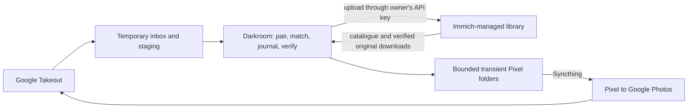

# Immich owns the library; Darkroom coordinates

Design for [#259](https://github.com/AnthonyPluth/Darkroom/issues/259), prepared 2026-11-09. **Owner approved; sign-off recorded on #259. Implementation follows the gates below; production uploads, cleanup and migration are not enabled by design approval.**

The owner has decided that Immich stores and organises the photos. Darkroom must not maintain another permanent library in `originals/` and `google-only/`. The upload, retention, quality and migration rules below are the approved target for making that decision safe. Current code continues to use the existing folders until the gated implementation sequence is completed.

## 1. Scope and ownership

Immich's managed storage is the copy of record. Its storage-template job chooses and moves paths. Darkroom uses asset IDs and checksums through the API; it never mounts, reads or writes Immich's upload, library, database or thumbnail directories directly. One Immich user remains associated with each Darkroom person. An external library is not the destination of a new import.

Darkroom keeps its database, import receipts, decisions, encrypted keys and browser profiles. Those are service state, not a second photo library. Pending review media stays inside the temporary inbox. Persistent review thumbnails or a new hidden media cache must not replace the folders being removed. `_pixels/` remains a separate, explicitly bounded transport buffer; it is not an exception allowing a permanent library.

Until cutover, `PHOTOS_ROOT` must still point to a dedicated Darkroom share, **never Immich's storage**. This design changes no container mounts, browser jobs, phone behaviour or deletion checks today.

## 2. API spike and evidence

Evidence has three levels: **prior live observation**, **pinned API/source inspection**, and **unverified on a live server**. Source inspection is not an upload test. The existing [#202 reconcile spike](immich-reconcile.md) observed a server running v3.3.6; it made read-only requests and does not prove upload behaviour. No live upload or metadata mutation was performed while this design was written. The live upload spike was run afterwards, on 2026-11-17 against Immich v3.4.1; its results are in [Live spike result](#live-spike-result-2026-11-17-immich-v341) below, and the "Live upload status" column now says what it confirmed.

The source/API inspection for this design used Immich **v3.3.6**, including its OpenAPI `info.version`, and was repeated for **v3.4.1** ([below](#pinned-v341-sources-411)). Re-check the deployed version and its schema before implementation; accepting a newer image tag is not a compatibility check.

| Question | Finding and evidence | Live upload status |
| --- | --- | --- |
| Upload destination | OpenAPI and `AssetMediaService.uploadAsset`: `POST /api/assets`, multipart, permission `asset.upload`; new assets use the authenticated user's ID and `libraryId: null` | Confirmed on v3.4.1: owner is the key's user, `libraryId: null` |
| Required fields | `AssetMediaCreateDto`: `assetData`, `fileCreatedAt`, `fileModifiedAt`; optional `filename`, `sidecarData`, `livePhotoVideoId`, `metadata`, `visibility`, `duration`, `isFavorite`. This version has no required `deviceId` or `deviceAssetId` | Confirmed on v3.4.1 for `assetData`, `sidecarData`, `fileCreatedAt`, `fileModifiedAt`, `filename` and `livePhotoVideoId` (the subset Darkroom's codec sends); the other optional fields were not sent |
| Success response | OpenAPI/controller: 201 for a new asset, 200 for a duplicate; JSON is `{id, status}`, with `status` equal to `created` or `duplicate` | Confirmed on v3.4.1: 201 `created`, 200 `duplicate` |
| Duplicate scope | Service/repository upload lookup uses `auth.user.id` and `libraryId: null`; bulk check uses that owner ID but does not filter external libraries. An admin key is not an upload-on-behalf-of-another-user mechanism | Confirmed across two non-admin users on v3.4.1; the external-library side was not run |
| Preflight | `POST /api/assets/bulk-upload-check`, permission `asset.upload`, accepts client IDs plus base64 or hex SHA-1. Results contain `action` and may contain `assetId`, `reason`, `isTrashed`. It can return an external-library match, so rejection is not managed-custody proof and must not suppress a required migration upload | Confirmed on v3.4.1 for managed duplicates: `reject`/`duplicate` with the existing ID, and `isTrashed: true` for a trashed one; an external-library match was not run |
| Original verification | #202 downloaded one original whose SHA-1 equalled the decoded base64 `checksum`; the API exposes `GET /api/assets/{id}` and `GET /api/assets/{id}/original` | Confirmed on v3.4.1 for new small uploads (SHA-1 and size of the unedited download equal the input); large video not run |
| Sidecar handling | Upload service registers `sidecarData` as an XMP file and queues metadata extraction. Metadata service merges sidecar tags over media tags and gives sidecar dates precedence | Confirmed on v3.4.1 for date, offset and GPS from EXIF only and from XMP only; on a conflict the XMP date won. Description was not reported in the result |
| Duplicate plus new sidecar | Duplicate handling returns the existing ID and queues incoming files for deletion; it does not establish that the existing asset received the sidecar or its metadata | Confirmed on v3.4.1: a duplicate with a new sidecar leaves the existing asset's metadata unchanged. Darkroom does not enrich an existing asset (the owner's decision of 2026-11-24 on [#548](https://github.com/AnthonyPluth/Darkroom/issues/548)): the gap is a `not_enriched` hold the owner resolves |
| Extraction timing | Upload service queues extraction after creating the asset. A 201 response or `hasMetadata` alone is not proof that all expected fields were extracted | About 0.1 s for small generated images on v3.4.1; large-media and async delays not run |
| Compound media | Upload DTO accepts `livePhotoVideoId`; #202 observed separate still/video assets and checksums | Confirmed on v3.4.1: Live Photo pairing after an interruption between the halves; RAW/JPEG are two unstacked IMAGE assets. Edited variants not run |

Pinned sources checked for this design:

- [OpenAPI](https://github.com/immich-app/immich/blob/v3.3.6/open-api/immich-openapi-specs.json), blob `2468a3a173adb4ab1fa9ea7e02e3f2e8446dff62`.
- [Upload DTO](https://github.com/immich-app/immich/blob/v3.3.6/server/src/dtos/asset-media.dto.ts), blob `d4eb397bede2a531212b411abb70a2251977035f`.
- [Upload controller](https://github.com/immich-app/immich/blob/v3.3.6/server/src/controllers/asset-media.controller.ts), blob `8ea527e45bcb35391ea4f51ae785f5a6025d9d7f`.
- [Upload service](https://github.com/immich-app/immich/blob/v3.3.6/server/src/services/asset-media.service.ts), blob `b12161e6184e917ce9490381cdbcdda2c125cc18`.
- [Metadata service](https://github.com/immich-app/immich/blob/v3.3.6/server/src/services/metadata.service.ts), blob `e1c1bee16ef3c5779d424a283491b43156141e75`.
- [Asset repository](https://github.com/immich-app/immich/blob/v3.3.6/server/src/repositories/asset.repository.ts), blob `6c24e7e13a63d10ca93de21f7555f5da79b8118c`.

#### Pinned v3.4.1 sources ([#411](https://github.com/AnthonyPluth/Darkroom/issues/411))

Inspected on 2026-11-18 at tag `v3.4.1` (commit `22b95194c80a2f2e6201093916b6c8c3d6d271dd`), each file diffed against `v3.3.6` (commit `587f549f46f1cd1822a06e16dcccecef04ea4565`, whose blobs match the list above). For each controller, the route decorators and their `@Authenticated({ permission })` were compared line by line; for the OpenAPI, the operations and schemas below were compared with descriptions and history ignored.

- [OpenAPI](https://github.com/immich-app/immich/blob/v3.4.1/open-api/immich-openapi-specs.json), blob `5a07e2c4b8958b883f17389c2603087abf99127e`: `info.version` is `3.4.1`. Unchanged: `POST /assets` (`asset.upload`), `POST /assets/bulk-upload-check` (`asset.upload`), `GET /assets/{id}` (`asset.read`), `GET /assets/{id}/original` (`asset.download`), `GET /assets/{id}/metadata` (`asset.read`), `POST /search/metadata` (`asset.read`), `GET /users/me` (`user.read`), `GET /server/about` (`server.about`), `GET /api-keys/me` (no permission), and the schemas `AssetMediaCreateDto`, `AssetMediaResponseDto`, `AssetMediaStatus`, `AssetResponseDto`, `AssetBulkUploadCheck*`, `ApiKeyResponseDto`, `UserAdminResponseDto`, `ServerAboutResponseDto`, `MetadataSearchDto`, `SearchResponseDto`. The `Permission` enum only gains `passkey.read`, `passkey.update`, `passkey.delete` and `clusterGroup.admin`; `all`, `user.read`, `server.about` and the `asset.*` names are unchanged.
- [Upload DTO](https://github.com/immich-app/immich/blob/v3.4.1/server/src/dtos/asset-media.dto.ts), blob `d8289e70a0aa2207cc57fc707be14e7f3715be8f`: comment formatting only.
- [Upload controller](https://github.com/immich-app/immich/blob/v3.4.1/server/src/controllers/asset-media.controller.ts), blob `1646c867e3eb3e559ef0f9d041ce0111f683e039`: an import moved; routes, permissions and 201/200 unchanged.
- [Upload response DTO](https://github.com/immich-app/immich/blob/v3.4.1/server/src/dtos/asset-media-response.dto.ts), blob `a35d75fb5f6f8d5db24e951db2907e650a347534`: identical.
- [Upload service](https://github.com/immich-app/immich/blob/v3.4.1/server/src/services/asset-media.service.ts), blob `15d356492b677a4e8770280a45c1d89869d7fa49`: `requireQuota` still answers `400 Quota has been exceeded!`; bulk check still reports `isTrashed` from `deletedAt`. Two changes: the checksum-header duplicate lookup now also requires upload access to the caller's own user (granted by `asset.upload`), and an upload with `livePhotoVideoId` now requires the caller to own that video (`requireAccess` with `asset.update`, an ownership check in `utils/access.ts`, not an API-key grant), so another user's video is refused with `400 Not found or no asset.update permission`. Original download resolves `edited` through `isEditedOnly`, which is the query's `edited=false` for an API key.
- [Metadata service](https://github.com/immich-app/immich/blob/v3.4.1/server/src/services/metadata.service.ts), blob `1e968eda86b78ed8f1f61c518109d83d99df3d03`: sidecar tags still merge over media tags; the zone fields dropped when a sidecar sets the date are now `zone`, `tz`, `zoneSource` (was `tzSource`); ISO falls through on zero; motion-photo extraction checks its byte range and deletes an old motion video on disk only when Immich extracted it.
- [Asset repository](https://github.com/immich-app/immich/blob/v3.4.1/server/src/repositories/asset.repository.ts), blob `6bf649b5c5a7f1a446a7ecad42729c70f4fdf71e`: `getUploadAssetIdByChecksum`, `getByChecksums`, `getById` and `getForOriginal` are byte-identical; the other changes are to Live Photo lookup options and offline external-asset detection.
- [`utils/access.ts`](https://github.com/immich-app/immich/blob/v3.4.1/server/src/utils/access.ts), blob `9cbcc97401504359e3944af4221cfd32b43ca2d3`: `isGranted` still treats `all` as every grant; `requireAccess` still answers `400 Not found or no <permission> access`; owner, album and partner checks for `asset.read` and `asset.download` keep their order (set helpers replaced by native `Set` methods); `asset.share` now also checks album access.
- [Auth service](https://github.com/immich-app/immich/blob/v3.4.1/server/src/services/auth.service.ts), blob `dc285833214f9b07d1d9c360ce7ac29b3fb2c38d`, and [auth guard](https://github.com/immich-app/immich/blob/v3.4.1/server/src/middleware/auth.guard.ts), blob `6995d3f673ca876bd7db389f12bfc64fcdd7bdb9`: an API key still needs the route's permission by `isGranted` (`403 Missing required permission: …`); the guard now also reads class-level options.
- [Asset controller](https://github.com/immich-app/immich/blob/v3.4.1/server/src/controllers/asset.controller.ts), blob `9e670a6d6fb684cb8f10c941c74feda9c070fef9`, [asset service](https://github.com/immich-app/immich/blob/v3.4.1/server/src/services/asset.service.ts), blob `e53d20f64788619a0fd2ff4d0c95d93f0315e717`, and [asset response DTO](https://github.com/immich-app/immich/blob/v3.4.1/server/src/dtos/asset-response.dto.ts), blob `defb2749ed47f0d65d7d25aa91df5ebcbb6b5d60`: `GET /assets/:id` keeps `asset.read` and returns `id`, `ownerId`, `libraryId`, `type`, `checksum` (base64), `originalFileName`, `visibility`, `livePhotoVideoId`, `isTrashed` (from `deletedAt`) and `isOffline`; metadata is stripped only for a shared link.
- [User controller](https://github.com/immich-app/immich/blob/v3.4.1/server/src/controllers/user.controller.ts), blob `58975a8c6b74ea9ed9a7026119c39f36bcbb0abb`, [user service](https://github.com/immich-app/immich/blob/v3.4.1/server/src/services/user.service.ts), blob `510c3cdc29efaa02d5abb1182ad2e233f56bf471`, and [user DTO](https://github.com/immich-app/immich/blob/v3.4.1/server/src/dtos/user.dto.ts), blob `b57d080c3aee91b8537525af121081db10c9eee8`: `GET /users/me` (`user.read`) returns `UserAdminResponseDto` with `id` and a required boolean `isAdmin`; imports moved only.
- [API key controller](https://github.com/immich-app/immich/blob/v3.4.1/server/src/controllers/api-key.controller.ts), blob `edf29f8579bc9562e019ffb085d08ea54effa745` (history metadata only), [API key service](https://github.com/immich-app/immich/blob/v3.4.1/server/src/services/api-key.service.ts), blob `e1067072a3698ff965ba89283d6d4b2cc5ab982a`, and [API key DTO](https://github.com/immich-app/immich/blob/v3.4.1/server/src/dtos/api-key.dto.ts), blob `7d5c69a12d91abad659da4f12c24b15c847cbc1c`: both identical to v3.3.6; `GET /api-keys/me` returns the current key's `permissions`.
- [Server controller](https://github.com/immich-app/immich/blob/v3.4.1/server/src/controllers/server.controller.ts), blob `2a07a47523d056c884c40218e297f46a18aabfa3` (identical), and [server service](https://github.com/immich-app/immich/blob/v3.4.1/server/src/services/server.service.ts), blob `bf5e323eb2555644a00b525ebc64f79f5a8747a9`: `getAboutInfo` unchanged (`v` plus the version); only feature flags changed.
- [Search controller](https://github.com/immich-app/immich/blob/v3.4.1/server/src/controllers/search.controller.ts), blob `766874d2cae956556f470a3b9587553fd8ce12ed`, and [enum](https://github.com/immich-app/immich/blob/v3.4.1/server/src/enum.ts), blob `de6307e9064b5f02d599a1d80d80ce84bb1af7fb`: routes and permissions as above.

None of these differences changes a route, field, status, message or grant the managed reader or the upload codec relies on. The Live Photo ownership check is stricter and matches what Darkroom already requires (same owner). The `tzSource` fix only touches which zone wins when a sidecar sets the date, which the live spike observed on v3.4.1 itself. So the managed reader accepts exactly `v3.3.6` and `v3.4.1`; `v3.4.0`, a later `v3.4.x` and anything else are refused until their sources are pinned here the same way and the version is added to `MANAGED_VERSIONS` with its test row.

### Live spike required before enabling imports

Use a disposable instance or dedicated test users, generated media and narrowly scoped keys. Record server version, request field names, status codes and assertions; publish no credentials, real media, names, locations or raw account responses. Provision credentials through environment settings, not an issue or chat. Nothing in this design permits uploading test files into the household's production library.

| Test | Required result; currently unverified |
| --- | --- |
| JPEG with embedded EXIF; another with missing EXIF plus generated XMP | Unedited download hashes equal input hashes; API capture time, offset, GPS and description reflect the intended values after extraction |
| Conflicting EXIF/XMP, UTC+0, nonzero offset and unknown offset | Confirm precedence and rounding. Preserve existing embedded values by writing only missing values into the submitted XMP. Never invent a UTC capture instant; hold an input for review when no defensible instant exists for the required timestamp mapping |
| Identical upload twice, including concurrent and lost-response retries | One usable asset for that owner; stable duplicate ID; no mistaken metadata-complete receipt |
| Same bytes under a second user; a partner-shared asset | Ownership stays separate. No import, match, receipt or cleanup is authorised by another owner's asset |
| Duplicate with additional XMP; trashed or offline duplicate | A duplicate does not take the new XMP (confirmed on v3.4.1), and Darkroom does not enrich the existing asset (below); a trashed/offline asset cannot authorise cleanup. Do not restore it automatically |
| Same bytes already indexed through an external library | Establish whether upload creates a usable managed asset or returns the external one. Do not count an external asset as migrated or detach its source library without a supported, verified custody transition |
| Live Photo still and video, interrupted between uploads | Verify each resource, relationship, visibility and resumability; no orphan half is counted as the completed photo |
| RAW/JPEG, edited image and large video | Preserve resource identity and bytes; test duration, time and metadata. Check the actual proxy/body-size and quota limits over the intended LAN route |
| Revoked key, quota exhaustion, extraction delay and metadata mismatch | Import stays pending or failed with its source retained; retries and alerts do not claim success |

**Existing-asset enrichment is not built**, by the owner's decision of 2026-11-24 on [#548](https://github.com/AnthonyPluth/Darkroom/issues/548): the person's key gets no `asset.update` grant, and Darkroom never changes the metadata of an asset already in Immich. It sends no `PUT /api/assets/{id}` (which the pinned API marks deprecated) and no other update. Metadata reaches Immich only in the XMP sidecar sent with a first upload. A duplicate whose existing asset lacks something Google knows is held as `not_enriched` and resolved by the owner ([terminal-holds.md](terminal-holds.md), section 3): accepting the asset as it is, with Google's values kept recorded in Darkroom, recording an offset in Darkroom, or checking again after fixing it in Immich by hand; never by writing to Immich. This does not overwrite an original or drop Google-only metadata: Google's values stay in Darkroom's records.

### Live spike result (2026-11-17, Immich v3.4.1)

The owner ran `tools/spikes/immich_live.py` ([how](../spikes/immich-live-run.md)) on 2026-11-17 against a production server reporting **v3.4.1**, with two empty, disposable, non-admin users and generated media only; no real photo or account was touched. Each key had exactly `user.read`, `server.about`, `asset.read`, `asset.download` and `asset.upload`, which the harness requires. It ran in three phases (main, after one asset was trashed in the web UI, and as the second user), merged into one result posted on [#266](https://github.com/AnthonyPluth/Darkroom/issues/266). The harness's expected denial and quota messages come from the v3.3.6 source; the rows that ran matched them on v3.4.1. The raw data (asset IDs, owner hashes) stays with the owner and is not recorded here. **12 rows passed, 7 were not run, none failed** (the five not-run lines below hold seven rows).

| #266 evidence | Result | Observed on v3.4.1 |
| --- | --- | --- |
| Server version and the key's exact grants | pass | Exactly the five grants; both users non-admin |
| New original plus sidecar | pass | 201 `created`; owner is the key's user; `libraryId: null`; the unedited download's SHA-1 and size equal the input |
| Extraction, EXIF-first and XMP missing-field values, offset and GPS | pass | EXIF only: instant, `timeZone: UTC+2` and GPS as written. XMP only: instant, a named zone and GPS as written. Conflicting EXIF and XMP dates: **the XMP date won**. Extraction took about 0.1 s |
| Duplicate upload with a new sidecar | pass | 200 `duplicate` with the existing ID; the existing asset's metadata unchanged |
| Concurrent duplicate uploads | pass | 3 at once: one 201 `created`, two 200 `duplicate`, no errors; checksum search finds one asset; bulk check `reject`/`duplicate` with that ID |
| Lost response, reconciled by checksum before a retry | pass | Bulk check and `POST /api/search/metadata` by checksum found the one asset; the retry was a 200 `duplicate` |
| Same bytes owned by two users | pass | The second user's upload was 201 `created` with its own ID and owner |
| Owner binding | pass | Each asset's owner is its uploader; the other user's asset answered `400 Not found or no asset.read access` |
| Trashed duplicate | pass | Bulk check `reject`/`duplicate` with `isTrashed: true`; the upload answered 200 `duplicate` with the trashed ID; the asset stayed trashed |
| Live Photo pairing, interrupted between uploads | pass | The video was found again by checksum before the still was sent; the still's `livePhotoVideoId` is the video; the video's visibility is `hidden` |
| RAW/JPEG pair | pass | Two distinct assets, both type `IMAGE`, bytes verified, not stacked |
| Managed imports need no `asset.delete` or admin grant | pass | Every upload step passed with only the five grants; the harness sends no delete, trash, restore or update request |
| Partner-visible assets | not run | The disposable users have no partner sharing |
| Offline or external-library duplicate | not run | Needs an admin key, which the harness refuses |
| Edited representations; existing-asset metadata enrichment | not run | Need `asset.update`, which the harness refuses |
| Large video and async extraction delay | not run | Opt-in (`--large-video-mb`), not turned on |
| Quota error; revoked-key error | not run | Need extra keys that a single-key setup could not provide |

Other findings:

- The server sits behind a WAF (Cloudflare) that answers Python's default `Python-urllib` User-Agent with 403, error 1010. The harness sends its own User-Agent since #409; Darkroom's Immich provider now does too (below).
- Video `duration` was read as an integer number of milliseconds, not a `H:MM:SS` string. Nothing in the provider reads it yet; a future tier-2 duration match must use milliseconds.
- An asset the key cannot read answers 400, not 404, and by the pinned source so does a missing ID. The phone-upload reconcile treated only a 404 for a still's Live Photo video as "waiting", so against a real server such a still failed the person's run. Fixed in [#412](https://github.com/AnthonyPluth/Darkroom/issues/412), by the owner's decision: a 400 whose body is exactly `Not found or no asset.read access` (a `Bad Request` with `statusCode` 400 where those fields are sent) is treated like a 404, so the still waits, stores nothing and is retried on every run, as a 404 wait was. Any other 400 (a validation error, another message) and every other status still fail the run with its alert. A video the key can read but that another user owns is still refused (`LiveVideoOwner`); one it cannot read only keeps the still waiting and is never downloaded. The fake Immich now answers that 400 for a missing or unreadable asset.
- A trashed duplicate answers the upload like any other duplicate. The upload response alone therefore never shows usability: the read-back in section 3, step 5 (which refuses a trashed asset) is what decides.

**Confirmed** by this run: upload destination, owner binding and `libraryId: null` for new assets; 201/200 with `created`/`duplicate` (what `upload_result` accepts); the codec's field order with a sidecar and `livePhotoVideoId`; per-owner duplicate scope; checksum reconciliation through bulk check and metadata search after a lost response; trashed duplicates reported by bulk check and returned, still trashed, by upload; XMP missing-field values and XMP-over-EXIF date precedence; Live Photo resumability and its link and hidden video; RAW/JPEG kept apart; no `asset.delete` or admin grant needed.

**Still open**: partner-visible assets; external-library and offline duplicates; edited representations; large video, proxy body size and async extraction delay; quota and revoked-key errors; description and unknown-offset handling, which the result does not report. The pinned v3.4.1 source and schema check is done ([above](#pinned-v341-sources-411)). Existing-asset enrichment is no longer open: it is not built ([above](#live-spike-required-before-enabling-imports), the owner's decision of 2026-11-24 on [#548](https://github.com/AnthonyPluth/Darkroom/issues/548)).

### Before imports can be enabled

1. Run the rows that were not run, on disposable users or a disposable instance, and record them on #266: partner-visible, offline/external-library, edited representations, large video with extraction delay, quota, revoked key. Existing-asset enrichment, the seventh, needs no run: it is not built (the owner's decision of 2026-11-24 on [#548](https://github.com/AnthonyPluth/Darkroom/issues/548)).
2. ~~Settle the key's grants.~~ Settled in [#411](https://github.com/AnthonyPluth/Darkroom/issues/411) (section 8): the managed reader accepts v3.3.6 and v3.4.1 (`MANAGED_VERSIONS`); a read-only reader needs exactly the four read grants, and the import path exactly those four plus `asset.upload`, the key the run used. Since the owner's decision of 2026-11-23 ("Accept either approved key", [recorded on #555](https://github.com/AnthonyPluth/Darkroom/pull/555#issuecomment-7115935945)), the scheduled Pixel job's reader (`read_or_import`) takes exactly the read grants or exactly the import grants and issues GET requests only; `upload` and `bulk_check` still require access `import`. `asset.update`, `asset.delete` and admin grants are never added: there is no enrichment path (the owner's decision of 2026-11-24 on [#548](https://github.com/AnthonyPluth/Darkroom/issues/548)). This enables no upload.
3. Before inbox cleanup (step 5), separately record a successful restore of the Immich database and media and of Darkroom's database and secrets, and a backup recovery point within the retention window, as #266 and section 4 require. This spike is not that evidence.
4. Record the owner's acceptance of remote deletion races (section 4): another Immich client can remove an asset after Darkroom's last read.

Until all four are done, imports, uploads, cleanup and migration stay disabled.

## 3. Import and verification protocol

1. Fix the destination person and their Immich owner ID for the export. Validate the person key with `GET /api/users/me`; never fall back to an admin key or infer ownership from a file name.
2. Read each part of the export as it downloads (per-part ingest, #424; [design](per-part-ingest.md)) rather than unpacking all parts together: list the part into a ledger, stream its media through a scratch folder in `_inbox/` a batch at a time, pair resources and JSON across the parts read so far, and hold the few items that need a later part until the export finishes. An export that had started unpacking when this was built finishes the old way, with all parts unpacked together in `_inbox/`. Retain the existing EXIF-first metadata policy. Compute fingerprints from immutable input bytes; generate an XMP sidecar containing only missing values. The exact timestamp/XMP mapping is gated by the live spike above.
3. Match against the person's owner-filtered Immich catalogue. Refresh a candidate before accepting it. Missing, trashed, offline, changed-checksum or other-owner assets are not keepers. An external-library asset is not a managed keeper; migrate it to verified managed custody before treating its source as releasable. A search cursor or upload preflight is only an optimisation.
4. Before a network write, persist a receipt intent keyed by destination owner, export/resource identity and source SHA-1. Record expected byte size, compound-resource group, intended metadata and its provenance, and the match/quality decision. Upload original bytes and the sidecar with that person's key. Do not rewrite EXIF into the media or create a permanent local copy.
5. Interpret both HTTP status and response `status`. Store the returned ID, then read it back: owner, `libraryId: null`, checksum, byte count, usability and compound links must agree. Stream an **unedited** original download through a hash check; a thumbnail, `edited=true` rendition or 2xx response is insufficient. Verify expected metadata fields after extraction with bounded polling and later retries, not an unbounded upload loop.
6. Commit verified resource receipts and only then mark the import complete. For an accepted tier-2 policy match, record that the existing asset represents the shot with a different checksum; do not describe this as an exact-byte receipt. An explicit owner skip is distinct from verification and never proves Google backup.
7. A timeout after upload leaves an uncertain outcome. Reconcile by owner and checksum and verify the returned asset before retrying. A crash after upload but before recording its ID must not cause a second logical import or an unsafe cleanup. A duplicate response still needs all applicable verification and metadata checks.

The receipt state sequence is `prepared → outcome_unknown/returned → bytes_verified → metadata_verified → committed`. Retryable failures stay pending.

Step 3 ([#531](https://github.com/AnthonyPluth/Darkroom/issues/531), `darkroom/domain/managed_upload.py`, called by nothing outside tests) records the first three: the receipt moves to `outcome_unknown` after the key's checks pass and before the body is sent, a 201 `created` or 200 `duplicate` records `returned` with the ID, and the unedited read-back of that ID (owner, `libraryId: null`, not trashed or offline, checksum, then the download's SHA-1 and size) records `bytes_verified`. A 5xx, a lost answer or one it cannot read leaves `outcome_unknown`, and every later send is preceded by the bulk check and a checksum search: an asset there that is this owner's, managed and not trashed is recorded as `returned`/`duplicate` and read back instead of sending again. Sending is claimed by one compare-and-set on the state, the attempt count (`send_attempts`) and an expired lease (`send_lease_until`, an hour): only the worker whose update matched sends, and any other worker leaves the receipt pending while the lease runs. The lease is cleared when the attempt ends. After a crash it runs out, and the next attempt starts with the checksum recovery. It is not renewed while the body streams, so a send that lasts longer than an hour can overlap a second worker's send of the same bytes; Immich's per-owner checksum dedupe and the asset-ID check when an answer is recorded keep that to one asset, and the lease is what keeps shorter attempts to one send. One call sends at most three times. A 4xx stops the call where the receipt is (`prepared` when the key's checks failed, so nothing was sent). An asset that is trashed, offline, in an external library or another owner's leaves the receipt `returned` and is reported unusable; nothing restores, trashes, updates or deletes it. Required members of a compound item commit together. API receipts, source hashes, intended metadata, decisions and timestamps remain in the database after media cleanup so the import can be audited and resumed.

Step 4 ([#532](https://github.com/AnthonyPluth/Darkroom/issues/532), `darkroom/domain/managed_metadata.py`, called by nothing outside tests) records the last two. `intend` works out a resource's intended metadata from the original's own tags and Google's sidecar with the existing missing-field mapping (`xmp.gaps`, under the Takeout-copy rules): the date, offset, place and description Immich must show (a `DateCreated` tag in the original is no capture date, as in the index, so Google's instant is written in its place), each with its provenance (`media` or `sidecar`), and the fields the XMP sent with the upload carries, only those the original lacks or Google corrected. `xmp.upload_sidecar` writes them as the packet the live spike sent: the place as `exif:GPSLatitude`/`exif:GPSLongitude`, the description as `dc:description`, and the date with its offset as both `photoshop:DateCreated` (Darkroom's own mapping) and `exif:DateTimeOriginal` (the tag the spike saw Immich read over EXIF); exiftool reads the packet as the same values as the sidecar it writes itself. The upload's `fileCreatedAt` and `fileModifiedAt` are the intended instant at its offset. A wall clock with neither an offset nor a position of its own takes the offset that makes it agree with Google's `photoTakenTime` to a whole quarter hour (#437's rule, which the index uses; a borrowed Live Photo sidecar gives none) only when the place Immich will see has that offset at that instant, since Immich reads the bare clock in that place's zone. A resource whose capture time still has no known offset (such a wall clock otherwise, a date Google corrected with no position and no offset of the file's own, a QuickTime instant with no place, or a wall clock resolved at the file's own position when the place Immich will see is in another zone; a QuickTime instant, exact in UTC, takes the offset of the place Immich will see), that has no capture time at all, or whose description XML cannot carry, is held for review before anything is sent (`metadata_hold`, migration 0048): no offset is invented and Immich is never left to pick one. After the read-back, the asset's `exifInfo` is polled a bounded number of times (5 reads, 2 s apart; a later run reads again): the instant within a second, the offset of its `timeZone` at that instant (`UTC±H[:MM]` or a zone name), the place within 0.00001° and the description (none and empty alike) must equal the intended values, as must the asset's type and, for a Live Photo's still, its link to the video. Only then is the receipt `metadata_verified`, with what Immich showed as `metadata_evidence`. A mismatch leaves it `bytes_verified` with `metadata_hold` `mismatch`, or `not_enriched` when the upload was a duplicate and its sidecar had something to add: existing-asset enrichment is not built (the key gets no `asset.update`, the owner's decision of 2026-11-24 on [#548](https://github.com/AnthonyPluth/Darkroom/issues/548)), so nothing changes the existing asset; the owner resolves the hold ([terminal-holds.md](terminal-holds.md)). A Live Photo sends its video first and verifies it, then the still with `livePhotoVideoId`; after an interruption between the halves the next run finds the video verified and sends only the still. `commit_compound` commits every receipt of a compound item in one transaction, only when each is `metadata_verified`, after a fresh read of each asset (owner, managed, not trashed or offline, checksum), with the still linked to its hidden video, or, for separate assets such as a RAW and its JPEG, none linked to another. It commits the receipts that exist for the compound key, so its caller (step 5) creates every member's receipt, checked against the intent's resource manifest, before calling it; if a member appears or moves while it checks, it commits nothing. A 201 alone never commits a receipt. Intended metadata and evidence are stored as ASCII-escaped JSON, so a description with a lone surrogate is still recorded and held.

Step 5 ([#533](https://github.com/AnthonyPluth/Darkroom/issues/533), `darkroom/domain/managed_ingest.py`) is the caller, for an export with an intent (`managed_import_intents`, the person's Immich user as owner), which a part ingest creates for a fresh export of a person whose `people.managed_imports` is `on`. Nothing outside the tests sets that yet: the switch (pausing that person's old-folder writers, the reconcile and cleanup, and waiting for their locks), the recovery-point gate below and matching a different-byte same shot against Immich are follow-ups. A managed export decides as before against the person's index, holds tier 4 items for review in the inbox and writes nothing into `google-only/` or beside an original. At its finish, after every item is decided, each automatic, unreversed tier 5 item gets its receipt (its intended metadata from its bytes and the sidecar chosen at the finish) and is completed through steps 3 and 4: an exact copy Immich already holds comes back as a duplicate and is verified, never a second asset; Live Photo halves are held, since their compound manifest is not built yet. The export completes only when no receipt is left pending (an Immich outage, a refusal, an uncertain answer, extraction not seen yet, or for a day not matching yet), with an alert, and items held for review are pinned with an alert. Keep both on its review pair records a receipt for the held copy that the import tick uploads, refusing a photo that would be held, a Live Photo half or a name Immich refuses; the pair is not undone afterwards. Cleanup and part freeing never remove a managed export's inbox copies or review holds.

## 4. What remains on Darkroom's disk

The approved successful-import retention remains **14 days**, measured from the final verified completion of the whole export (for a per-part export, when its last part is ingested and the export is finished), not its download time, a part's ingest or an upload response. For an export Darkroom imports into its own folders, the owner amended promise 2 (decisions 1 and 4 on #424): phase 2 of per-part ingest (#487) frees each part's zip once its proof holds and the held copies once the export is finished, and only a zip whose proof doesn't hold, and the review holds, keep to this clock. For an Immich-managed import phase 2 stays off: the zips, held copies and review holds all keep to this clock, and only a part's scratch copies go sooner, until the recovery-point proof below exists and the proof's "placed" becomes a committed, verified receipt. It provides a bounded undo/retry window; it is not a permanent library. Owner approval of this duration is recorded in section 10.

| Data | Location | Lifetime and remover |
| --- | --- | --- |
| Zip parts, unpacked media, JSON/XMP and pending-review copies | `_inbox/<person>/...`, including existing download staging | The service's guarded inbox cleanup removes them after the 14-day completion window and a fresh safety check; the browser worker only manages its existing download scratch files |
| Failed, uncertain, metadata-incomplete or unresolved-review resources | Same inbox | Pinned until repaired, verified or explicitly discarded by the owner. They are not eligible for age-only cleanup. Alert on stalled retention/disk pressure and pause new downloads rather than deleting the only usable copy |
| A verified download needed to fingerprint or send an Immich asset | Temporary inbox subfolder | Discard after its operation, with a crash-recovery sweep using persisted operation ownership; copy to `_pixels/` through the guarded Pixel writer if needed |
| Per-Pixel copies | `_pixels/<pixel>/<person>/` | Existing 50 GB default cap and per-destination Takeout proof, potentially about two months. The Pixel pruning job removes only these separate copies |
| Receipts, catalogue, decisions and minimal metadata needed for replay | Database/data directory | Persistent non-media service state; backed up with the database, with no media blobs or new thumbnail library |
| Browser profiles and failure captures | `_browser/` | Existing sensitive service state and existing lifecycle, unchanged by #259 |

Cleanup rechecks every required resource's committed disposition under the write lock and a fresh Immich read. An exact receipt needs the same owner/ID/checksum, managed custody (`libraryId: null`) and an available untrashed original. A policy match also needs its unreversed authorised decision, verified managed keeper and completed metadata handling. A resource changed, removed or unconfirmed since import pins the source again. If Immich is unavailable, cleanup does nothing. Every cleanup batch must also prove that each required managed resource and its metadata/compound links were committed before, and are included in, an identified successful restorable Immich database/media recovery point, with corresponding Darkroom state and secrets. Verify the recovery point against an owner-configured backup integration or an explicit owner attestation bound to that recovery point and manifest; a schedule or old rehearsal alone is insufficient. Require its age to remain within the approved retention window and its latest backup status to be successful; missing coverage, a failed/stopped backup, stale evidence or an unavailable verifier pins sources and pauses cleanup. No such backup integration exists yet, so cleanup remains disabled until this proof is implemented and tested. The local delete has a pending/completed journal so a crash cannot convert missing files into a fabricated success receipt.

The local write lock coordinates Darkroom jobs; it **does not lock Immich**. A user or another client can remove an asset after the final read and race inbox cleanup. Rechecking narrows that window but does not make the two systems atomic. The target deliberately has no independent permanent Darkroom copy after retention, so owner acceptance of that boundary and a tested Immich backup/restore are prerequisites before any inbox cleanup can be enabled, including opt-in imports before full cutover. No server-side custody lease or cross-system transaction has been verified; do not claim that fresh reads alone prevent every last-copy loss.

Paths must be inside that export's guarded inbox tree; refuse links, traversal, a replaced directory, an active import/download and ownership changes. Reassignment or undo invalidates the cleanup decision. No cleanup traverses a person's legacy library or an Immich mount. An owner discard must name the unresolved item explicitly and record that it was discarded, not backed up. After the window and cleanup, media-dependent undo may require a fresh Takeout download; the UI must say so before promising reversal.

## 5. Matching and the higher-quality rule

Matching uses `(person, Immich owner ID, asset ID, checksum)` plus cached fingerprints and capture metadata, not `originalPath`. Convert Immich's base64 SHA-1 to the hex representation already used by Darkroom. Catalogue refreshes retain owner filtering even when partner sharing exposes other users' assets. Fingerprint reads use verified temporary downloads only. Changed IDs/checksums, trash or deletion invalidate dependent assumptions; a full reconciliation is needed as well as the bounded incremental window because metadata-only changes and deletions are not reliably covered by `updatedAt` (#202).

Keep the existing tier rules: exact checksum first; unique same-shot matches with the existing time/camera/dimensions-or-duration conditions second; edited-copy policy third; perceptual similarity is review only; an unmatched item is a new candidate upload. Takeout confirmation remains per person and destination Google account, and only an unreversed automatic tier 1/2 decision proves it.

| Situation | Proposed result |
| --- | --- |
| Same bytes already in that owner's managed Immich library | Keep the existing asset, verify it and handle missing metadata separately; no second permanent Darkroom copy |
| Accepted same-shot match; incoming photo has no greater pixel count | Prefer the existing Immich original, subject to metadata preservation. Record a policy match rather than claiming identical bytes |
| Higher-pixel copy of a proven same photo arrives | Preserve it as a verified Immich-managed asset if needed, but do not delete or replace the incumbent automatically. Resolution of two different-byte Immich assets is an owner action until separately authorised |
| Different dimensions without a proven identity, burst ambiguity, RAW/JPEG, edited or video-quality ambiguity | Review. More pixels, byte size or pHash alone does not prove a duplicate or justify discarding a resource |

This carries forward #234's quality preference, not its authority to unlink a copy in a Darkroom-owned folder. **Automatically keeping only the higher-quality Immich asset conflicts with the approved prohibition on deleting Immich assets.** The approved first version reports the winner and requires the owner to resolve distinct-byte duplicates in Immich. It cannot promise their automatic removal. If automatic removal is required, it needs a separate owner decision, backup/recovery design and security review before implementation; it is not implied by #234 or approval of uploads.

No permanent Takeout metadata is lost merely because bytes match. Preserve the original sidecar/provenance in service state. Darkroom never adds metadata to an asset already in Immich (no enrichment path, the owner's decision of 2026-11-24 on [#548](https://github.com/AnthonyPluth/Darkroom/issues/548)), so for a duplicate, completed metadata handling before held source material is released means the owner's resolution of its hold ([terminal-holds.md](terminal-holds.md), section 3), with Google's values kept recorded in Darkroom. Do not copy the old XMP writer into Immich's filesystem or assume re-uploading a duplicate applies metadata. User edits take precedence; unresolved conflicts remain review items.

## 6. Replacement safety promises and checks

These are approved target replacements for the file-based portions of promises 1 and 2; the current `AGENTS.md`, `SECURITY.md` and their enforcement remain in force until a follow-up changes them together with tests.

**Promise 1 — Immich owns originals.** Darkroom may create an asset through an approved upload API and read originals, but never rewrite/replace existing original bytes or directly access Immich's storage. It never changes an existing asset's metadata either: metadata reaches Immich only in the XMP sidecar sent with a first upload, and the key never holds `asset.update` (the owner's decision of 2026-11-24 on [#548](https://github.com/AnthonyPluth/Darkroom/issues/548)).

**Promise 2 — Darkroom deletes no Immich asset.** It never requests trash, deletion, purge, replacement or an equivalent operation. Its media deletions are confined to verified/discard-authorised inbox data and per-Pixel transient copies under their separate rules. It never deletes migration sources, old libraries or a legacy source automatically. The old local losing-copy exception does not migrate into API deletion authority.

Enforcement must exist before enabling each new write or cleanup:

- A versioned method/path allowlist in the sole Immich provider, with negative tests for every unlisted operation, `DELETE`, replacement, owner mismatch and an admin-key fallback. POST search is a read despite its HTTP method. No metadata-update route or permission is allowlisted: the key never holds `asset.update` (#548).
- Semgrep/import-boundary checks that keep outbound calls in `tls.py`/the provider, block direct Immich filesystem access and prevent new asset-delete or media-rewrite calls. Keep the browser's no-password/2FA policy unchanged.
- Receipt and cleanup tests for wrong-owner/partner assets, changed checksum, absent original, trash/offline state, API outage, partial Live Photo, delayed extraction, metadata conflict, reassignment, reversed decision, symlinks/path swaps, stale transactions and each crash boundary. Test SQLite and PostgreSQL write locking.
- `no_leaks` canaries for keys, filenames, locations, emails and raw multipart/error bodies. Log fixed reasons, counts and internal IDs; error responses must not echo Immich payloads. Session auth stays on user routes and worker auth stays on the existing browser-internal routes.
- Restore tests for the database plus required service secrets and Immich's own database/media backups. An upload/read-back receipt proves current readability, not redundancy, a backup or protection from later user deletion. Immich backup readiness is an operational cutover prerequisite; parity alone is not a backup. Record a backup schedule/recovery point that fits the approved retention window and restore a sample uploaded before the backup, including its metadata and compound links. Backup-job success is not inferred from Immich's upload API.

The stronger-model review requested by #259 covers these deletion and copy-of-record rules before any implementation starts. No safety claim rests solely on this prose.

## 7. Pixel transport without `originals/`

Keep `_pixels/`, Syncthing Send Only, the size cap and existing per-destination Takeout proof. Replace a permanent-path source with an Immich asset/resource reference and expected owner/checksum. Placement downloads the unedited resource to the inbox, verifies it, writes a separate Pixel copy through the existing guarded helper and discards the scratch copy. Never hardlink an Immich-managed path.

For independently arriving phone assets, preserve #199's late-arrival rule: enqueue once per resource version for every Pixel serving that person, even if an earlier Takeout matched. As today, pruning an always-send copy requires suitable proof from a Takeout created after placement. A hash or asset change starts a new generation and cannot inherit old confirmation silently.

Darkroom's own uploads must not create an endless Immich → Pixel → Google → Takeout → Immich loop. Receipts retain multiple origins and the source Google account. An upload from that account's Takeout is not a new phone arrival requiring a return trip to the same account; it does not prove another Google account has the photo. A duplicate response that points at a phone asset must not erase its phone origin or suppress its existing always-send obligation. Preserve current person/destination routing; any additional replication policy needs owner approval.

If a decision is reversed after pruning, requeue from the referenced Immich original and reverify it. If the source is missing, trashed, offline or changed, hold the queue and alert. Do not silently substitute a similarly named photo, another owner's asset or a preview. This replaces #199's assumption that `originals/` is always available for reversal; no new permanent rescue cache is created.

Step 6 ([#534](https://github.com/AnthonyPluth/Darkroom/issues/534)) implements this behind `DARKROOM_PIXEL_IMMICH_SOURCE`, off by default. `pixel_folder.queue_managed` queues a verified managed version (`bytes_verified`, `libraryId: null`, the person's own owner) and records its reference for the copy's generation and destination account; a phone origin makes it always-send, and a Takeout origin without one skips that Takeout's own account. Placement streams the unedited original through `ManagedReader` (read grants) into `_pixels/.incoming`, checks its SHA-1 and size, and publishes it with the guarded Pixel writer outside the database write lock, re-checking the copy and its reference under the lock first. A requeued copy carries its previous generation's reference forward only when the checksum and size still match, and is verified again when placed. A changed, missing, trashed, offline, external or other-owner asset, an unmapped reference, or the setting being off holds the copy (a `pixel_copy_source_held` event): it is neither placed nor pruned. No caller queues a managed version yet; the backfill (step 7) will.

## 8. Keys and access

Use the existing per-person key, sealed with `storage.secretbox` and the service secret key. Validate the key's owner at configuration and before establishing its binding. Do not use the administrator's key to upload for everyone. Source inspection binds upload ownership to the authenticated user; the two-user live spike must confirm least-privilege operation and ownership checks.

Scopes from the pinned API are `user.read` (binding), `server.about` (version), `asset.read`, `asset.download` and `asset.upload`. Do not grant `asset.delete`, user administration or library administration. The live spike on v3.4.1 ran every upload step with exactly these five.

`ManagedReader` checks the grants exactly, by its `access` ([#411](https://github.com/AnthonyPluth/Darkroom/issues/411)):

| Access | Key's grants must equal | Used by |
| --- | --- | --- |
| `read` (the default) | `user.read`, `server.about`, `asset.read`, `asset.download` | read-only reads and downloads |
| `import` | those four plus `asset.upload` | the managed import (its read-back included), once uploads are enabled |
| `read_or_import` | exactly the `read` set or exactly the `import` set | the scheduled Pixel placement (`jobs.pixel_readers`), GET requests only, by the owner's decision of 2026-11-23 ("Accept either approved key", [recorded on #555](https://github.com/AnthonyPluth/Darkroom/pull/555#issuecomment-7115935945), docs/DECISIONS.md): a person's one key that the backfill or a managed import needs with `asset.upload` still places their Pixel copies; it never uploads or checks an upload, since `upload` and `bulk_check` still require access `import` |

A missing grant, `all`, `asset.update`, `asset.delete`, any admin, library, user or other extra grant, a non-list answer or a non-string entry is refused before any asset is read, on every path; a `read` reader also refuses the five-grant key, and a `read_or_import` reader (the scheduled Pixel job, by the owner's decision above) takes exactly the read set or exactly the import set and nothing else. The key's user must answer `isAdmin: false`; an admin user, or a missing or non-boolean flag, is refused on both paths, as is the configured admin key. The server must report a version in `MANAGED_VERSIONS` (exactly `v3.3.6` and `v3.4.1`, each pinned in section 2). All three are re-read on every operation. Step 3 (#531) adds two routes, for the `import` access only: `POST /api/assets` and `POST /api/assets/bulk-upload-check` pass `require_allowed_request` only on a call that says it is importing (a keyword-only flag that only `Client.open` and `Client.call` forward). Only `Client.upload` and `Client.bulk_check` make one, and they refuse the admin key or an empty key. In the provider they are called only after `self.check_access()` in the same method, which only `ManagedReader.upload` and `ManagedReader.bulk_check` do, and refused for a `read` reader (Semgrep's `darkroom-immich-import-routes-behind-check-access`). Outside it only `darkroom/domain/managed_upload.py` calls those (`darkroom-immich-upload-one-caller`). Trash, restore, update and delete stay outside the allowlist. `asset.update` is not needed to create a new asset with its sidecar, and is never added: there is no existing-asset enrichment (the owner's decision of 2026-11-24 on [#548](https://github.com/AnthonyPluth/Darkroom/issues/548)). Remove the obsolete admin/rescan dependency only when the old external-library workflow is retired, not in this docs change.

A leaked read/download key can expose that person's library and any partner access Immich permits. Upload permission can inject unwanted files and exhaust quota; update permission is never granted (#548). These keys are sensitive even without delete permission. Keep them out of URLs, logs, browser responses, exception bodies and browser-worker configuration. Revocation pauses that person's work and pins incomplete imports. Rotation revalidates owner binding; no privilege escalation or cross-user fallback occurs. Back up the encrypted database and service secret securely and test restoration without publishing either.

## 9. Migration and rollback sequence

Owner sign-off is recorded on #259; #265 and #266 begin the follow-ups. Each row below becomes a separate, bounded follow-up, **under 1,000 added lines including tests**; split a row again if it exceeds the budget. Removals do not count toward that limit. New tables/columns use new Alembic migrations with SQLite and PostgreSQL tests; historical migrations are not edited.

| Step | Change and acceptance gate | Rollback |
| --- | --- | --- |
| 0. Live API spike and safety review | Complete section 2 on disposable users, decide metadata handling, approve section 10, and review replacement promises with a stronger model. No production writes | Remove only disposable test data through the test instance's administration; production is untouched |
| 1. Capability and ownership guards | Add version checks, explicit route/permission allowlist, key binding and negative privacy/ownership tests. New workflow disabled | Disable the new capability; existing workflow unchanged |
| 2. Additive catalogue and receipts | Add asset/resource identity, owner/checksum, source origins, metadata/receipt states and versioned Pixel references. Keep legacy columns and IDs; no file moves | Disable readers of new fields and keep the additive schema/data so intervening legacy records survive. Snapshot restoration is allowed only within a verified zero-write window with matching storage state and all jobs stopped; never restore a stale pre-migration snapshot over subsequent imports, decisions or Pixel updates |
| 3. Upload and read-back provider | Streaming multipart and unedited hash verification, bounded retries and uncertain-outcome recovery; fixture/test account only, no scheduler switch | Disable uploads; keep receipts. Never delete an uploaded asset to undo a deployment |
| 4. Metadata and compound-resource completion | Verified XMP mapping, extraction polling, Live Photo resource/link tests and missing-field conflict rules; no existing-asset enrichment (#548), an existing asset's gap is a hold the owner resolves | Disable this path, retain sources and intents; do not overwrite metadata back from a stale snapshot |
| 5. Opt-in ingest and guarded retention | Switch a controlled import to native uploads/catalogue dedupe only after pausing that owner's legacy writers, reconcile and cleanup and waiting for active leases. Completion requires receipts and fresh checks. Before enabling any 14-day cleanup, rehearse restoring the Immich database/media and Darkroom database/secrets, record a backup schedule/recovery point within retention, and obtain owner acceptance of the remote-deletion boundary. Every cleanup batch additionally requires the current recovery-point coverage and backup-health proof in section 4; stale or failed backup evidence pauses cleanup. Until these gates pass, retain all sources and pause new downloads on disk pressure | Stop new imports and cleanup. Keep sources, receipts and created Immich assets for reconciliation; no destructive compensation or blind restart of the old writer |
| 6. Pixel source conversion | Use verified Immich reads for placement/requeue, preserve per-destination generations, cap, always-send and reversal semantics | Pause Pixel placement/pruning; keep existing copies and rows. The legacy source path may be used only for an individually verified unmigrated row |
| 7. Backfill existing state | Map local items to verified same-owner managed assets or upload missing resources. Migrate every dependent decision/review/legacy/Pixel reference; produce an exception report | Stop the backfill. Keep old files read-only and both identifier sets. Resume from receipts; do not replay old losing-copy removals |
| 8. Cutover and retire old writers | Stop every old worker first; repeat the backup/restore rehearsal already required before step 5 cleanup; disable local placement, external-library rescans and losing-copy execution. Switch all runtime writers together only after parity and receipt gates pass | Before native writes, a snapshot rollback requires a verified zero-write window since a matched DB/folder snapshot; otherwise preserve intervening records and recover forward. After native writes, pause imports/pruning and recover forward from receipts; an old binary must not be restarted against the mixed/new catalogue |
| 9. Contract and owner-managed archive retirement | After an agreed rollback window and audit, remove obsolete path dependencies/configuration and archive historical state. Only then retire schema fields in a separately tested migration. The owner, not a job, decides when to dispose of old photo folders | Keep current data and roll the schema forward if any native import, decision or Pixel update committed after the backup. Restoring a matched database/schema backup plus owner-retained source archive requires a verified zero-write window since that snapshot, matching storage state and all writers stopped. Loss of that archive ends the old-file rollback option and must be explicitly acknowledged |

### Existing folders and tables

- `originals/` and `google-only/`: freeze old deletion/placement jobs before backfill; mount legacy sources read-only. Index a file's actual bytes and metadata, not a guessed path correspondence. An externally indexed asset is not proof of managed custody: `libraryId` must be null and unedited read-back must verify before its source library can be detached. The source's upload duplicate lookup excludes external-library assets, unlike bulk preflight; verify on a test server that a managed upload succeeds and map its actual returned ID. Do not assume this converts the external asset in place, trust a preflight rejection or detach a library while any such row is unresolved. No directory is removed or chmod/chown operation applied to Immich's storage by the migrator.
- `media_items`: preserve existing IDs while adding nullable owner/asset/resource and receipt references; retain fingerprints, ownership, source hash and decision history. Do not reinterpret a local path as an Immich path or match a changed file by name. Contract old path requirements only after all active references and exceptional rows are accounted for.
- `immich_assets`: retain per-owner IDs/checksums and compound relationships; replace the meaning of “stored” locally with explicit catalogue/verified-receipt states through a migration. Origin receipts prevent import feedback loops.
- `duplicate_removals`: preserve the immutable history, including paths/hashes and completed outcomes. Pending entries are frozen/reconciled as historical local operations, not retried against an API asset or replayed by a downgraded worker. Preserve links even when a formerly removed item no longer exists; never invent replacement evidence from a filename.
- `pixel_copies`: retain queued/placed/pruned states, destination, hashes, placement/proof times and requeue count. Add source asset version/resource references and backfill only verified mappings. A placed copy may finish under its old proof rules, but it may not claim an unverified new source. Unmappable or changed items stay blocked, not silently pruned.
- `dedupe_decisions`, `review_items` and `legacy_files`: preserve IDs, attribution, reversals and source provenance. A held review needs either its pinned inbox bytes or a verified source reference; no cascade may remove the only material needed to decide it. Reindex existing read-only legacy sources through the same API import path; #259 does not authorise deleting them.

Parity is per owner and required resource: verify IDs, decoded checksums, read-back bytes, metadata obligations, compound links and all dependent references. Counts and matching file names are insufficient. Keep a manifest of unmapped, changed, trashed and offline assets and a clean backup of the old database/folders. Re-read mutable Immich state before cutover; a successful upload months earlier is not current custody proof.

Step 7a ([#535](https://github.com/AnthonyPluth/Darkroom/issues/535), `darkroom/domain/backfill.py`) backfills a person who opted in on their own (`people.managed_backfill`, migration 0051; the opt-in command is #544, and `managed_imports` does not imply it). It is called by the Immich reconcile job and does nothing for anyone else. Each single photo or video in the person's `google-only/` whose bytes still hash to its `media_items` record gets a receipt under a backfill intent (`managed_import_intents.kind = 'backfill'`, for the item's export, or with no export when its Google account is unknown; `place.managed_import` and `managed_ingest.intent_of` count only import intents) and goes through steps 3 and 4 with its stored Google sidecar: Immich's managed duplicate is verified and mapped, and an asset Immich holds only through an external library gets a managed upload. Each phone original in `originals/immich/` with one stored, non-Live `immich_assets` row is mapped after the unedited read-back. A committed receipt or a verified read-back records a `bytes_verified` version with a `takeout` origin (its receipt), an `other` origin when the account is unknown, or a `phone` origin, and a row in `managed_backfill_items`, which is also the exceptions report: Live Photo halves (step 7b, #553), same-shot pairs with other bytes against a phone original and every edited copy, whatever became of its original (tiers 2 to 4; step 7c, #554), terminal metadata holds, and changed, missing, unreadable or unusable files are listed and not uploaded; an outage leaves an item `pending` and it is tried again. With `DARKROOM_PIXEL_IMMICH_SOURCE` on, a mapped photo's existing Pixel copies are bound to the version (`queue_managed(..., existing_only=True)`), so no new Pixel obligation is created and a photo with an unknown account is never queued. A Pixel copy held for its Immich source records a fixed reason in its `pixel_copy_source_held` event, a local write failure counts as failed, and a copy held for a day opens an alert. A photo the backfill may have sent to Immich (a mapping, or any backfill receipt except one held before it was ever sent) is neither reassigned nor taken back by undoing keep both: both answer 409 and say why. An outage, a read or exiftool failure, or a folder on the way that is not there (an unmounted share) leaves an item `pending`; it is retried, after new items, and one still pending after a day opens an alert. The reconcile job runs no backfill while the share check fails. A Google-only photo is taken only once its export is imported; one whose export failed or expired is listed as `export_unfinished`: a failed export's import can be retried from the Exports page and the photo is backfilled once it finishes, while an expired export cannot finish, so its photos stay listed. The export's status is checked again under the write lock before a receipt is made. Nothing under `google-only/` or `originals/` is written or removed, and recorded losing-copy removals stay with the reconcile.

## 10. Approval and remaining gates

| Item | Approved target / validation gate | Status |
| --- | --- | --- |
| Ownership | Immich owns the library; Darkroom has no second permanent photo library | Owner decision recorded in #259 |
| API deletion and quality | No automatic Immich deletion/replacement; distinct-byte quality conflicts require owner resolution. Automatic winner-only removal needs a separate policy | Owner approved; sign-off recorded on #259 |
| Successful-import retention | 14 days after verified completion; unresolved items are pinned with alerts and backpressure, never expired by age alone | Owner approved; sign-off recorded on #259 |
| Metadata and API compatibility | Complete the live spike's remaining rows. No existing-asset enrichment or update path: the key gets no `asset.update` (the owner's decision of 2026-11-24 on [#548](https://github.com/AnthonyPluth/Darkroom/issues/548)), and a duplicate's missing metadata is a hold the owner resolves ([terminal-holds.md](terminal-holds.md)) | Partly verified: 12 of 19 live rows passed on v3.4.1 (2026-11-17, section 2), and v3.4.1's sources are pinned (#411); 7 not run, of which enrichment no longer needs a run (owner decision, #548); blocks enabling the relevant workflow |
| Pixel flow | Preserve destination proof/cap/late-phone rules, fetch originals by API, and prevent Takeout upload loops | Owner approved; sign-off recorded on #259 |
| Migration/rollback | No automatic source-directory deletion; keep old files/database through a rehearsed rollback window, with an explicit boundary after native writes | Owner approved; sign-off recorded on #259 |
| Copy-of-record boundary | Accept the loss of an independent Darkroom copy after retention and the non-atomic boundary with other Immich clients; require tested Immich backup/restore | Owner approved; sign-off recorded on #259 |
| Safety promises | Approve replacement wording, then land enforcement and stronger-model review before implementation is enabled | Owner approved wording; enforcement and stronger-model review remain gates; no current check is removed here |

Approval of this document is not evidence that an unverified API assumption passed. Live spike results and the implementation gates still apply after design sign-off. Owner approval is recorded on #259. Implementation may proceed through the gated steps above; approval does not authorise bypassing safety review, live validation or backup/restore prerequisites.
