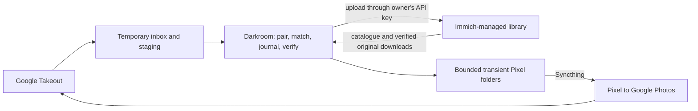

# Immich owns the library; Darkroom coordinates

Design for [#259](https://github.com/AnthonyPluth/Darkroom/issues/259), prepared 2026-11-09. **Owner approved; sign-off recorded on #259. Implementation follows the gates below; production uploads, cleanup and migration are not enabled by design approval.**

The owner has decided that Immich stores and organises the photos. Darkroom must not maintain another permanent library in `originals/` and `google-only/`. The upload, retention, quality and migration rules below are the approved target for making that decision safe. Current code continues to use the existing folders until the gated implementation sequence is completed.

## 1. Scope and ownership

Immich's managed storage is the copy of record. Its storage-template job chooses and moves paths. Darkroom uses asset IDs and checksums through the API; it never mounts, reads or writes Immich's upload, library, database or thumbnail directories directly. One Immich user remains associated with each Darkroom person. An external library is not the destination of a new import.

Darkroom keeps its database, import receipts, decisions, encrypted keys and browser profiles. Those are service state, not a second photo library. Pending review media stays inside the temporary inbox. Persistent review thumbnails or a new hidden media cache must not replace the folders being removed. `_pixels/` remains a separate, explicitly bounded transport buffer; it is not an exception allowing a permanent library.

Until cutover, `PHOTOS_ROOT` must still point to a dedicated Darkroom share, **never Immich's storage**. This design changes no container mounts, browser jobs, phone behaviour or deletion checks today.

## 2. API spike and evidence

Evidence has three levels: **prior live observation**, **pinned API/source inspection**, and **unverified on a live server**. Source inspection is not an upload test. The existing [#202 reconcile spike](immich-reconcile.md) observed a server running v3.3.6; it made read-only requests and does not prove upload behaviour. No live upload or metadata mutation was performed for this design: this session has no configured Immich test endpoint or credentials.

The source/API inspection for this design used Immich **v3.3.6**, including its OpenAPI `info.version`. Re-check the deployed version and its schema before implementation; accepting a newer image tag is not a compatibility check.

| Question | Finding and evidence | Live upload status |
| --- | --- | --- |
| Upload destination | OpenAPI and `AssetMediaService.uploadAsset`: `POST /api/assets`, multipart, permission `asset.upload`; new assets use the authenticated user's ID and `libraryId: null` | Unverified |
| Required fields | `AssetMediaCreateDto`: `assetData`, `fileCreatedAt`, `fileModifiedAt`; optional `filename`, `sidecarData`, `livePhotoVideoId`, `metadata`, `visibility`, `duration`, `isFavorite`. This version has no required `deviceId` or `deviceAssetId` | Unverified |
| Success response | OpenAPI/controller: 201 for a new asset, 200 for a duplicate; JSON is `{id, status}`, with `status` equal to `created` or `duplicate` | Unverified |
| Duplicate scope | Service/repository upload lookup uses `auth.user.id` and `libraryId: null`; bulk check uses that owner ID but does not filter external libraries. An admin key is not an upload-on-behalf-of-another-user mechanism | Unverified across two real users |
| Preflight | `POST /api/assets/bulk-upload-check`, permission `asset.upload`, accepts client IDs plus base64 or hex SHA-1. Results contain `action` and may contain `assetId`, `reason`, `isTrashed`. It can return an external-library match, so rejection is not managed-custody proof and must not suppress a required migration upload | Unverified |
| Original verification | #202 downloaded one original whose SHA-1 equalled the decoded base64 `checksum`; the API exposes `GET /api/assets/{id}` and `GET /api/assets/{id}/original` | Prior live read of one asset; new uploads and larger resources unverified |
| Sidecar handling | Upload service registers `sidecarData` as an XMP file and queues metadata extraction. Metadata service merges sidecar tags over media tags and gives sidecar dates precedence | Unverified end to end, including offset, GPS, description and conflicting EXIF |
| Duplicate plus new sidecar | Duplicate handling returns the existing ID and queues incoming files for deletion; it does not establish that the existing asset received the sidecar or its metadata | Metadata enrichment on duplicates remains unverified and is a release gate |
| Extraction timing | Upload service queues extraction after creating the asset. A 201 response or `hasMetadata` alone is not proof that all expected fields were extracted | Completion timing and polling behaviour unverified |
| Compound media | Upload DTO accepts `livePhotoVideoId`; #202 observed separate still/video assets and checksums | Creation, retry and linking of a complete Live Photo unverified; RAW/JPEG and edited variants unverified |

Pinned sources checked for this design:

- [OpenAPI](https://github.com/immich-app/immich/blob/v3.3.6/open-api/immich-openapi-specs.json), blob `2468a3a173adb4ab1fa9ea7e02e3f2e8446dff62`.
- [Upload DTO](https://github.com/immich-app/immich/blob/v3.3.6/server/src/dtos/asset-media.dto.ts), blob `d4eb397bede2a531212b411abb70a2251977035f`.
- [Upload controller](https://github.com/immich-app/immich/blob/v3.3.6/server/src/controllers/asset-media.controller.ts), blob `8ea527e45bcb35391ea4f51ae785f5a6025d9d7f`.
- [Upload service](https://github.com/immich-app/immich/blob/v3.3.6/server/src/services/asset-media.service.ts), blob `b12161e6184e917ce9490381cdbcdda2c125cc18`.
- [Metadata service](https://github.com/immich-app/immich/blob/v3.3.6/server/src/services/metadata.service.ts), blob `e1c1bee16ef3c5779d424a283491b43156141e75`.
- [Asset repository](https://github.com/immich-app/immich/blob/v3.3.6/server/src/repositories/asset.repository.ts), blob `6c24e7e13a63d10ca93de21f7555f5da79b8118c`.

### Live spike required before enabling imports

Use a disposable instance or dedicated test users, generated media and narrowly scoped keys. Record server version, request field names, status codes and assertions; publish no credentials, real media, names, locations or raw account responses. Provision credentials through environment settings, not an issue or chat. Nothing in this design permits uploading test files into the household's production library.

| Test | Required result; currently unverified |
| --- | --- |
| JPEG with embedded EXIF; another with missing EXIF plus generated XMP | Unedited download hashes equal input hashes; API capture time, offset, GPS and description reflect the intended values after extraction |
| Conflicting EXIF/XMP, UTC+0, nonzero offset and unknown offset | Confirm precedence and rounding. Preserve existing embedded values by writing only missing values into the submitted XMP. Never invent a UTC capture instant; hold an input for review when no defensible instant exists for the required timestamp mapping |
| Identical upload twice, including concurrent and lost-response retries | One usable asset for that owner; stable duplicate ID; no mistaken metadata-complete receipt |
| Same bytes under a second user; a partner-shared asset | Ownership stays separate. No import, match, receipt or cleanup is authorised by another owner's asset |
| Duplicate with additional XMP; trashed or offline duplicate | Confirm enrichment semantics separately; a trashed/offline asset cannot authorise cleanup. Do not restore it automatically |
| Same bytes already indexed through an external library | Establish whether upload creates a usable managed asset or returns the external one. Do not count an external asset as migrated or detach its source library without a supported, verified custody transition |
| Live Photo still and video, interrupted between uploads | Verify each resource, relationship, visibility and resumability; no orphan half is counted as the completed photo |
| RAW/JPEG, edited image and large video | Preserve resource identity and bytes; test duration, time and metadata. Check the actual proxy/body-size and quota limits over the intended LAN route |
| Revoked key, quota exhaustion, extraction delay and metadata mismatch | Import stays pending or failed with its source retained; retries and alerts do not claim success |

Existing-asset enrichment needs its own result. The pinned API describes `PUT /api/assets/{id}` with date, GPS and description fields, but marks it deprecated; generic asset key/value metadata is not proof that timeline EXIF fields are updated. Determine the supported endpoint for the deployed version, its missing-value and concurrent-edit behaviour, permission and recovery path. If the API cannot protect a concurrent user edit, leave enrichment for review instead of writing from a stale missing-field snapshot. **Do not enable enrichment or clear its held sources until this is verified and approved.** This is not a proposal to overwrite an original or silently drop Google-only metadata.

## 3. Import and verification protocol

1. Fix the destination person and their Immich owner ID for the export. Validate the person key with `GET /api/users/me`; never fall back to an admin key or infer ownership from a file name.
2. Unpack all parts together in `_inbox/`, pair resources and JSON, and retain the existing EXIF-first metadata policy. Compute fingerprints from immutable input bytes; generate an XMP sidecar containing only missing values. The exact timestamp/XMP mapping is gated by the live spike above.
3. Match against the person's owner-filtered Immich catalogue. Refresh a candidate before accepting it. Missing, trashed, offline, changed-checksum or other-owner assets are not keepers. An external-library asset is not a managed keeper; migrate it to verified managed custody before treating its source as releasable. A search cursor or upload preflight is only an optimisation.
4. Before a network write, persist a receipt intent keyed by destination owner, export/resource identity and source SHA-1. Record expected byte size, compound-resource group, intended metadata and its provenance, and the match/quality decision. Upload original bytes and the sidecar with that person's key. Do not rewrite EXIF into the media or create a permanent local copy.
5. Interpret both HTTP status and response `status`. Store the returned ID, then read it back: owner, `libraryId: null`, checksum, byte count, usability and compound links must agree. Stream an **unedited** original download through a hash check; a thumbnail, `edited=true` rendition or 2xx response is insufficient. Verify expected metadata fields after extraction with bounded polling and later retries, not an unbounded upload loop.
6. Commit verified resource receipts and only then mark the import complete. For an accepted tier-2 policy match, record that the existing asset represents the shot with a different checksum; do not describe this as an exact-byte receipt. An explicit owner skip is distinct from verification and never proves Google backup.
7. A timeout after upload leaves an uncertain outcome. Reconcile by owner and checksum and verify the returned asset before retrying. A crash after upload but before recording its ID must not cause a second logical import or an unsafe cleanup. A duplicate response still needs all applicable verification and metadata checks.

The receipt state sequence is `prepared → outcome_unknown/returned → bytes_verified → metadata_verified → committed`. Retryable failures stay pending. Required members of a compound item commit together. API receipts, source hashes, intended metadata, decisions and timestamps remain in the database after media cleanup so the import can be audited and resumed.

## 4. What remains on Darkroom's disk

The approved successful-import retention remains **14 days**, measured from the final verified completion of the whole export, not its download time or an upload response. It provides a bounded undo/retry window; it is not a permanent library. Owner approval of this duration is recorded in section 10.

| Data | Location | Lifetime and remover |
| --- | --- | --- |
| Zip parts, unpacked media, JSON/XMP and pending-review copies | `_inbox/<person>/...`, including existing download staging | The service's guarded inbox cleanup removes them after the 14-day completion window and a fresh safety check; the browser worker only manages its existing download scratch files |
| Failed, uncertain, metadata-incomplete or unresolved-review resources | Same inbox | Pinned until repaired, verified or explicitly discarded by the owner. They are not eligible for age-only cleanup. Alert on stalled retention/disk pressure and pause new downloads rather than deleting the only usable copy |
| A verified download needed to fingerprint or send an Immich asset | Temporary inbox subfolder | Discard after its operation, with a crash-recovery sweep using persisted operation ownership; copy to `_pixels/` through the guarded Pixel writer if needed |
| Per-Pixel copies | `_pixels/<pixel>/<person>/` | Existing 50 GB default cap and per-destination Takeout proof, potentially about two months. The Pixel pruning job removes only these separate copies |
| Receipts, catalogue, decisions and minimal metadata needed for replay | Database/data directory | Persistent non-media service state; backed up with the database, with no media blobs or new thumbnail library |
| Browser profiles and failure captures | `_browser/` | Existing sensitive service state and existing lifecycle, unchanged by #259 |

Cleanup rechecks every required resource's committed disposition under the write lock and a fresh Immich read. An exact receipt needs the same owner/ID/checksum, managed custody (`libraryId: null`) and an available untrashed original. A policy match also needs its unreversed authorised decision, verified managed keeper and completed metadata handling. A resource changed, removed or unconfirmed since import pins the source again. If Immich is unavailable, cleanup does nothing. Every cleanup batch must also prove that each required managed resource and its metadata/compound links were committed before, and are included in, an identified successful restorable Immich database/media recovery point, with corresponding Darkroom state and secrets. Verify the recovery point against an owner-configured backup integration or an explicit owner attestation bound to that recovery point and manifest; a schedule or old rehearsal alone is insufficient. Require its age to remain within the approved retention window and its latest backup status to be successful; missing coverage, a failed/stopped backup, stale evidence or an unavailable verifier pins sources and pauses cleanup. No such backup integration exists yet, so cleanup remains disabled until this proof is implemented and tested. The local delete has a pending/completed journal so a crash cannot convert missing files into a fabricated success receipt.

The local write lock coordinates Darkroom jobs; it **does not lock Immich**. A user or another client can remove an asset after the final read and race inbox cleanup. Rechecking narrows that window but does not make the two systems atomic. The target deliberately has no independent permanent Darkroom copy after retention, so owner acceptance of that boundary and a tested Immich backup/restore are prerequisites before any inbox cleanup can be enabled, including opt-in imports before full cutover. No server-side custody lease or cross-system transaction has been verified; do not claim that fresh reads alone prevent every last-copy loss.

Paths must be inside that export's guarded inbox tree; refuse links, traversal, a replaced directory, an active import/download and ownership changes. Reassignment or undo invalidates the cleanup decision. No cleanup traverses a person's legacy library or an Immich mount. An owner discard must name the unresolved item explicitly and record that it was discarded, not backed up. After the window and cleanup, media-dependent undo may require a fresh Takeout download; the UI must say so before promising reversal.

## 5. Matching and the higher-quality rule

Matching uses `(person, Immich owner ID, asset ID, checksum)` plus cached fingerprints and capture metadata, not `originalPath`. Convert Immich's base64 SHA-1 to the hex representation already used by Darkroom. Catalogue refreshes retain owner filtering even when partner sharing exposes other users' assets. Fingerprint reads use verified temporary downloads only. Changed IDs/checksums, trash or deletion invalidate dependent assumptions; a full reconciliation is needed as well as the bounded incremental window because metadata-only changes and deletions are not reliably covered by `updatedAt` (#202).

Keep the existing tier rules: exact checksum first; unique same-shot matches with the existing time/camera/dimensions-or-duration conditions second; edited-copy policy third; perceptual similarity is review only; an unmatched item is a new candidate upload. Takeout confirmation remains per person and destination Google account, and only an unreversed automatic tier 1/2 decision proves it.

| Situation | Proposed result |
| --- | --- |
| Same bytes already in that owner's managed Immich library | Keep the existing asset, verify it and handle missing metadata separately; no second permanent Darkroom copy |
| Accepted same-shot match; incoming photo has no greater pixel count | Prefer the existing Immich original, subject to metadata preservation. Record a policy match rather than claiming identical bytes |
| Higher-pixel copy of a proven same photo arrives | Preserve it as a verified Immich-managed asset if needed, but do not delete or replace the incumbent automatically. Resolution of two different-byte Immich assets is an owner action until separately authorised |
| Different dimensions without a proven identity, burst ambiguity, RAW/JPEG, edited or video-quality ambiguity | Review. More pixels, byte size or pHash alone does not prove a duplicate or justify discarding a resource |

This carries forward #234's quality preference, not its authority to unlink a copy in a Darkroom-owned folder. **Automatically keeping only the higher-quality Immich asset conflicts with the approved prohibition on deleting Immich assets.** The approved first version reports the winner and requires the owner to resolve distinct-byte duplicates in Immich. It cannot promise their automatic removal. If automatic removal is required, it needs a separate owner decision, backup/recovery design and security review before implementation; it is not implied by #234 or approval of uploads.

No permanent Takeout metadata is lost merely because bytes match. Preserve the original sidecar/provenance in service state and complete the approved missing-field enrichment before releasing held source material. Do not copy the old XMP writer into Immich's filesystem or assume re-uploading a duplicate applies metadata. User edits take precedence; unresolved conflicts remain review items.

## 6. Replacement safety promises and checks

These are approved target replacements for the file-based portions of promises 1 and 2; the current `AGENTS.md`, `SECURITY.md` and their enforcement remain in force until a follow-up changes them together with tests.

**Promise 1 — Immich owns originals.** Darkroom may create an asset through an approved upload API and read originals, but never rewrite/replace existing original bytes or directly access Immich's storage. Metadata changes require a separately verified, owner-approved missing-field API path; they may not modify media bytes.

**Promise 2 — Darkroom deletes no Immich asset.** It never requests trash, deletion, purge, replacement or an equivalent operation. Its media deletions are confined to verified/discard-authorised inbox data and per-Pixel transient copies under their separate rules. It never deletes migration sources, old libraries or a legacy source automatically. The old local losing-copy exception does not migrate into API deletion authority.

Enforcement must exist before enabling each new write or cleanup:

- A versioned method/path allowlist in the sole Immich provider, with negative tests for every unlisted operation, `DELETE`, replacement, owner mismatch and an admin-key fallback. POST search is a read despite its HTTP method. Any later metadata-update permission is an explicit extension, not a wildcard PUT.
- Semgrep/import-boundary checks that keep outbound calls in `tls.py`/the provider, block direct Immich filesystem access and prevent new asset-delete or media-rewrite calls. Keep the browser's no-password/2FA policy unchanged.
- Receipt and cleanup tests for wrong-owner/partner assets, changed checksum, absent original, trash/offline state, API outage, partial Live Photo, delayed extraction, metadata conflict, reassignment, reversed decision, symlinks/path swaps, stale transactions and each crash boundary. Test SQLite and PostgreSQL write locking.
- `no_leaks` canaries for keys, filenames, locations, emails and raw multipart/error bodies. Log fixed reasons, counts and internal IDs; error responses must not echo Immich payloads. Session auth stays on user routes and worker auth stays on the existing browser-internal routes.
- Restore tests for the database plus required service secrets and Immich's own database/media backups. An upload/read-back receipt proves current readability, not redundancy, a backup or protection from later user deletion. Immich backup readiness is an operational cutover prerequisite; parity alone is not a backup. Record a backup schedule/recovery point that fits the approved retention window and restore a sample uploaded before the backup, including its metadata and compound links. Backup-job success is not inferred from Immich's upload API.

The stronger-model review requested by #259 covers these deletion and copy-of-record rules before any implementation starts. No safety claim rests solely on this prose.

## 7. Pixel transport without `originals/`

Keep `_pixels/`, Syncthing Send Only, the size cap and existing per-destination Takeout proof. Replace a permanent-path source with an Immich asset/resource reference and expected owner/checksum. Placement downloads the unedited resource to the inbox, verifies it, writes a separate Pixel copy through the existing guarded helper and discards the scratch copy. Never hardlink an Immich-managed path.

For independently arriving phone assets, preserve #199's late-arrival rule: enqueue once per resource version for every Pixel serving that person, even if an earlier Takeout matched. As today, pruning an always-send copy requires suitable proof from a Takeout created after placement. A hash or asset change starts a new generation and cannot inherit old confirmation silently.

Darkroom's own uploads must not create an endless Immich → Pixel → Google → Takeout → Immich loop. Receipts retain multiple origins and the source Google account. An upload from that account's Takeout is not a new phone arrival requiring a return trip to the same account; it does not prove another Google account has the photo. A duplicate response that points at a phone asset must not erase its phone origin or suppress its existing always-send obligation. Preserve current person/destination routing; any additional replication policy needs owner approval.

If a decision is reversed after pruning, requeue from the referenced Immich original and reverify it. If the source is missing, trashed, offline or changed, hold the queue and alert. Do not silently substitute a similarly named photo, another owner's asset or a preview. This replaces #199's assumption that `originals/` is always available for reversal; no new permanent rescue cache is created.

## 8. Keys and access

Use the existing per-person key, sealed with `storage.secretbox` and the service secret key. Validate the key's owner at configuration and before establishing its binding. Do not use the administrator's key to upload for everyone. Source inspection binds upload ownership to the authenticated user; the two-user live spike must confirm least-privilege operation and ownership checks.

Candidate scopes from the pinned API are `user.read` (binding), `server.about` (version), `asset.read`, `asset.download` and `asset.upload`. Do not grant `asset.delete`, user administration or library administration. The exact scoped-key configuration is unverified on a live test server. `asset.update` is not needed merely to create a new asset with its sidecar; adding it for existing-asset enrichment requires the separate approved endpoint and tests described above. Remove the obsolete admin/rescan dependency only when the old external-library workflow is retired, not in this docs change.

A leaked read/download key can expose that person's library and any partner access Immich permits. Upload permission can inject unwanted files and exhaust quota; update permission, if later enabled, can alter supported metadata. These keys are sensitive even without delete permission. Keep them out of URLs, logs, browser responses, exception bodies and browser-worker configuration. Revocation pauses that person's work and pins incomplete imports. Rotation revalidates owner binding; no privilege escalation or cross-user fallback occurs. Back up the encrypted database and service secret securely and test restoration without publishing either.

## 9. Migration and rollback sequence

Owner sign-off is recorded on #259; #265 and #266 begin the follow-ups. Each row below becomes a separate, bounded follow-up, **under 1,000 added lines including tests**; split a row again if it exceeds the budget. Removals do not count toward that limit. New tables/columns use new Alembic migrations with SQLite and PostgreSQL tests; historical migrations are not edited.

| Step | Change and acceptance gate | Rollback |
| --- | --- | --- |
| 0. Live API spike and safety review | Complete section 2 on disposable users, decide metadata handling, approve section 10, and review replacement promises with a stronger model. No production writes | Remove only disposable test data through the test instance's administration; production is untouched |
| 1. Capability and ownership guards | Add version checks, explicit route/permission allowlist, key binding and negative privacy/ownership tests. New workflow disabled | Disable the new capability; existing workflow unchanged |
| 2. Additive catalogue and receipts | Add asset/resource identity, owner/checksum, source origins, metadata/receipt states and versioned Pixel references. Keep legacy columns and IDs; no file moves | Disable readers of new fields and keep the additive schema/data so intervening legacy records survive. Snapshot restoration is allowed only within a verified zero-write window with matching storage state and all jobs stopped; never restore a stale pre-migration snapshot over subsequent imports, decisions or Pixel updates |
| 3. Upload and read-back provider | Streaming multipart and unedited hash verification, bounded retries and uncertain-outcome recovery; fixture/test account only, no scheduler switch | Disable uploads; keep receipts. Never delete an uploaded asset to undo a deployment |
| 4. Metadata and compound-resource completion | Verified XMP mapping, extraction polling, supported existing-asset enrichment, Live Photo resource/link tests and missing-field conflict rules | Disable this path, retain sources and intents; do not overwrite metadata back from a stale snapshot |
| 5. Opt-in ingest and guarded retention | Switch a controlled import to native uploads/catalogue dedupe only after pausing that owner's legacy writers, reconcile and cleanup and waiting for active leases. Completion requires receipts and fresh checks. Before enabling any 14-day cleanup, rehearse restoring the Immich database/media and Darkroom database/secrets, record a backup schedule/recovery point within retention, and obtain owner acceptance of the remote-deletion boundary. Every cleanup batch additionally requires the current recovery-point coverage and backup-health proof in section 4; stale or failed backup evidence pauses cleanup. Until these gates pass, retain all sources and pause new downloads on disk pressure | Stop new imports and cleanup. Keep sources, receipts and created Immich assets for reconciliation; no destructive compensation or blind restart of the old writer |
| 6. Pixel source conversion | Use verified Immich reads for placement/requeue, preserve per-destination generations, cap, always-send and reversal semantics | Pause Pixel placement/pruning; keep existing copies and rows. The legacy source path may be used only for an individually verified unmigrated row |
| 7. Backfill existing state | Map local items to verified same-owner managed assets or upload missing resources. Migrate every dependent decision/review/legacy/Pixel reference; produce an exception report | Stop the backfill. Keep old files read-only and both identifier sets. Resume from receipts; do not replay old losing-copy removals |
| 8. Cutover and retire old writers | Stop every old worker first; repeat the backup/restore rehearsal already required before step 5 cleanup; disable local placement, external-library rescans and losing-copy execution. Switch all runtime writers together only after parity and receipt gates pass | Before native writes, a snapshot rollback requires a verified zero-write window since a matched DB/folder snapshot; otherwise preserve intervening records and recover forward. After native writes, pause imports/pruning and recover forward from receipts; an old binary must not be restarted against the mixed/new catalogue |
| 9. Contract and owner-managed archive retirement | After an agreed rollback window and audit, remove obsolete path dependencies/configuration and archive historical state. Only then retire schema fields in a separately tested migration. The owner, not a job, decides when to dispose of old photo folders | Keep current data and roll the schema forward if any native import, decision or Pixel update committed after the backup. Restoring a matched database/schema backup plus owner-retained source archive requires a verified zero-write window since that snapshot, matching storage state and all writers stopped. Loss of that archive ends the old-file rollback option and must be explicitly acknowledged |

### Existing folders and tables

- `originals/` and `google-only/`: freeze old deletion/placement jobs before backfill; mount legacy sources read-only. Index a file's actual bytes and metadata, not a guessed path correspondence. An externally indexed asset is not proof of managed custody: `libraryId` must be null and unedited read-back must verify before its source library can be detached. The source's upload duplicate lookup excludes external-library assets, unlike bulk preflight; verify on a test server that a managed upload succeeds and map its actual returned ID. Do not assume this converts the external asset in place, trust a preflight rejection or detach a library while any such row is unresolved. No directory is removed or chmod/chown operation applied to Immich's storage by the migrator.
- `media_items`: preserve existing IDs while adding nullable owner/asset/resource and receipt references; retain fingerprints, ownership, source hash and decision history. Do not reinterpret a local path as an Immich path or match a changed file by name. Contract old path requirements only after all active references and exceptional rows are accounted for.
- `immich_assets`: retain per-owner IDs/checksums and compound relationships; replace the meaning of “stored” locally with explicit catalogue/verified-receipt states through a migration. Origin receipts prevent import feedback loops.
- `duplicate_removals`: preserve the immutable history, including paths/hashes and completed outcomes. Pending entries are frozen/reconciled as historical local operations, not retried against an API asset or replayed by a downgraded worker. Preserve links even when a formerly removed item no longer exists; never invent replacement evidence from a filename.
- `pixel_copies`: retain queued/placed/pruned states, destination, hashes, placement/proof times and requeue count. Add source asset version/resource references and backfill only verified mappings. A placed copy may finish under its old proof rules, but it may not claim an unverified new source. Unmappable or changed items stay blocked, not silently pruned.
- `dedupe_decisions`, `review_items` and `legacy_files`: preserve IDs, attribution, reversals and source provenance. A held review needs either its pinned inbox bytes or a verified source reference; no cascade may remove the only material needed to decide it. Reindex existing read-only legacy sources through the same API import path; #259 does not authorise deleting them.

Parity is per owner and required resource: verify IDs, decoded checksums, read-back bytes, metadata obligations, compound links and all dependent references. Counts and matching file names are insufficient. Keep a manifest of unmapped, changed, trashed and offline assets and a clean backup of the old database/folders. Re-read mutable Immich state before cutover; a successful upload months earlier is not current custody proof.

## 10. Approval and remaining gates

| Item | Approved target / validation gate | Status |
| --- | --- | --- |
| Ownership | Immich owns the library; Darkroom has no second permanent photo library | Owner decision recorded in #259 |
| API deletion and quality | No automatic Immich deletion/replacement; distinct-byte quality conflicts require owner resolution. Automatic winner-only removal needs a separate policy | Owner approved; sign-off recorded on #259 |
| Successful-import retention | 14 days after verified completion; unresolved items are pinned with alerts and backpressure, never expired by age alone | Owner approved; sign-off recorded on #259 |
| Metadata and API compatibility | Complete the live spike, including duplicate enrichment and the deployed version's supported update path | Unverified; blocks enabling the relevant workflow |
| Pixel flow | Preserve destination proof/cap/late-phone rules, fetch originals by API, and prevent Takeout upload loops | Owner approved; sign-off recorded on #259 |
| Migration/rollback | No automatic source-directory deletion; keep old files/database through a rehearsed rollback window, with an explicit boundary after native writes | Owner approved; sign-off recorded on #259 |
| Copy-of-record boundary | Accept the loss of an independent Darkroom copy after retention and the non-atomic boundary with other Immich clients; require tested Immich backup/restore | Owner approved; sign-off recorded on #259 |
| Safety promises | Approve replacement wording, then land enforcement and stronger-model review before implementation is enabled | Owner approved wording; enforcement and stronger-model review remain gates; no current check is removed here |

Approval of this document is not evidence that an unverified API assumption passed. Live spike results and the implementation gates still apply after design sign-off. Owner approval is recorded on #259. Implementation may proceed through the gated steps above; approval does not authorise bypassing safety review, live validation or backup/restore prerequisites.
