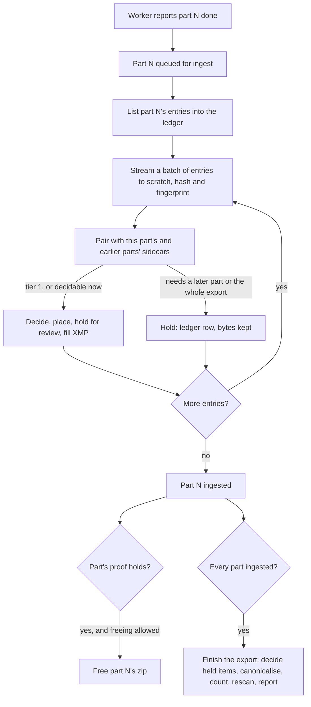

# Ingest each Takeout part as it downloads

Design for [#424](https://github.com/AnthonyPluth/Darkroom/issues/424), prepared 2026-11-18. **Phase 1 (PP-1 to PP-9) is built and switched on for new and in-flight exports. Phase 2 (PP-10, #487: freeing a part's zip on its proof and the held copies at completion) is built too, after the owner amended promise 2 (decisions 1 and 4 on #424, recorded in docs/DECISIONS.md); it stays off for Immich-managed imports. Section 6 lists the promise amendments, and section 10 the decisions only the owner can make.**

A full Takeout of a large library is about 25 parts of about 53 GB each. Today Darkroom waits for every part of an export to download, then unpacks all of them into one staging copy, then pairs, fingerprints, dedupes and places, and keeps the zips and the staging copy for 14 days after the import finishes. For 25 parts that is a wait of a day or more before the first photo lands and a peak of about 2.7 TB on the share. This design ingests each part as soon as it has downloaded, without a full second copy, holds the few items that need something from a later part, finishes the rest when the export completes, and lets a part's zip go once nothing it holds exists only in the zip.

## 1. How it works today

### Where "all parts first" is enforced

| Step | Code | What it does |
| --- | --- | --- |
| Download finish | `darkroom/domain/downloads.py`, `finish` | Refuses unless `exports.all_done` (`darkroom/domain/exports.py`: every part `done` and `part_count == len(parts)`); only then sets the export `downloaded` and calls `run.request_import`. `part_done` records one part and queues nothing |
| Import gate | `darkroom/domain/ingest/run.py`, `IMPORTABLE`, `import_export`, `request_import`, `waiting_exports` | An export is importable only in `downloaded`, `unpacking`, `importing` or `failed`; while it is `downloading` (`exports.STILL_WAITING`) the import tick (`darkroom/server/jobs.py`, `run_imports`, every 60 s) skips it |
| Unpack | `darkroom/domain/ingest/unpack.py`, `check_parts`, `unpack`, `extract` | `check_parts` fails the whole export when any part number up to `part_count` is missing, then runs `testzip` on every part. `unpack` extracts every part into one tree, `_inbox/<person>/export-<id>/staging/`, with a per-part marker in `.darkroom-unpacked/` so a rerun skips parts already extracted |
| Pair | `darkroom/domain/ingest/pairing.py`, `pair` (called from `run.prepare`) | Walks the whole staging tree at once: sidecars are looked up per folder, copies of the same bytes in different folders become one `TakeoutItem`, `-edited` files find their original by name, and the item's path prefers the year-folder copy |
| Dedupe | `darkroom/domain/dedupe.py`, `decide_all`, `decide`, `rivals_of` | Decides every candidate of the export together: tier 2's "exactly one candidate both ways" compares each item with all of the export's other items (`peers`), and edited copies are decided in a second pass after their originals |
| Count, rescan, report | `run.stage_count`, `check_unmatched`, `stage_rescan`, `stage_report` | Run once, after everything is placed |
| Cleanup | `darkroom/domain/ingest/cleanup.py`, `clean`, `clean_export`, `KEEP_FOR` | Only exports in `imported`, only `KEEP_FOR` (14 days) after the last finished `ImportRun`. Removes every staging tree and every zip of the export together, or keeps all of them (an item that failed, a review hold that no longer matches its staged copy) |

The docs say the same: [SPEC](../SPEC.md) "Takeout side (per export)" step 1 ("Unpack all parts of one export together into staging. Takeout can put a photo in one part and its JSON sidecar in another"), "Nothing is deleted until a whole export has been processed" and step 8; [the #259 design](immich-managed-storage.md) section 3 step 2 ("Unpack all parts together in `_inbox/`") and section 4 (14 days "measured from the final verified completion of the whole export"); AGENTS.md promise 2 ("Cleanup removes only staging, archives and resolved review holds, 14 days after the fact").

### What Takeout's part layout implies

Each of these is something the whole-tree walk handles for free and per-part ingest has to handle on purpose:

- **Media and its sidecar in different parts.** `pairing.sidecar_for` looks only in the media's own folder, with four rules in order (`exact`, `supplemental`, `counter`, `truncated`, the `RULES` tuple). The fixture builder already models a sidecar in another part (`tests/takeout_fixtures.py`, `TakeoutBuilder.add`'s `sidecar_part`).
- **One sidecar, two media.** An `-edited` file without its own sidecar uses its original's (`edited_sidecar`), so a sidecar is never consumed by the first media that pairs with it.
- **Copies across folders.** The same bytes in `Photos from 2019/` and in an album folder are one item (`pair`'s grouping by SHA-1, `slots_of`). The copies can be in different parts, and which copy names the item (the year folder first) depends on seeing all of them.
- **Duplicate-suffix and truncated names.** `IMG(1).jpg` pairs with `IMG.jpg(1).json` (`counter`); names longer than the 46-character sidecar limit pair by prefix (`truncated`). These rules need the folder's sidecar names, not their contents.
- **Edited copies.** Tier 3 skips an `-edited` file only when its original matched at tier 1 or 2, and the original can be in another part.
- **Bursts.** Tier 2 sends a shot to review when another item of the same export qualifies for the same phone original; that other item can be in any part.
- **Live Photo videos.** A video with no sidecar of its own uses the sidecar of its same-stem still (`live_match`, `sidecar_from_still`), for GPS, description and, only when the video has no date, the capture time. The still and its sidecar can be in other parts, so per-part ingest must carry them across parts like the `-edited` case.
- **Capture time comes from the sidecar when EXIF has none.** `metadata.candidate` falls back to `photoTakenTime`, and the time decides tiers 2 and 4 and the `google-only/YYYY/MM/` folder, so a media file's decision can depend on a sidecar that has not arrived.

Two things the code does not do today, which the task description assumed: `pairing.PairingReport.orphan_sidecars` and `unpaired_media` are computed but never reported anywhere outside the tests (`metadata.summarize` is test-only), so there is no unmatched-sidecar report to move; and `TakeoutItem.albums` feeds no decision (`live_pair_of` feeds a video's sidecar, above).

## 2. The per-part flow

### When a part becomes ingestible

`downloads.part_done` already records a part as `done` only after the worker has checked its size and run `testzip` (`darkroom_browser/jobs/download.py`, `problem_with`) and the server has checked its file and size. It also queues the part for ingest by setting its new ingest state to `queued`. `unpack.register_zips` (the manual inbox) queues each part it registers. The import tick runs queued parts as well as queued exports.

- A part is ingested under the existing per-account lock (`run.account_lock`), one part at a time per account, so per-part ingest never runs beside a whole-export import of the same account.
- Exports of one account ingest in creation order: a part of a later export waits until every earlier export of that account has finished, failed or expired. That keeps `dedupe.repeated` and tier 1 against earlier exports' Takeout items exactly as they are today, when exports import one after the other.
- The export's status stays the download's (`downloading`) while its parts ingest, so the worker's calls (`waiting_export`, `STILL_WAITING`) are unchanged. Ingest progress lives on the parts.
- The server runs `testzip` on the part before its first entry is read, as `check_parts` does today, so a damaged part changes nothing.

### What unpacks

Nothing is unpacked into a full staging tree. For each part:

1. **List.** Read the zip's central directory and record every entry in a new ledger table (`takeout_entries`: export, part number, entry name, kind `media`, `sidecar` or `other`, size, CRC-32). Entries go through the existing checks (`unpack.plain_entry`, `safe_target`, the symbolic-link refusal), so a part `unpack` would refuse is refused before anything else happens. The entry name is the path `unpack` would have staged it at, so a decision's `source_path` keeps its meaning.
2. **Sidecars.** Each sidecar's raw JSON goes into a ledger table (`takeout_sidecars`: export, part, folder, name, text). The text is what `MediaItem.sidecar_json` already stores for a paired item; it is small, and once it is in the database the zip is no longer needed for it.
3. **Media, in batches.** Media entries are streamed, a batch at a time (the existing `PINNED_AT_ONCE` of 100 files, capped by bytes as well), into a scratch folder in the export's inbox tree, hashing the SHA-1 on the way. Fingerprints and EXIF are read from the scratch files exactly as `run.prepare` reads staged files today (`exiftool` and Pillow need a file path, so pure in-memory streaming is not possible without changing those providers). The scratch folder is emptied after each batch and swept after a crash. This is the only extracted copy, and it never holds more than one batch.
4. **Pair** each media entry (next subsection), then decide what can be decided, place or hold it, and mark the entry's outcome in the ledger, one commit per entry as `stage_place` commits per item today.

### Pairing within a part, and items held for later

Pairing works on names, so `pairing.pair` is first split into a pure function over a list of (folder, file names) and a walker that feeds it from a directory (section 9, PP-1). Per part, a folder's sidecar set is this part's sidecars in that folder plus every earlier part's sidecars in it (from `takeout_sidecars`), and the same rules run in the same order.

A media entry ends the part in one of these states, each with a ledger row:

| State | When | What happens next |
| --- | --- | --- |
| **Copy of an item** | Its SHA-1 equals an item already seen in this export, in another folder | Attached to that item as a copy, with no decision of its own, as `pair` groups copies today. It never produces a tier-1 match against its own export. The relation doesn't depend on listing, id or hash order (PP-4): an item's root, once its part has paired it, stays the root; a part's newly hashed entries attach in whole-export naming order (year folder first, then not Trash or Archive, then path) to the same-SHA-1 item with the most copies that has none in their folder, or become roots. Each item then has the folders whole-export `slots_of` gives it. Which entry is the root follows arrival, not whole-export naming: an earlier root whole-export wouldn't pick stays the root (nothing is moved on it), and its `source_path` is canonicalised at completion (D2, D6) |
| **Decided** | Tier 1 (same SHA-1 as a phone item or an earlier export's Takeout item), whatever its sidecar; or paired by a final match ("Final and provisional matches" below), not edited, and with no phone shot that `same_shot` matches at any time the decision can use (so tier 4's perceptual check or tier 5) | Decided now with `dedupe.decide`, applied with `dedupe.apply`, placed or held for review with `place.place`, reading the bytes from scratch. A tier-1 item without a final sidecar yet is marked "metadata pending": its XMP fill (`place.fill_original` or `refresh_takeout`) runs when a final match arrives, at completion with the sidecar whole-export pairing chooses if it is still provisional then, or never if it has no sidecar at all, which is what whole-export ingest would do |
| **Waiting for its sidecar** | Not tier 1, not edited, and no sidecar yet or only a provisional one (its `sidecar_entry_id` is then the current choice, chosen again each part) | Held until a later part makes its match final, then treated as just arrived; or until the export finishes, when its provisional sidecar is the one whole-export pairing chooses and it is decided with it |
| **Waiting for the export** | Not tier 1, and either an `-edited` file (tier 3 needs its original's final decision, and its own sidecar may still arrive), or a tier-2 candidate (one or more phone shots `same_shot` match it, so the rival check needs every item of the export) | Held until the export finishes, then decided with the whole export as peers |
| **Failed** | Hashing, reading or placing failed | Recorded as today (`import_item_failed`), counted in the run, and pins the part's zip |

A held item keeps its fingerprint fields in the ledger (everything `dedupe.TakeoutCandidate` needs) and its bytes. While the part's zip is kept, the bytes are the zip entry itself and nothing is copied. When the zip is to be freed, each held item's bytes are first copied once into a held store, `_inbox/<person>/held/export-<id>/`, through `paths.write_inbox_once` with its SHA-1 checked, the same writer review holds use today.

A sidecar that arrives after its media pairs with the held media (or with a tier-1 item's pending metadata) in the part that brings it. Sidecars are never removed from the ledger when they pair, because an edited copy may still need the same one.

**Final and provisional matches** (PP-4). Every part pairs over every name the ledger knows so far, and an undecided entry's sidecar is chosen again each time, so nothing sticks from an earlier part. A match is *final* when the media's own name and the sidecar's name settle it (the `exact`, `supplemental` and `counter` rules). A match that the folder's other names decide (a long name's cut sidecar settled by title, the two folder rules, an edited or creation file's base name, a shared claim) is *provisional*: a later part can bring a name that changes it. A non-tier-1 entry is ready only on a final match; on a provisional one it waits for its sidecar and is decided at completion unless a later part makes the match final. A tier-1 entry is decided at once, but its XMP fill waits for a final match. So nothing irreversible (placement, an XMP write, the freeing of its bytes) is done on a match that can still change. A final match could change only if a later part brought a media file whose name begins with another's whole name (`IMG.jpg` and `IMG.jpg.mp4`), or a second sidecar that the name rules match for the same media. Takeout isn't known to do either; PP-6's comparison counts it (D3).

**The tier-2 hold uses the sidecar's times.** Whole-export takes the capture time from the sidecar when the file has none, drops a scan `CreateDate` once a sidecar has a time, and derives an offset or a wall clock from the sidecar's time and GPS (`metadata.candidate`). The ledger doesn't record which tag the file's time came from, so a paired entry is a tier-2 candidate when a phone shot matches (`same_shot`) any of those times: its own, the sidecar's `photoTakenTime`, the UTC time its wall clock gives with the offset derived from the sidecar's time, and the wall clocks the sidecar's GPS gives. The ledger doesn't keep the file's own GPS, which `metadata.candidate` uses for the wall clock when the sidecar has none, so then the sidecar's time is matched against a phone shot's wall clock in any zone (any whole-minute offset within 16 hours). This can hold an entry that whole-export would not count as a tier-2 candidate, which costs only time, and never releases one that it would.

### What runs only when the export completes

The export finishes when its `part_count` is known, every part is downloaded and every part is ingested. Then, under the account lock:

1. **Decide the held items** with `dedupe.decide_all`, whose peers are every candidate of the export from the ledger, the early-decided ones included, and whose `decided` map for edited copies is every stored decision of the export. An item still waiting for a sidecar is decided with its provisional sidecar, which once every part is paired is the one whole-export pairing chooses; only an item with no sidecar at all is decided without one. Their bytes come from the zip or the held store.
2. **Canonicalise.** Run the pure pairing over every name in the ledger, as the whole-tree walk would. Rewrite each decision's `source_path` to the copy whole-export ingest would have chosen (the year-folder copy first). Compare each item's chosen sidecar with the canonical choice and count differences whose JSON differs (section 7, D3).
3. **Report what never paired:** the count of sidecars no media used and of media that never had a sidecar, in the run and its `import_done` event. This is new, since today nothing surfaces `orphan_sidecars`; whether it also goes into the "Export imported" alert's text is the owner's call (section 10).
4. The existing tail, unchanged: `stage_count` (tier counts, `added_items`, `check_unmatched`'s unmatched-originals alert), `stage_rescan`, `stage_report` ("Export imported" summary), and the export becomes `imported`.

Anything that needs the full set runs here and nowhere else: the tier-2 rival check, tier 3, the canonical source paths and sidecar choice, the unmatched-originals alert, the counts and the summary. Immich rescans can also run after each part that placed something, so photos show sooner; that is a decision for the owner (section 10).

### An export that never completes

Today an export with a part that never downloads imports nothing. With per-part ingest, the parts that did download are already ingested and their records stand, and the held items wait. The proposal keeps them held, keeps every zip that holds one, and raises the existing failure alert. Finishing an export without its missing parts (deciding held items with what is known) is a separate owner decision and a later issue.

## 3. Idempotence and crash safety

Every step writes its ledger row and its effect so that running it again changes nothing:

- **Entries** are unique on (export, part, entry name). Listing a part again finds the same rows and adds none.
- **Decisions** are unique on (export, `source_path`) already, and `dedupe.apply` returns the stored row when one exists.
- **Placement** uses `place.copy_into`, which adopts an existing file with the same SHA-1 rather than writing a second; review holds and the held store use `paths.write_inbox_once`, which does the same in the inbox.
- **XMP fills** go through `xmp.fill`, which writes only missing fields.

The cases the task names:

| Case | Behaviour |
| --- | --- |
| Re-running an ingested part | The part's state is `ingested` and its entries are terminal: nothing is read. Forcing a rerun reads the central directory, finds every entry recorded with the same size and CRC-32, and does nothing else |
| A part ingested twice at once | Impossible: the account lock admits one ingest, and the second is skipped as `Busy`, as `run_waiting` does today |
| A crash mid-part | Entries already terminal stay terminal; the next tick resumes the part at its first entry that is not. The scratch folder is swept first. A placed file whose ledger row didn't commit is adopted by SHA-1, as a rerun of `stage_place` adopts one today |
| Parts out of order | Nothing depends on order except what is held: a sidecar seen first waits in `takeout_sidecars` for its media, a media seen first waits for its sidecar, and everything order-sensitive is decided at completion. Section 7 shows the result is the same |
| A part re-downloaded | If its central directory matches the ledger (same names, sizes and CRC-32s), it is the same part and nothing happens. If not, the part is refused, kept and alerted, and nothing is written: Takeout does not change a part's content, so a difference means a wrong file or a different export |
| A crash while freeing a zip | Freeing is journalled (section 5); a restart finishes or refuses it and never records a zip as freed while it still exists, or as present once it is gone |

## 4. Disk budget

For 25 parts of 53 GB, Z = 1.33 TB. Media is already compressed, so an unpacked part is about the size of its zip. Placed `google-only/` copies (G, the tier-5 share) and review holds (R) are the same in every column, so they are left out of the totals and written as "+ placed". H is the held items' bytes: items waiting for a sidecar (only those whose sidecar straddles a part boundary, expected to be few), edited copies (expected to be a few percent) and tier-2 candidates, whose share is unknown until spike #20's results table is filled in: it is the share of Takeout items whose bytes differ from the phone original.

| | Today | Per-part, zips kept to 14 days (phase 1) | Per-part, zips freed on proof (phase 2) |
| --- | --- | --- | --- |
| Zips | 1.33 TB, until 14 days after completion | 1.33 TB, until 14 days after completion | About 2 parts (the one downloading and the one ingesting), 0.11 TB |
| Unpacked copy | 1.33 TB staging, until 14 days after completion | One scratch batch, a few GB | One scratch batch, a few GB |
| Held items | None (staging has everything) | None copied (read from the kept zips) | H, kept until the export is finished (owner decision 4; this table first assumed 14 days) |
| **Peak, tier-2 share 0%** | **2.65 TB + placed** | **1.34 TB + placed** | **about 0.15 TB + placed** (edited copies only) |
| **Peak, tier-2 share 30%** | **2.65 TB + placed** | **1.34 TB + placed** | **about 0.55 TB + placed** |
| **Peak, tier-2 share 100%** | **2.65 TB** (little is placed) | **1.34 TB** | **about 1.45 TB** (everything held until completion) |

Even in phase 1, with no promise changed, the staging copy disappears and the peak roughly halves. Phase 2's saving depends on how much is held until the export completes, which is why the tier-2 hold is an owner decision (section 10, decision 3). Under the #259 target, placed items go to Immich rather than `google-only/`, so the "+ placed" term leaves Darkroom's disk entirely.

Downloads never wait for ingest to catch up: if ingest falls behind, zips accumulate as they do today, and the export cannot expire because ingest is slow. Downloads pause only when free space on the share falls below a threshold (the #259 design's backpressure; the threshold is an owner decision), and the pause raises the existing expiry alerts.

## 5. When a part's zip may be deleted

### The proof

A part's zip may be deleted only when all of these hold, rechecked under the database's write lock immediately before the delete:

1. The part's state is `ingested`, and the ledger lists every entry of its central directory (names, sizes and CRC-32s match the file on disk). An entry the ledger doesn't know pins the zip.
2. **Every media entry has a recorded, verified outcome**, and none is `failed`:
   - placed: the `google-only/` file exists, is a regular file inside the person's folder, and hashes to the entry's SHA-1 (hashed again, not trusted from the write);
   - held for review: the review hold exists in the inbox and hashes to `ReviewItem.hold_sha1`;
   - held for later: the held-store copy exists and hashes to the entry's SHA-1;
   - skipped (tier 1, 2 or 3): the decision row exists, is automatic and unreversed, and its matched item still exists; a pending XMP fill is recorded with the sidecar text it needs;
   - a copy of an item whose own entry has one of the outcomes above.
3. **Every sidecar entry** is in `takeout_sidecars` with its full text (byte length matches the entry's size).
4. **Nothing the zip holds is only in the zip**: every `other` entry is a kind Darkroom never reads (`pairing.NON_MEDIA_JSON`, the archive browser page), recorded by name and size.
5. The part is not being ingested, the export is not being finished, and nothing is pinned by an owner action (a review undo or reassignment in progress).

Freeing is a cleanup step, not part of ingest, and runs at least one tick after the part became `ingested`, so a second, independent pass reads the disk again. The delete has a journal (`freeing`, then `freed`, as `duplicate_removals` does for the losing copy): a crash between the two finishes or refuses on the next run. The remover is one function in `darkroom/storage/paths.py` that refuses anything but a `.zip` directly in the export's inbox folder, through `Photos.removable`, with one caller module, held by a Semgrep rule like `darkroom-losing-copy-one-caller` and a negative test for each refusal.

### One deletion, step by step (#487)

A part's zip and a held copy are deleted by one routine, `paths.remove_checked` (through `remove_part_zip` and `remove_held_copy`), and recovered by another, `paths.put_back_claimed`, which `part_free` calls before it proves anything. The journal (`freeing`, then `freed`, on `export_parts` or `takeout_entries`) is written by `part_free`. The remover claims the file into a private, locked folder beside it, `.freeing-<hash>/copy`, renamed without replacing. It deletes only the claimed inode the proof checked, and then requires the name to be absent: no entry at the name and nothing claimed (`paths.inbox_entry_absent`, which raises when the folder can't be opened). The same table holds for a zip in `_inbox/<person>/export-<id>/` and for a held copy in `_inbox/<person>/held/export-<id>/`.

| At the name | In the claim folder | Where a crash left it | Outcome |
| --- | --- | --- | --- |
| The proven file | Nothing | Before the claim (journal `freeing`) | Proved again, claimed, deleted, absence checked, recorded `freed` |
| Nothing | Nothing | After the delete, before `freed` was written | Absence checked, recorded `freed` with the part's size |
| Nothing | The proven file | After the claim, before the delete | Put back first, then proved again and freed as in row 1; until then it counts as present, never `freed` |
| Another file | The proven file | After the claim, then something took the name | Can't be put back: both kept, counted as present, the attempt refuses (`zip_changed` / `changed`) |
| Nothing | Another file | A claim of a file that was not the proven one | Put back, then proved as whatever it is: a different file fails the proof and is kept |
| A link, a folder or a hard-linked file | Nothing | Any | Refused (`Photos.removable`, or not a plain single-linked file); kept; never absent |
| A different file than the proof checked | Nothing | Swapped in before the claim | Refused at the identity check; kept |
| A different file than the proof checked | — | Swapped in at the claim | The claimed inode isn't the proven one: put back and refused; kept |
| A new file | Nothing | Created after the proven file was deleted | The absence check fails: not recorded `freed`; the new file is kept and proved like any file at that name |
| Anything | Anything | The folder can't be opened (missing, a link above it) | The attempt fails with the error type logged; the journal stays as it was and nothing is recorded `freed` |

Each row has a test: `tests/test_paths.py`'s `PartZipRemoverTests.test_every_cell_of_the_removers_state_table_for_a_zip_and_a_held_copy` and `test_a_file_that_takes_the_name_right_after_the_delete_is_kept_and_the_remover_refuses`, and through `part_free` `tests/test_part_free.py`'s `JournalTests`, `ClaimSwapTests` and `ClaimRecoveryTests`.

### Against today's retention and Takeout's limits

Today a zip is kept 14 days after the whole export finishes. Takeout allows 5 downloads per part, and the export expires about 7 days after it is ready; Darkroom caps itself at 2 retries per part and normally uses 1 download.

What a freed zip could still have been needed for, and what the proposal does instead:

| Reason to redo | Needs the zip? |
| --- | --- |
| A sidecar that arrives in a later part | No: the media is held, with its bytes, until it pairs or the export finishes |
| A bug in sidecar parsing | No: the raw sidecar text is in the ledger and is parsed again |
| A bug in a pairing rule | Mostly no: pairing is re-run on names from the ledger. A tier-5 item placed with the wrong metadata has its bytes in `google-only/`; a held item has them in the held store |
| A bug in fingerprinting or a tier rule that should have placed or held an item Darkroom skipped (tier 1, 2 or 3) | Yes: the Takeout copy of a skipped item is gone. Google and the phone original still have the photo. While the export is still live, the part can be downloaded again (one of its remaining downloads); after it expires, only a new Takeout export brings it back |
| Undo of a skip from the review queue | No: `dedupe.reverse` places nothing today |
| A review "keep both" | No: it reads the review hold, which is checked against `ReviewItem.hold_sha1` rather than a staged copy (`review.kept_fields` already falls back to it) |
| Retrying a failed item | Yes, and a part with a failed item is never freed |

Today the same skipped Takeout copies are deleted 14 days after completion, so the loss in the last-but-one row is not new; per-part freeing makes it happen within the export's own download window instead of two weeks later, and keeps everything else re-derivable from the database.

### The safe default

- **Phase 1 (no promise changes):** ingest each part as it downloads; no staging copy; keep every zip to today's 14-day rule after the export completes. The scratch batch is the only new deletion, and it deletes a copy of bytes the zip still holds.
- **Phase 2 (the owner amended promise 2, decisions 1 and 4 on #424; #487):** free a part's zip on its proof, as above, and free the held store when the export is finished, once every held item's outcome is verified again.
- Never free a zip with a failed, unknown or pinned entry, or while its export has another export of the same account waiting ahead of it.
- Under the #259 target, the proof's "placed" becomes "committed, verified receipt", and freeing also needs the backup recovery-point proof of that design's section 4, which does not exist yet; until it does, phase 2 stays off for Immich-managed imports.

## 6. The promises

| Promise | Effect of this proposal |
| --- | --- |
| 1. An original is written once | Unchanged. Placement still goes through `place.copy_into` and, for whole-export ingest and review holds, `paths.write_once`; per-part and finish Google-only placements copy into a private placement copy before the write lock and `copy_into` renames it into `google-only/` without replacing (`paths.StagedPlacement.publish`, #517), falling back to `paths.write_once` where the share can't rename or link it; XMP fills still write only `.xmp` files; nothing under `originals/` is read differently. `tests/test_place.py`'s `FixtureExportRun` whole-tree SHA-1 check must also run on a per-part ingest of the same export (PP-7) |
| 2. Dedupe deletes nothing on Unraid, except the losing copy | **Needs the owner to amend it for phase 2.** It says "Cleanup removes only staging, archives and resolved review holds, 14 days after the fact". Freeing a part's zip on proof deletes an archive before 14 days. The held store is staging in the promise's sense; the design proposed it keep the 14-day rule, and the owner chose to free it at completion instead (decision 4). The scratch batch is deleted right after use; it is a copy of bytes the zip still holds, but the wording should say so (decision 2). The losing-copy rule is unchanged: copies of an item attach without a decision, so `takeout_copies`'s "every decision naming it is an unreversed automatic tier 5" sees the same decisions as today. A copy arriving in a later part after the reconcile has already removed its item attaches to the removed item and is never placed again (the existing "a retried import never places a removed Takeout copy again" rule, which PP-5 must test). Pixel pruning still rests only on unreversed automatic tier 1 or 2 decisions; tier 2 is decided only at completion, as today, and tier 1 earlier, which proves the same thing earlier |
| 3. Retired | Not affected |
| 4. The worker never types a password or 2FA code | Not affected: the worker's download loop is unchanged |
| 5. Metadata gaps go in XMP sidecars | Unchanged: a late sidecar fills through the same `xmp.fill` and `refresh_takeout` |
| 6. No design changes without sign-off | The Exports page changes (section 8). Nothing on screen is built before the owner signs off a design in `docs/design/web/` |

"Deleting is the one thing that can lose a photo" applies to the zip remover: it gets a negative test for each way it must not act (an unknown entry, a failed entry, a placed file with the wrong hash, a held copy missing, a link anywhere on the path, an active ingest, a re-downloaded part whose listing differs, a crash between journal and delete).

The docs this amends, in the same pull request as the code that needs it: SPEC "Takeout side (per export)" steps 1 and 8 and "Nothing is deleted until a whole export has been processed"; the #259 design's section 3 step 2 and section 4's retention clock; AGENTS.md promise 2 and `.github/agent-review/invariants.md` item 2 (phase 2 only).

## 7. Dedupe correctness

### The claim

With the dedupe index fixed while the export ingests (no phone items arriving from the Immich reconcile in between) and Takeout's naming as observed (at most one sidecar in a folder matches a media file under the rules), per-part ingest in any part order gives the same decisions (tier, matched item, person, decided by, reason, keyed by canonical `source_path`), the same placed files and month folders, the same review holds and the same XMP sidecars as whole-export ingest.

### Tier by tier

- **Tier 1** depends on the item's SHA-1 and the index: phone items, and Takeout items of the account's other exports. The export's own items never enter it, because a copy with the same SHA-1 attaches to its item instead of being decided, and exports of one account ingest in order. Order-independent.
- **Tier 2 and its ambiguous tier 4** depend on the phone shots (fixed) and on every other item of the export (`rivals_of` over `peers`). Every tier-2 candidate is held to completion and decided with the whole export as peers, early-decided items included (their fingerprints are in the ledger). Same result. An item can only be a rival if it `same_shot` matches the phone shot, which makes it a tier-2 candidate itself or a tier-1 item; both are in the peers.
- **Tier 3** depends on the original's decision. Edited copies are decided at completion, after every original, in the same two passes `decide_all` uses. Same result.
- **Tier 4 (perceptual)** compares only with phone shots (`nearest` reads `index.phone_times`). It depends on the capture time, which can come from the sidecar, so an item is decided only once paired or at completion. Same result.
- **Tier 5** depends on nothing else; its month folder comes from the same capture time. Same result.
- **The index growing as parts land:** within an export it doesn't, by the copy rule above; the Takeout items placed from earlier parts of the same export are never matched against.

### The exact differences

| | Difference | Effect | Proposal |
| --- | --- | --- | --- |
| D1 | Phone items that arrive through the Immich reconcile while the export ingests are seen by later parts and by completion, not by earlier parts | An item an early part placed at tier 5 could have matched at tier 1, 2 or 4 had it been decided later. The reconcile's Takeout-copy resolution (`takeout_copies`) then resolves the pair as it does today for a Takeout imported before Immich; the photo set is the same, but the records differ (a tier-5 decision and a `duplicate_removals` row instead of a tier-1 or 2 decision) and the phone item is not `confirmed_in_google` by this export | Accept: the export is a snapshot taken when Google made it, and whole-export ingest has the same effect for anything that arrives after its single dedupe pass. The property test fixes the index |
| D2 | An item with several copies is first named by the copy seen first | Its decision's `source_path` is rewritten to the canonical copy at completion. Its placed file's name comes from the first-seen copy and is never renamed (written once) | Differs only when Takeout names a photo's album copy differently from its year-folder copy (unverified; PP-6 counts it) |
| D3 | A media file paired early with a sidecar that the canonical pairing would not choose: another copy's sidecar, a lower rule's match when a higher rule's sidecar is in a later part, or a final match that a later name contests (section 2, "Final and provisional matches"). A provisional match is never acted on, so it isn't one | Counted at completion; matters only when the two JSONs differ | Expected to be zero (one sidecar format per export); any non-zero count is a bug with an event, and the fixture tests assert zero |
| D4 | An export with a part that never downloads | Whole-export ingest imports nothing; per-part ingest has ingested the other parts | Owner decision 5 |
| D5 | Timing | Photos, confirmations and Pixel prunes from tier 1 arrive days sooner; tier-2 confirmations at completion, as today | None needed |
| D6 | Two copies of the same bytes in one folder | Whole-export assigns copies to items by sorted path (`slots_of`); per-part by arrival. Both items get the same tier and adopt the same placed file | Only the `source_path` of the second item can differ; canonicalised at completion |
| D7 | Two different photos in one folder that collide on their placed name (found by PP-7's gate, #484: `IMG_4000.JPG` and `IMG_4000(1).JPG`) | When two different photos in one folder collide on name, per-part gives the plain name to whichever part arrived first, and whole-export gives it to a fixed photo; the other gets the `~<sha1>` suffix either way. No photo is lost, and tiers, counts and file contents must match | Accepted by the owner (#484, 2026-11-21). PP-7's gate asserts exactly this difference, only which of the two photos gets the plain name, and nothing wider |

## 8. How the owner sees progress

The Exports page shows each part's download state today (`exports.part_dict`, `frontend/src/pages/Exports.svelte`'s parts table, and the line "Darkroom downloads each part once and keeps the file until it is imported"). Per-part ingest needs it to show, per part, one of: downloaded, ingesting, ingested, holding N items, freed, kept (with why: a failed item, a listing mismatch); and per export: parts ingested of the total, items held until the export completes and how many are waiting for a sidecar, and how much disk was freed. The Imports page may show a run that is still taking parts. The API gains the part fields (`contract.py`, `api-types.ts`, the feature map).

**This changes screens, so it needs the owner's design sign-off first** (promise 6; the signed-off Exports designs are `docs/design/web/04-exports-desktop.dc.html` and `04-exports-phone.dc.html`). This document designs no visuals; PP-12 adds the API only, and the screen waits for a signed-off design. The API reports `kept_reason` as `failed_item` only (from `failed_items`); a refused part carries no reason code until a later issue stores the reader's refusal reason on `export_parts`. PP-10 (#487) adds each part's `freed` and `bytes_freed`, and the export's `bytes_freed` sums them; the screen shows neither until a signed-off design does.

## 9. Plan

### Tests

- **Pairing equivalence** (PP-1): the pure pairing over names gives exactly `pair`'s report for every existing `tests/test_pairing.py` case and for builder exports.
- **Order property** (PP-7): for exports built by `tests/takeout_fixtures.py`'s `TakeoutBuilder` with 3 to 5 parts, sidecars in other parts, album copies across parts, edited copies apart from their originals, numbered and truncated names, a burst that makes tier 2 ambiguous across parts, orphan sidecars and non-media files, ingest the parts in every order (all 120 orders of 5 parts; seeded random orders for larger builds, with `random.Random`, no new dependency) and assert that the final `dedupe_decisions`, `media_items`, `review_items`, the files under `google-only/` and the review folder, their `.xmp` sidecars and the run's counts equal a whole-export ingest of the same build, after mapping database ids. Run it on SQLite and, in `make test-pg`, PostgreSQL.
- **Crash points** (PP-5, PP-6): stop the ingest after each commit of a part (a test hook raising at the Nth commit) and resume; the result equals an uninterrupted run, and no file is written twice.
- **Re-download** (PP-3): the same part again changes nothing; a part whose listing differs is refused and nothing is written.
- **Zip freeing** (PP-10): a negative test for each failed proof condition in section 5, a file swapped in at every step, and the journal's crash boundaries; Semgrep's one-caller rule with a failing and a passing example.
- **Promise 1** (PP-7): `FixtureExportRun`'s whole-tree SHA-1 before and after, on a per-part run.
- **Privacy**: new events and logs carry counts and ids only, never an entry name; `tests/privacy.py`'s `no_leaks` over a part ingest with canary file names and sidecar text.
- **Migration**: the new tables and columns in `tests/test_migrations.py` on both databases.

### Exports already in flight

The owner has one export running now. At deploy:

- An export whose stage is `unpacked` or later, or that has a staging folder, finishes the old way, and cleanup treats it as today.
- An export still downloading, or downloaded with stage `queued` or none and no staging folder, switches to per-part: its parts already `done` are queued at once and ingested in any order, and the rest as they arrive. Its zips stay to the 14-day rule (phase 1).
- An export marked `failed` before unpacking can be retried as per-part.
- No schema change touches the old path's rows; the migration only adds. Rolling back means stopping the import tick, then running the old code: a per-part export it finds `downloading` it leaves alone, and one `downloaded` it would unpack in full from the zips, which phase 1 keeps. The ledger rows stay and the old code ignores them. Phase 2 (freed zips, #487) has no rollback to whole-export ingest for its exports, which is one reason it waited for the owner's amendment of promise 2.

Which way the running export goes depends on its stage on the server, which this design can't see (section 11).

### Issues

Each is one session and one pull request, under about 1,000 added lines with tests. Opus is the default for this repository, and all of these touch the ingest pipeline, dedupe or deletion safety.

| Key | Issue | Depends on | Model |
| --- | --- | --- | --- |
| PP-1 | Split `pairing.pair` into a pure pairing over (folder, names) and the directory walker; identical reports | Nothing | Opus |
| PP-2 | Migration and models: part ingest state and counts on `export_parts`, `takeout_entries` (with candidate fingerprint fields and outcome), `takeout_sidecars`; tests on SQLite and PostgreSQL | Nothing | Opus |
| PP-3 | Part reader: list a part into the ledger with the existing entry checks, `testzip` first, scratch batches with SHA-1, the scratch sweep, and re-download comparison. No decisions | PP-2 | Opus |
| PP-4 | Per-part pairing against earlier parts' sidecars and held media, copy attachment by SHA-1, the hold states and rules, the held store writer | PP-1, PP-3 | Opus |
| PP-5 | Decide, place and hold per part; late-sidecar XMP fills; queueing from `part_done` and `register_zips`; per-account export order; crash-point tests | PP-4 | Opus |
| PP-6 | Finish an export: decide held items with the whole export as peers, canonicalise source paths, count D2 and D3, report what never paired, then the existing count, rescan and report stages | PP-5 | Opus |
| PP-7 | The order property test and the whole-tree SHA-1 check on per-part runs; the gate before PP-9 switches anything on | PP-6 | Opus |
| PP-8 | Cleanup for per-part exports in phase 1: scratch and held store, review holds checked by `hold_sha1`, zips by today's 14-day rule | PP-6 | Opus |
| PP-9 | Switch: route new and in-flight exports as in "Exports already in flight", SPEC and the #259 design's section 3 updated | PP-7, PP-8 | Opus |
| PP-10 | Phase 2, after the owner amends promise 2: the zip proof, its journal, the one remover and its Semgrep rules, the negative tests, and the promise text in AGENTS.md, `invariants.md` and SPEC | PP-9, owner decision 1 | Opus |
| PP-11 | Download backpressure on free space, with the owner's threshold | PP-2, owner decision 8 | Opus |
| PP-12 | Part ingest fields in the exports API and contract, regenerated `openapi.json`, `api-types.ts` and feature map; no screen | PP-5 | Opus |
| PP-13 | The Exports page, built against the design the owner signs off | PP-12, owner decision 9 | Opus |

PP-1 and PP-2 can run at once; so can PP-8 and PP-12 once their dependencies land, and PP-11 at any time after PP-2.

## 10. Decisions for the owner

1. **Amend promise 2** (and the #259 design's retention clock) so a part's zip may be deleted before the 14 days, once its proof in section 5 holds? Recommended: yes, as phase 2, after phase 1 has run one export. If no, phase 1 alone still removes the staging copy.
2. **Scratch copies:** confirm that a scratch copy of bytes the zip still holds is deleted right after its batch, and is not "staging" under the 14-day rule.
3. **Tier-2 candidates:** hold their bytes until the export completes (exact; up to the whole export held in the worst case), or decide them per part (less disk, but a burst rival in a later part then makes a review item whose Takeout copy may be gone)? Recommended: hold, and look again once spike #20 says how many there are.
4. **Held store retention:** keep held copies 14 days after the export completes, as staging today (recommended), or free them at completion? (Answered: free them at completion; docs/DECISIONS.md.)
5. **An export that never completes:** keep held items and their zips, and alert (recommended), and later add a "finish without part N" action?
6. **Re-fetching a freed part** while the export is still live, at the cost of one of its 5 downloads: add the action later?
7. **Immich rescans** after each part that placed something (photos show sooner, recommended) or only at completion?
8. **Download backpressure:** pause downloads when free space falls below what threshold (suggested: three parts' worth plus the held store)? Downloads never wait on ingest itself.
9. **The Exports and Imports pages:** what they show is listed in section 8; their design needs your sign-off.
10. **The export running now:** switch it to per-part at deploy if it hasn't started unpacking (recommended), or let it finish the old way.
11. **The differences D1 to D6** in section 7: accept them as listed, or ask for a mitigation (D1 could re-check early tier-5 items against new phone items at completion).
12. **The unmatched report:** add the never-paired counts to the "Export imported" alert's text, or keep them in the run and the Imports page only?

## 11. What the code can't tell

- How often Takeout puts a media file and its sidecar in different parts, and how far apart: this sizes the "waiting for a sidecar" hold. The fixture builder models it; real exports haven't been measured.
- The tier-1 to tier-2 split (spike #20's results table is empty), which sizes the tier-2 hold and so phase 2's saving.
- Whether Takeout ever names an album copy differently from its year-folder copy (D2), or mixes sidecar formats in one export (D3).
- How long one part takes to ingest on the server (hashing, `exiftool` and perceptual hashes for about 53 GB) compared with how long it takes to download.
- Which stage the export running now has reached on the server, which decides its migration path.
- The part sizes: 25 parts of 53 GB is 1.33 TB, more than the "about 1.1 TB" of zips quoted; the tables use 1.33 TB.
