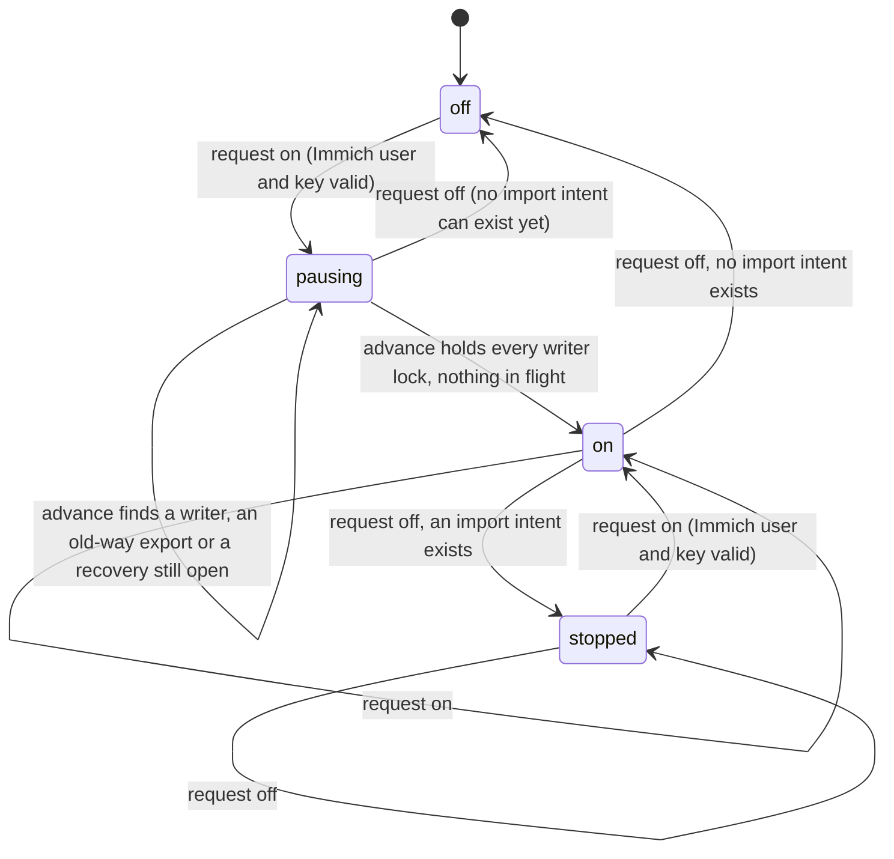

# Per-person switch to Immich-managed imports

Design for [#542](https://github.com/AnthonyPluth/Darkroom/issues/542), part of [#530](https://github.com/AnthonyPluth/Darkroom/issues/530), prepared 2026-11-24. **The owner answered its open questions on 2026-11-27 (section 14).** It fills in step 5 of [the managed-storage design](immich-managed-storage.md), section 9: "Switch a controlled import to native uploads/catalogue dedupe only after pausing that owner's legacy writers, reconcile and cleanup and waiting for active leases". Enabling still waits on the owner's gates in #266 (that design's section 2, "Before imports can be enabled").

PR #541 had a switch (329424f to ff52466) that was taken out after repeated race findings: the switch could flip to `on` while a legacy import was still copying (Codex P1), cleanup could remove a hold after the pause took effect (Codex P1), a stopped person's exports stalled with nothing saying why, an old-way retry after the switch stayed `importing` for good, and two functions disagreed about what "started" means (Second review). This design settles each of those before any code is written. The refusals at every entry point are [#543](https://github.com/AnthonyPluth/Darkroom/issues/543), the command is [#544](https://github.com/AnthonyPluth/Darkroom/issues/544) and the recovery-point gate for managed cleanup is [#545](https://github.com/AnthonyPluth/Darkroom/issues/545). This document defines the states, the lock order, the guard those issues use and what each writer does in each state.

## 1. What exists today

- `people.managed_imports` (migration 0049) is a nullable string. Only tests set it. `managed_ingest.begin` creates a `managed_import_intents` row (`kind = 'import'`) for a fresh export of a person whose setting is `on`. After that, the export's intent is what every guard reads (`place.managed_import`, `part_free.managed`, `cleanup.clean_export`, `managed_ingest.hold_pinned`).
- `people.managed_backfill` (migration 0051) is a separate opt-in. This design leaves it alone (section 6).
- Locks, all non-blocking (`fcntl.flock(LOCK_EX | LOCK_NB)`, `storage/locks.py`). A lock someone else holds raises `Held` at once:
  - `import-account-<account id>.lock`, plus an in-process `threading.Lock` (`ingest.run.account_lock`). Taken by part ingest, whole-export import, finish and part freeing.
  - `legacy-import-<slug>.lock` (`legacy.person_lock`). Taken by `legacy.import_person`.
  - `immich-reconcile-<slug>.lock` (`immich_reconcile.person_lock`). Taken by `reconcile_person`, which also runs the losing-copy removal (`takeout_copies.resolve_person`).
  - The database write lock (`db.write_lock`). On PostgreSQL this is a blocking transaction advisory lock with `lock_timeout`. On SQLite it does nothing: writes serialise through WAL's single writer. With the default pysqlite driver a plain `SELECT` opens no snapshot, so a session that only read takes the write lock at its first write and then reads the latest state; a deferred transaction fails with busy only when it began earlier (an explicit `BEGIN`, or an earlier write) and its snapshot is stale by the time it writes.
- `video_times.hold_locks` already takes several of these at once, in this order: account locks (ascending), then for each person the legacy lock and then the reconcile lock. ff52466's switch used the reverse order.
- Cleanup (`cleanup.clean`) takes no file lock. `clean_holds` takes no write lock, and `clean_export` for a whole export takes none either. Its sweeps (`paths.sweep_dropping`, `paths.sweep_placing`) finish or undo interrupted losing-copy removals and moves inside `google-only/`, so they write into an old folder.
- "Started" has three definitions: `managed_ingest.started` (any `stage`, which counts a whole export that is only `queued`), `ingest.run.started_whole` (a stage past `queued`, `unpacking`/`importing`, or a staging tree), and ff52466's version (stage past `queued`).

## 2. States and transitions

`people.managed_imports` takes exactly four values. The meaning of each, from the point of view of the old folders (`originals/`, `google-only/`, sidecars beside originals) and the person's inbox:

| State | Meaning | New exports | Old-folder writers |
| --- | --- | --- | --- |
| off (`NULL`) | Today's behaviour | Imported the old way | Run |
| `pausing` | The owner asked for `on`. Darkroom waits until every old-folder writer of the person has stopped | A fresh export waits, neither failed nor refused, and goes the managed way once `on`. An export already started the old way finishes the old way | Writers already running finish. None starts. Crash recovery still runs |
| `on` | New exports go to Immich | A fresh export gets an intent and is uploaded (`managed_ingest`) | Refused (#543). None is running |
| `stopped` | The owner turned it off after something went to Immich | A fresh export waits, with an alert once per export. An export with an intent still finishes | Refused, as for `on` |

Two functions in a new module, `darkroom/domain/managed_switch.py`, make every transition. Nothing else writes the column:

- `request(opened, person, want_on, now) -> str | None` makes the owner's transitions. #544's command calls it. It takes `db.write_lock`, makes the claim write (section 4) and refreshes the person. `on` checks `immich.is_canonical_id(person.immich_user_id)` and a sealed key; #544 adds the live check of the key's owner and grants. `off` goes to `stopped` when any `managed_import_intents` row of `kind = 'import'` exists for the person, and otherwise goes back to `NULL`. A backfill intent does not count, because the backfill writes nothing in the old folders and has its own opt-in. `stopped` goes straight to `on`: old-folder writers were refused all through `stopped`, so there is nothing to wait for. Each transition records a `managed_imports_set` event with the new state and sets `people.managed_imports_since`.
- `advance(opened, settings, person, now) -> Waiting | None` tries `pausing → on` and changes nothing else. The import tick (`server/jobs.py`'s `run_imports`) calls it for every `pausing` person before `run.run_waiting`, and the command calls it once right after `request`, so the owner sees at once whether the switch is waiting.

`advance`, in order:

1. If the person is not `pausing`, return.
2. Work out the person's account set: `accounts.accounts_serving(person)` plus the accounts of exports the person owns (`video_times.accounts_of`, which moves to the lock module in section 3).
3. Enter, through `writer_locks.hold` (section 3): each account lock in ascending order, then the person's legacy lock, then their reconcile lock. A lock someone else holds returns `Waiting` with the kind of writer holding it.
4. `db.write_lock`, the claim write, then refresh the person. If the person is no longer `pausing`, roll back and return.
5. Work out the account set again. If it has grown (an account was linked to the person while the locks were being taken), roll back and return `Waiting("accounts_changed")`. The next tick takes the new lock.
6. If any export of the person is `old` by `ingest.run.way` (section 5) and not finished (`status` not in `imported`, `failed`, `expired`), return `Waiting("old_way_export")`.
7. If the person has a `duplicate_removals` row in `pending`, or a `.dropping` or `.placing` leftover under their own folders (`paths.leftovers`, filtered to the person), return `Waiting("recovery")`.
8. If the person has no canonical Immich user or no sealed key any more, return `Waiting("no_key")`.
9. Set `on`, set `managed_imports_since`, clear `managed_switch_waiting`, record a `managed_imports_on` event, close the `managed:pausing:<person id>` alert and commit. The locks are released after the commit, in reverse order.

Every `Waiting` result is stored as `people.managed_switch_waiting` (a fixed code from the list above) in its own short write-locked transaction after the locks are released, so the status the owner reads is the last attempt's reason, not a guess.

## 3. One lock order for every old-folder writer

| Order | Lock | Key | Who takes it | Blocking |
| --- | --- | --- | --- | --- |
| 1 | Account import lock (in-process `threading.Lock`, then `import-account-<id>.lock`) | Account id, ascending | Part ingest, whole import, finish, part freeing, **cleanup of an export** (new), `advance`, `video_times.reread` | No (`Busy`) |
| 2 | Legacy import lock (`legacy-import-<slug>.lock`) | Person id, ascending | `legacy.import_person`, `advance`, `video_times.reread` | No (`Busy`) |
| 3 | Immich reconcile lock (`immich-reconcile-<slug>.lock`) | Person id, ascending | `immich_reconcile.reconcile_person` (losing-copy removal included), `advance`, `video_times.reread` | No (`Busy`) |
| 4 | Database write lock (`db.write_lock` plus the claim write) | One for the database | Every check that decides a write, every transition, every destructive batch | Yes (PostgreSQL advisory lock with `lock_timeout`; SQLite busy timeout of 30 s) |

Rules:

- A caller that needs more than one file lock takes them only through one helper, `darkroom/domain/writer_locks.py`'s `hold(stack, opened, settings, people, accounts)`. It takes the account locks ascending, then for each person by ascending id the legacy lock and then the reconcile lock. `video_times.hold_locks` moves there unchanged in behaviour; it already uses this order. Semgrep's new `darkroom-writer-locks-one-helper` flags any function outside `writer_locks.py` that enters more than one of `account_lock`, `legacy.person_lock` and `immich_reconcile.person_lock`.
- No file lock is taken while the database write lock is held or while a write transaction is open. A caller commits or rolls back first. File locks never block, so this is not about deadlock. It keeps a writer from holding the whole database while it fails over a file lock.
- A writer reads the switch state **after** its own file lock is held, in a fresh read under the write lock (section 4). A check made before the lock can pass, the switch can then take the lock, flip and release it, and the writer then takes the lock and writes. That is the legacy-import race on #541.
- Locks are taken before any writing and kept until the writer's last old-folder write has committed. A writer that commits between batches keeps its file lock across those commits. That is what lets `advance` treat "I hold the lock" as "nothing of this kind is writing".

The order matters even though no file lock blocks. Two callers that want overlapping sets in different orders can each get one lock and fail on the other, every tick. With one order, whoever gets the first lock in the order gets the rest unless a single-lock writer holds one.

## 4. The guard: write lock, claim write and refresh before every decision to write

`managed_switch.hold(opened, person, writer, export=None) -> None` is the single check. It raises `Paused` (a subclass of the caller's existing "not now" error, `run.NotReady`, so job loops skip it without failing) or `Refused` (#543's `place.LEGACY_REFUSED`):

1. `db.write_lock(opened)`.
2. The claim write: `UPDATE people SET managed_imports = managed_imports WHERE id = :person`, issued with SQLAlchemy Core so it is always sent. On SQLite this makes the transaction a writer. With default pysqlite a session that has only read has no snapshot yet, so the claim takes the write lock and the refresh that follows reads the latest committed state; the statement fails with busy only when the transaction began earlier and a transition committed after its snapshot, and then the caller rolls back without touching a file. Either way a transition and a batch are ordered, and the tests cover both. On PostgreSQL the advisory lock already orders it, and the update also locks the person's row.
3. `opened.expire_all()`, then refresh the person and, when given, the export.
4. Look up `writer` and the state in the per-writer table (section 6), with `ingest.run.way(export)` when the row depends on it.

What a caller must do:

- **Long writers** (reconcile, legacy import, part ingest, whole import, finish, part freeing) call `hold` once, right after their file lock is taken and before their first write. They keep the lock until they finish, so `advance` cannot flip under them.
- **Destructive batches** (each export cleanup, each review-hold removal, each zip or held-copy removal, each sweep entry) call `hold` at the start of the batch's own transaction. They delete the file in that same transaction and commit after the delete and its journal. A batch never reuses a check from an earlier transaction: after any commit, the next batch calls `hold` again. This is the fix for the cleanup race on #541. `clean_holds` and the whole-export `clean_export` move into write-locked transactions, and `clean_export` also takes its export's account lock, as `part_free.free_ready` does.
- **Request writers** (`review.resolve`'s Keep both, `review.undo`, `review.reassign` and the import route) already run in `db.session(engine, writing=True)`. #543 adds `hold` as their first call, for both people in a reassignment, by ascending id, so a reassignment never moves a file into or out of a managed person's `google-only/`.
- **The route decision** (`managed_ingest.begin`) calls `hold(..., writer="route")` under the export's account lock, so a fresh export is routed from the state as it is now, not from the person row the part ingest loaded earlier.

`hold` rolls its transaction back before it raises `Paused` or `Refused`, so a refused writer never leaves the claim transaction open (`tests/test_managed_switch_hold.py`). The claim write is new because `db.write_lock` alone does not order a read before a file deletion on SQLite. ff52466's `clean_holds` read the setting and deleted the file with no database write in between, so nothing could make it fail.

## 5. One definition of "started"

`darkroom/domain/ingest/run.py` gets `way(opened, photos, export) -> Literal["managed", "old", "fresh"]`. It replaces `managed_ingest.started`, and every caller that asks "has this export started?" to choose a route or a refusal uses it. `started_whole` stays only as `route_of`'s whole-versus-per-part test, renamed `staged_whole` so it can't be mistaken for this.

- `managed`: the export has a `managed_import_intents` row of `kind = 'import'`. An intent is created once, by `begin`, and never removed.
- `old`: there is no such intent, and Darkroom may have written something for the export outside its inbox, or recorded a decision from its bytes. That is any of:
  - `export.stage` is in `STARTED_STAGES` (`unpacked` and later; `queued` is not started);
  - an `import_runs` row in `running`, `done` or `failed`;
  - a part in `ingesting`, `ingested`, `refused` or `failed`;
  - a `takeout_entries` row with a `decision_id`, an `outcome` or a `held_path`;
  - a staging tree on disk (`run.staging_of`).
- `fresh`: everything else, including a whole export that is only `queued`, a per-part export whose parts are only listed or queued, and an export still downloading.

`fresh` is the only shape the switch can still route either way. `begin` makes that choice exactly once, under the account lock and `hold`: a fresh export of an `on` person gets an intent, a fresh export of an off person is ingested the old way, and a fresh export of a `pausing` or `stopped` person waits. After that, `way` never changes again except from `fresh`.

## 6. What each writer does in each state

"Waits" means the work is left for a later tick: the part stays `queued`, nothing is marked failed and no refusal is recorded. "Refused" is #543's fixed refusal, made before anything is registered or written. "Kept" means a destructive batch leaves its file and records why.

| Writer (module) | Writes | off | `pausing` | `on` | `stopped` |
| --- | --- | --- | --- | --- | --- |
| Immich reconcile (`immich_reconcile.reconcile_person`) | `originals/immich/`, losing-copy removal in `google-only/` and `originals/immich/`, Pixel queue from originals | Runs | One running at the request finishes. A later run only finishes the person's `pending` `duplicate_removals` (`takeout_copies.finish_pending`, split out of `resolve_person`): no listing, no new pair, no Pixel queue. Event `immich_reconcile_paused` once per state change. No failure alert | Catalogue-only (section 8): lists the person's phone assets, writes nothing on disk, records each as a verified managed version and queues its managed Pixel copy. No losing-copy removal | As `on` |
| Legacy import (`legacy.import_person`, `run.py import-legacy`) | `originals/legacy/` | Runs | One running finishes. A new one is refused under its lock | Refused | Refused |
| Per-part ingest and finish, `fresh` export (`part_ingest.ingest_part`, `finish_export.finish`) | `google-only/`, sidecars beside originals | Old way | Waits | Gets an intent, then managed | Waits, alert `managed:stopped:<export id>` once |
| Per-part ingest and finish, `old` export | as above | Runs | Runs to the end. `advance` waits for it | Refused (#543): only a retry of a failed or expired export can get here | Refused |
| Per-part ingest and finish, `managed` export | Immich, through `managed_upload` | n/a | n/a (no intent can exist) | Runs | Runs to the end. An intent is a commitment; leaving its photos half-sent helps no one |
| Whole-export import (`run.import_export`, `run.py import-takeout`, `POST /api/exports/{id}/import`) | `google-only/`, sidecars | Runs | An `old` one finishes. A `fresh` one is refused before it is queued (#543): the whole route has no ledger to upload from | Refused | Refused |
| Review Keep both, Undo, Reassign (`review.py`) on an old-way pair | `google-only/` | Runs | Runs. These are short write-locked requests, so they never hold up `advance`, and `hold` orders them against the flip | Refused (#543). Keep both on a managed pair goes to Immich as today | Refused, as `on` |
| Cleanup of an export's staging and zips (`cleanup.clean_export`) | Inbox | Runs after 14 days | Kept, event `cleanup_kept` with fixed text | Kept (open question 3) | Kept |
| Cleanup of review holds (`cleanup.clean_holds`) | Inbox | Runs | Kept | Kept | Kept |
| Cleanup sweeps (`paths.sweep_dropping`, `paths.sweep_placing`) | `google-only/`, `originals/immich/` (crash recovery) | Runs | Runs: it is recovery, and `advance` waits until none is left | Nothing to do: no writer that leaves one can run | Nothing to do |
| Part freeing (`part_free.free_ready`) | Inbox zips and held copies | Runs | Runs only for an `old` export that is not finished yet (it is a step of that export's own ingest, and `advance` waits for that export anyway). Kept otherwise, reason `managed_switch` | Kept for `old` exports. Managed exports stay off until #545 | Kept |
| Backfill (`backfill.run_all`) | Immich only; reads the old folders | Independent: it runs by `managed_backfill`, whatever this switch says | Same | Same | Same |
| Pixel tending (`pixel_folder.tend`) | `_pixels/` only | Runs | Runs on the copies already queued. No new phone copies arrive while the reconcile is paused (section 8) | Runs | Runs |
| `video_times.reread` | Database only | Runs | Runs (it takes the same locks in the same order) | Runs | Runs |

`reconcile_all` still runs the backfill for a person whose reconcile is paused. The job's skip must not drop the person from `backfill.run_all`.

## 7. How the owner sees the switch

The command is #544's (CLI first). This design fixes what it shows and where the same facts already appear:

- `run.py managed-imports status --person <slug>` prints the state, the time since `managed_imports_since`, the last `managed_switch_waiting` reason as a sentence, the paused writers for that state, and, while `pausing`, the side effect: "New iPhone photos are not copied to originals/immich or queued for the Pixels until the switch is on." For `waiting` on `old_way_export` it lists the export ids, not names. Failed or expired old-way exports are listed with "will not be retried after the switch" (open question 2).
- Events (the Events page, `GET /api/events`): `managed_imports_set` (requested state), `managed_imports_on` (flipped), `immich_reconcile_paused`, `cleanup_kept` and the part-freeing keep, each with a fixed text.
- Alerts (the existing alert list and push): `managed:pausing:<person id>` opens once the person has been `pausing` for a day, with the waiting reason as a fixed text, and closes when they flip or go off. `managed:stopped:<export id>` opens once per fresh export that waits because the person is `stopped`.
- Logs use `monitoring.log` with fixed texts and counts: the person's slug, export ids and the reason code, never a file name or a path.

A page in the web app needs a design the owner signs off first (promise 6). It is open question 4 and is not part of this design.

## 8. The accepted side effect

The owner's decision of 2026-11-24, recorded on #542: **while a person's Immich reconcile is paused, new iPhone photos stop reaching `originals/immich` and the Pixels; this is accepted, and the pause lasts until that person's managed imports are on.**

So, from the commit of `pausing` until the flip to `on`, the person's new Immich assets are not stored in `originals/immich/` and not queued for any Pixel serving them. They are still in Immich (Immich's own app uploads them), and the next reconcile run after the pause picks them up from its stored watermark (`immich_reconciled_until`, with its overlap), so nothing is lost, only delayed. The `pausing` alert after a day is how the owner learns that the delay is growing. From the flip to `on` the reconcile runs again as a catalogue-only run: it lists the person's phone assets from the stored watermark, streams each original once to verify its SHA-1 and size without keeping it, records a `ManagedAssetVersion` and a phone `ManagedAssetOrigin`, gives the asset a catalogue `MediaItem` (source `phone`, path `<slug>/immich-catalogue/<asset id><suffix>`, outside `originals/`) and queues the managed Pixel copies through `pixel_folder.queue_managed`. The `immich_assets` row gets status `cataloged` (migration 0064). Nothing is written under `originals/`, `google-only/` or anywhere else on disk; an asset whose bytes are already in `originals/` is marked `stored` as before and not catalogued. The classic reconcile ignores catalogue items when it looks for a stored original, so a person who goes back to off (possible only with no import intent) gets the original written the first time it sees the asset. A downgrade past 0064 is refused while an asset is `cataloged`.

## 9. Failure paths

| What goes wrong | What happens | What the owner sees |
| --- | --- | --- |
| A writer is running when `on` is requested | Stays `pausing`; `advance` retries every import tick | Status: "waiting for this person's Immich reconcile / legacy import / import of another account to finish"; alert after a day |
| An old-way export of the person is still downloading or ingesting | Stays `pausing` until it is imported, failed or expired | Status lists the export ids; alert after a day |
| A losing-copy removal or a move was interrupted | Stays `pausing`; the reconcile's recovery step and the cleanup sweeps finish it | Status: "an interrupted removal in this person's folders is being finished" |
| The person loses their key or Immich user while `pausing` | Stays `pausing` | Status and alert say the key is missing; `request on` is needed again after the key is fixed (it validates) |
| The key is revoked while `on` | Managed uploads stay pending with their alerts (`managed_ingest`); old-folder writers stay refused | The existing managed-import alerts; status says `on` |
| `request` and a batch race | Ordered by the write lock and the claim write; the loser rolls back with no file touched | Nothing: the batch runs next tick, or is kept with its reason |
| A fresh export of a `stopped` person | Its parts stay queued; no intent is created | One `managed:stopped:<export id>` alert with "this person's Immich-managed imports are stopped, so their new Takeout export waits until they are on again" |
| A part ingest finds `pausing` | Its part stays queued, logged as skipped | Nothing until the pausing alert; the export page shows it as queued |
| The CLI's `reconcile-immich` or `import-legacy` is run by hand while paused or refused | Exits 1 with the fixed reason; nothing written | The reason on stderr |
| The import tick fails inside `advance` | Rolled back, locks released, logged with the error's type; the rest of the tick runs | A log line; the state is unchanged |

## 10. Schema (migration described only)

One new Alembic migration, numbered after main's newest when it is written (0052 today), with its `test_<revision>_…` in `tests/test_migrations.py`, on SQLite and PostgreSQL:

- `people.managed_imports_since` `Float`, nullable: when the state was last set. It drives the day-old alert and the status line.
- `people.managed_switch_waiting` `String`, nullable: the last `advance` reason code (`reconcile`, `legacy`, `account`, `accounts_changed`, `old_way_export`, `recovery`, `no_key`, `pixel_source`), cleared on the flip.
- A check constraint `ck_people_managed_imports` with `models.one_of("managed_imports", ("pausing", "on", "stopped"), "ck_people_managed_imports")` (a `NULL` passes it), through `batch_alter_table` so SQLite rebuilds the table. The migration first refuses (raises) if any row holds another value, rather than rewriting it.
- `downgrade` drops the two columns and the constraint only when they are there, as 0049 does.

No new table. The journals the batches already keep (`export_parts.free_state`, `takeout_entries.held_state`, `review_items.hold_path`) are unchanged.

## 11. Negative tests each refusal needs

All in `tests/test_managed_switch.py` unless named otherwise, and run on SQLite and PostgreSQL (`make test-pg`):

- **The lock order.** A fake lock recorder sees `advance` and `video_times.reread` enter account locks ascending, then legacy, then reconcile. Semgrep's `darkroom-writer-locks-one-helper` has a failing and a passing example in `.semgrep/examples/darkroom/domain/writer_locks.py`.
- **Each lock held in turn** (each of two accounts, legacy, reconcile): `advance` leaves the person `pausing` with that reason and writes nothing else, then flips once the lock is released.
- **Account linked mid-switch**: an account is linked to the person between step 2 and step 4 (a hook in the test). Nothing is committed, the reason is `accounts_changed`, and the next call holds the new lock and flips.
- **Old-way exports**: one ingesting, one whole and running, one waiting for parts. Each keeps `pausing`. A failed and an expired one do not.
- **Recovery left**: a `pending` `duplicate_removals` row, a `.dropping` and a `.placing` leftover in the person's folder keep `pausing`. Another person's leftover does not.
- **Request off wins the race**: `request(off)` commits between `advance`'s first read and its write lock. The person ends off, never `on`.
- **Transitions table**: every (state, on/off) pair gives section 2's result. Off from `on` with only a backfill intent gives off. `on` without a canonical user or a sealed key is refused and nothing changes.
- **"started"**: one test per bullet in section 5 gives `old`. A queued whole export, a listed-only part and a downloading export give `fresh`. An intent gives `managed` whatever else is there. An AST test in `tests/test_managed_switch.py` fails if `started` or `started_whole` is defined again in `darkroom/domain/`.
- **Route decided under the lock**: `request(on)` commits between `ingest_part`'s refresh and `begin`. `begin` sees `pausing`, the part stays queued, there is no intent and nothing is in `google-only/`. After the flip, the same part gets an intent.
- **Fresh export while `pausing`**: its part stays `queued` (not `failed`, not `refused`), nothing is written, and no alert opens before a day. An old-way export started before the request finishes and is imported, and the flip comes after it.
- **Reconcile paused** (`tests/test_immich_reconcile.py`): a run that starts after `pausing` sends no listing request to the fake Immich, writes nothing under `originals/immich/`, queues no Pixel copy and opens no failure alert, but finishes a pending removal. A run that holds its lock when `pausing` commits completes, and `advance` waits for it. The setting is committed between `reconcile_person`'s entry and its lock: the run reads it under the lock and does nothing.
- **Legacy import** (`tests/test_legacy.py`): the setting commits between `import_person`'s entry and its lock. Refused, nothing under `originals/legacy/`, no `legacy_files` row changed.
- **Cleanup race** (`tests/test_cleanup.py`): `pausing` commits after `clean`'s candidate query and before the batch, for a whole export's staging, a per-part export's zips and a resolved review hold. Each file is still there and is counted kept. A batch whose snapshot went stale fails its claim write and removes nothing (SQLite). An off person's batch still removes after 14 days.
- **Freeing** (`tests/test_part_free.py`): for `pausing` with an unfinished old-way export, its zip is freed; once it is imported, kept. For `on` and `stopped`, an old-way export's zip and held copies are kept with reason `managed_switch`.
- **Sweeps**: for a `pausing` person, a `.dropping` leftover is finished or put back as today, and the flip follows.
- **Stopped**: a fresh export waits and opens exactly one alert over three ticks. An export with an intent commits its receipts and is imported. `request(on)` from `stopped` flips at once, with no lock taken.
- **Privacy** (`tests/privacy.py`'s `no_leaks`): canary file names, paths, the key and an email appear in no event, alert, log line or status output of any of the above.

## 12. Rollback

- **Before anything went to Immich**: `request(off)` from `pausing`, or from `on` with no import intent, goes back to off. The writers resume on their next run, and the reconcile catches up from its watermark. No data changes.
- **After something went to Immich**: off gives `stopped`, never off. New exports wait, intents finish, the old-folder writers stay refused, and nothing is taken out of Immich (promise 2's managed rule). Going back to the old way for such a person means the old folders would miss what is now only in Immich. That needs an owner decision (#544's "what off means") and is not something this switch does.
- **Code rollback**: the migration adds only nullable columns and a constraint, so a downgrade keeps the data. A binary older than this design reads only `managed_imports == "on"` in `begin` and runs every old-folder writer for an `on` or `stopped` person, so a person in `on` or `stopped` makes a binary downgrade unsafe. As in section 9, step 8 of the managed-storage design, recover forward. While the people with the switch on are only `pausing` or off, a downgrade is safe after turning them off.
- **Turning the feature off**: nothing outside tests sets the column until #544 ships. Until then, this code changes no behaviour.

## 13. Implementation slicing

Each is one pull request under 1,000 added lines with its tests, in this order. Each one changes no behaviour for an off person (the column stays unset outside tests until #544).

| PR | Change | About |
| --- | --- | --- |
| 1 | `ingest.run.way` and its callers; `managed_ingest.started` removed and `started_whole` renamed `staged_whole`; the "started" tests and the AST test | 300 lines |
| 2 | `writer_locks.hold` (moving `video_times.hold_locks`), the Semgrep rule and its examples; `managed_switch.hold` with the claim write and its SQLite and PostgreSQL tests | 450 lines |
| 3 | The migration, `managed_switch.request` and `advance`, the import tick's call, `managed_switch_waiting`, the pausing alert and events; the transition, lock, account, old-way and recovery tests | 850 lines |
| 4 | The long writers: reconcile pause with `takeout_copies.finish_pending`, legacy refusal under its lock, `begin` under `hold` with the fresh-export wait, the stopped alert, the CLI commands' exit; their tests | 800 lines |
| 5 | The batches: cleanup in write-locked batches with the account lock, holds, sweeps' person filter, part freeing's `managed_switch` keep; the race tests | 700 lines |
| 6 | The catalogue-only reconcile at `on` and `stopped` (`immich_catalogue.py`, migration 0064's `cataloged` status), and `request(on)` and the flip refused while `DARKROOM_PIXEL_IMMICH_SOURCE` is off | 900 lines; split if larger |

After these come #543 (refusals at every entry point and its structural check, using `managed_switch.hold`) and #544 (the command and status, which make the switch reachable). Neither is part of this slicing.

### Old-folder refusals (#543)

Fresh whole imports are refused while the switch is `pausing`. The CLI says “this person's imports are being switched to Immich, so a new old-folder import cannot start.” It registers no new export or parts. In `on` and `stopped`, an old-folder writer says “this person's imports go to Immich, so nothing is written to their old folders.” An import request answers 409 and keeps the existing run, stage and part states. Fresh per-part exports may still queue for the routing and wait rules in section 6.

Downloads are recorded even if ingest is refused. The worker can finish the download job and its zip stays in the inbox. The refused export fails without adding an import run. A scheduled import or finish that was already queued records a failed run with the fixed reason. Old parts already queued for ingest are marked refused, and the run records the switch refusal. The part's ZIP-validation reason stays empty. These exports leave the active queue so subsequent exports can run. A refusal keeps the existing files.

Old-way Keep both, Undo and Reassign answer 409 while the person whose folder would be changed is `on` or `stopped`. Reassign checks both people. Undo checks the current owner and the recorded place it could restore. A shared-account import can still match another person's files, while a match in a managed person's old folder never writes a sidecar there. `tests/test_old_folder_writers.py` pins the old-folder writer call sites and their entry guards.

## 14. The owner's answers

Recorded on #542 on 2026-11-27:

1. **The reconcile at `on`.** Yes: a catalogue-only reconcile runs at `on` (section 8, PR 6), and `request(on)` is refused while `DARKROOM_PIXEL_IMMICH_SOURCE` is off. The flip also waits (`pixel_source`) if the setting is turned off while the person is `pausing`.
2. **Failed and expired old-way exports.** The switch does not wait for them.
3. **Cleanup and freeing for a managed person's old-way exports.** They stay kept until cutover.
4. **A page for the switch.** The question was "Does the per-person switch get a web page?", with the options CLI-only and "Page on People - needs signed-off design". The owner answered "Page on people, no design signoff needed" ([#542 comment](https://github.com/AnthonyPluth/Darkroom/issues/542#issuecomment-7224479542)), which waives promise 6's sign-off for this page. It is a separate slice.
5. **`stopped` and new exports.** A fresh export of a `stopped` person waits with one alert and is never imported the old way.
