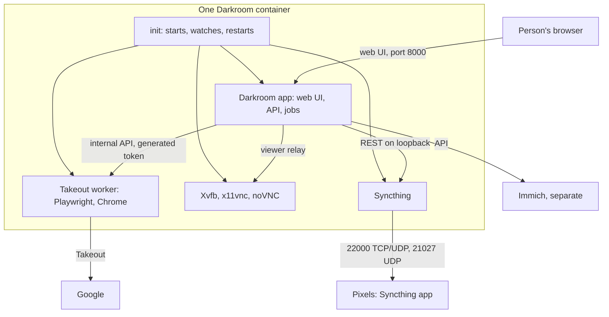

# One container for everything

Design for [#284](https://github.com/AnthonyPluth/Darkroom/issues/284), prepared 2026-11-09 and revised 2026-11-10 with the owner's answers. **Section 1 holds the owner's decisions, including the answers to the questions this design first left open (section 11). Nothing here is built, and the current runtime (two containers plus a hand-configured Syncthing) stays as it is until the gated steps in section 13 land.**

Anything marked **UNVERIFIED** is what this design believes about Syncthing, Chromium in the image or Unraid without having tested it. No such statement may be relied on by an implementation step until the named spike in section 12 confirms it. This session could not run Syncthing, build an image or reach an Unraid host.

## 1. The owner's decisions

| # | Decision (2026-11-09) | Consequence |
| --- | --- | --- |
| 1 | Darkroom is a one-stop shop for the whole process end to end, dead simple to get running: ultimately one container for everything, coordinated and executed by Darkroom | One image, one Unraid template, one appdata folder. Darkroom starts, watches and restarts everything inside it |
| 2 | Darkroom owns the Pixel transport: Syncthing, or its sync function, is integrated instead of configured by hand | Pairing, folders, Send Only, the `*.xmp` ignore pattern, device IDs and removal become Darkroom's job, driven from the `pixels`, `pixel_people` and `pixel_copies` records it already keeps |
| 3 | The browser (Takeout worker) joins the same container, and may do so in the first phase; the separate container stays as the fallback. Everything is local-only and never exposed publicly, so the owner sees no security concern in sharing a container with the browser | Recorded as decided, not re-argued. Section 5 states the residual risk and what a single container still keeps |
| 4 | Zero-configuration secrets and addresses: the browser token is generated at startup and is never a user setting; the browser's addresses are derived or disappear; every other hand-set value is reviewed | Sections 6 and 8 |
| 5 | Immich stays a separate application, coordinated through its API, as [#259](immich-managed-storage.md) says | Not redesigned. This design changes how Darkroom is packaged and how the Pixels are fed, not who owns the library |
| 6 | **One user (2026-11-10).** Everything in the container (the app, the browser, Syncthing) runs as one unprivileged user. No separate users, no group arrangement, no second mappings for permission reasons, and no root init that drops privileges | Section 5 says once what this gives up. The seccomp profile stays as one manual step on Unraid, and the generated secret key lives in appdata with the environment variable as an override |
| 7 | **Answers to the remaining questions (2026-11-10).** The browser moves in first. The wizard is open to the first visitor from a private address. State lives in appdata, with the working folders on a second mapping. Syncthing uses local discovery only, with host networking, and a fresh identity. A Pixel is paired by QR scan plus approval, never automatically. A Pixel holding pruned files is fixed manually only. #54 gets scoped re-scans after phases A and C. The separate browser container is kept for one minor release | Section 11 lists each answer |

## 2. Goals and non-goals

**Goals**

- Install one container, map one appdata folder, open the web UI, and be led through everything else.
- No secret that a person has to invent, copy between containers or seal by hand.
- Darkroom's database is the single description of which Pixel gets which folder; Syncthing's configuration is derived from it and repaired when it drifts.
- Promises 1 to 6 in `AGENTS.md` hold unchanged, each with a check that exists before the code it guards (section 10).
- Every step is small, reversible and leaves the current deployment working until the owner switches.

**Non-goals**

- Bundling Immich, Pocket ID, Traefik or PostgreSQL. SQLite stays the default; `DATABASE_URL` still points at an external PostgreSQL.
- Reimplementing Syncthing's protocol, or putting any Darkroom software on a Pixel or an iPhone. The Pixels keep their own Syncthing app.
- Exposing Syncthing's own web UI, the VNC port or the worker's internal API outside the container.
- Changing what proves Google has a photo. The Takeout match stays the only signal for pruning (#199, #216); Syncthing's progress is display only.
- Building any screen. Section 8 lists the wizard's screens for later sign-off (promise 6).

## 3. Target architecture

**Processes**

| Process | Listens on | Started by |
| --- | --- | --- |
| init | nothing | Docker (under `tini`) |
| Darkroom app (`run.py serve`) | 8000 (the only published web port) | init |
| Takeout worker (`python -m darkroom_browser`) | nothing | init |
| Xvfb, x11vnc, websockify + noVNC | inside the container only | init, with the worker |
| Chrome or Chromium, in its own sandbox | nothing | Playwright, only while a job runs (unchanged) |
| Syncthing | 22000 TCP and UDP, 21027 UDP; its REST API inside the container only | init |

Every process runs as the one unprivileged user (uid 99, gid 100 by default, as both containers do today), with every capability dropped and `no-new-privileges` set. Nothing in the container runs as root (decision 6).

The init is Darkroom's own, small and dependency-free (its own package, importing neither `darkroom` nor `darkroom_browser`, so the import-linter boundary between those two stays as it is). It holds no secret beyond the browser token it generates and forgets, opens no socket and reads no request. It starts the app first, then the others; restarts a child that exits with a capped backoff; stops all of them on `SIGTERM`; and gives each child an allowlisted environment (section 5). It runs as the same user as its children and needs no privilege. The app decides what should be running (for example, Syncthing off until the first Pixel exists) and reads each child's state back; the init only carries that out. `tini` remains PID 1 for zombie reaping. Whether a ready-made supervisor (s6-overlay) would do instead is part of spike S1; the recommendation is the small init, because the token handoff and the per-child environment are specific to Darkroom.

Today the worker exits with code 3 when it loses contact or Chrome will not close, and Docker restarts its container. In one container the init restarts the worker and its display stack only; the app keeps running.

**Volumes**

| Container path | Holds | Backed up |
| --- | --- | --- |
| `/data` (appdata) | The database and the generated secret key, where today's image already keeps the database. `browser/`: the per-account browser profiles and failure captures, moved from `_browser/` on the photo share. `syncthing/`: Syncthing's configuration, device certificate and key, and index | Yes: this is everything needed to restore Darkroom (section 9) |
| `/photos` (working share) | `_inbox/` and `_pixels/`, and until the #259 cutover the current `originals/` and `google-only/` trees | `_pixels/` is refillable from the originals. `_inbox/` can hold pinned, unresolved imports (#259) and is worth backing up until they are resolved. `originals/` and `google-only/` remain the owner's to back up until #259 retires them |

The working share is a second mapping, as the owner decided; when it is not mapped, the working folders fall back to `/data/work/`. There are no further mappings: with one user, nothing is mapped twice for permission reasons.

**Ports**

| Port | Published | Purpose |
| --- | --- | --- |
| 8000/tcp | Yes | Web UI and API, including the remote browser view |
| 22000/tcp, 22000/udp | Yes, once Syncthing is integrated | Syncthing's sync protocol (TCP and QUIC). UNVERIFIED (S3) |
| 21027/udp | Yes, once Syncthing is integrated | Syncthing's local discovery. UNVERIFIED (S3, S4) |
| 8384 (Syncthing REST and GUI), 5900 (VNC), 6080 (noVNC) | Never | Reached only by the app, inside the container |

## 4. The browser in the container

This is what "the worker moves in" consists of, taken from `Dockerfile.browser`, `deploy/browser/` and [docs/deploy/browser.md](../deploy/browser.md).

| Piece | Today | In the one container | Must be true first |
| --- | --- | --- | --- |
| Base image | App: `python:3.14-slim`. Worker: `mcr.microsoft.com/playwright/python` pinned to one Playwright release, with its own Python | One image that runs both packages, each in its own virtualenv so the worker's dependencies stay out of the app's | UNVERIFIED (S1): the pinned Playwright release installs and runs on the app's Python 3.14, or the image carries two Python runtimes |
| Chrome and Chromium | Chrome stable on amd64 through Playwright's installer, bundled Chromium as the fallback and on aarch64 | The same: `playwright install --with-deps` for the one bundled Chromium and, on amd64, Chrome. Firefox and WebKit are not installed | UNVERIFIED (S1): both launch a real page in the merged image (`deploy/browser/smoke.sh`) |
| Xvfb, x11vnc, noVNC, websockify, tini | `deploy/browser/entrypoint.sh` | Started by the init | S1 |
| Chromium sandbox | On (`chromium_sandbox=True`), relying on `deploy/browser/seccomp.json` to allow user namespaces and `chroot`; never `--no-sandbox` | Unchanged, and still never `--no-sandbox`. The profile now applies to the whole container, so the app and Syncthing also run under it | UNVERIFIED (S1): the app, exiftool, libheif and Syncthing run under the profile; any syscall they need is added with a reason. On Unraid the profile file is put on the host by hand, once (decision 6) |
| `cap_drop: [ALL]`, `no-new-privileges` | Both containers | Both stay, for the whole container | UNVERIFIED (S1): Chrome's sandbox starts under them in the merged image, as it does in the worker's image today |
| `shm_size: 1g` | Worker container | The one container | Docker or Unraid template setting |
| Shared non-root user (uid 99, gid 100) | Both containers run as it, after the move away from 10001/10002 | The one user for everything (decision 6). The profiles move into appdata under the same owner, so the move is a plain move | The profile move is rehearsed with a signed-in profile that stays signed in (S1) |
| Image size | Two images, neither measured in this repository | One larger image; the app image gains Chrome, Chromium, X and their libraries, and Trivy scans Chrome's packages on every app build | UNVERIFIED (S1): measure both current images and the merged one before choosing. Proposed budget: no larger than the two current images together |
| aarch64 | Chrome is skipped; Chromium only | The same | S1 builds both architectures |

`darkroom_browser` stays its own package that talks to `darkroom` only over the internal API with the worker token. Being in one container changes packaging and startup, not that boundary, and promise 4 (the worker never types a password or 2FA code) keeps its test untouched.

## 5. Security position, residual risk and what is kept

**Decided (decision 3):** the deployment is local-only and never exposed publicly, and the owner accepts the browser sharing Darkroom's container. This section does not reopen that.

**Residual risk, plainly.** Today the kernel keeps the two apart: the worker's container cannot see the database, the secret key or anything on the share except `_inbox/` and `_browser/`. In one container that mount boundary is gone. The browser is signed in to the household's Google accounts and holds their session profiles; Darkroom holds the secret key and, sealed with it, each person's Immich API key, the sign-in refresh tokens and the Resend key; Syncthing holds the device key the Pixels trust. A fault in Chrome that escapes its sandbox, or in the worker, would be inside the same container as all of that, and the relaxed seccomp profile (user namespaces allowed) now covers every process. The app can already read the browser profiles today (it mounts the whole share), so the new exposure is in the browser-to-app direction.

**What the one-user choice gives up (decision 6).** With one user, file permissions separate nothing inside the container: the browser, the worker and Syncthing can each read the database, the secret key and the Syncthing device key, and each can write anywhere under the share that the app can. Operating-system permissions therefore no longer stop the browser or Syncthing from writing under the share. Promises 1 and 2 rest on what holds them today plus the checks of section 10: the existing Semgrep rules and tests, the provider boundaries (only the Syncthing provider talks to Syncthing, only the reconciler decides its configuration, the worker reaches the app only through `worker` routes), the reconciler's Send Only and path invariants, and the real-Syncthing whole-tree hash test. They do not rest on file permissions.

**What a single container still keeps**

- One unprivileged user, never root, with every capability dropped and `no-new-privileges`, as both containers have today.
- No Darkroom secret in the browser's environment: the init gives the worker and the display stack an allowlisted environment with no `DARKROOM_SECRET_KEY`, OIDC, Immich, Resend or database settings. With one user this is hygiene (nothing leaks through a crash report or a child process's environment), not a barrier.
- The worker still authenticates to the internal API with a token and may call only `worker` routes; the app still treats what it reports as untrusted (`validate.py`, the existing size limits).
- Chrome's own sandbox stays on. No `--no-sandbox`, no unconfined seccomp.
- Nothing but 8000 and Syncthing's sync ports is published; VNC, noVNC and Syncthing's REST API are reachable only inside the container.
- The remote browser view sits behind Darkroom's own session (section 6), instead of a second proxy route that has to be protected separately.

**Deep scan #54.** The scan is running against the two-container code. Its findings about application code stay valid. These parts change the trust boundary or add new surface and get a scoped re-scan before the phase that introduces them is deployed (decision 7):

| Phase | To re-scan |
| --- | --- |
| Browser in the container | The init (the per-child environment, the token handoff), every process sharing one user, the merged `Dockerfile` and entrypoint, the seccomp profile and capability set as applied to all processes, the viewer relay (session check, origin check, fixed target), the worker's authentication in `darkroom/server/auth.py`, and the new home of the browser profiles |
| Zero-config settings and wizard | The window before sign-in exists, the settings store and its sealed values, the generated secret key file, and anything that builds a URL from a request |
| Syncthing | The Syncthing provider and reconciler, the pairing routes (approving a device), the bundled binary and how it is pinned, its listeners (22000, 21027, the REST API), and the folder-path and Send Only invariants |

Each implementing pull request is labelled `security`, so the Second review runs on it as well.

## 6. Token and addresses

**In the one container (recommended path).** The init generates the worker token at every container start (32 random bytes, URL-safe) and hands it to the app and to the worker on a pipe each inherits, never through the environment, a file or the command line. Neither side logs it; `monitoring.log`'s scrubbing and a `no_leaks` canary test hold that. `DARKROOM_BROWSER_TOKEN` is no longer a setting anyone makes. A restart of the container makes a new token for both sides at once. If only one child restarts, the init hands the same token to the replacement, so a running job is not cut off.

The browser's addresses go away entirely:

| Setting today | In the one container |
| --- | --- |
| `DARKROOM_URL` (worker to app) | Gone. The worker reaches the app on the container's loopback, an address the init supplies |
| `VNC_URL` (person to noVNC, a second Traefik route with its own forward-auth) | Gone. The app serves the viewer under its own address: noVNC's static files and a relay of its WebSocket to the display stack, on a `session` route. The alert link becomes the Remote browser page under `DARKROOM_PUBLIC_URL`, and the page's frame source is the app itself |

The viewer relay checks the session and the request's origin, connects only to the fixed internal display address (never one taken from the request) and copies bytes both ways. UNVERIFIED (S2): that this works from Darkroom's `ThreadingHTTPServer` through Traefik with noVNC. The route gets its entry in `routes.py`, its contract type and its tests like any other.

**Fallback: the browser stays a separate container.** If S1 fails, or for anyone who prefers two containers, the current layout keeps working exactly as documented, with `DARKROOM_BROWSER_TOKEN`, `DARKROOM_URL` and `VNC_URL` set by hand. That costs no new code and is the fallback the owner chose, kept for one minor release (decision 7). If a zero-config fallback is ever wanted, the design is:

- **Token:** the app generates the token at startup and writes it atomically (temporary file, then rename; mode `0640`) into a small pairing volume mounted read-write in `darkroom` and read-only in `darkroom-browser`. The volume is a named Docker volume or an appdata folder, never the photo share, which may be exported over SMB. The worker reads the file at startup, waits with a fixed log line while it does not exist, and reads it again whenever a request is answered 401, so an app restart (a new token) does not lose a running job. The token is never distributed over a network or kept in either container's environment; it is still presented as a bearer header on the internal Docker network, as today.
- **`DARKROOM_URL`:** the pairing file also lists the addresses the app can be reached at (the compose service name, its hostname, its address on the Docker network), and the worker uses the first that accepts the token.
- **`VNC_URL`:** the same viewer relay, with the app connecting to the address its authenticated worker last called from and the port the worker reported.
- A pairing handshake over the network (the worker asks, a person approves) was considered and rejected: it adds a manual step and puts the token on the wire unless a key exchange is added.

UNVERIFIED (S2): file modes and visibility of a shared folder between two containers on Unraid.

## 7. Syncthing integration

### 7.1 Form

| Option | Assessment |
| --- | --- |
| **Syncthing's own binary, supervised inside the container and driven through its REST API** | Recommended. It is the protocol the Pixels' app already speaks, and Darkroom writes no sync code. Costs: a second language's binary to pin and update, a second configuration that can drift, and unverified API details (S3) |
| Darkroom configures an existing Syncthing elsewhere over the same API | Not the target (it keeps a second container and needs an address and API key typed in), but the provider takes an address, so tests and the spike can use it |
| Embedding Syncthing as a library | Not possible from Python without a Go helper, which is the first option with more glue |
| Implementing the sync protocol in Python | Rejected: a large protocol with discovery and encryption, and a mistake would fail silently on the way to the off-site backup |
| Replacing Syncthing on the Pixels with something Darkroom ships | Rejected: it would put Darkroom software on a phone, which #199 removed, and change what the Pixels run |

A risk to record rather than solve here: the Pixels are original Pixels on an old Android. UNVERIFIED (S4): that the Syncthing app available for them still pairs with the Syncthing release Darkroom pins.

### 7.2 Control plane

- The binary is a pinned official release, checksum-verified at image build, with automatic upgrades, usage reporting and crash reporting off. At startup Darkroom reads its version and disables the transport with an alert if it is outside the range Darkroom was tested with.
- Syncthing's home is `/data/syncthing`. Its REST API listens only inside the container, authenticated with an API key that Darkroom generates and never logs. With host networking (decision 7), "inside the container" needs a Unix socket rather than a loopback port, since the host's loopback is shared (S3, S4). A fresh identity is generated on first start; an existing Syncthing's keys are not imported. Global discovery, relays and NAT traversal are off: a Pixel away from home waits.
- A new provider module, `darkroom/providers/syncthing.py`, is the only code that calls the API (through `tls.py`, like every outbound request, and added to the `providers-alone` contract). The init is the only code that starts the process.
- What this design believes about the API, all UNVERIFIED (S3): requests carry an `X-API-Key` header; `/rest/system/status` returns the instance's own device ID; `/rest/system/version` its version; `/rest/config` and `/rest/config/folders`, `/rest/config/devices`, `/rest/config/options` read and change configuration without a restart; a folder has a `type` whose Send Only value is `sendonly`, a `path` and a list of devices; `/rest/db/ignores` reads and sets a folder's ignore patterns; `/rest/db/scan` asks for a rescan; `/rest/db/completion` reports how complete a device is for a folder; `/rest/cluster/pending/devices` lists devices that tried to connect and are not configured; `/rest/system/connections` and `/rest/stats/device` say whether and when a device was last connected; a device ID is 56 base32 characters in eight dash-separated groups with check characters.

### 7.3 What Darkroom stores and what Syncthing stores

| Fact | Lives in | Notes |
| --- | --- | --- |
| Which Pixels exist, their name, Google account and people | Darkroom's database (`pixels`, `pixel_people`), as today | The source of truth |
| A Pixel's Syncthing device ID | `pixels.syncthing_device_id`, as today | Set by the pairing flow instead of typed |
| What is queued, placed and pruned | `pixel_copies`, as today | Unchanged; Syncthing is never asked |
| Transport state per Pixel: paired, last seen, last reported completion, last fixed error code | A new table, written by the reconciler | Display and alerts only. Never an input to pruning |
| Devices, folders, ignore patterns, options | Syncthing's `config.xml` and each folder's `.stignore` | Derived from the database by the reconciler through the API. Darkroom never edits these files directly |
| Darkroom's own device certificate and key, Syncthing's index | `/data/syncthing` | Secret. Losing the key means every Pixel must be paired again |
| Syncthing's API key | Generated by Darkroom at start, held in memory | Never in the database, a reply or a log |

**Start paused, then resume.** Syncthing's configuration is persisted in `/data/syncthing`, so at start it is whatever the last run, a restore or a fault left there, and Syncthing would act on it before Darkroom has looked. Syncthing is therefore always started in a state in which it syncs nothing: every folder and device paused (its `--paused` start option or an equivalent, such as a configuration written paused at every stop; UNVERIFIED, S3: that such a start exists in the pinned release and that a paused instance neither scans, connects nor announces changes). The reconciler then verifies or repairs the persisted configuration while it is paused, and resumes only the folders and devices it has just approved. A folder that is not Send Only, lies outside `_pixels/` or was not asked for is removed while still paused and never runs. If the reconciler cannot finish, nothing is resumed and the transport stays down with an alert.

**The reconciler** computes the wanted configuration from the database and makes Syncthing match it: at startup (before anything is resumed), after any change to a Pixel, and before each hourly `pixels.tend`. For every Pixel with a device ID it wants one device and one folder:

- folder path `_pixels/<pixel id>/`, built only by the existing `Photos` path helpers (the folder holds one part per person, `_pixels/<pixel id>/<person>/`, as #216 laid out);
- type Send Only, shared with that Pixel's device and nobody else, no versioning;
- ignore patterns containing `*.xmp`, so sidecars never reach a Pixel (the manual `.stignore` step in the spec becomes this), set through the API and read back before the folder is shared.

Anything else it finds (a device or folder Darkroom did not ask for, a folder that is not Send Only, a path outside `_pixels/`, a missing ignore pattern) is corrected and recorded as an event. It reads the configuration back after writing and treats a mismatch as a failure. It deletes no file: removing a folder or device from Syncthing's configuration leaves the files where they are (UNVERIFIED, S3).

### 7.4 Pairing, and what the web UI asks of a person

1. In Darkroom, the person starts adding a Pixel and chooses its Google account and the people it serves (as the Pixel form does today). Darkroom shows its own device ID as a QR code and as text.
2. On the Pixel, in the Syncthing app: add a device and scan the code.
3. The Pixel now tries to connect. Darkroom lists it as waiting, with the name and device ID the Pixel presented, and the person confirms it is theirs by comparing the ID with the one the app shows. Nothing is ever accepted without that confirmation by a signed-in person. Typing or pasting the device ID stays available for when the Pixel does not appear.
4. Darkroom saves the device ID and the reconciler shares the folder. On the Pixel, the person accepts the folder and picks where it goes.
5. On the Pixel, in Google Photos: turn on backup for that folder. Darkroom cannot see or set this; the runbook step and the "unmatched after a full export cycle" alert stay as they are.
6. Darkroom shows the Pixel as connected once Syncthing reports it, and fills `last_sync`.

So the person's part is: one scan, one confirmation, one accept, and the Google Photos backup switch. They no longer install or open a Syncthing on Unraid, create folders, set Send Only, write `.stignore` or copy device IDs.

**Changes later.** Changing the people a Pixel serves changes sub-folders, not Syncthing's configuration. A new device ID (a reset phone) is paired again the same way, and the Pixel receives the copies still marked placed. Deleting a Pixel keeps today's rule (refused while anything is queued or in its folder, `tests/test_pixels_api.py`); afterwards the reconciler removes its device and folder from Syncthing. The Pixel keeps whatever files it already has; removing a share deletes nothing on either side (UNVERIFIED, S3). The emptied folder skeleton under `_pixels/<pixel id>/` is left in place: removing it would be a new deletion path, which needs its own decision and check.

### 7.5 Failure handling, and Syncthing being down

| Situation | What Darkroom does |
| --- | --- |
| Syncthing is not running or not answering | The init restarts it with backoff. Placing and pruning carry on: neither waits for Syncthing, and a copy removed while it is down is noticed and carried to the Pixel on its next scan (UNVERIFIED, S3). The Status page shows the transport as down, and an alert opens after a set time (wording for sign-off) |
| The reconciler cannot apply or read back the configuration | It changes nothing further, records a fixed reason, alerts and retries on the next run. It never falls back to editing Syncthing's files |
| Syncthing's version is outside the tested range | The transport is not started; alert |
| A Pixel is not seen for a long time | Shown on the People and Status pages. The existing alert for originals unmatched after a full export cycle still covers "photos are not reaching Google" from end to end |
| The working share is not mounted, disappears while running, or comes back empty | Today's guard only notices a mount at or below `_pixels/`; it does not prove the share root is still the mounted share. If the share vanished at runtime, the path would be an empty folder on the container's own disk: the remover treats a missing file as already gone, so pruning would mark copies pruned although nothing was removed, and placing would write into the container. Every placing and pruning cycle is therefore gated on a share check first: a sentinel file Darkroom wrote on the share at setup must be present with its recorded content, and the share root must be the same mounted filesystem as at startup. If either fails, the cycle does nothing, changes no row, the transport is paused and an alert opens (plan step C0, which is needed whether or not Syncthing is integrated). Syncthing's folder marker is believed to stop the folder as well, so an empty mount is not read as "everything was deleted" (UNVERIFIED, S3). A folder is not shared again while `placed` copies are unaccounted for (section 9) |
| Syncthing's index or device key is lost or restored from an older backup | A lost key means pairing every Pixel again. A lost index can leave a Pixel holding copies Darkroom already pruned, since a Send Only side does not pull or delete on its own. Darkroom shows this and offers a manual "make the Pixel match"; it never does so automatically (decision 7; UNVERIFIED, S3) |
| A person changes or deletes files on the Pixel | Send Only means nothing comes back to Unraid (UNVERIFIED, S3, tested with a hostile peer) |

## 8. Settings: generated, derived, or asked once

Every variable in `.env.example` and `darkroom/config.py`:

| Setting | Today | Proposed |
| --- | --- | --- |
| `DARKROOM_BROWSER_TOKEN` | Invented by hand, set in both containers | Generated at every start (section 6). Not a setting |
| `DARKROOM_URL`, `VNC_URL` | Set by hand | Gone in the one container; unchanged in the fallback (section 6) |
| `DARKROOM_SECRET_KEY` | Invented by hand | Generated on first start into `/data`, mode `0600`. If the key is missing while the database already holds sealed values, Darkroom refuses to start rather than make a new key. The variable stays as an override for anyone who wants the key kept apart from the database (decision 6) |
| `DARKROOM_PUBLIC_URL` | Set by hand | Asked in the wizard, prefilled with the address the person is using and confirmed by them. Not taken silently from a request, since it ends up in alert emails and the sign-in redirect |
| `OIDC_ISSUER`, `OIDC_CLIENT_ID`, `OIDC_CLIENT_SECRET`, `OIDC_ALLOWED_GROUPS`, `OIDC_ALLOWED_EMAILS` | Set by hand | Asked in the wizard, which shows the redirect address to copy into Pocket ID and requires one successful test sign-in before it takes effect. The secret is sealed with the secret key. These exist only in the identity provider, so a person has to supply them |
| `IMMICH_URL` | Set by hand | Asked in the wizard and checked against the server |
| `IMMICH_ADMIN_KEY` | Set by hand | Left as it is: #259 retires it with the external-library rescans, so no wizard step is built for it |
| Each person's Immich API key | Entered on the People page, sealed | Unchanged; the wizard leads to it |
| `RESEND_API_KEY`, `ALERT_EMAIL_FROM`, `ALERT_EMAIL_TO` | Set by hand, after sealing the key with `run.py seal-secret` | Optional wizard step with a test email; the key is sealed for the person |
| `TZ` | Set by hand, default UTC | Taken from the container's `TZ`, which Unraid is believed to set for every container (UNVERIFIED, S4); otherwise confirmed in the wizard |
| `PUID`, `PGID` | Default 99 and 100 | Unchanged defaults, which fit Unraid |
| `DARKROOM_HOST`, `DARKROOM_PORT`, `DARKROOM_PHOTOS_ROOT`, `DARKROOM_DATA_DIR`, `DISPLAY`, `POLL_SECONDS`, `BROWSER_CHANNEL` | Defaults set by the image | Unchanged; nobody needs to set them |
| `PIXEL_FOLDER_CAP_GB` | Default 50 | Unchanged |
| `DATABASE_URL` | Empty for SQLite | Unchanged |
| `DARKROOM_ALLOW_NO_AUTH`, `DARKROOM_DEMO` | Development and special cases | Unchanged |
| Syncthing device IDs, folders, Send Only, `.stignore` | Done by hand in a separate Syncthing | Darkroom's job (section 7) |

Values the wizard collects live in a new settings table, sealed where secret. Precedence is environment, then the stored value, then the generated or default one, so an existing `.env` keeps working unchanged and an operator can still pin anything. `run.py check-config` reports where each value came from, never the value of a secret.

**First-run wizard: the screens, as a list for sign-off.** Nothing is built until the owner signs off a design in `docs/design/web/`.

1. Welcome: what Darkroom has already generated (secret key, browser token, its Pixel-sync identity) and what it will ask for.
2. Address: confirm the address Darkroom is opened at.
3. Sign-in: the identity provider's details, the redirect address to copy, and a test sign-in.
4. Immich: its address, checked.
5. People: add each person and their Immich API key (the existing People functions).
6. Google accounts: add each account and sign in through the remote browser (the existing Connect flow).
7. Pixels: the pairing flow of section 7.4.
8. Alerts, optional: the email settings and a test email.
9. Done: what to back up (the appdata folder, which contains the key), and where the Status page is.

What a person must still supply: the appdata mapping and ports in the template, the identity provider's details, Immich's address and each person's key, each Google sign-in, each Pixel's scan, confirmation and Google Photos switch, and optionally the email settings. Before sign-in exists, the wizard is open to the first visitor from a private address; the first successful sign-in locks it, and a console command reopens it (decision 7).

## 9. Unraid, backup, upgrade and rollback

**Unraid.** All UNVERIFIED until S4 runs on the owner's server.

- One Community Applications template: the image, `/data` mapped to `appdata/darkroom`, the working share mapped to `/photos`, port 8000, and from the Syncthing phase 22000 TCP, 22000 UDP and 21027 UDP. Extra parameters carry the 1 GB shared memory size, `no-new-privileges`, `--cap-drop=ALL`, the user and the seccomp profile. The profile file has to exist on the host before the container starts, which a container cannot do for itself: placing it is the one manual host step (decision 6).
- **Host or bridge networking.** With bridge networking, Syncthing's local discovery broadcasts are believed not to cross Docker's bridge, so a Pixel would not find Darkroom unless someone types Darkroom's address into the Pixel's app. Host networking (or a container address on the LAN through Unraid's custom `br0` network) is believed to make discovery work with no typing. Host networking shares the host's loopback, so every internal listener (Syncthing's API, VNC, noVNC, the worker's route to the app) must then be a Unix socket or authenticated, not an open loopback port. The owner chose host networking with local discovery only (decision 7). Until Syncthing is integrated, bridge networking is enough.
- An existing Syncthing on the server uses the same ports. It must stop serving `_pixels/`, and either move off 22000 and 21027 or be retired, before Darkroom's starts.
- Appdata on Unraid's user-share layer is believed to be unreliable for Unix sockets and sometimes for SQLite locking; the template may need the direct pool path.

**Backup and restore.** Back up `/data` with the container stopped (or use Unraid's appdata backup, which stops it): the database, the secret key, the browser profiles and Syncthing's identity are consistent only together. Restoring it onto a new container gives back the people, accounts, decisions, sealed keys (readable, because the key is in the same backup), the signed-in browser sessions (Google may still ask for a sign-in) and the pairing with every Pixel. Because the key and the database are in one backup, that backup must be stored as carefully as the keys it contains. All of this holds for the generated key only. With the supported `DARKROOM_SECRET_KEY` override the key is not in `/data` at all: it lives wherever the operator keeps it (the template, an `.env` file, a secret store). That store is then its own component of the backup, taken and kept with the same care and matched to the same point in time, and restoring appdata alone gives back sealed values that cannot be read until the same key is supplied again. Darkroom refuses to start on sealed values without their key rather than generate a new one (section 8), so a missing external key is loud, not silent. This paragraph is about the default SQLite database, which lives in `/data`. With `DATABASE_URL` pointing at an external PostgreSQL ([docs/deploy/postgres.md](../deploy/postgres.md)), appdata holds the key, the browser profiles and Syncthing's identity but none of the people, decisions or Pixel state. A backup is then two parts taken at the same stopped, zero-write point: appdata and a dump of that database. A restore, including the pre-upgrade restore below, puts both back together; restoring appdata alone leaves the newer database and its Alembic revision in place, so it neither recovers the state nor lets a previous image start. The S5 rehearsals are run for SQLite and repeated for PostgreSQL, and each once with the generated key and once with the key supplied from outside appdata, before any of those combinations is described as supported.

What it does not contain: the working share. `_inbox/` material that was pinned for review is lost unless the share was backed up too.

`_pixels/` is not refilled by today's rules after such a restore, and the design must not claim it is: `pixel_folder.fill` places only `queued` rows and the reversal rules revive only `pruned` ones, so a copy the restored database records as `placed` whose file is gone would never resume its way to Google. Worse, an emptied folder under a restored Syncthing index reads as "these files were deleted", which Syncthing would carry to the Pixel before Google has them. The restore therefore needs an explicit step, new in this design (plan step C3a): after any start in which the database and the share may not match, the transport stays off until a placed-copy check has compared every `placed` row with its file (present, a regular file, the recorded size and SHA-1). A row whose file is missing or different is marked for re-placement with an event, not sent through today's `revive`: that clears `placed_at`, after which `fill` would see an always-send copy's older Takeout match (the late-Immich case, #199 decision 5), take it as confirmation and mark the copy pruned without ever writing the file. Re-placement is its own path: it writes the file again without the pre-placement confirmation check and keeps the original placement time as the cutoff, so the copy is still pruned only on proof from after it was first placed. The row keeps its original place in the queue so that it is placed before anything queued later and still fits under the cap it fitted under before; nothing is deleted by the check. Re-queueing is not enough to share the folder again: with the restored index still listing the file, a folder shared while the file is absent would announce a deletion. So the Pixel's folder stays unshared until `pixel_folder.fill` has written every copy the check re-queued and each has been read back with its recorded size and SHA-1. A copy that cannot be placed again (its source is gone or changed) keeps the folder unshared with an alert; Darkroom does not give up on it silently.

The same check covers the opposite mismatch, a database older than the share: it lists every file in a Pixel's folder that no intact `placed` row accounts for. The folder's own control entries are not part of that list: the `.stignore` file and Syncthing's folder marker at `_pixels/<pixel id>/` are expected and are never treated as an unaccounted photo. Today's code would not count such a file against the cap (`used_bytes`) and would never prune it, yet Syncthing would send it. A file whose name, size and SHA-1 match a `queued` row of that Pixel and person is adopted (the row becomes `placed`, no file is touched). Any other unaccounted file keeps that Pixel's folder unshared, with an alert that gives the count only, until the owner has removed or moved it by hand: the check itself removes and moves nothing, because that would be a new deletion path needing its own decision and check. Files a Pixel still holds that Darkroom has pruned are the separate case of section 7.5. Until the #259 cutover, `originals/` and `google-only/` are permanent data on the share and are backed up as today. The restore is rehearsed before the single container is recommended (S5a) and again with the transport before Syncthing is deployed (S5b).

**Upgrade and rollback.** Each step in section 13 keeps the previous deployment working: the two images keep being published and the compose file keeps its `browser` profile until the cleanup step. Moving to the one container is: stop both containers, back up, move the browser profiles from `_browser/` on the share into `browser/` in appdata, start the one container. The database stays where today's image keeps it, directly under `/data`, and no ownership or group changes: everything already belongs to the one user. Rolling back is the reverse, with the previous variables still in `.env`.

A step that adds a migration (B2, C3) cannot be rolled back by starting the previous image on the same database: `run.py serve` migrates at startup, and an older image does not know the newer revision recorded in the database, so it would not start. Additive tables do not change that. The rollback for those steps is therefore one of two things, and never an older image on a newer database:

- **Roll forward, the default:** stay on the newer image and turn the feature off (environment values override stored settings; the Syncthing integration is switched off). The new tables stay, unused. Each migrating step ships with that switch, so this needs no release.
- **Restore, only inside a zero-write window:** stop the container, restore the backup taken immediately before the upgrade (appdata, and with PostgreSQL the database dump from the same moment), and start the previous image. This discards everything written since that backup (imports, decisions, Pixel copies), so it is only for an upgrade that failed before Darkroom did any work; the working share must match that backup, as #259's rollback rules also require. The upgrade procedure takes that backup as its first step.

Steps without a migration (phase A, B1, C1, C2) roll back by redeploying the previous image. No step edits or drops existing columns. Turning the Syncthing integration off leaves `_pixels/` and `pixel_copies` exactly as they are, and a hand-configured Syncthing can take the folders over again. Two Syncthing instances must never serve the same `_pixels/` folder at once.

## 10. How each promise still holds

| Promise (`AGENTS.md`, unchanged) | Why it holds | Check that must exist before the code |
| --- | --- | --- |
| 1. An original is written once | Syncthing is only ever given folders under `_pixels/<pixel id>/`, as Send Only, which does not write to local files. Nothing else in this design writes outside `/data`, `_inbox/` and `_pixels/`. File permissions add nothing here (section 5): this rests on the checks in the next column | Existing `darkroom-originals-read-only` and `tests/test_place.py`'s `FixtureExportRun`, unchanged. New: reconciler tests that the wanted configuration contains only Send Only folders whose path comes from the `Photos` helpers, and that any other folder found is removed; a Semgrep rule with examples that keeps folder paths in the provider to those helpers; and image CI running the real binary against a peer that edits and deletes its copies, comparing a whole-tree SHA-1 of the share before and after |
| 2. Dedupe deletes nothing on Unraid except the losing copy; pruning touches only a Pixel's folder | No new deletion path. The reconciler, the provider and the init delete no file. Pruning is still only `pixel_folder.prune` through the one remover, on the Takeout match and nothing else | Existing `darkroom-pixel-prune-one-remover`, `darkroom-pixel-prune-one-caller`, `tests/test_pixel_paths.py`, `tests/test_pixel_folder.py`, unchanged. New: a test that the pruning modules do not import the Syncthing provider or read the transport table, and a negative test that a "fully synced" report prunes nothing |
| 3. Retired | Nothing here touches an iPhone | None needed |
| 4. The worker never types a Google password or 2FA code | The worker's code is unchanged by the move; the wizard and pairing ask for no Google credential | `tests/browser/test_no_credentials.py`, unchanged, also run against the merged image's worker |
| 5. Metadata gaps are filled with XMP sidecars, never by rewriting media | Unchanged. The `*.xmp` ignore pattern that keeps sidecars off the Pixels is now set and read back by the reconciler instead of by hand | Existing `darkroom-xmp-only-sidecars` and `tests/test_xmp.py`. New: reconciler test that a folder without the pattern is corrected |
| 6. No design changes without sign-off | This design builds no screen. The wizard, pairing, transport status and new alert wording are each gated on a signed-off design | Review, as today; each UI pull request carries `make verify` screenshots |

The #259 replacement promises are compatible: this design gives Syncthing no access to Immich's storage and adds no Immich call.

## 11. The owner's answers

The questions this design first left open were answered on #284 on 2026-11-10. Nothing is open for the owner except the two known gaps below.

| # | Question | Answer |
| --- | --- | --- |
| 1 | Does the browser move in first, or after Syncthing? | First |
| 2 | One unix user, or a root init dropping to separate users? | One user for everything; no separate users, groups, second mappings or root init. This was not the design's recommendation; section 5 states what it gives up |
| 3 | The Chromium seccomp profile on Unraid | Kept, as one manual host step |
| 4 | Who may open the wizard before sign-in exists? | The first visitor from a private address, until the first successful sign-in |
| 5 | The generated secret key in appdata beside the database | Yes, with the environment variable as an override |
| 6 | Volumes | State in appdata, including browser profiles; the working folders on a second mapping |
| 7 | Syncthing's reach and Unraid networking | Local discovery only, with host networking |
| 8 | Syncthing identity | Fresh, one pairing per Pixel |
| 9 | How a Pixel is recognised | QR scan, then approval in Darkroom; never automatic |
| 10 | A Pixel holding copies Darkroom already pruned | Shown, and fixed manually only |
| 11 | Deep scan #54 | Scoped re-scans after phase A and after phase C, each before that phase is deployed |
| 12 | The separate browser container | Kept for one minor release after the one container is the default, configured as today |

### Known gaps

Raised in review of this document and recorded here rather than designed; each is settled in the issue for the step it names, before that step starts. They are the only open items.

| Gap | Recommendation |
| --- | --- |
| Step order of C3 and C3a: as listed, the reconciler (C3) could share a restored folder before the placed-copy check (C3a) exists | Make C3a a prerequisite: land it before C3, or in the same step, so no build can share a folder without the check |
| Adopting an unaccounted file that matches a `queued` row (section 9) sets no placement time, and `confirms_copy` reads a missing `placed_at` as "any earlier Takeout match counts", so an adopted always-send copy could be pruned on a match from before it was placed | On adoption record the time of adoption as the placement cutoff (the conservative choice), and add the always-send, older-database test to C3a |

## 12. Spikes

Each is a `manual` or `spike` issue whose result is written up under `docs/spikes/` with versions, commands and observations, and no credential, real device ID, address or file name.

| Spike | Confirms |
| --- | --- |
| S1. Merged image | One image runs the app and the worker as one unprivileged user; Playwright on the app's Python or two runtimes; Chrome and Chromium pass `smoke.sh` under the seccomp profile, `no-new-privileges` and every capability dropped; the app, exiftool and libheif run under the same profile; amd64 and aarch64 build; the sizes of today's two images and the merged one; a signed-in profile survives the move into appdata |
| S2. Viewer relay and handoff | noVNC works through a byte relay in the app's server behind Traefik; a pipe handoff of the token to both children; for the fallback only, a shared pairing folder between two containers |
| S3. Syncthing's API and behaviour | Every belief in section 7.2 against the pinned release; configuration changes without a restart; a Send Only folder never changes local files when a peer edits, deletes or adds; deletions made while Syncthing was down are carried on restart; removing a folder or device deletes nothing; the folder marker stops an unmounted folder; what a lost index does and what "override" does; the API on a Unix socket; a paused start that scans, connects and announces nothing until folders are resumed one by one |
| S4. Unraid and a real Pixel | Discovery with host, `br0` and bridge networking; the ports; the template's extra parameters and the seccomp file; `TZ`; appdata on the user-share layer for SQLite and sockets; the Syncthing app on an original Pixel pairing by QR with the pinned release, and the pending-device approval |
| S5a. Backup and restore, app and browser | Restoring appdata alone onto a fresh single container, before Syncthing exists: sign-in, sealed keys and browser sessions all work, and an account can still be deleted with its profile. With the key overridden from outside appdata: the restore works only once that key is supplied, and refuses to start without it |
| S5b. Backup and restore, transport | The same with Syncthing: Pixel pairing survives; with the share lost, `placed` copies are found missing, queued and placed again before the folder is shared, and nothing is deleted from a Pixel; with a database older than the share, unaccounted files are adopted or keep the folder unshared; the stale-restore case of section 7.5 |

## 13. Plan

**Order: the browser first, then the settings and wizard, then Syncthing.** Reasons:

- Moving the browser in removes work instead of adding it: the cross-container token file and address discovery never have to be built, because the handoff is internal and the addresses disappear.
- The browser is the process that dictates the container's shape (the seccomp profile, shared memory, the init). Settling that once means Syncthing is added to a finished process model rather than re-homed later.
- It can be proven without the owner's hardware: `smoke.sh` and the image CI already launch real pages. Syncthing depends on spikes with a physical Pixel and the Unraid network.
- It concentrates the change of trust boundary in one phase, so #54 needs one scoped re-scan for it; the Syncthing phase then adds a second, narrower one. Doing Syncthing first would change the app container twice.
- It is not literally the first pull request: S1 comes first, and the first two steps change nothing a deployment uses. If S1 fails, the fallback of section 6 applies and the plan continues from phase B.

Every step is one pull request under 1000 added lines including tests (deletions do not count), split again if it would exceed that. Each is opt-in or inert until the step that switches the default. New tables are new Alembic migrations tested on SQLite and PostgreSQL.

| # | Pull request | Rollback | Check that holds it |
| --- | --- | --- | --- |
| **A** | **The browser in the container** (after S1 and S2) | | |
| A1 | Build one image that contains the app and the worker; both current images still build and nothing uses the new one | Stop building it | Image CI: `/healthz` and `smoke.sh` in the merged image under the profile; `tests/browser/test_image.py` covers its Playwright pin |
| A2 | The init: starts the app and the worker stack as the one user, restarts with backoff, allowlisted environments, token by pipe; opt-in through a compose profile | Use the default profile (two containers) | Unit tests for restart, shutdown and the environment allowlist; `no_leaks` canary for the token in both processes' logs and in `check-config`; a `noop` job end to end in image CI |
| A3 | The remote browser view through the app: relay route, frame source, alert link; `VNC_URL` still honoured when set | Set `VNC_URL` again | `tests/test_every_route.py` (a `session` route); tests for no session, wrong origin and a target that cannot be influenced by the request; CSP test |
| A4 | Browser profiles under `/data/browser` in the one container, with the stopped move documented | Move the folder back | Worker tests for the configurable profile root; the existing link and mode refusals still pass; the account-deletion test still removes the profile |
| A5 | The one container becomes the documented default: compose, an Unraid template, `docs/deploy/`; the separate layout is documented as the fallback | Redeploy the two containers with the previous `.env` | Image CI on the default path; S5a rehearsed; the scoped re-scan of section 5 recorded on #54 before deploying |
| **B** | **Zero-config settings and the wizard** | | |
| B1 | Generate the secret key on first start; refuse to start when sealed values exist and the key is missing | Put the key in `DARKROOM_SECRET_KEY` | Tests for the file's mode, for never regenerating, and for the refusal |
| B2 | Settings table with sealed values and environment precedence; `check-config` reports sources | Stay on this image; environment variables override everything stored. The previous image only with the pre-upgrade backup restored (section 9) | Migration test on both databases; precedence tests, including that the environment alone still starts the service with the table present; `no_leaks` for stored secrets |
| B3 | The owner signs off the wizard's design (`docs/design/web/`); no code | Not applicable | Promise 6 |
| B4 | Wizard API: the steps of section 8, the pre-sign-in rule of decision 7, the test sign-in | Disable the wizard; settings from the environment | Every route in `tests/test_every_route.py`; negative tests for the pre-sign-in window (closed after sign-in, refused from a non-private address) |
| B5 | Wizard UI, to the signed-off design | Revert; the API stays inert | `make verify` screenshots at both widths; frontend tests |
| **C** | **Syncthing** (after S3 and S4) | | |
| C0 | The share check before every placing and pruning cycle: sentinel and root-mount test, no row changed when it fails | Revert; today's guard remains | Tests for a missing sentinel, a changed sentinel and a different filesystem at the root; a live-disappearance test in which the share is taken away between two cycles of a running service and no copy is marked pruned or placed; a negative test that a healthy share is not refused |
| C1 | The Syncthing provider against a fake server; not used by anything | Remove the module | Provider tests at the coverage floor; `providers-alone`; strict mypy |
| C2 | The pinned binary in the image, started paused by the init, off by default | Leave it off | Image CI: it starts paused, reports the pinned version, syncs nothing with a peer until resumed, and its API is not reachable from outside the container |
| C3 | The reconciler and the transport table; it resumes only what it has approved | Stay on this image and turn the integration off; `_pixels/` and `pixel_copies` untouched. The previous image only with the pre-upgrade backup restored (section 9) | The promise 1, 2 and 5 checks of section 10; a test that a persisted folder that is not Send Only or lies outside `_pixels/` is removed before anything is resumed, and that a failed reconcile resumes nothing; migration test on both databases |
| C3a | The placed-copy check of section 9: `placed` rows whose file is missing or different go back to `queued`, and a Pixel's folder stays unshared until every one of them has been placed again and verified | Turn the integration off; rows it re-queued stay queued, which is safe | Tests for a missing file, a changed file, a link in place of a file and a missing folder; for an unaccounted file that matches a queued row (adopted) and one that matches nothing (folder stays unshared, file untouched); that the control entries are never counted as unaccounted; that an always-send copy with a match older than its placement is written again and not pruned; that the folder is not shared between re-queueing and a verified re-placement, nor when a re-queued copy cannot be placed; a negative test that it deletes nothing and never re-queues a copy whose file is intact; a test that the folder is not given to Syncthing while the check is pending |
| C4 | Real-Syncthing invariants in image CI: a second instance as a hostile peer, whole-tree hash before and after | Not applicable (a test) | It is the check |
| C5 | Pairing API: Darkroom's device ID, waiting devices, approval, device ID validation | Type the device ID as today | Route tests; negative tests that nothing is accepted without a session and an explicit approval |
| C6 | The owner signs off the pairing, transport status and alert wording designs; then the UI | Revert the UI; the API stays | Promise 6; `make verify` screenshots |
| C7 | Transport health on the Status page and its alert | Disable the alert kind | Tests that the alert carries only its kind and an id; failure-path tests for each row of section 7.5 |
| C8 | Deployment: ports and networking in the template, moving from a hand-configured Syncthing, the runbook | Stop Darkroom's Syncthing and re-enable the previous one | S4 and S5b recorded; the scoped re-scan recorded on #54 before deploying |
| **D** | **Cleanup**, one minor release after A5 (decision 7) | | |
| D1 | Remove `Dockerfile.browser`, the compose `browser` profile and the `DARKROOM_BROWSER_TOKEN`, `DARKROOM_URL` and `VNC_URL` settings; a breaking release (`feat!`) | Pin the previous release | `check-config` names the removed variables as ignored, as it does for the `NTFY_*` ones |
| **F** | **Fallback only**, if S1 fails or the owner asks for a zero-config separate container | | |
| F1 | The pairing file: token written by the app, read by the worker, re-read on 401; the variable still honoured when set | Set the variable in both containers | Tests for the atomic write, the modes, the re-read and a missing file; `no_leaks` canary |
| F2 | The app's addresses in the pairing file; `DARKROOM_URL` optional | Set `DARKROOM_URL` | Worker tests for address order and for refusing an address that does not accept the token |

Phases A and B touch different areas and may overlap; C starts once A5 has settled the process model. No step is started before its spikes are written up.
