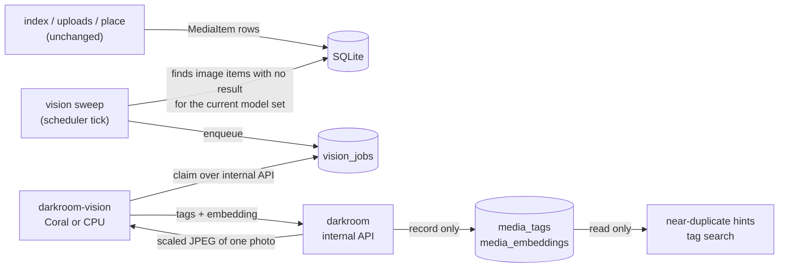

# Plan: Coral-accelerated tagging and near-duplicate hints (#63)

Status: draft for the owner's review. Nothing here is built yet, and nothing here changes a promise in `AGENTS.md`. Every decision this plan cannot make alone is a numbered open point at the end, with a recommended default; until the owner answers one, its default is what the pull requests below build.

## Summary

Darkroom already gives every photo a perceptual hash (pHash and dHash, `darkroom/domain/media.py`) and already sends likely re-encodes to the review queue as tier 4 (`darkroom/domain/dedupe.py`). This plan adds a small vision worker that runs quantized TensorFlow Lite models on a Google Coral Edge TPU, or on the CPU when there is no TPU, and stores two things per photo: tags (what is in it) and an embedding (a short vector that is close for photos that look alike). Tags are for finding photos. Embeddings are a secondary hint for near-duplicate groups. Neither one ever decides a dedupe tier, skips or places a file, sets `confirmed_in_google`, or makes a photo eligible for deletion from an iPhone.

## Goals

1. Tag every indexed photo with a small set of labels (people, pets, vehicles, a few scenes) from an on-device model, stored per photo.
2. Store an image embedding per photo and use it, together with the existing pHash and dHash, to suggest near-duplicate groups that the hashes alone miss (crops, filters, heavy edits) and to explain the groups they find.
3. Run inference outside the main `darkroom` container, from a queue, so an ingest never waits on, fails because of, or loses work to inference.
4. Use the Coral when it is there, fall back to the CPU when it is absent or failing, and say on the status page which one is running.
5. Keep every photo on the Unraid box: no image, tag, embedding or file name leaves it.

## Non-goals

- Changing the dedupe tiers, their thresholds or their order (`docs/SPEC.md`, "Dedupe rules"). Tier 4 stays pHash plus capture time, as today.
- Any automatic skip, merge, move or delete driven by a model or a perceptual match. Promise 2 stands: dedupe decides and records, and a perceptual match only ever suggests.
- Changing eligibility (promise 3). Only an unreversed automatic tier 1 or 2 decision makes a photo eligible, and that stays true with tags and embeddings present.
- Captions, large vision-language models, CLIP-quality search embeddings or face recognition. The Edge TPU runs MobileNet-class models; anything bigger is out of scope (#63, "Out of scope").
- Video. Videos get no perceptual hash today and get no tags or embedding in this plan (open point 9).
- Web or iPhone screens. No screen ships without a signed-off design (promise 6); this plan lists the API a screen would use and leaves the screen to a design issue.
- Writing tags into media files. Promise 5 allows XMP sidecars only, and even sidecar tags are an open point (open point 7).

## How it fits the pipeline today

The ingest pipeline (`docs/SPEC.md`, "Ingest pipeline"; `darkroom/domain/ingest/run.py`) runs per export through fixed stages: `queued`, `unpacked`, `deduped`, `placed`, `counted`, `rescanned`, `reported`, `done`. Phone originals are indexed by `darkroom/domain/index.py` and `darkroom/domain/uploads.py`. Every image that becomes a `MediaItem` already gets a SHA-1, a pHash and a dHash from `media.fingerprint` at that point, and `darkroom/domain/near_duplicates.py` can group a person's items by those hashes (with a wider allowance for bursts within 2 seconds), though nothing calls it from the API yet.

The vision work attaches after that, never inside it:

- **No ingest code changes.** A scheduler tick (the same loop that runs the alert and push ticks) looks for image `MediaItem` rows under a person's `originals/` or `google-only/` with no result for the current model set and no open job, and enqueues them, a bounded batch per tick. Ingest, indexing, uploads and placing don't know the vision worker exists, so an inference failure cannot reach them.
- **Results arrive after decisions.** By the time an item has tags or an embedding, its dedupe decision is already made and its file already placed. That is deliberate: it is what keeps a model out of the decision.
- **Which items.** Phone originals and placed Google-only items. Not staging (cleaned up after 14 days) and not review holds in v1 (open point 10). Not videos (open point 9).

## Where inference runs

### A separate container, `darkroom-vision`

A third service in `docker-compose.yml`, under a `vision` profile so it is opt-in like `darkroom-browser`. Its code is a new package `darkroom_vision/` that, like `darkroom_browser/`, never imports `darkroom` and is never imported by it (an import-linter contract), and talks to `darkroom` only through one client module over the internal API.

Why a separate container rather than inside `darkroom`:

- The Edge TPU runtime (`libedgetpu`) and a TFLite interpreter are native libraries with their own Python version constraints (open point 3); keeping them out of the main image keeps the main image on Python 3.14 and its current audit surface.
- The device passthrough (`/dev/bus/usb` or `/dev/apex_0`) is given to the one container that needs it, not to the one that holds the database, the OIDC secrets and write access to the photo share.
- A crash or a hung TPU kills only the worker; `darkroom` keeps serving and ingesting.

### The worker sees pixels, not files (recommended)

The recommended shape (open point 4) gives `darkroom-vision` **no photo mount at all**. When it claims a job, `darkroom` hands it one JPEG, scaled to the model's input (at most 640 pixels on the long side, upright after EXIF orientation, from a strict variant of `darkroom/domain/thumbs.py`'s rendering that raises on a file it can't decode instead of returning the Review page's placeholder JPEG, so such a photo is `skipped`, never classified as the placeholder), and an opaque job id. The worker returns labels, scores and the embedding for that job id. It never learns a path, a file name, a person or a capture time.

This means the worker cannot modify, move or delete an original even if it is compromised (promise 1 holds by construction, not only by Semgrep), and the only files `darkroom` reads for it are read through the existing thumbnail path, which Semgrep's `darkroom-originals-read-only` already covers. The cost is one JPEG over the compose network per photo, which is small next to decoding a HEIC.

The alternative, a read-only mount of the photo share, avoids the transfer but gives the worker every file name and every photo; it is listed only for comparison.

### Network

`darkroom-vision` joins one compose network, marked `internal: true`, that it shares only with `darkroom`. It has no route to the internet and publishes no port. Models are baked into the image at build time, each pinned by SHA-256 and checked at start-up; nothing is downloaded at run time, and there is no telemetry to turn off.

### Coral form factors and Unraid passthrough

| Form factor | Host side on Unraid | Container side | Notes to confirm on the hardware |
| --- | --- | --- | --- |
| USB Accelerator | No kernel driver. Plug into a USB 3 port. | Pass `/dev/bus/usb` (the whole bus, not one device node). | The device re-enumerates with a different USB id after the runtime loads its firmware, so a single `/dev/bus/usb/XXX/YYY` path goes stale; passing the bus avoids that. The container user needs read-write access to the device node (group or udev rule). |
| M.2 or Mini PCIe | Needs the `gasket` and `apex` kernel modules, which Unraid's stock kernel does not ship; a community driver plugin from Community Applications provides them. | Pass `/dev/apex_0`. | Confirm the plugin supports the owner's Unraid version, and that the M.2 slot is the right key (A+E or B+M) and not wired for SATA only. |

The container runs as a non-root user with `cap_drop: [ALL]` and `no-new-privileges`, like the other two; it gets the device, not `privileged: true`. Whether the USB path works without `privileged` on the owner's Unraid is a hardware question (open point 2). The Unraid setup goes into `docs/deploy/vision.md` (pull request 6 below).

### Fallback

The worker picks a backend once at start-up and reports it with every claim:

| Situation | What happens | What the owner sees |
| --- | --- | --- |
| Coral present and working | `edgetpu` backend: the `_edgetpu.tflite` models | Status: "Vision: Coral" with the rate |
| No Coral, CPU fallback on (default) | `cpu` backend: the same models' CPU builds, one at a time, at a capped rate (open point 5) | Status: "Vision: CPU (no Coral found)" |
| No Coral, CPU fallback off | Worker claims nothing | Status: "Vision: waiting for a Coral"; queue grows; nothing else changes |
| Coral present but failing mid-run (USB reset, thermal throttling, a timeout) | The current job fails with a fixed code and goes back to the queue; after 3 failures in a row the worker re-opens the device; if that fails it falls back to CPU (if allowed) and reports the change | Status shows the change and the time; one event, no alert storm |
| Worker not running at all | Jobs stay queued; leases on claimed jobs expire and they go back to the queue | Status: "Vision: worker not seen since …"; an alert only if the owner wants one (open point 12) |

Inference is never on a path that waits for it, so "slow" only means the queue drains later.

An Edge TPU runs a MobileNet-class model in a few milliseconds; the cost per photo is mostly decoding and scaling the image, which happens on the CPU in `darkroom` either way. The Coral's gain is therefore real but bounded, and the CPU fallback is a working mode, not an emergency one. The numbers for the owner's box come from the self-test (pull request 6) and are recorded in `docs/deploy/vision.md`, not estimated here.

## Models and licensing

Recommended starting set (open points 6 and 8), all from the Coral project's published models, each in an Edge TPU build and a CPU build of the same quantized network:

| Use | Model | Input | Output stored | Licence |
| --- | --- | --- | --- | --- |
| Objects: people, pets, vehicles | SSD MobileNet V2 or EfficientDet-Lite0, trained on COCO | 300 or 320 px | Up to 10 labels with score at or above the floor, one row per label (best box score per label) | Apache 2.0 (model files); COCO's annotations are CC BY 4.0, which asks for attribution in `docs/deploy/vision.md` |
| Scenes and things | MobileNet V2, trained on ImageNet (1,000 classes) | 224 px | Top 5 labels with score at or above the floor | Apache 2.0 (model files). ImageNet's terms cover the images, not the published weights; record the question for the owner (open point 8) |
| Embedding | MobileNet V1 embedding extractor (the network without its classifier, as the Coral project publishes it for on-device retraining) | 224 px | One 1,024-value uint8 vector | Apache 2.0 |

- The runtime pieces (`libedgetpu`, a TFLite interpreter) are Apache 2.0.
- The repository has no licence file today; nothing above restricts what the owner chooses (open point 8).
- Each model is listed in a registry in `darkroom_vision/` with its file name, SHA-256, input size, label file and version. A **model set** is the tuple of the three versions; results are stored against the model set that produced them, so changing a model re-queues photos through the sweep instead of mixing results.
- Raw labels are stored as the model gives them, and a fixed table in code maps them onto a short family taxonomy for display and search (person, dog, cat, bird, car, bicycle, boat, food, beach, mountains, snow, indoors, document or screen). The mapping is data in code, so changing it needs no re-inference (open point 6).

## Perceptual hashes and embeddings: what they can get wrong

### What exists

- `media.perceptual_hashes`: 64-bit pHash and dHash of the image as decoded by Pillow (HEIC through `pillow_heif`), `None` for videos and for anything Pillow cannot open.
- Dedupe tier 4 (`dedupe.nearest`): pHash within 8 bits and capture time within 2 seconds of a candidate goes to review. Never auto-skipped, never confirms.
- `near_duplicates.group`: pHash within 6 and dHash within 8, or within 10 and 14 for frames at most 2 seconds apart, grouped around an anchor. Suggests only.

### False positives (two different photos look like one)

| Case | Why it happens | Consequence today | With this plan |
| --- | --- | --- | --- |
| Burst frames, quick re-takes | Nearly identical framing within seconds | Tier 4 review (never auto). A "skip" in review would leave a real, different Google-only frame out of `google-only/` | Unchanged. The embedding is no help here (it also says "same"); the review screen should show the time gap and the hash distances so the person can tell |
| Low-detail images (night sky, black frames, white walls, screenshots of the same app) | Few features, so hashes collapse towards the same value | Possible tier 4 match if times also line up; groups of unrelated photos in `near_duplicates` | Add a low-detail guard before a hint is shown: an image whose pHash has fewer than 8 or more than 56 bits set, or whose thumbnail's pixel variance is below a floor, gets no hint (open point 11) |
| Same subject, same place, minutes apart | Embedding similarity is semantic: two photos of the same dog on the same couch score high | None today | Embedding hints only pair photos that the hashes already put within the burst allowance, or that are within 10 minutes and above a high cosine floor; never on the embedding alone across days |

### False negatives (one photo, two copies, not matched)

| Case | Why it happens | With this plan |
| --- | --- | --- |
| A crop, a filter, a strong edit | pHash moves far | The embedding can catch it: shown as a hint "may be an edit of", never as a tier |
| A copy rotated by EXIF orientation against one with rotated pixels | `media.perceptual_hashes` hashes the pixels as stored, without applying EXIF orientation, so the two hash differently | The vision worker gets an upright thumbnail, so embeddings agree. Whether to fix the hash itself is out of scope here, because it would change tier 4 for existing decisions (open point 13) |
| Capture time missing or off by more than 2 seconds on one side | Tier 4 needs both pHash and time | Unchanged for tiers. A hint can still be shown, marked "no matching time" |
| HEIC that Pillow cannot decode, or a video | No hash at all | Unchanged; counted on the status page as "no perceptual hash" so the gap is visible |

### What keeps a wrong match from losing a photo

The file-safety promises already cover the worst case, and this plan adds nothing that could weaken them:

1. A perceptual match or a model hint never deletes, merges, moves, skips or places a file. Hints are rows in a table that only the API reads.
2. Originals are untouched: the worker has no mount, and `darkroom` reads them only through the thumbnail path.
3. A hint never creates a `DedupeDecision`, never changes a `ReviewItem`'s status, never sets `confirmed_in_google` and never writes `PhoneAsset.eligible_at` or the other eligibility columns. Semgrep's `darkroom-confirmed-flag-single-writer` and `darkroom-eligibility-single-path` already fail on those writes outside their modules; a new rule, `darkroom-vision-records-only`, fails any write from `darkroom/domain/vision.py` or `darkroom_vision/` to `dedupe_decisions`, `review_items`, `media_items` or the eligibility columns, with a failing and a passing example.
4. Acting on a hint, once a screen exists, goes through the existing review actions (keep both, skip, undo), which are reversible and already tested; a hint is never a shortcut around them.

## Privacy

- **No photo leaves the box.** The vision container has no internet route, no published port, and no photo mount; the only image it sees is the scaled JPEG `darkroom` hands it over the internal network for one job.
- **Tags are personal data.** "dog", "beach" and "person" describe a family's life. They are returned only to `session` routes (the `parents` group), never in a push payload, an alert's text, an event's detail or a log line. Log lines carry counts, fixed codes and job ids only (`monitoring.log`), tested with `tests/privacy.py`'s `no_leaks` and canary labels.
- **The worker learns nothing it doesn't need.** A claim carries an opaque job id and the image; no path, name, person, account or time. Its own logs therefore cannot leak those.
- **Its token is its own.** A `DARKROOM_VISION_TOKEN`, separate from `DARKROOM_BROWSER_TOKEN`, under a new auth kind `vision` (open point 1), so a compromised vision container cannot claim browser jobs, and the reverse.
- **Fixtures are generated.** Test images are drawn in code (shapes, gradients, noise); no real photo, name or label from the family's library goes in the repo.

## Data model sketch

Three tables and one migration, numbered after main's newest at the time (0019 today), with its own `test_<revision>_…` in `tests/test_migrations.py`.

| Table | Columns | Keys and rules |
| --- | --- | --- |
| `vision_jobs` | `id`, `media_item_id`, `model_set`, `status` (`queued`, `claimed`, `done`, `failed`, `skipped`), `attempts`, `lease_until`, `backend` (`edgetpu`, `cpu`), `error_code`, `created`, `finished` | Unique (`media_item_id`, `model_set`); cascade on media item delete; at most 3 attempts, then `failed` with a fixed code; `skipped` for a file that is no longer an image or no longer there |
| `media_tags` | `media_item_id`, `model_set`, `model`, `label`, `score` | Primary key (`media_item_id`, `model_set`, `model`, `label`); the family label is not stored but mapped from `label` at read time; a photo with nothing above the floor gets one row with `label = ''` so "classified, nothing found" differs from "not classified yet" |
| `media_embeddings` | `media_item_id`, `model_set`, `vector` (1,024-byte blob), `created` | Primary key (`media_item_id`, `model_set`); about 1 KB a photo, so 200,000 photos is about 200 MB in the database |

- A new model set's results replace the old set's for an item in one transaction once they land; until then the old ones are served.
- The settings `vision_enabled` (default off until the owner turns it on), `vision_cpu_fallback` (default on) and `vision_tag_floor` live in the existing `settings` table.
- No change to `media_items`, `dedupe_decisions` or `review_items`.

## API surface

Every route declares its auth kind in `darkroom/server/routes.py`, is typed in `darkroom/server/contract.py`, has a test (`make feature-map-check`) and appears in `docs/openapi.json`.

**Worker routes** (auth kind `vision`, internal network only), mirroring the browser worker's shape:

| Route | Does |
| --- | --- |
| `POST /internal/vision/jobs/claim` | Body: the worker's backend and model set. Leases up to N queued jobs for that model set and returns each job's id; refuses a model set the server doesn't expect |
| `GET /internal/vision/jobs/{id}/image` | The scaled JPEG for a job the caller holds the lease on |
| `POST /internal/vision/jobs/{id}/result` | Labels with scores and the embedding; validated (label count, score range, vector length) through `darkroom/validate.py`; recorded only while the lease is held |
| `POST /internal/vision/jobs/{id}/failed` | A fixed error code; the job goes back to the queue or to `failed` after 3 attempts |
| `POST /internal/vision/heartbeat` | Backend, device kind, model set, recent rate; feeds the status page |

**Session routes** (auth kind `session`):

| Route | Does |
| --- | --- |
| `GET /api/vision/status` | Enabled, backend, device kind, last seen, queue depth, done, failed and skipped counts, photos with no perceptual hash |
| `PATCH /api/vision/settings` | `enabled`, `cpu_fallback`, `tag_floor` |
| `GET /api/people/{id}/tags` | The family labels with counts for one person's library |
| `GET /api/people/{id}/similar` | Near-duplicate groups for one person: the existing hash groups plus embedding hints, each member with its hash distances, cosine score, time gap and which signal grouped it. Read only |

Screens for these (a Vision line on the status page, tags and similar groups somewhere near Review) need a design signed off in `docs/design/` first (open point 14).

## Failure modes

| Failure | Effect | Handling |
| --- | --- | --- |
| Coral unplugged, reset or throttled | Jobs fail or slow down | Job back to the queue; device re-opened; CPU fallback if allowed; one event, status updated |
| Model file missing or its SHA-256 wrong | Worker would run a different model | Worker refuses to start and logs a fixed code; status says "Vision: worker not seen"; nothing is recorded |
| Model's input or output shape differs from the registry | Garbage results | Checked at start-up against the registry; refused like a wrong hash |
| A photo can't be decoded (corrupt, unsupported) | No image to send | Job `skipped` with a fixed code; counted |
| Worker crashes holding leases | Jobs stuck as `claimed` | Leases expire (5 minutes) and the sweep re-queues them |
| Result for a job whose item was deleted or whose lease expired | Stale write | Refused; nothing recorded |
| Database busy | Claim or result can't be written | 503 to the worker, which backs off; no partial rows |
| Queue backlog after a large import | Hints arrive hours later | By design; status shows depth and rate |
| `vision_enabled` turned off | Nothing new is queued; worker claims nothing | Existing results kept and still served |
| Worker reports nonsense (scores out of range, wrong vector length, too many labels) | Polluted tables | Refused by validation; job counted as a failure |

None of these touch ingest, dedupe, placing, review, eligibility or cleanup.

## Test strategy

- **Fakes for the TPU.** `darkroom_vision` reaches the interpreter through one backend interface with three implementations: `EdgeTpu`, `Cpu` and `Fake`. The fake derives labels and an embedding deterministically from the image's bytes, can be told to be absent, to fail every Nth call, to hang until a timeout, or to return out-of-range values. Every worker test and every end-to-end test uses it; it is documented in `docs/fakes.md` next to the fake Immich.
- **Domain tests** (`tests/test_vision.py`, 90% coverage floor for `darkroom/domain/`): the sweep enqueues exactly the image items without a result for the current model set; leases expire; 3 failures make `failed`; a new model set re-queues and swaps results atomically; stale results are refused.
- **The negative tests the file-safety promises need** (`tests/test_vision_invariants.py`): with the fake returning a perfect match between every pair of photos, a full vision run over a household with phone originals, google-only items, review holds and staging leaves the whole tree's SHA-1s unchanged, adds no `DedupeDecision`, changes no `ReviewItem`, sets no `confirmed_in_google` and makes nothing eligible (reusing `tests/test_eligibility_invariants.py`'s helpers). A property test with random fake outputs over random households checks the same.
- **Route tests**: each new route in `tests/test_every_route.py` (an unlisted kind answers 401, a `vision` token can't call a `worker` route and the reverse), plus `no_leaks` over every vision reply and log line with canary labels and file names.
- **Worker tests** (`tests/vision/`, with a coverage floor for `darkroom_vision/` added to `[tool.fleet.coverage]`): backend selection (Coral, CPU, none), re-open after failures, fallback, refusing a wrong model hash or shape, backing off on 503.
- **Image tests**: the vision image's model hashes match the registry, and its runtime pins match (like `tests/browser/test_image.py`).
- **Real hardware is not in CI.** A `python -m darkroom_vision selftest` command runs each model once on the real device with a generated image and prints the backend, the device, the per-model latency and whether the outputs match the CPU build's within tolerance. The owner runs it on Unraid and records the result in `docs/deploy/vision.md` (open point 2).
- **Calibration** of the hint floors (cosine floor, low-detail guard) needs the family's real photos, so it is an owner-run spike like #20: a read-only tool that prints only distributions (counts of pairs by distance and score, never names), and a Results table the owner fills (open point 11).

## Rollout: stacked pull requests

Each one stays under 1,000 changed lines, lands behind `vision_enabled` (off), and leaves `make check` green. Checks come before the code they guard.

| # | Pull request | Contents | Depends on |
| --- | --- | --- | --- |
| 1 | Invariants and the Semgrep rule | `.github/agent-review/invariants.md` gets a "Vision (#63)" section; Semgrep's `darkroom-vision-records-only` with its failing and passing examples; `tests/test_vision_invariants.py` skeleton over the fake | This plan approved |
| 2 | Storage | Migration and models for `vision_jobs`, `media_tags`, `media_embeddings`; the migration test | 1 |
| 3 | Domain queue | `darkroom/domain/vision.py`: sweep, claim, lease, result, failure, model-set swap; the scheduler tick; domain and invariant tests | 2 |
| 4 | Worker API | Auth kind `vision` and `DARKROOM_VISION_TOKEN` (with `SECURITY.md` and `.env.example`), the internal routes, contract types, feature map and OpenAPI; route and leak tests | 3 |
| 5 | Worker package | `darkroom_vision/`: client, backend interface, `Fake`, `Cpu`, `EdgeTpu`, model registry, claim loop, selftest; import-linter contracts; worker tests | 4 |
| 6 | Image and deploy | `Dockerfile.vision`, the compose service under the `vision` profile on an internal network, `docs/deploy/vision.md` (USB and M.2 passthrough, the driver plugin, the self-test, licences and attribution); image tests | 5 |
| 7 | Hints | Embedding hints combined with `near_duplicates` groups, the low-detail guard, `GET /api/people/{id}/similar`; tests including the false-positive cases above | 3 (and the calibration spike for the floors) |
| 8 | Status and tags API | `GET /api/vision/status`, `PATCH /api/vision/settings`, `GET /api/people/{id}/tags`; status counts | 3 |
| 9 | Calibration spike | Read-only tool and `docs/spikes/vision-calibration.md` with the owner's Results table | 5 |

Screens come after, from a design issue (open point 14). Turning `vision_enabled` on is the owner's step, after pull request 6's self-test.

## Open points for the owner

Each has a recommended default; the pull requests build the default unless the owner says otherwise.

1. **Auth for the worker.** Default: a new auth kind `vision` with its own `DARKROOM_VISION_TOKEN`, so the vision and browser workers can't use each other's routes. Alternative: reuse `worker` and the browser token (fewer moving parts, wider blast radius).
2. **Which Coral, and does passthrough work on this Unraid.** The issue leaves the form factor open. Default: the USB Accelerator (no kernel driver, passes through as `/dev/bus/usb`). Needs the owner to confirm on the real box: the device is seen, the container works without `privileged`, the self-test passes, the latency recorded. For M.2 or PCIe, also the driver plugin on the owner's Unraid version.
3. **Runtime stack.** The Coral project's own Python packages stopped tracking new Python releases; the Edge TPU runtime still loads as a TFLite delegate from newer interpreters. Default: the vision image uses its own pinned Python and interpreter version (whatever the self-test proves works with `libedgetpu`), independent of the main image's 3.14, built from pinned packages with hashes. Needs hardware to confirm.
4. **Worker sees pixels or files.** Default: pixels only (a scaled JPEG per job over the internal network, no photo mount). Alternative: a read-only mount of the photo share.
5. **CPU fallback.** Default: on, one image at a time, at most 2 images a second, so a backfill on the CPU doesn't starve ingest. Alternative: off, so without a Coral nothing runs.
6. **Tag taxonomy** (the issue's question). Default: store the stock COCO and ImageNet labels as given, and show a short family taxonomy mapped from them in code (the list under "Models and licensing"). Alternative: stock labels only, or a different family list.
7. **Do tags reach Immich.** Default: no; tags live in Darkroom's database and API only. Immich already runs its own machine learning (smart search, faces, duplicate detection) over the same library, so first decide what Darkroom's tags add that Immich's don't. Writing them as XMP keywords is allowed by promise 5 but means merging with the sidecars placing already writes, and Immich's reading of those keywords is unconfirmed (as #21 found for other sidecar fields).
8. **Model choice and licences.** Default: the three models in the table, from the Coral project's published set (Apache 2.0), with COCO attribution in the deploy doc. The owner decides whether ImageNet-trained weights are acceptable and what licence, if any, the repository itself takes (it has no licence file today).
9. **Videos.** Default: not in v1. Later option: one key frame per video through the same path.
10. **Review holds.** Default: not in v1 (they are short-lived and already in the review queue). Option: classify holds too, so a review card can show the embedding score.
11. **Hint floors and the low-detail guard.** Default until the calibration spike: cosine at least 0.92 and within 10 minutes, or within the existing burst hash allowance; no hint when the pHash has fewer than 8 or more than 56 bits set. The spike's Results table replaces these with measured values.
12. **Alert when vision stops.** Default: no push alert; the status page shows it. Option: an alert after 24 hours with queued work and no worker seen.
13. **EXIF orientation in the perceptual hash.** `media.perceptual_hashes` doesn't apply EXIF orientation. Fixing it would change pHash values for existing items and so the inputs of tier 4 and `near_duplicates`. Default: leave it; the embedding path uses upright images. Option: a separate issue that re-hashes with orientation applied and records which decisions it would have changed, without changing any.
14. **Screens.** Default: no UI in #63 (as the issue says); a design issue later for a Vision line on the status page and a similar-photos view, signed off in `docs/design/` before any screen is built.
15. **Scope of near-duplicate hints across people and accounts** (the issue's question). Default: per person, as `near_duplicates.suggest` is today; dedupe decisions keep their current scope (the people an account serves, `docs/SPEC.md`). Option: hints across everyone an account serves, still read only.
16. **Retention.** Default: tags and embeddings live as long as their `MediaItem` (cascade on delete) and are replaced when the model set changes; nothing is kept for deleted items.
